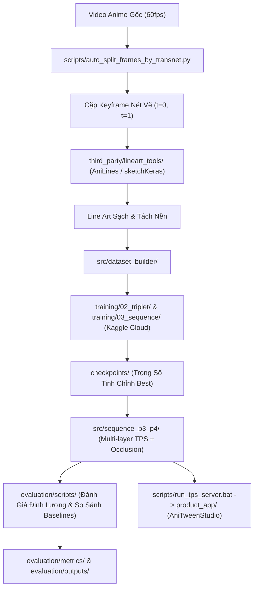

# CẤU TRÚC THƯ MỤC VÀ KIẾN TRÚC DỰ ÁN PBL6 (8+1 CHUẨN HÓA)

> **Đề tài:** Nghiên cứu & Tinh chỉnh Mô hình TPS-Inbetween cho Hoạt họa Anime 2D (Animation Line Inbetweening)  
> **Mục tiêu:** Tự động sinh khung hình trung gian (inbetween frames) sạch nét từ cặp keyframe nét vẽ anime 2D tại thời điểm $t \in (0, 1)$ bất kỳ; khắc phục hiện tượng méo nét, phình nét và bóng ma (ghosting) do domain gap của mô hình gốc, hỗ trợ giảm tải công việc vẽ tay thủ công của họa sĩ hoạt hình.

---

## MỤC LỤC
1. [Cây Thư Mục Chuẩn Hóa (8+1 Standard Layout)](#1-cây-thư-mục-chuẩn-hóa-81-standard-layout)
2. [Bảng Tra Cứu Chuyển Đổi Đường Dẫn (Phase 1 -> Phase 2 Mapping Table)](#2-bảng-tra-cứu-chuyển-đổi-đường-dẫn-phase-1---phase-2-mapping-table)
3. [Chi Tiết Chức Năng Từng Cụm Thư Mục](#3-chi-tiết-chức-năng-từng-cụm-thư-mục)
   - [3.1. `src/` - Package Nguồn Dùng Chung](#31-src---package-nguồn-dùng-chung)
   - [3.2. `training/` - Huấn Luyện & Notebooks Phân Tầng](#32-training---huấn-luyện--notebooks-phân-tầng)
   - [3.3. `evaluation/` - Hệ Thống Đánh Giá & Benchmark](#33-evaluation---hệ-thống-đánh-giá--benchmark)
   - [3.4. `demos/` - Trình Diễn & Kiểm Tra Độc Lập](#34-demos---trình-diễn--kiểm-tra-độc-lập)
   - [3.5. `third_party/` - Mã Nguồn Bên Thứ Ba (Baselines & Lineart Tools)](#35-third_party---mã-nguồn-bên-thứ-ba-baselines--lineart-tools)
   - [3.6. `tools/` - Công Cụ Hiệu Chuẩn & Tiện Ích Nội Bộ](#36-tools---công-cụ-hiệu-chuẩn--tiện-ích-nội-bộ)
   - [3.7. `scripts/` - Scripts Vận Hành & Automation](#37-scripts---scripts-vận-hành--automation)
   - [3.8. `data_samples/` - Caches Cố Định & Dữ Liệu Mẫu](#38-data_samples---caches-cố-định--dữ-liệu-mẫu)
   - [3.9. `docs/` - Tài Liệu Kỹ Thuật & Kế Hoạch Nghiên Cứu](#39-docs---tài-liệu-kỹ-thuật--kế-hoạch-nghiên-cứu)
4. [Các Thư Mục Local-Only (Ngoại Trừ Khỏi Git)](#4-các-thư-mục-local-only-ngoại-trừ-khỏi-git)
5. [Sơ Đồ Luồng Hoạt Động Toàn Dự Án (End-to-End Pipeline)](#5-sơ-đồ-luồng-hoạt-động-toàn-dự-án-end-to-end-pipeline)

---

## 1. CÂY THƯ MỤC CHUẨN HÓA (8+1 STANDARD LAYOUT)

```plaintext
PBL6/
├── src/                                      # [CLUSTER 1] Package nguồn dùng chung toàn dự án
│   ├── __init__.py
│   ├── repo_paths.py                         # Tiện ích định vị root repo tự động (find_repo_root)
│   ├── tps_v22/                              # Model & dataloader TPS v2.2
│   │   ├── model_v22.py
│   │   └── train_v22.py
│   ├── sequence_p3_p4/                       # Pipelines suy luận chuỗi Pha 3 & Pha 4
│   │   ├── multi_layer_tps.py
│   │   ├── seq_p3_build_multilayer_cache.py
│   │   ├── seq_p3_eval_multilayer_val_cache.py
│   │   ├── seq_p3_inference_pipeline.py
│   │   └── seq_p4_occlusion_pipeline.py
│   ├── dataset_builder/                      # Pipeline tạo dataset Sakuga Golden & ATD-12K
│   │   ├── atd12k_pipeline/
│   │   └── create_test_dataset/
│   └── utils/                                # Module tiện ích kiểm toán & phụ trợ
│       └── verify_triplet_v3_0_dataset_270p.py
│
├── training/                                 # [CLUSTER 2] Mã nguồn & notebooks huấn luyện
│   ├── 01_dataset_notebooks/                 # Notebooks sinh & đóng gói dataset
│   │   ├── ds01_extract_mix_nb.ipynb
│   │   └── ds02_triplet_v0_nb.ipynb
│   ├── 02_triplet/                           # Huấn luyện mô hình triplet (v0.1 -> v3.0R)
│   │   ├── builders/                         # Scripts sinh tự động & thẩm định notebook (nbgen_*, nbverify_*)
│   │   ├── cells/                            # Từng cell code độc lập cho v3.0, v3.1, v3.2, v3.0R
│   │   └── notebooks/                        # 14 Jupyter Notebooks huấn luyện chuẩn Kaggle
│   └── 03_sequence/                          # Huấn luyện mô hình sequence (Pha 0 -> Pha 4)
│       ├── 00_ablation_m1_m3_patch1/
│       ├── 01_run1_baseline_ws/
│       ├── p1_v32_ghost_temp_scale/
│       ├── p2_v33_ghost_purge/
│       ├── p3_multilayer_tps/
│       └── p4_occlusion_head/
│
├── evaluation/                               # [CLUSTER 3] Hệ thống đánh giá & benchmark
│   ├── scripts/                              # Scripts chạy benchmark định lượng & định tính
│   │   ├── baselines/                        # Benchmark các mô hình đối chứng (AnimeInbet, uniVIP, ...)
│   │   ├── triplet/                          # Benchmark toàn diện mô hình triplet (v0.1 -> v3.0R)
│   │   └── sequence/                         # Benchmark chuỗi chuyển động Pha 1 -> Pha 4
│   ├── metrics/                              # Dữ liệu kết quả số liệu (CSV, JSON, Markdown)
│   │   ├── baselines/                        # Bảng tổng hợp overall_benchmark
│   │   ├── triplet/                          # Metrics chi tiết từng phiên bản v1.0, v1.1, v2.0 -> v3.0R
│   │   └── sequence/                         # Metrics chuỗi đối đầu
│   └── outputs/                              # Ảnh và biểu đồ kết quả xuất ra từ benchmark
│       ├── triplet/
│       └── sequence/                         # p3_vs_original, p4_occlusion, ...
│
├── demos/                                    # [CLUSTER 4] Demos độc lập & trình diễn
│   ├── 01_atd12k_orig_tps/                   # Demo tái tạo frame từ tập ATD-12K
│   │   ├── scripts/
│   │   └── outputs/
│   └── 02_seq_p3_sharp/                      # Demo bộ làm sắc nét biên cạnh cục bộ Pha 3
│       ├── demo_seq_p3_sharp_lineart.py
│       └── outputs/
│
├── third_party/                              # [CLUSTER 5] Mã nguồn & công cụ clone từ GitHub
│   ├── baselines/                            # 6 mô hình đối chứng
│   │   ├── AnimeInbet/                       # ICCV 2023
│   │   ├── AnimeInterp/                      # CVPR 2021
│   │   ├── SAIN/                             # ArXiv 2023
│   │   ├── tps-inbetween/                    # Mô hình trọng tâm gốc
│   │   ├── uniVIP/                           # ICASSP 2025
│   │   └── UPR-Net/                          # CVPR 2023
│   └── lineart_tools/                        # 5 công cụ trích xuất nét vẽ
│       ├── AniLines/
│       ├── anime-segmentation/
│       ├── Anime2Sketch/
│       ├── Real-CUGAN/
│       └── sketchKeras/
│
├── tools/                                    # [CLUSTER 6] Công cụ tùy biến & tiện ích nội bộ
│   ├── score_weight_calibrator/              # Bộ hiệu chuẩn trọng số Sakuga Composite Score
│   ├── auto_commit/                          # Tool tự động commit Git
│   └── setup_env/                            # Tool kiểm tra môi trường chạy
│
├── scripts/                                  # [CLUSTER 7] Scripts vận hành & tự động hóa
│   ├── run_tps_server.bat                    # Chạy backend inference server
│   ├── run_auto_playwright_v26.bat           # Tự động hóa kiểm thử UI
│   └── auto_split_frames_by_transnet.py      # Tách shot video bằng TransNetV2
│
├── data_samples/                             # [CLUSTER 8] Dữ liệu mẫu thử nghiệm & Caches cố định
│   ├── caches/
│   │   └── lineart_test_gluestick_matches.npz  # Cache điểm neo GlueStick chuẩn duy nhất
│   └── atd12k_build_artifacts/               # Artifacts mẫu xây dựng tập ATD-12K
│
└── docs/                                     # [CLUSTER 9] Tài liệu kỹ thuật, kế hoạch & audit
    ├── 01_architecture/
    ├── 02_dataset_plans/
    ├── 03_retrain_plans/
    ├── 04_benchmark_reports/
    └── REPO_REORG_PLAN_TPS_INBETWEEN_CUSTOM.md
```

---

## 2. BẢNG TRA CỨU CHUYỂN ĐỔI ĐƯỜNG DẪN (PHASE 1 -> PHASE 2 MAPPING TABLE)

| Cấu Trúc Cũ (Giai Đoạn Trước) | Cấu Trúc Chuẩn Hóa Mới (8+1 Layout) | Mô Tả & Chú Thích |
|:---|:---|:---|
| `pipelines/tps_v22/` | `src/tps_v22/` | Package huấn luyện model TPS v2.2 |
| `pipelines/` (multi_layer_tps, seq_p3_*, seq_p4_*) | `src/sequence_p3_p4/` | Pipelines suy luận Pha 3 & Pha 4 |
| `pipelines/dataset_builder/` | `src/dataset_builder/` | Pipeline trích xuất dataset ATD-12K & Sakuga |
| `pipelines/verify_triplet_v3_0_dataset_270p.py` | `src/utils/` | Script kiểm toán dataset |
| `kaggle/create_test_dataset/` | `training/01_dataset_notebooks/` | Notebooks đóng gói dataset |
| `kaggle/` (notebooks `triplet_*.ipynb`) | `training/02_triplet/notebooks/` | 14 notebooks huấn luyện triplet |
| `kaggle/` (cells `triplet_10..13_*_cells/`) | `training/02_triplet/cells/` | Thư mục cell code v3.0 -> v3.0R |
| `kaggle/` (scripts `nbgen_*`, `nbverify_*`) | `training/02_triplet/builders/` | Scripts sinh & thẩm định notebook |
| `kaggle_seq_00_ablation_m1_m3_patch1/` | `training/03_sequence/00_ablation_m1_m3_patch1/` | Ablation M1 vs M3 |
| `kaggle_seq_01_local_test_workspace/` | `training/03_sequence/01_run1_baseline_ws/` | Run 1 sequence baseline |
| `kaggle_seq_p1_v32_ghost_temp_scale/` | `training/03_sequence/p1_v32_ghost_temp_scale/` | Pha 1 Sequence v3.2 |
| `kaggle_seq_p2_v33_ghost_purge/` | `training/03_sequence/p2_v33_ghost_purge/` | Pha 2 Sequence v3.3 |
| `kaggle_seq_p3_multilayer_tps/` | `training/03_sequence/p3_multilayer_tps/` | Pha 3 Sequence Multilayer |
| `kaggle_seq_p4_occlusion_head/` | `training/03_sequence/p4_occlusion_head/` | Pha 4 Sequence Occlusion |
| `continuous_benchmark/inference_scripts/` | `evaluation/scripts/triplet/` | Benchmark định lượng triplet |
| `continuous_benchmark/metrics/` | `evaluation/metrics/triplet/` | File metrics CSV triplet |
| `continuous_benchmark/visual_audit/` | `evaluation/outputs/triplet/` | Ảnh & video audit triplet |
| `Benchmark/` (scripts runner & overall) | `evaluation/scripts/baselines/` | Benchmark các baseline |
| `Benchmark/` (overall_benchmark.md, .csv) | `evaluation/metrics/baselines/` | Metrics báo cáo tổng hợp |
| `demo_01_atd12k_orig_tps/` | `demos/01_atd12k_orig_tps/` | Demo ATD-12K |
| `demo_02_seq_p3_sharp/` | `demos/02_seq_p3_sharp/` | Demo Sharpener Pha 3 |
| `models/` (AnimeInbet, uniVIP, tps-inbetween, ...) | `third_party/baselines/` | Baselines từ GitHub |
| `tools/` (AniLines, Real-CUGAN, sketchKeras, ...) | `third_party/lineart_tools/` | Công cụ xử lý nét vẽ |
| `tools/score_weight_calibrator/` | `tools/score_weight_calibrator/` | Giữ nguyên tại tools/ |
| `tools/auto_commit/`, `tools/setup_env/` | `tools/auto_commit/`, `tools/setup_env/` | Giữ nguyên tại tools/ |
| `run_tps_server.bat`, `run_auto_playwright_v26.bat` | `scripts/` | Batch files chuyển vào scripts/ |
| `isolated_sequence_phase3_remake/` | *(Đã dọn dẹp loại bỏ)* | Thư mục rác trùng lặp |
| `kaggle_finetune_sequence_final/*.npz` | `data_samples/caches/*.npz` | Gom 4 file trùng về 1 cache chuẩn |

---

## 3. CHI TIẾT CHỨC NĂNG TỪNG CỤM THƯ MỤC

### 3.1. `src/` - Package Nguồn Dùng Chung
Chứa mã nguồn Python cốt lõi được import chéo bởi các scripts huấn luyện, demo và đánh giá:
- **`src.repo_paths`**: Module tìm kiếm và thiết lập `REPO_ROOT` an toàn trên mọi hệ điều hành.
- **`src.tps_v22`**: Kiến trúc mạng và DataLoader của phiên bản TPS v2.2 (Anti-Thickening).
- **`src.sequence_p3_p4`**: Động cơ suy luận chuỗi dài ứng dụng giải thuật phân tầng chuyển động đa lớp (Multi-layer TPS) và phần đầu xử lý che khuất (Occlusion Head).
- **`src.dataset_builder`**: Pipeline chuẩn hóa dữ liệu ATD-12K, trích xuất nét vẽ và tính toán tương ứng hình học.
- **`src.utils`**: Các hàm phụ trợ kiểm toán tính toàn vẹn dữ liệu.

### 3.2. `training/` - Huấn Luyện & Notebooks Phân Tầng
Toàn bộ mã nguồn phục vụ huấn luyện trên Kaggle/Cloud GPU:
- **`01_dataset_notebooks/`**: Các Jupyter Notebook tự động trích xuất và đóng gói tập dữ liệu thành `.tar.gz` hoặc `.zip`.
- **`02_triplet/`**: Hệ thống huấn luyện triplet qua 14 thế hệ:
  - `builders/`: Chứa các script `nbgen_*.py` tự động lắp ráp cell code thành file `.ipynb` hoàn chỉnh và `nbverify_*.py` kiểm toán cú pháp AST, tính hợp lệ JSON trước khi tải lên Kaggle.
  - `cells/`: Chứa các cell Python độc lập cho từng module (DataLoader, Architecture, Loss Engine, DDP Worker).
  - `notebooks/`: 14 notebooks `.ipynb` chuẩn Kaggle (từ v0.1 Bounded Residual đến v3.0R Remastered).
- **`03_sequence/`**: 6 thư mục huấn luyện chuỗi chuyển động liên tục:
  - `00_ablation_m1_m3_patch1`: Thử nghiệm triệt tiêu lỗi (ablation study).
  - `01_run1_baseline_ws`: Baseline sequence run 1.
  - `p1_v32_ghost_temp_scale`: Pha 1 mở rộng biên độ thời gian.
  - `p2_v33_ghost_purge`: Pha 2 loại bỏ bóng ma.
  - `p3_multilayer_tps`: Pha 3 tích hợp biến dạng đa lớp.
  - `p4_occlusion_head`: Pha 4 huấn luyện đầu suy đoán che khuất.

### 3.3. `evaluation/` - Hệ Thống Đánh Giá & Benchmark
Cơ sở hạ tầng đo lường định lượng và định tính:
- **`scripts/`**: Chứa các file benchmark độc lập được phân chia theo `baselines/`, `triplet/`, và `sequence/`.
- **`metrics/`**: Lưu trữ các file dữ liệu bảng biểu `.csv`, `.json`, `.md` kết quả của toàn bộ các thí nghiệm.
- **`outputs/`**: Lưu trữ các hình ảnh so sánh đối đầu, error heatmaps và video đối chứng sinh ra từ benchmark.

### 3.4. `demos/` - Trình Diễn & Kiểm Tra Độc Lập
- **`01_atd12k_orig_tps/`**: Trình diễn mô hình TPS trên tập phim hoạt hình Nhật Bản ATD-12K.
- **`02_seq_p3_sharp/`**: Trình diễn bộ lọc thích ứng làm sắc nét biên cạnh hoạt họa.

### 3.5. `third_party/` - Mã Nguồn Bên Thứ Ba (Baselines & Lineart Tools)
- **`baselines/`**: Các repository mã nguồn của các công trình công bố quốc tế đối trọng (`AnimeInbet`, `AnimeInterp`, `SAIN`, `tps-inbetween`, `uniVIP`, `UPR-Net`). Các checkpoint lớn (~1.03 GB) được lưu cục bộ và loại trừ khỏi Git tracking.
- **`lineart_tools/`**: Các công cụ mã nguồn mở phục vụ trích xuất nét vẽ và phân tách nền anime (`AniLines`, `anime-segmentation`, `Anime2Sketch`, `Real-CUGAN`, `sketchKeras`).

### 3.6. `tools/` - Công Cụ Hiệu Chuẩn & Tiện Ích Nội Bộ
- **`score_weight_calibrator/`**: Công cụ trích xuất 100 triplet mẫu và hiệu chuẩn trọng số cho chỉ số tổng hợp `Sakuga Composite Score`.
- **`auto_commit/`**: Script tự động tạo commit định kỳ.
- **`setup_env/`**: Script kiểm tra cấu hình môi trường Python và CUDA.

### 3.7. `scripts/` - Scripts Vận Hành & Automation
- **`run_tps_server.bat`**: Khởi động backend FastAPI phục vụ ứng dụng Studio.
- **`run_auto_playwright_v26.bat`**: Chạy bộ kiểm thử tự động trên giao diện trình duyệt web.
- **`auto_split_frames_by_transnet.py`**: Tự động phân đoạn shot cảnh anime sử dụng TransNetV2.

### 3.8. `data_samples/` - Caches Cố Định & Dữ Liệu Mẫu
- **`caches/lineart_test_gluestick_matches.npz`**: Tệp điểm neo GlueStick chuẩn duy nhất cho tập test 24 frames lineart.
- **`atd12k_build_artifacts/`**: Artifacts trung gian của quá trình xây dựng tập dữ liệu.

### 3.9. `docs/` - Tài Liệu Kỹ Thuật & Kế Hoạch Nghiên Cứu
Chứa toàn bộ báo cáo nghiên cứu, tài liệu phân tích kỹ thuật và kế hoạch tái cấu trúc dự án (`REPO_REORG_PLAN_TPS_INBETWEEN_CUSTOM.md`).

---

## 4. CÁC THƯ MỤC LOCAL-ONLY (NGOẠI TRỪ KHỎI GIT)

Các thư mục dưới đây phục vụ lưu trữ tài nguyên lớn, môi trường ảo và sản phẩm ứng dụng chạy cục bộ, được liệt kê trong `.gitignore` để không làm phình kích thước repository:
- **`checkpoints/`**: Lưu trữ các file trọng số PyTorch (.pt, .pth, .pkl) nặng hàng chục Gigabytes.
- **`data/` & `Dataset/`**: Chứa toàn bộ video raw, frames đã giải nén và keypoints dataset Sakuga / ATD-12K.
- **`product_app/`**: Chứa ứng dụng hoàn thiện AniTweenStudio (gồm backend server và client frontend).
- **`scratch/`**: Thư mục chứa các script phân tích nhanh, trích xuất dữ liệu tạm thời.
- **`.venv/`**: Môi trường ảo Python của dự án.

---

## 5. SƠ ĐỒ LUỒNG HOẠT ĐỘNG TOÀN DỰ ÁN (END-TO-END PIPELINE)


