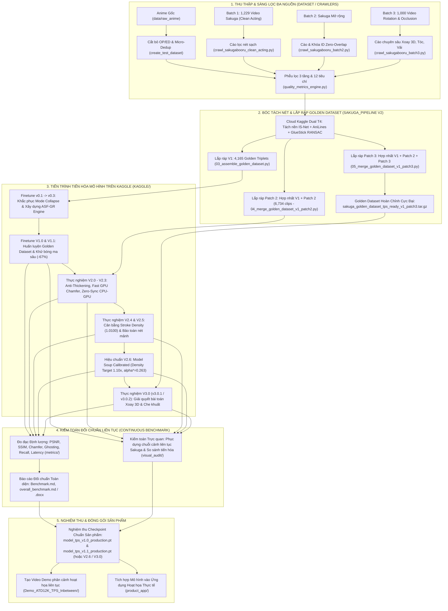

# CẤU TRÚC THƯ MỤC VÀ KIẾN TRÚC DỰ ÁN PBL6
> **Đề tài:** Nghiên cứu & Tinh chỉnh Mô hình TPS-Inbetween cho Hoạt họa Anime 2D (Animation Line Inbetweening)  
> **Mục tiêu:** Tự động sinh khung hình trung gian (inbetween frames) sạch nét từ cặp keyframe nét vẽ anime 2D tại thời điểm $t \in (0, 1)$ bất kỳ; khắc phục hiện tượng méo nét, phình nét và bóng ma (ghosting) do domain gap của mô hình gốc, hỗ trợ giảm tải công việc vẽ tay thủ công của họa sĩ hoạt hình.

---

## MỤC LỤC
1. [Cây Thư Mục Tổng Thể (Directory Tree)](#1-cây-thư-mục-tổng-thể-directory-tree)
2. [Bảng Tóm Tắt Vai Trò Các Thư Mục](#2-bảng-tóm-tắt-vai-trò-các-thư-mục)
3. [Chi Tiết Chức Năng & Nội Dung Từng Thư Mục](#3-chi-tiết-chức-năng--nội-dung-từng-thư-mục)
   - [3.1. checkpoints/](#31-checkpoints)
   - [3.2. continuous_benchmark/](#32-continuous_benchmark)
   - [3.3. data/](#33-data)
   - [3.4. Dataset/ [MỚI]](#34-dataset-mới)
   - [3.5. Demo_ATD12K_TPS_Inbetween/](#35-demo_atd12k_tps_inbetween)
   - [3.6. docs/](#36-docs)
   - [3.7. Finetune/ [MỚI]](#37-finetune-mới)
   - [3.8. kaggle/](#38-kaggle)
   - [3.9. models/ (Mô hình Trọng tâm & Baseline Cloned từ GitHub)](#39-models)
   - [3.10. pipelines/](#310-pipelines)
   - [3.11. product_app/](#311-product_app)
   - [3.12. tools/ (Công cụ Xử lý Dữ liệu Cloned từ GitHub & Custom Scripts)](#312-tools)
   - [3.13. _test_ckpt_v25/ [MỚI]](#313-_test_ckpt_v25-mới)
4. [Sơ Đồ Luồng Hoạt Động Toàn Dự Án (End-to-End Pipeline)](#4-sơ-đồ-luồng-hoạt-động-toàn-dự-án-end-to-end-pipeline)

---

## 1. CÂY THƯ MỤC TỔNG THỂ (DIRECTORY TREE)

> [!NOTE]
> Để giữ tài liệu tinh gọn và dễ theo dõi, các thư mục chứa dữ liệu lớn (dataset với hàng nghìn clip/frame) và các thư mục mã nguồn clone từ GitHub được tóm tắt công dụng cốt lõi thay vì liệt kê chi tiết toàn bộ các file và thư mục con bên trong.

```plaintext
e:\CODE\PBL\PBL6\
├── checkpoints/                              # Lưu trữ trọng số (weights) mô hình qua các thế hệ nghiên cứu
│   ├── experiments/                          # Trọng số trong các lần train/fine-tune thử nghiệm
│   │   ├── v0.1/                             # Fine-tune v0.1 (baseline phát hiện Mode Collapse)
│   │   ├── v0.2/                             # Fine-tune v0.2 (khắc phục Mode Collapse bằng Bounded Residual)
│   │   ├── v0.3/                             # Fine-tune v0.3 (ASF-GR Engine, Zero-Leak)
│   │   ├── v1.0/                             # Huấn luyện trên Sakuga Golden Dataset (4,165 triplets, 30 epochs)
│   │   ├── v1.1/                             # Tối ưu Khử Bóng Ma Sâu (-67% ghosting trên chuỗi cảnh)
│   │   ├── v2.0/                             # Thực nghiệm đối đầu V2.0 (v2.0.1 từ model gốc vs v2.0.2 từ v0.3)
│   │   ├── v2.1/                             # Thực nghiệm mở rộng V2.1 với Patch 2 (6,734 triplets)
│   │   ├── v2.2/                             # Tối ưu cân bằng thời gian (Temporal Reversal) & chống phình nét
│   │   ├── v2.3/                             # Ổn định số học, Fast GPU Chamfer & Zero-Sync CPU-GPU (-34.3% ghosting)
│   │   ├── v2.4/                             # Cân bằng Density & bảo toàn nét mảnh (Stroke Recall 93.46%)
│   │   ├── v2.5/                             # Chuẩn hóa Stroke Density tuyệt đối (1.0100) với Exact-STE
│   │   ├── v2.6/                             # Hiệu chuẩn Model Soup đạt chuẩn vàng Density ~1.10x
│   │   └── v3.0 (2.6)/                       # [MỚI] Thực nghiệm thế hệ V3.0 (Rotation & Occlusion) kế thừa V2.6
│   │       ├── v3.0.1/                       # Nhánh V3.0.1 (checkpoints_v3.0, training_history, fast_benchmark)
│   │       └── v3.0.2/                       # Nhánh V3.0.2 (kết quả fast benchmark đối chiếu trực quan)
│   ├── pretrained_baselines/                 # Checkpoints gốc của các mô hình đối chứng (AnimeInterp, SAIN, TPS gốc)
│   └── production_candidates/                # Trọng số tối ưu chuẩn sản phẩm (v1.0_production, v1.1_production, v0.2, v0.3)
│
├── continuous_benchmark/                     # Hệ thống đánh giá đối chuẩn tự động và liên tục
│   ├── inference_scripts/                    # Kịch bản chạy suy luận & kiểm thử đối chuẩn (v0.1 -> v3.0)
│   │   ├── calibrate_and_build_v26.py        # Hiệu chuẩn Model Soup V2.6
│   │   ├── extract_sakuga_continuous_triplets.py # Trích xuất triplet chuỗi cảnh liên tục từ Sakuga
│   │   ├── run_comparison_v10_vs_original.py # So sánh đối đầu trực quan v1.0 vs TPS gốc
│   │   ├── run_continuous_comparison_v10_vs_v11.py # So sánh phục dựng cảnh liên tục v1.0 vs v1.1
│   │   ├── run_continuous_scene_reconstruction.py # Tái tạo cảnh liên tục tổng quát
│   │   ├── run_continuous_scene_reconstruction_v10.py # Tái tạo cảnh liên tục chuyên biệt v1.0
│   │   ├── run_continuous_scene_reconstruction_v23.py # [MỚI] Tái tạo cảnh liên tục chuyên biệt v2.3
│   │   ├── run_evolution_benchmark_v01_to_v23.py # [MỚI] Đối chuẩn bước nhảy tiến hóa xuyên suốt từ v0.1 đến v2.3
│   │   ├── run_fast_benchmark_v30.py         # [MỚI] Script benchmark nhanh thế hệ V3.0.1
│   │   ├── run_fast_benchmark_v302.py        # [MỚI] Script benchmark nhanh nhánh V3.0.2
│   │   ├── run_final_test.py                 # Bài test kiểm định nghiệm thu tổng hợp
│   │   ├── run_tps_benchmark.py              # Bộ runner benchmark đối chuẩn TPS tổng quát
│   │   ├── run_tps_benchmark_v02 / v03 / v10 / v20 / v21 / v22 / v23 / v24 / v25 / v26.py # Bộ script đo đạc từng phiên bản
│   │   └── run_tps_fix.py                    # Kiểm thử thuật toán TPS cải tiến (lambda=0.2, anchors)
│   ├── metrics/                              # Dữ liệu định lượng (PSNR, SSIM, Chamfer, Ghost Pixels, Latency)
│   │   ├── AnimeInbet/ / AnimeInterp/ / SAIN/ / uniVIP/ / UPR-Net/ # Số liệu baseline đối chứng
│   │   ├── tps-inbetween/                    # Số liệu của TPS-Inbetween gốc
│   │   ├── tps-inbetween-finetuned-v0.1 -> v1.1/ # Số liệu chi tiết từng phiên bản tinh chỉnh
│   │   ├── Benchmark.md / overall_benchmark.md / .csv / .docx # Báo cáo tổng hợp đa định dạng
│   │   └── tps_benchmark_comparison_v1.0_vs_v1.1.md # Báo cáo đối đầu chuyên sâu v1.0 vs v1.1
│   └── visual_audit/                         # Đánh giá trực quan đối đầu (Side-by-side, Heatmaps, Zoom)
│       ├── baseline_comparision_renders/     # Ảnh so sánh từng frame giữa các mô hình baseline
│       ├── comparison_v0.1_to_v2.3_evolution/# [MỚI] Bảng đối chiếu tiến hóa chất lượng nét từ v0.1 đến v2.3
│       ├── comparison_v1.0_vs_v1.1/          # Render đối đầu chuỗi cảnh liên tục v1.0 vs v1.1
│       ├── finetune_v0.1 / v0.2 / v0.3 / v1.0 / v1.1 / v2.3/ # Render kiểm toán trực quan theo phiên bản
│
├── data/                                     # Kho lưu trữ dữ liệu huấn luyện, kiểm thử và phân mảnh
│   ├── crawled/                              # Video anime tải về từ Sakugabooru (chứa gói clean_character_acting.zip)
│   ├── lineart_experiments/                  # Mẫu thử nghiệm các phương pháp bóc tách nét (AniLines, IS-Net...)
│   ├── processed/                            # Các bộ dataset Golden hoàn thiện và phân mảnh trung gian
│   │   ├── anime_tps_finetune_dataset_ready/ # Bộ dataset ATD-12K hybrid ban đầu (3,388 triplets)
│   │   ├── candidate_triplets_anime_540p/    # Candidate triplets từ anime 540p
│   │   ├── sakuga_golden_dataset_tps_ready_v0/ # Bản đối chứng snapshot v0 của Golden Dataset
│   │   ├── sakuga_golden_dataset_tps_ready_v0_patch2/ # Dataset hoàn thiện từ Kaggle Patch 2 (2,569 triplets)
│   │   ├── sakuga_golden_dataset_tps_ready_v1/ # Golden Dataset V1 chính thức (4,165 triplets)
│   │   ├── sakuga_golden_dataset_tps_ready_v1_patch2/ # Dataset hợp nhất V1 + Patch 2 (6,734 triplets)
│   │   ├── sakuga_golden_dataset_tps_patch3/ # [MỚI] Phân mảnh dữ liệu Patch 3 (Rotation & Occlusion)
│   │   ├── sakuga_golden_dataset_tps_ready_v1_patch3/ # [MỚI - TOÀN DIỆN NHẤT] Bộ dữ liệu hợp nhất V1 + Patch 2 + Patch 3
│   │   ├── sakuga_shards_zip/                # Kho lưu trữ các phân mảnh ZIP nén ứng viên Sakuga
│   │   └── *.tar.gz, *.csv, *.json           # Các file nén đóng gói thành phẩm và file metadata tổng hợp
│   └── test_sets/                            # Các tập dữ liệu kiểm thử chuẩn (Benchmark test sets)
│       ├── sakuga_continuous_triplets/       # Tập kiểm thử chuỗi cảnh hoạt họa liên tục
│       ├── test_lineart_clean/               # Tập kiểm thử nét vẽ sạch không nền
│       ├── test_sakuga_hard/                 # Tập kiểm thử chuyển động biên độ khó
│       └── visual_samples/                   # Ảnh và video phục vụ kiểm tra trực quan nhanh
│
├── Dataset/                                  # [MỚI] Trung tâm điều phối kỹ thuật dữ liệu & phân mảnh Sakuga
│   ├── crawlers/                             # Hệ thống crawler tự động đa đợt (Multi-Batch Crawlers)
│   │   ├── crawl_sakugabooru.py              # Crawler phiên bản v1 ban đầu
│   │   ├── crawl_sakugabooru_clean_acting.py # Crawler Batch 1 nét sạch lọc bỏ tạp chất
│   │   ├── crawl_sakugabooru_batch2.py       # [MỚI] Crawler Batch 2 mở rộng
│   │   ├── crawl_sakugabooru_batch3.py       # [MỚI] Crawler Batch 3 chuyên sâu góc quay 3D & che khuất (1,000 scenes)
│   │   ├── verify_batch2_zero_overlap.py     # [MỚI] Xác thực 100% không trùng lặp ID cho Batch 2
│   │   ├── verify_batch3_zero_overlap.py     # [MỚI] Xác thực 100% không trùng lặp ID cho Batch 3
│   │   ├── zip_sakugabooru_batch2 / batch3.py# [MỚI] Script tự động nén dữ liệu theo phân mảnh
│   │   └── run_*.bat & *.md                  # Batch script chạy tự động và tài liệu hướng dẫn vận hành
│   ├── dataset_labotary/                     # Phòng thí nghiệm kiểm định & thẩm định chất lượng triplet mẫu
│   │   ├── bad_triplets/ & good_triplets/    # Các mẫu triplet đối chứng lỗi và đạt chất lượng
│   │   ├── sakuga_quality_metric_experiment/ # Thí nghiệm đo đạc ngưỡng chất lượng toán học
│   │   ├── sakuga_golden_vs_metric_experiment_comparison/ # Đối soát chất lượng trực quan bộ Golden
│   │   └── TRIPLET_QUALITY_AUDIT_AND_METRIC_PROPOSAL.md # Đề xuất bộ 12 chỉ số chất lượng & ngưỡng phễu lọc
│   ├── sakuga_pipeline/                      # Pipeline thế hệ 1 xây dựng Golden Dataset từ 1,229 video Sakugabooru
│   └── sakuga_pipeline v2/                   # Pipeline thế hệ 2 tự động hóa lắp ráp & ghép nối quy mô lớn
│       ├── 01_extract_candidates_*.ipynb     # Notebook trích xuất ứng viên trên Cloud (gồm cả Batch 3)
│       ├── 02_process_sakuga_tps_*.ipynb     # Notebook xử lý bóc nét AniLines & đối sánh GlueStick Dual GPU
│       ├── 03_assemble_golden_dataset.py     # Script lắp ráp và đối soát phân mảnh Part 1, 2, 3
│       ├── 04_merge_golden_dataset_v1_patch2.py # Script hợp nhất V1 và Patch 2 thành dataset 6,734 clips
│       ├── 05_merge_golden_dataset_v1_patch3.py # [MỚI] Script hợp nhất V1, Patch 2 và Batch 3 thành bộ dữ liệu cực đại
│       ├── patch2/ & patch3/                 # [MỚI] Thư mục lưu trữ artifact tải về từ Kaggle kèm metadata
│       └── generate_*.py, run_*.bat          # Trình sinh mã notebook và script chạy tự động trên Windows
│
├── Demo_ATD12K_TPS_Inbetween/                # Trực quan hóa năng lực nội suy phục vụ báo cáo và thuyết trình
│   ├── Continuous_Scene_Demo_8s/             # Video demo phân cảnh hoạt họa liên tục 8 giây
│   ├── Example_1_Triplet_10/                 # Mẫu kiểm thử nội suy cụ thể Triplet #10
│   ├── Example_2_Triplet_132/                # Mẫu kiểm thử nội suy cụ thể Triplet #132
│   ├── generate_continuous_scene_demo.py     # Script dựng video so sánh song song cảnh 8s
│   ├── generate_demo_samples.py              # Script xuất các bộ mẫu so sánh trực quan
│   └── README.md                             # Hướng dẫn chi tiết thư mục Demo
│
├── docs/                                     # Tài liệu nghiên cứu, phân tích kỹ thuật và kế hoạch thực thi
│   ├── finetune_plans/                       # Kế hoạch chi tiết theo từng phiên bản huấn luyện
│   │   ├── README.md                         # Quy chuẩn quản lý và vòng đời phiên bản
│   │   ├── v0.1/ / v0.2/ / v0.3/ / v1.0/     # Kế hoạch huấn luyện và kiểm toán v0.1 đến v1.0
│   │   ├── v2.1/                             # [MỚI] Kế hoạch benchmark đối chuẩn Tam Mã V2.1 trên Patch 2
│   │   ├── v2.2/                             # [MỚI] Kế hoạch huấn luyện V2.2 giải quyết phình nét & đối xứng thời gian
│   │   ├── v2.4/                             # Kế hoạch V2.4 cân bằng Density & bảo toàn nét mảnh
│   │   └── v2.6/                             # [MỚI] Kế hoạch hiệu chuẩn Model Soup V2.6 đạt chuẩn vàng Density
│   ├── COMPLETE_DATASET_GENERATION_PLAN.md   # Kế hoạch tổng thể sinh Golden Dataset từ Sakugabooru
│   ├── dataset_design_and_kaggle_finetune_analysis.md # Phân tích kiến trúc lai Local - Kaggle Cloud
│   ├── huongdi.md                            # Lộ trình nghiên cứu chiến lược xuyên suốt đề tài
│   ├── KAGGLE_PHASE2_PHASE3_EXECUTION_PLAN.md# Kế hoạch thực thi Pha 2 (Kaggle) và Pha 3 (Local Assembly)
│   ├── pipeline_dataset_atd12k_tps.md        # Thiết kế pipeline lấy mẫu thời gian đặc thù anime 2D
│   ├── research_notes.md                     # Ghi chép nghiên cứu thực nghiệm và đánh giá hạn chế
│   └── tps_inbetween_analysis_and_dataset_solution.md # Phân tích chuyên sâu kiến trúc TPS & giải pháp toán học
│
├── Finetune/                                 # [MỚI] Thư mục dự phòng cho các module fine-tune độc lập
│
├── kaggle/                                   # Mã nguồn và notebook huấn luyện trên nền tảng Kaggle Cloud GPU
│   ├── 00_extract_and_mix_sakugabooru_atd12k_kaggle.ipynb # Notebook trộn Sakuga và ATD-12K
│   ├── 00_extract_sakugabooru_candidates_kaggle.ipynb     # Notebook trích xuất ứng viên Sakuga
│   ├── 01_process_sakuga_tps_dataset_kaggle.ipynb         # Bóc nét AniLines & đối sánh GlueStick Dual T4
│   ├── 02_process_sakuga_tps_dataset_part3_kaggle.ipynb   # [MỚI] Xử lý candidate ATD-12K Part 3
│   ├── 01_train_tps_inbetween_finetune_v0.1.ipynb         # Huấn luyện fine-tune v0.1
│   ├── 02_train_tps_inbetween_finetune_v0.2.ipynb         # Huấn luyện fine-tune v0.2 chống Mode Collapse
│   ├── 03_train_tps_inbetween_finetune_v0.3.ipynb         # Huấn luyện fine-tune v0.3 (ASF-GR Engine)
│   ├── 04_train_tps_inbetween_finetune_v1.0.ipynb         # Huấn luyện fine-tune v1.0 trên Golden Dataset
│   ├── 04_train_tps_inbetween_finetune_v1.1.ipynb         # [MỚI] Huấn luyện fine-tune v1.1 khử bóng ma sâu
│   ├── 05_train_tps_inbetween_finetune_v2.2.ipynb         # Huấn luyện fine-tune v2.2 (chống phình nét)
│   ├── 05_train_tps_inbetween_finetune_v2.3.ipynb         # [MỚI] Huấn luyện fine-tune v2.3 (ổn định số học, anti-thickening)
│   ├── 06_train_tps_inbetween_finetune_v2.4.ipynb         # Huấn luyện fine-tune v2.4 (cân bằng Density)
│   ├── 06_train_tps_inbetween_finetune_v2.5.ipynb         # Huấn luyện fine-tune v2.5 (Exact-STE Density Calibration)
│   ├── 07_train_tps_inbetween_finetune_v3.0.ipynb         # [MỚI] Huấn luyện fine-tune v3.0 (Rotation & Occlusion)
│   ├── finetune-v1-0 / v1-1 / v2-2 / v2-3 / v2-4 / v2-5 / v3-0.ipynb # Notebook thực thi trực tiếp trên Kaggle
│   ├── generate_tps_dataset_kaggle.ipynb                  # Notebook sinh dataset tọa độ cho TPS
│   ├── generate_v10 / v11 / v22 / v23 / v24 / v25 / v30_notebook.py # Trình sinh tự động notebook từ template chuẩn
│   └── verify_v10 / v11 / v22 / v23 / v24 / v25 / v30_notebook.py   # Trình kiểm tra cú pháp và cấu trúc cell
│
├── models/                                   # Mã nguồn kiến trúc Deep Learning (Core Model & Baselines)
│   ├── baselines/                            # Các mô hình đối chứng (Cloned từ GitHub)
│   │   ├── AnimeInbet/                       # [Clone Git] Deep Geometrized Cartoon Line Inbetweening (ICCV 23)
│   │   ├── AnimeInterp/                      # [Clone Git] Deep Animation Video Interpolation (CVPR 21)
│   │   ├── SAIN/                             # [Clone Git] Sketch-Aware Interpolation Network (ArXiv 23)
│   │   ├── uniVIP/                           # [Clone Git] Unified Arbitrary-Time Interpolation (ICASSP 25)
│   │   └── UPR-Net/                          # [Clone Git] Unified Pyramid Recurrent Network (CVPR 23)
│   └── tps-inbetween/                        # Mô hình trọng tâm của đề tài (Core Target Model)
│       └── tps-inbetween/                    # [Clone Git & Tối ưu] Thin-Plate Spline-based Inbetweening
│
├── pipelines/                                # Các pipeline xử lý dữ liệu và module phụ trợ
│   ├── dataset_builder/                      # Pipeline tiền xử lý dữ liệu nền tảng
│   │   ├── atd12k_pipeline/                  # Pipeline 6 bước chuẩn hóa bộ dữ liệu ATD-12K
│   │   ├── create_test_dataset/              # Bộ công cụ tiền xử lý & tạo candidate triplets (AnimeGoc + ATD-12K)
│   │   └── work_final_stages/                # Tài nguyên trung gian khâu cuối (matches GlueStick .npy)
│   ├── tps_v22/                              # Module tinh chỉnh huấn luyện V2.2 (Losses, Engine, Checkpoint Manager)
│   └── utils/                                # Tiện ích chuyển đổi video sang khung hình và ngược lại
│
├── product_app/                              # Không gian phát triển phần mềm ứng dụng hoàn chỉnh (GUI / API)
│
├── tools/                                    # Bộ công cụ tiền xử lý ảnh, hiệu chuẩn và đóng gói
│   ├── ailab/                                # [Clone Git] Real-CUGAN: Siêu phân giải và khử nhiễu nén anime
│   ├── AniLines-Anime-Lineart-Extractor/     # [Clone Git] AniLines: Trích xuất nét vẽ chuyên sâu từ ảnh màu
│   ├── anime-segmentation/                   # [Clone Git] Anime Segmentation: Tách nền nhân vật anime (IS-Net)
│   ├── Anime2Sketch/                         # [Clone Git] Anime2Sketch: Chuyển đổi tranh anime thành phác thảo
│   ├── score_weight_calibrator/              # [MỚI] Ứng dụng Web Human-in-the-Loop hiệu chuẩn trọng số hàm Score
│   │   ├── images/                           # Khung hình mẫu 100 triplets phục vụ đánh giá trực quan
│   │   ├── dataset_100_triplets.csv / .json  # Dữ liệu chỉ số của 100 triplets trích từ Golden Dataset
│   │   ├── extract_100_triplets.py           # Script trích xuất ngẫu nhiên phân tầng 100 mẫu kiểm định
│   │   ├── index.html                        # Giao diện web tương tác đánh giá Flipbook và Live Metrics
│   │   ├── README.md                         # Hướng dẫn chi tiết vận hành bộ hiệu chuẩn
│   │   └── run_calibrator.py                 # Script khởi chạy web server cục bộ
│   ├── sketchKeras/                          # [Clone Git] SketchKeras: Trích xuất phác thảo qua mạng U-Net
│   ├── binarize_lines_nobg.py                # Script nhị phân hóa và khử nhiễu nét vẽ nền trắng
│   └── package_single_file_for_kaggle.py     # Script tự động đóng gói toàn bộ model TPS thành 1 file duy nhất cho Kaggle
│
└── _test_ckpt_v25/                           # [MỚI] Không gian kiểm thử cục bộ nạp và xác thực checkpoint V2.5
```

---

## 2. BẢNG TÓM TẮT VAI TRÒ CÁC THƯ MỤC

| Thư mục | Nguồn gốc | Vai trò chính trong dự án PBL6 |
|:---|:---:|:---|
| [`checkpoints/`](file:///e:/CODE/PBL/PBL6/checkpoints) | Tự xây dựng | Quản lý tập trung các checkpoint trọng số từ v0.1 đến v3.0, checkpoint gốc và ứng viên sản phẩm. |
| [`continuous_benchmark/`](file:///e:/CODE/PBL/PBL6/continuous_benchmark) | Tự xây dựng | Hệ thống đánh giá đối chuẩn tự động liên tục: đo đạc định lượng (PSNR, SSIM, Chamfer, Ghosting) và kiểm toán trực quan. |
| [`data/`](file:///e:/CODE/PBL/PBL6/data) | Tự xây dựng | Lưu trữ video Sakuga tải về, dữ liệu trung gian và các bộ Golden Dataset thành phẩm (`v1`, `v1_patch2`, `v1_patch3`). |
| [`Dataset/`](file:///e:/CODE/PBL/PBL6/Dataset) | Tự xây dựng | **[MỚI]** Trung tâm kỹ thuật dữ liệu chuyên biệt: chứa crawler đa đợt (Batch 1-3), phòng thí nghiệm chất lượng triplet và pipeline lắp ráp mở rộng. |
| [`Demo_ATD12K_TPS_Inbetween/`](file:///e:/CODE/PBL/PBL6/Demo_ATD12K_TPS_Inbetween) | Tự xây dựng | Lưu trữ kết quả trình diễn trực quan (video chuỗi cảnh liên tục 8 giây, GIF, mẫu so sánh đối chứng) phục vụ báo cáo. |
| [`docs/`](file:///e:/CODE/PBL/PBL6/docs) | Tự xây dựng | Toàn bộ tài liệu kỹ thuật, lộ trình nghiên cứu, kế hoạch huấn luyện và đối chuẩn theo từng phiên bản (v0.1 đến v2.6). |
| [`Finetune/`](file:///e:/CODE/PBL/PBL6/Finetune) | Tự xây dựng | **[MỚI]** Thư mục dự phòng cấp cao dành cho việc tổ chức các module fine-tune độc lập trong tương lai. |
| [`kaggle/`](file:///e:/CODE/PBL/PBL6/kaggle) | Tự xây dựng | Quản lý notebook huấn luyện trên Cloud GPU (Dual T4/P100), kịch bản sinh mã tự động và kiểm thử notebook. |
| [`models/`](file:///e:/CODE/PBL/PBL6/models) | Clone Git + Cải tiến | Chứa mã nguồn mô hình nghiên cứu trọng tâm (**TPS-Inbetween**) và 5 mô hình đối chứng (AnimeInbet, AnimeInterp, SAIN, uniVIP, UPR-Net). |
| [`pipelines/`](file:///e:/CODE/PBL/PBL6/pipelines) | Tự xây dựng | Quy trình xử lý dữ liệu nền tảng (ATD-12K, tạo candidate triplets), module huấn luyện V2.2 và tiện ích chuyển đổi video/frame. |
| [`product_app/`](file:///e:/CODE/PBL/PBL6/product_app) | Tự xây dựng | Không gian phát triển phần mềm ứng dụng hoàn chỉnh cho người dùng cuối (animator, họa sĩ hoạt hình). |
| [`tools/`](file:///e:/CODE/PBL/PBL6/tools) | Clone Git + Script riêng | Tập hợp công cụ bóc tách nét, tách nền, siêu phân giải, script nhị phân hóa và ứng dụng web hiệu chuẩn trọng số hàm Score. |
| [`_test_ckpt_v25/`](file:///e:/CODE/PBL/PBL6/_test_ckpt_v25) | Tự xây dựng | **[MỚI]** Thư mục phục vụ kiểm thử cục bộ cho việc nạp và xác thực tính toàn vẹn của checkpoint V2.5. |

---

## 3. CHI TIẾT CHỨC NĂNG & NỘI DUNG TỪNG THƯ MỤC

### 3.1. checkpoints/
* **Mục đích:** Là nơi lưu trữ tập trung toàn bộ trọng số (weights/checkpoints) của các mô hình Deep Learning trong dự án. Việc phân tách rõ ràng giúp tránh ghi đè model gốc và thuận tiện cho việc kiểm toán, so sánh phiên bản.
* **Các thư mục con:**
  * `experiments/`: Lưu lại các checkpoint sinh ra trong từng đợt huấn luyện/fine-tune qua các thế hệ nghiên cứu:
    * `v0.1/`: Trọng số của phiên bản fine-tune v0.1 (`model_tps_v0.1_best.pt`, `README.md`) - phát hiện hiện tượng Mode Collapse.
    * `v0.2/`: Trọng số v0.2 khắc phục Mode Collapse bằng Bounded Residual $\pm 0.15$ (`model_tps_v0.2_best.pt`, `model_tps_v0.2_latest.pt`).
    * `v0.3/`: Trọng số v0.3 tích hợp động cơ ASF-GR Engine (`model_tps_v0.3_best.pt`, `model_tps_v0.3_latest.pt`, `training_history_v0.3.csv`).
    * `v1.0/`: Trọng số V1.0 huấn luyện trên Sakuga Golden Dataset (4,165 triplets), gồm checkpoint tối ưu `model_tps_v1.0_best.pt`, các mốc định kỳ mỗi 5 epoch (`ep05.pt` đến `ep30.pt`), `latest.pt` và nhật ký `training_history_v1.0 (1).csv`.
    * `v1.1/`: Trọng số V1.1 tối ưu khử bóng ma sâu (`model_tps_v1.1_best.pt`, `training_history_v1.1.csv`, `tps_finetune_v1.1_artifacts/`).
    * `v2.0/`: Thực nghiệm đối đầu chuyên sâu V2.0 trên Sakuga Golden Dataset giữa:
      - `v2.0.1/`: Finetune từ model gốc Mixamo 3D.
      - `v2.0.2/`: Finetune từ checkpoint tốt nhất của v0.3.
      - Chứa kết quả đo đạc `benchmark_results_fast.csv`, `summary_metrics_v20.json`, ảnh kiểm toán và báo cáo `BENCHMARK_REPORT_V2.0.md`.
    * `v2.1/`: Thực nghiệm mở rộng quy mô dữ liệu V2.1 với Patch 2 (hợp nhất 6,734 triplets):
      - Trọng số tối ưu `model_tps_v1.1_best.pt` (kế thừa V2.0.2 Best và train thêm 30 epochs).
      - Kết quả đối chuẩn Tam Mã: `summary_metrics_v21.json`, `benchmark_results_v21.csv`, `visual_comparisons/` và báo cáo `BENCHMARK_REPORT_V2.1.md`.
    * `v2.2/`: Huấn luyện V2.2 giải quyết triệt để phình nét và cân bằng thời gian (StrokeDensityLoss, DirectionalTangentLoss, Temporal Reversal) với `training_history_v2.2.csv`.
    * `v2.3/`: Phiên bản V2.3 Ổn định số học, Anti-Thickening, Fast GPU Chamfer & Zero-Sync CPU-GPU (`model_tps_v2.3_best.pt`, `training_history_v2.3.csv`, `BENCHMARK_REPORT_V2.3.md`, giảm -34.3% bóng ma, thắng 90% mẫu đối đầu).
    * `v2.4/`: Phiên bản V2.4 Cân bằng Mật độ Nét & Bảo tồn Nét Mảnh (`model_tps_v2.4_best.pt`, `model_tps_v2.4_best_progress.pt`, `model_tps_v2.4_last.pt`, `BENCHMARK_REPORT_V2.4.md`, Stroke Recall đạt 93.46%).
    * `v2.5/`: Phiên bản V2.5 Chuẩn hóa Mật độ Nét Tuyệt đối & Kiểm soát Bề rộng Hai chiều (`model_tps_v2.5_best.pt`, `model_tps_v2.5_best_progress.pt`, `model_tps_v2.5_last.pt`, `BENCHMARK_REPORT_V2.5.md`, Stroke Density đạt 1.0100 tiệm cận chuẩn tuyệt đối 1.0000).
    * `v2.6/`: Phiên bản V2.6 Visual Gold Standard Model Soup Calibrated (`model_tps_v2.6_best.pt`, `v26_model_soup_config.json`, `alpha_calibration_sweep_v26.csv`, `BENCHMARK_REPORT_V2.6.md`, Density Target 1.10x với $\alpha^* = 0.263$).
    * `v3.0 (2.6)/` **[MỚI]**: **Thực nghiệm Thế hệ V3.0 (Rotation & Occlusion)** kế thừa trên nền tảng Model Soup V2.6 để giải quyết bài toán quay cơ thể/khuôn mặt 3D và tóc/vải bay:
      - `v3.0.1/`: Chứa các checkpoint `checkpoints_v3.0/model_tps_v3.0_best.pt`, `model_tps_v3.0_best_progress.pt`, `model_tps_v3.0_interrupted.pt`, `model_tps_v3.0_last.pt`, `latest.pt`, file notebook `finetune-v3-0.ipynb`, nhật ký `training_history_v3.0.csv`, biểu đồ hội tụ `training_metrics_convergence_v30.png` và thư mục `fast_benchmark/` kèm báo cáo `FAST_BENCHMARK_REPORT_V3.0.md`.
      - `v3.0.2/`: Nhánh thử nghiệm tiếp nối với bộ kết quả fast benchmark đối chiếu trực quan (heatmaps, side-by-side, zoomed details).
  * `pretrained_baselines/`: Checkpoints pre-trained từ tác giả gốc của các mô hình đối chứng:
    * `AnimeInterp/anime_interp_full.ckpt`: Trọng số của AnimeInterp.
    * `SAIN/model_best.pth`: Trọng số của SAIN.
    * `tps-original/model_latest.pt`: Trọng số gốc của TPS-Inbetween (huấn luyện trên Mixamo 3D).
  * `production_candidates/`: Lưu trữ các checkpoint có điểm số đánh giá cao nhất, vượt qua kiểm toán gắt gao sẵn sàng tích hợp vào `product_app/`:
    * `model_tps_v1.0_production.pt`: Ứng viên sản phẩm V1.0 cân bằng cấu trúc hoạt hình.
    * `model_tps_v1.1_production.pt`: Ứng viên sản phẩm V1.1 đột phá về khử bóng ma (-67% ghosting trong chuỗi cảnh liên tục).
    * `tps_anime_candidate_v0.2.pt` & `tps_anime_candidate_v0.3.pt`: Các ứng viên đối chứng phiên bản trước.

---

### 3.2. continuous_benchmark/
* **Mục đích:** Cung cấp hệ thống kiểm thử đối chuẩn liên tục (Continuous Benchmarking), đảm bảo mỗi bước nâng cấp giải thuật và dữ liệu đều được đo đạc định lượng khách quan và kiểm toán trực quan khắt khe.
* **Cấu trúc & Chức năng:**
  * `inference_scripts/`: Các script tự động nạp mô hình và thực hiện nội suy trên tập benchmark:
    * `extract_sakuga_continuous_triplets.py`: Tự động trích xuất các bộ ba khung hình liên tiếp từ các phân cảnh Sakugabooru phục vụ đánh giá tính nhất quán thời gian (Temporal Consistency).
    * `run_comparison_v10_vs_original.py`: Chạy so sánh trực tiếp khung hình giữa TPS v1.0 và mô hình TPS gốc.
    * `run_continuous_comparison_v10_vs_v11.py`: Đối đầu chuyên sâu phục dựng chuỗi cảnh liên tục giữa V1.0 và V1.1.
    * `run_continuous_scene_reconstruction.py` & `run_continuous_scene_reconstruction_v10.py`: Tái tạo cảnh hoạt họa liên tục tổng quát và chuyên biệt cho v1.0.
    * `run_continuous_scene_reconstruction_v23.py` **[MỚI]**: Tái tạo cảnh liên tục đánh giá độ mượt và khử bóng ma cho checkpoint V2.3.
    * `run_evolution_benchmark_v01_to_v23.py` **[MỚI]**: Script chạy benchmark tiến hóa đa thế hệ, đối chiếu bước nhảy vọt chất lượng nét từ v0.1 lên v2.3 trên cùng tập test mẫu.
    * `run_fast_benchmark_v30.py` & `run_fast_benchmark_v302.py` **[MỚI]**: Kịch bản chạy benchmark nhanh phục vụ thẩm định sớm kết quả các checkpoint thế hệ V3.0 (v3.0.1 và v3.0.2).
    * `run_final_test.py`: Thực hiện bài test kiểm định nghiệm thu tổng hợp.
    * `run_tps_benchmark.py`: Bộ runner đối chuẩn đa năng cho các biến thể TPS-Inbetween.
    * `run_tps_benchmark_v02.py` đến `run_tps_benchmark_v26.py`: Hệ thống script chuyên biệt đo đạc định lượng từng checkpoint (v0.2, v0.3, v1.0, v2.0, v2.1, v2.2, v2.3, v2.4, v2.5, v2.6).
    * `calibrate_and_build_v26.py`: Script quét tham số và hiệu chuẩn Model Soup V2.6 đạt chuẩn vàng Density ~1.10x.
    * `run_tps_fix.py`: Kiểm thử các cải tiến giải thuật toán học ($\lambda=0.2$, border anchors, interior anchors).
  * `metrics/`: Chứa số liệu định lượng (PSNR, SSIM, Chamfer Distance, Tortuosity, Ghost Pixels, Blank Rate, Latency):
    * Các thư mục con theo mô hình: `AnimeInbet/`, `AnimeInterp/`, `tps-inbetween/` (gốc), `tps-inbetween-finetuned-v0.1/` đến `v1.1/`, `uniVIP/`, `UPR-Net/`.
    * Các công cụ tổng hợp: `generate_overall_benchmark.py`, `generate_overall_benchmark_docx.py`, `Benchmark.md`, `overall_benchmark.md` / `.csv` / `.docx`.
    * `tps_benchmark_comparison_v1.0_vs_v1.1.md`: Báo cáo đối đầu chi tiết v1.0 vs v1.1.
  * `visual_audit/`: Thư mục phục vụ đánh giá định tính (Qualitative Audit) qua hình ảnh so sánh, heatmap sai số và video:
    * `baseline_comparision_renders/`: Ảnh so sánh từng frame giữa các baseline đối chứng.
    * `comparison_v0.1_to_v2.3_evolution/` **[MỚI]**: Tập hợp các render trực quan so sánh tiến trình tiến hóa chất lượng nét từ v0.1 đến v2.3 kèm file `multi_clip_evolution_summary.csv`.
    * `comparison_v1.0_vs_v1.1/`: Bộ ảnh và chuỗi render đối đầu trực tiếp giữa V1.0 và V1.1 (`continuous_reconstruction/`).
    * `finetune_v0.1/`, `finetune_v0.2/`, `finetune_v0.3/`, `finetune_v1.0/`, `finetune_v1.1/`: Render kiểm toán các phiên bản theo từng thư mục phân loại (`difference_heatmaps`, `side_by_side_comparison`, `zoomed_details`, `visual_samples`).
    * `finetune_v2.3/` **[MỚI]**: Render kiểm toán phục dựng chuỗi cảnh liên tục cho checkpoint V2.3.

---

### 3.3. data/
* **Mục đích:** Quản lý toàn bộ vòng đời dữ liệu, từ video anime gốc tải về đến các bộ dữ liệu Golden thành phẩm đã đóng gói và tập test kiểm chuẩn.
* **Cấu trúc & Chức năng:**
  * `crawled/`: Chứa dữ liệu video tải về từ Sakugabooru:
    * `sakugabooru_clean_character_acting.zip`: Gói nén chứa bộ video anime hành động nhân vật đã được lọc sạch các hiệu ứng khói, nổ, vệt nhòe và tạp chất nền theo crawler v2.
  * `lineart_experiments/`: Các thư mục thí nghiệm phương pháp bóc tách nét vẽ (như `ChayGoAnimeLinesBasic`, `ChayGoAnimeLinesDetail_NoBG`...).
  * `processed/`: Dữ liệu trung gian và dataset huấn luyện chuẩn hóa cho TPS *(lưu ý: chỉ nêu vai trò và quy mô dataset, không liệt kê chi tiết từng thư mục clip con)*:
    * `anime_tps_finetune_dataset_ready/`: Bộ dữ liệu ATD-12K hybrid ban đầu (3,388 triplets) kèm toạ độ GlueStick `.npy`.
    * `candidate_triplets_anime_540p/`: Các ứng viên triplet 540p từ khâu tiền xử lý anime.
    * `sakuga_golden_dataset_tps_ready_v0/`: Bản đối chứng snapshot v0 ban đầu của Golden Dataset.
    * `sakuga_golden_dataset_tps_ready_v0_patch2/`: Dataset hoàn thiện từ Kaggle Patch 2 (2,569 triplets).
    * `sakuga_golden_dataset_tps_ready_v1/`: Golden Dataset chuẩn thế hệ 1 (4,165 triplets: 3,545 train / 620 val) chắt lọc từ 1,229 video Sakugabooru.
    * `sakuga_golden_dataset_tps_ready_v1_patch2/`: Dataset hợp nhất quy mô lớn (6,734 triplets: 5,727 train / 1,007 val gồm V1 + Patch 2).
    * `sakuga_golden_dataset_tps_patch3/` **[MỚI]**: Phân mảnh dataset Patch 3 chuyên sâu về góc quay 3D và che khuất (Rotation & Occlusion).
    * `sakuga_golden_dataset_tps_ready_v1_patch3/` **[MỚI - BỘ DỮ LIỆU CỰC ĐẠI]**: Bộ dataset hợp nhất toàn diện nhất của dự án (kết hợp V1 + Patch 2 + Patch 3).
    * `sakuga_shards_zip/`: Kho lưu trữ các phân mảnh ZIP nén ứng viên Sakuga chuyển giao lên Kaggle Cloud.
    * Các tệp đóng gói & metadata: `sakuga_golden_dataset_tps_ready_v0_patch2.tar.gz`, `sakuga_golden_dataset_tps_ready_v1_patch2.tar.gz`, `sakuga_golden_dataset_tps_ready_v1_patch3.tar.gz`, `triplets_patch3.csv`, `quality_audit_report_patch3.csv`, `golden_meta_patch3.json`.
  * `test_sets/`: Các tập kiểm thử tiêu chuẩn:
    * `sakuga_continuous_triplets/`: Tập các bộ ba khung hình liên tiếp trích xuất từ Sakuga phục vụ đo độ giật và độ mượt thời gian.
    * `test_lineart_clean/`: Tập kiểm thử nét vẽ sạch, không nền.
    * `test_sakuga_hard/`: Tập kiểm thử các cảnh chuyển động biên độ cực lớn.
    * `visual_samples/`: Bộ ảnh và video kiểm thử trực quan nhanh.

---

### 3.4. Dataset/ [MỚI]
* **Mục đích:** Là không gian trung tâm chuyên biệt điều phối kỹ thuật dữ liệu (Data Engineering & Management) của dự án, tập hợp toàn bộ công cụ thu thập video đa đợt (multi-batch crawling), phòng thí nghiệm phân tích chất lượng triplet và pipeline tự động hóa lắp ráp/hợp nhất dataset quy mô lớn.
* **Cấu trúc & Chức năng:**
  * `crawlers/`: Hệ thống crawler tự động hóa thu thập dữ liệu Sakugabooru theo các đợt nghiên cứu:
    * `crawl_sakugabooru.py` & `run_crawl_sakugabooru.bat`: Bộ crawler Sakugabooru phiên bản v1 ban đầu.
    * `crawl_sakugabooru_clean_acting.py` & `run_crawl_sakugabooru_clean_acting.bat`: Crawler v2 Batch 1 nét sạch, ưu tiên studio lớn (KyoAni, CloverWorks, Ufotable...) và loại trừ 100% tạp chất khói, nổ, vệt nhòe (`CRAWLER_CLEAN_ACTING_README.md`).
    * `crawl_sakugabooru_batch2.py` & `run_crawl_sakugabooru_batch2.bat`: Crawler mở rộng cho Batch 2 (`BATCH2_CRAWL_AND_ZIP_GUIDE.md`).
    * `verify_batch2_zero_overlap.py` & `zip_sakugabooru_batch2.py`: Kiểm tra đảm bảo không trùng lặp ID và tự động nén dữ liệu Batch 2.
    * `crawl_sakugabooru_batch3.py` & `run_crawl_sakugabooru_batch3.bat` **[MỚI]**: Crawler Batch 3 chuyên biệt cho thế hệ V3.0 thu thập 1,000 video scene tập trung vào góc xoay 3D (tag `rotation`), chuyển động tóc (`hair`) và nếp gấp vải (`fabric`) nhằm giải quyết hiện tượng đứt nét khi che khuất (`BATCH3_CRAWL_AND_GUIDE.md`).
    * `verify_batch3_zero_overlap.py` & `zip_sakugabooru_batch3.py` **[MỚI]**: Bộ kiểm tra Dual-Gate đảm bảo 100% zero-overlap với Batch 1 và Batch 2, cùng công cụ nén zip tự động.
  * `dataset_labotary/`: Phòng thí nghiệm kiểm định chất lượng dữ liệu:
    * `bad_triplets/` & `good_triplets/`: Bộ sưu tập các mẫu đối chứng đạt chuẩn và không đạt chuẩn để phân tích lỗi.
    * `sakuga_quality_metric_experiment/`: Môi trường đo đạc các ngưỡng phân loại toán học.
    * `sakuga_golden_vs_metric_experiment_comparison/`: Không gian đối soát trực quan bộ dữ liệu Golden.
    * `TRIPLET_QUALITY_AUDIT_AND_METRIC_PROPOSAL.md`: Văn bản đề xuất bộ 12 chỉ số chất lượng toán học và cơ chế phễu lọc 3 tầng (CUDA Micro-Dedup $\to$ GlueStick RANSAC $\to$ Quality Metrics Engine).
  * `sakuga_pipeline/`: Pipeline thế hệ 1 trích xuất và sharding dữ liệu từ 1,229 video Sakugabooru ban đầu.
  * `sakuga_pipeline v2/`: Pipeline thế hệ 2 tự động hóa khâu xử lý Cloud và lắp ráp dữ liệu Local quy mô lớn:
    * `01_extract_candidates_kaggle.ipynb` & `01_extract_candidates_batch3_kaggle.ipynb`: Khâu trích xuất ứng viên trên Kaggle Cloud (gồm cả Batch 3).
    * `02_process_sakuga_tps_dataset_kaggle.ipynb`, `batch3_kaggle.ipynb`, `part3_kaggle.ipynb`: Khâu xử lý bóc nét AniLines và đối sánh GlueStick trên Kaggle Dual T4 GPU.
    * `03_assemble_golden_dataset.py` & `run_assemble_dataset.bat`: Tự động lắp ráp và thẩm định các phân mảnh tải về thành dataset hoàn chỉnh.
    * `04_merge_golden_dataset_v1_patch2.py` & `run_merge_v1_patch2.bat`: Hợp nhất V1 và Patch 2 thành dataset 6,734 clips.
    * `05_merge_golden_dataset_v1_patch3.py` & `run_merge_v1_patch3.bat` **[MỚI]**: Tự động ghép phân mảnh Batch 3 vào `v1_patch2` để hình thành bộ dữ liệu cực đại `sakuga_golden_dataset_tps_ready_v1_patch3`.
    * `patch2/` & `patch3/`: Thư mục tiếp nhận các artifact kết quả tải về từ Kaggle kèm metadata và hướng dẫn (`patch3/README.md`).

---

### 3.5. Demo_ATD12K_TPS_Inbetween/
* **Mục đích:** Trực quan hóa và trình diễn năng lực nội suy thực tế của mô hình TPS-Inbetween phục vụ báo cáo đồ án, thuyết trình và đánh giá chất lượng thị giác.
* **Cấu trúc & Chức năng:**
  * `Continuous_Scene_Demo_8s/`: Chứa sản phẩm demo hoàn chỉnh của phân cảnh anime 8 giây:
    * `01_tps_interpolated.mp4`: Video tạo ra từ khung hình nội suy của TPS.
    * `02_ground_truth.mp4`: Video gốc thực tế để đối chứng.
    * `03_side_by_side_comparison.mp4`: Video ghép song song so sánh trực tiếp.
    * `04_comparison_preview.gif`: Ảnh GIF xem trước nhanh.
    * `CONTINUOUS_DEMO_REPORT.md`: Báo cáo phân tích chuyên sâu về độ mượt và chất lượng nét của cảnh.
  * `Example_1_Triplet_10/` & `Example_2_Triplet_132/`: Các ví dụ nội suy chi tiết cho từng bộ ba khung hình cụ thể kèm heatmap sai số.
  * `generate_continuous_scene_demo.py` & `generate_demo_samples.py`: Script tự động sinh video và render frame demo.
  * `README.md`: Hướng dẫn chi tiết thư mục Demo.

---

### 3.6. docs/
* **Mục đích:** Lưu trữ toàn bộ tri thức học thuật, tài liệu phân tích kỹ thuật, phương pháp luận và kế hoạch hành động chi tiết của đề tài.
* **Cấu trúc & Các tài liệu chính:**
  * `finetune_plans/`: Quản lý kế hoạch tinh chỉnh, đặc tả notebook và kịch bản benchmark theo từng phiên bản:
    * `README.md`: Quy chuẩn đặt tên, phân chia phiên bản và sơ đồ vòng đời (lifecycle).
    * `v0.1/`: Kế hoạch tổng thể (`01_finetune_plan_v0.1.md`), đặc tả notebook (`02_kaggle_notebook_plan_v0.1.md`) và kế hoạch benchmark (`03_benchmark_testing_plan_v0.1.md`).
    * `v0.2/`: Kế hoạch v0.2 khắc phục Mode Collapse (`01_finetune_plan_v0.2.md`), đặc tả notebook (`02_kaggle_notebook_plan_v0.2.md`) và kịch bản benchmark (`03_benchmark_testing_plan_v0.2.md`).
    * `v0.3/`: Kế hoạch v0.3 kiến trúc ASF-GR (`01_finetune_plan_v0.3.md`), đặc tả notebook (`02_kaggle_notebook_plan_v0.3.md`), benchmark (`03_benchmark_testing_plan_v0.3.md`) và tái tạo cảnh liên tục (`04_continuous_animation_reconstruction_plan_v0.3.md`).
    * `v1.0/`: Kế hoạch chi tiết V1.0 huấn luyện trên Sakuga Golden Dataset và kịch bản phục dựng cảnh liên tục.
    * `v2.1/` **[MỚI]**: Kế hoạch đối chuẩn Tam Mã V2.1 trên tập Golden Dataset mở rộng Patch 2 (`01_benchmark_testing_plan_v2.1.md`).
    * `v2.2/` **[MỚI]**: Kế hoạch huấn luyện V2.2 giải quyết triệt để vấn đề phình nét và đối xứng thời gian (`01_finetune_plan_v2.2.md`).
    * `v2.4/`: Kế hoạch V2.4 cân bằng Density, bảo toàn nét mảnh và multi-tier selection (`01_finetune_plan_v2.4.md`).
    * `v2.6/` **[MỚI]**: Kế hoạch hiệu chuẩn Model Soup V2.6 đạt chuẩn vàng Density ~1.10x (`01_finetune_plan_v2.6.md`).
  * `COMPLETE_DATASET_GENERATION_PLAN.md`: Kế hoạch tổng thể sinh Golden Dataset từ Sakugabooru.
  * `KAGGLE_PHASE2_PHASE3_EXECUTION_PLAN.md`: Kế hoạch thực thi Pha 2 (Kaggle Dual T4) và Pha 3 (Local Assembly).
  * `huongdi.md`: Văn bản định hướng chiến lược đề tài: lộ trình 3 giai đoạn, các hàm loss chuyên sâu và chỉ số nghiệm thu.
  * `tps_inbetween_analysis_and_dataset_solution.md`: Phân tích sâu kiến trúc toán học TPS-Inbetween và nguyên nhân gây méo nét/ghosting.
  * `dataset_design_and_kaggle_finetune_analysis.md`: Thiết kế mô hình lai (Local preprocessing + Cloud GPU training).
  * `pipeline_dataset_atd12k_tps.md`: Phân tích quy tắc lấy mẫu thời gian, giải quyết đặc thù "Limited Animation" (On-2s, On-3s).
  * `research_notes.md`: Các ghi chép tổng hợp từ quá trình thực nghiệm.

---

### 3.7. Finetune/ [MỚI]
* **Mục đích:** Thư mục cấp cao được khởi tạo sẵn sàng cho việc đóng gói, tổ chức và tái cấu trúc các pipeline/module huấn luyện fine-tune độc lập, tách biệt khỏi các script xử lý dữ liệu và benchmark khi cần thiết.

---

### 3.8. kaggle/
* **Mục đích:** Quản lý môi trường tính toán trên Kaggle Cloud, tận dụng GPU (NVIDIA Tesla T4 x2 Dual-GPU hoặc P100 16GB) để xử lý dữ liệu nặng và huấn luyện mô hình qua các phiên bản.
* **Cấu trúc & Chức năng:**
  * Toàn bộ notebook và công cụ sinh mã được tổ chức trực tiếp tại [`kaggle/`](file:///e:/CODE/PBL/PBL6/kaggle):
    * `00_extract_and_mix_sakugabooru_atd12k_kaggle.ipynb`: Tải và trộn các cảnh Sakugabooru và ATD-12K trên Cloud.
    * `00_extract_sakugabooru_candidates_kaggle.ipynb`: Trích xuất và lọc ứng viên từ video Sakugabooru.
    * `01_process_sakuga_tps_dataset_kaggle.ipynb`: Bóc nét AniLines, tách nền IS-Net và đối sánh GlueStick trên Dual T4.
    * `02_process_sakuga_tps_dataset_part3_kaggle.ipynb` **[MỚI]**: Khâu xử lý candidate ATD-12K và xuất phân mảnh Part 3 trên Kaggle Dual T4 GPU.
    * `01_train_tps_inbetween_finetune_v0.1.ipynb`: Huấn luyện v0.1 (baseline phát hiện Mode Collapse).
    * `02_train_tps_inbetween_finetune_v0.2.ipynb`: Huấn luyện v0.2 (Bounded Residual $\pm 0.15$, Stroke Dice Loss).
    * `03_train_tps_inbetween_finetune_v0.3.ipynb`: Huấn luyện v0.3 (ASF-GR Engine, Zero-Leak).
    * `04_train_tps_inbetween_finetune_v1.0.ipynb`: Huấn luyện v1.0 trên toàn bộ Sakuga Golden Dataset trong 30 epochs.
    * `04_train_tps_inbetween_finetune_v1.1.ipynb` **[MỚI]**: Huấn luyện v1.1 tối ưu khử bóng ma sâu.
    * `05_train_tps_inbetween_finetune_v2.2.ipynb`: Huấn luyện v2.2 (chống phình nét, cân đối thời gian).
    * `05_train_tps_inbetween_finetune_v2.3.ipynb` **[MỚI]**: Huấn luyện v2.3 (ổn định số học, anti-thickening, zero-sync).
    * `06_train_tps_inbetween_finetune_v2.4.ipynb`: Huấn luyện v2.4 (cân bằng Density & bảo toàn nét mảnh).
    * `06_train_tps_inbetween_finetune_v2.5.ipynb`: Huấn luyện v2.5 (Exact-STE Density & Bidirectional Stroke Width).
    * `07_train_tps_inbetween_finetune_v3.0.ipynb` **[MỚI]**: Huấn luyện v3.0 giải quyết chuyển động quay 3D và che khuất (kèm file dự phòng `.bak`).
    * `finetune-v1-0 / v1-1 / v2-2 / v2-3 / v2-4 / v2-5 / v3-0.ipynb`: Các bản notebook thực thi trực tiếp trên giao diện Kaggle.
    * `generate_tps_dataset_kaggle.ipynb`: Trích xuất frame và sinh file tọa độ GlueStick cho TPS.
    * `generate_v10 / v11 / v22 / v23 / v24 / v25 / v30_notebook.py`: Script tự động sinh mã nguồn notebook từ template chuẩn hóa.
    * `verify_v10 / v11 / v22 / v23 / v24 / v25 / v30_notebook.py`: Script thẩm định tính hợp lệ của notebook trước khi tải lên Kaggle.

---

### 3.9. models/
* **Mục đích:** Chứa mã nguồn của mô hình trọng tâm được cải tiến và 5 mô hình đối chứng phục vụ so sánh đối đầu.
* **Cấu trúc & Chức năng:** *(Các thư mục clone từ GitHub được tóm tắt vai trò theo bài báo khoa học thay vì liệt kê chi tiết mã nguồn bên trong)*:

#### A. Mô hình Trọng tâm (Core Target Model): `models/tps-inbetween/`
* **Nguồn gốc:** Clone từ repository chính thức của bài báo *"Thin-Plate Spline-based Interpolation for Animation Line Inbetweening"*.
* **Định nghĩa:** Mô hình nội suy khung hình nét vẽ hoạt hình dựa trên biến dạng phi tuyến TPS (Thin-Plate Spline), mạng đối sánh đặc trưng GlueStick và mạng tinh chỉnh IFNet/UNet.
* **Cải tiến trong đề tài:**
  1. Cải tiến giải thuật TPS Solver ($\lambda=0.2$, border anchors, interior anchors).
  2. Bổ sung tầng Adaptive Stroke Fusion Head (ASF) thích ứng theo mốc thời gian $t$.
  3. Tích hợp mạng Gated Ghost Erasure Residual UNet (GR) khử triệt để bóng ma và nét thừa.

#### B. Các Mô hình Đối chứng (Baselines - Cloned từ GitHub): `models/baselines/`
1. **`models/baselines/AnimeInbet/`**: Mã nguồn bài báo *"Deep Geometrized Cartoon Line Inbetweening"* (ICCV 2023) - Đối chuẩn chuyên sâu về hình học vector đường nét.
2. **`models/baselines/AnimeInterp/`**: Mã nguồn bài báo *"Deep Animation Video Interpolation in the Wild"* (CVPR 2021) - Đối chuẩn nội suy anime màu có hướng dẫn phân đoạn.
3. **`models/baselines/SAIN/`**: Mã nguồn bài báo *"Bridging the Gap: Sketch-Aware Interpolation Network for High-Quality Animation Sketch Inbetweening"* (ArXiv 2023) - Đối chuẩn về nét vẽ phác thảo.
4. **`models/baselines/uniVIP/`**: Mã nguồn bài báo *"Unified Arbitrary-Time Video Frame Interpolation and Prediction"* (ICASSP 2025) - Đối chuẩn nội suy thời gian tùy ý $t \in (0, 1)$.
5. **`models/baselines/UPR-Net/`**: Mã nguồn bài báo *"A Unified Pyramid Recurrent Network for Video Frame Interpolation"* (CVPR 2023) - Đối chuẩn VFI tổng quát chuẩn công nghiệp.

---

### 3.10. pipelines/
* **Mục đích:** Cung cấp các pipeline tiền xử lý dữ liệu nền tảng, module huấn luyện tối ưu hóa và các tiện ích chuyển đổi video/khung hình.
* **Cấu trúc & Chức năng:**
  * `dataset_builder/`:
    * **`atd12k_pipeline/`**: Pipeline 6 giai đoạn chuẩn hóa dữ liệu anime từ tập ATD-12K (`stage1_extract_frames.py` đến `stage6_export_dataset.py`, `validate_pipeline.py`).
    * **`create_test_dataset/`**: Bộ công cụ tiền xử lý & tạo candidate triplets từ anime gốc kết hợp ATD-12K (`01_op_ed_detector.py`, `02_extract_local_candidates.py`, `03_pack_atd12k_japan.py`, `04_merge_and_build_kaggle_input.py`, `05_build_final_dataset.py`, `run_extract_and_mix.py`).
    * **`work_final_stages/`**: Thư mục lưu trữ tài nguyên trung gian khâu cuối (`matches/` chứa các ma trận tọa độ điểm khớp GlueStick `.npy` của từng triplet).
  * `tps_v22/`: Module huấn luyện tinh chỉnh V2.2:
    * `data_pipeline.py`: Temporal Reversal Augmentation & Dynamic 50/50 Sampler.
    * `losses.py`: Differentiable Losses (StrokeDensityRegularization, DirectionalTangentCoherence, SoftClDice).
    * `metrics.py`: Hàm tính metric chuẩn hóa GPU (bit-exact với benchmark).
    * `optimized_engine.py`: ASF-GR Engine v1.0 tối ưu luồng forward và grid caching.
    * `smart_checkpoint_manager.py`: Quản lý 3 Hard Gates và Sakuga Composite Score.
    * `train_v22.py`: Script huấn luyện V2.2 hoàn chỉnh (CLI, Differential LR, Warmup).
  * `utils/`:
    * `scene_to_frame.py`: Cắt và tách khung hình từ phân cảnh video.
    * `frame_to_vid.py`: Ghép chuỗi khung hình sau nội suy thành video hoạt họa mượt mà.

---

### 3.11. product_app/
* **Mục đích:** Không gian phát triển phần mềm ứng dụng hoàn chỉnh cho người dùng cuối (animator, họa sĩ, xưởng phim hoạt hình).
* **Định hướng phát triển:**
  * **Frontend/GUI:** Xây dựng giao diện trực quan cho phép người dùng kéo thả 2 khung hình keyframe đầu vào ($I_0, I_1$).
  * **Interactive Controls:** Cung cấp thanh trượt thời gian $t \in (0, 1)$ hoặc tùy chọn sinh hàng loạt (On-twos, On-threes, 24fps inbetweening).
  * **Backend Service:** Tích hợp trực tiếp các checkpoint sản phẩm tối ưu (như `model_tps_v1.1_production.pt` hoặc các phiên bản kế thừa V2.6/V3.0) để sinh khung hình inbetween theo thời gian thực, hỗ trợ xuất ảnh PNG trong suốt hoặc tệp video tương thích với Clip Studio Paint, OpenToonz.

---

### 3.12. tools/
* **Mục đích:** Tập hợp các công cụ chuyên dụng phục vụ khâu tiền xử lý ảnh trong pipeline (tách nền nhân vật, bóc tách nét vẽ, nâng cấp chất lượng ảnh), ứng dụng hiệu chuẩn và tiện ích đóng gói mã nguồn.
* **Cấu trúc & Chức năng:**
  1. `score_weight_calibrator/` **[MỚI]**: **Ứng dụng Web Human-in-the-Loop hiệu chuẩn trọng số hàm Composite Score** cho mô hình TPS-Inbetween:
     * Khắc phục hiện tượng bão hòa điểm số tại ngưỡng 60 - 62 trong các phiên bản v0.1 đến v1.0.
     * Cho phép họa sĩ/người dùng đánh giá trực quan 100 bộ triplet mẫu từ Sakuga Golden Dataset qua chế độ Flipbook (10-12 fps) và bảng chỉ số trực tiếp (Live Metrics).
     * Thuật toán tự động khớp bộ trọng số mới trải đều trên thang điểm chuẩn $0 - 100$ phù hợp thị giác con người.
     * Thành phần: `run_calibrator.py` (khởi chạy web server cổng 8080), `index.html` (giao diện tương tác), `extract_100_triplets.py` (trích xuất mẫu phân tầng), `dataset_100_triplets.csv` / `.json` và tài liệu hướng dẫn `README.md`.
  2. `ailab/Real-CUGAN/` *(Clone Git)*: Mô hình siêu phân giải chuyên sâu cho hình ảnh và video anime, dùng để khử vỡ nét và nhiễu nén video.
  3. `AniLines-Anime-Lineart-Extractor/` *(Clone Git)*: Mô hình Deep Learning trích xuất đường nét vẽ (line art) từ tranh anime có màu, giữ nguyên độ mờ biên (sub-pixel anti-aliasing) giúp GlueStick bắt cặp điểm tối ưu.
  4. `anime-segmentation/` *(Clone Git)*: Mô hình phân đoạn nhân vật anime dựa trên IS-Net, tự động bóc tách nhân vật ra khỏi phông nền chuyển động.
  5. `Anime2Sketch/` *(Clone Git)*: Mô hình Pix2Pix chuyển đổi tranh minh họa anime thành nét phác thảo chì (sketch).
  6. `sketchKeras/` *(Clone Git)*: Mô hình U-Net trích xuất phác thảo nét vẽ từ tranh tô màu để tham chiếu đối chiếu.
  7. `binarize_lines_nobg.py`: Script Python tự phát triển nhằm chuẩn hóa ảnh nét vẽ: đưa nền về màu trắng tuyệt đối (255) và nét vẽ về màu đen (0), khử hạt bụi sau khi tách nền.
  8. `package_single_file_for_kaggle.py`: Script tự phát triển giúp tự động đóng gói toàn bộ module mô hình TPS-Inbetween và các dependency thành **một file code duy nhất**, phục vụ việc nhúng trực tiếp vào Kaggle Notebook mà không gặp lỗi phân tán import đường dẫn.

---

### 3.13. _test_ckpt_v25/ [MỚI]
* **Mục đích:** Thư mục môi trường kiểm thử cục bộ được thiết lập để nạp, kiểm tra tính toàn vẹn của trọng số và thực hiện thẩm định nhanh cho checkpoint V2.5 trước khi triển khai các quy trình benchmark hoặc đóng gói tiếp theo.

---

## 4. SƠ ĐỒ LUỒNG HOẠT ĐỘNG TOÀN DỰ ÁN (END-TO-END PIPELINE)



---
*Tài liệu kiến trúc hệ thống PBL6 được cập nhật tự động đồng bộ theo trạng thái mới nhất của repository.*
