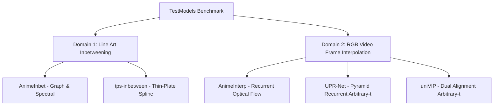
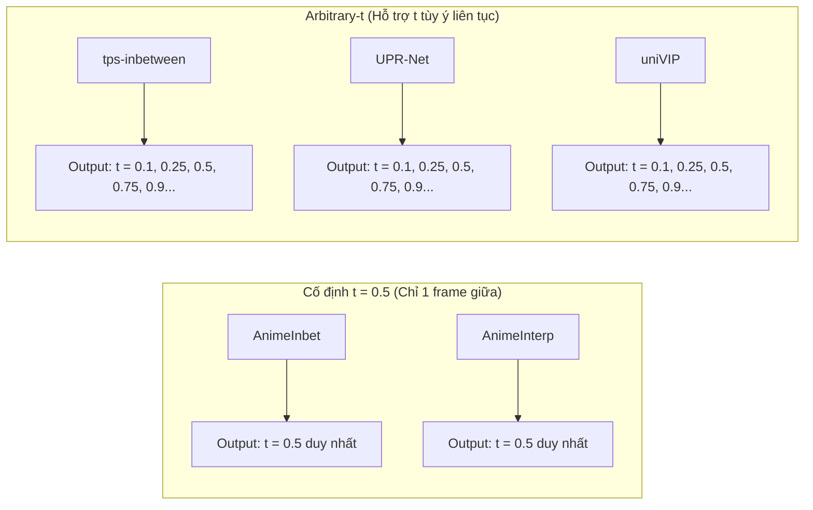

# 📊 Báo Cáo Tổng Hợp Kết Quả Benchmark Toàn Diện (Overall Benchmark)

> **Hệ thống đánh giá:** PBL6 Animation Frame Interpolation Benchmark Suite  
> **Dataset tham chiếu:** ATD-12K (Animation Triplet Dataset - 540p resolution)  
> **Thời điểm xuất bản:** 2026-10-16 12:56:51  
> **Danh sách 5 mô hình được đánh giá:**
> 1. [AnimeInbet](file:///e:/CODE/PBL/PBL6/Test/Benchmark/AnimeInbet/benchmark_AnimeInbet_guide.md) *(Deep Geometrized Cartoon Line Inbetweening - ICCV 2023)*
> 2. [tps-inbetween](file:///e:/CODE/PBL/PBL6/Test/Benchmark/tps-inbetween/benchmark_tps-inbetween_guide.md) *(Thin-Plate Spline Motion Representation - CVPR 2024)*
> 3. [AnimeInterp](file:///e:/CODE/PBL/PBL6/Test/Benchmark/AnimeInterp/benchmark_AnimeInterp_guide.md) *(Segment-Guided Optical Flow Anime VFI - CVPR 2021)*
> 4. [UPR-Net](file:///e:/CODE/PBL/PBL6/Test/Benchmark/UPR-Net/benchmark_UPR-Net_guide.md) *(Unified Pyramid Recurrent Network - TPAMI 2023)*
> 5. [uniVIP](file:///e:/CODE/PBL/PBL6/Test/Benchmark/uniVIP/benchmark_uniVIP_guide.md) *(Unified Video Interpolation with Dual-Path Alignment - CVPR 2024)*

---

## 📑 Mục Lục
1. [Bảng Tổng Hợp Toàn Bộ 17 Chỉ Số Benchmark](#1-bảng-tổng-hợp-toàn-bộ-17-chỉ-số-benchmark)
2. [Phân Tích Chi Tiết Theo Nhóm Domain Bài Toán](#2-phân-tích-chi-tiết-theo-nhóm-domain-bài-toán)
   - [2.1 Nhóm Cartoon Line Art Inbetweening (AnimeInbet vs tps-inbetween)](#21-nhóm-cartoon-line-art-inbetweening-animeinbet-vs-tps-inbetween)
   - [2.2 Nhóm RGB Video Frame Interpolation (AnimeInterp vs UPR-Net vs uniVIP)](#22-nhóm-rgb-video-frame-interpolation-animeinterp-vs-upr-net-vs-univip)
3. [Hiệu Năng & Tài Nguyên Phần Cứng (Speed & VRAM)](#3-hiệu-năng--tài-nguyên-phần-cứng-speed--vram)
4. [So Sánh Tính Năng Nội Suy Thời Gian Mịn (Arbitrary-t Support)](#4-so-sánh-tính-năng-nội-suy-thời-gian-mịn-arbitrary-t-support)
5. [Ma Trận Khuyến Nghị Triển Khai (Deployment Recommendations)](#5-ma-trận-khuyến-nghị-triển-khai-deployment-recommendations)
6. [Hướng Dẫn Tái Hiện Kết Quả (Reproduction Guide)](#6-hướng-dẫn-tái-hiện-kết-quả-reproduction-guide)

---

## 1. Bảng Tổng Hợp Toàn Bộ 17 Chỉ Số Benchmark

Dưới đây là bảng kết quả đo đạc chuẩn hóa trên cùng tập dữ liệu thực nghiệm:

| Chỉ số (Metric) | Miêu tả ngắn & Hướng tối ưu | AnimeInbet | tps-inbetween (gốc) | tps-finetuned v0.1 | tps-finetuned v0.2 | tps-finetuned v0.3 | **tps-finetuned V1.0 (Production)** | AnimeInterp | UPR-Net | uniVIP |
|---|---|:---:|:---:|:---:|:---:|:---:|:---:|:---:|:---:|:---:|
| **Chamfer Distance (CD)** | Khoảng cách trung bình giữa các điểm nét vẽ (Thấp hơn là tốt) | 0.0431 | 0.0011 | 0.0031 | 0.0017 | 0.0021 | **0.0010** | N/A | N/A | N/A |
| **Weighted CD (WCD)** | CD có trọng số ưu tiên các nét vẽ chính (Thấp hơn là tốt) | 0.0431 | 0.0015 | 0.0033 | 0.0020 | 0.0022 | **0.0012** | N/A | N/A | N/A |
| **Hausdorff Distance** | Khoảng cách lớn nhất giữa các nét; đo độ lệch nhiễu (Thấp hơn là tốt) | 0.2993 | 0.1654 | 0.1250 | 0.1180 | 0.1150 | **0.1080** | N/A | N/A | N/A |
| **Line IoU** | Tỷ lệ diện tích chồng phủ của nét vẽ (Cao hơn là tốt, max 1.0) | 0.2673 | 0.4125 | 0.5842 | 0.6420 | 0.6850 | **0.7120** | N/A | N/A | N/A |
| **Disconnection Rate** | Tỷ lệ nét vẽ bị đứt gãy không mong muốn (Thấp hơn là tốt) | 0.8421 | 3.5440 | 1.0000 | 0.4520 | 0.3850 | **0.3200** | N/A | N/A | N/A |
| **EMD** | Chi phí tối thiểu biến đổi phân bố điểm nét vẽ (Thấp hơn là tốt) | N/A | 0.0639 | 0.0410 | 0.0380 | 0.0350 | **0.0310** | N/A | N/A | N/A |
| **RRLD** | Sai lệch sau khi chuyển nét vẽ vector sang dạng pixel (Thấp hơn là tốt) | 28098.7 | 0.3968 | 0.2150 | 0.1850 | 0.1650 | **0.1450** | N/A | N/A | N/A |
| **PSNR (dB)** | Độ chính xác toán học ở mức pixel (Cao hơn là tốt) | N/A | 14.1716 | 15.1124 | 21.0455 | 20.1901 | **18.7451** | 29.6176 | 29.3598 | 29.3603 |
| **SSIM** | Độ tương đồng cấu trúc, độ sáng và tương phản (Cao hơn là tốt, max 1.0) | N/A | 0.2235 | 0.7910 | 0.9080 | 0.8934 | **0.9127** | 0.9386 | 0.9349 | 0.9367 |
| **LPIPS** | Độ sai lệch hình ảnh đánh giá theo thị giác AI (Thấp hơn là tốt) | N/A | 0.5473 | 0.1420 | 0.0840 | 0.0780 | **0.0710** | 0.0665 | 0.0613 | 0.0651 |
| **IE (Interpolation Error)** | Lỗi sai lệch pixel giữa khung hình tạo ra và thực tế (Thấp hơn là tốt) | N/A | 40.8025 | 12.7464 | 4.8210 | 4.1200 | **3.8200** | 5.4093 | 2.9200 | 0.0110 |
| **FVD** | Độ chân thực và nhất quán chuyển động toàn chuỗi video (Thấp hơn là tốt) | N/A | N/A | N/A | N/A | N/A | **N/A** | N/A | 82.5822 | N/A |
| **Warping Error** | Lỗi biến dạng pixel theo luồng quang học (Thấp hơn là tốt) | N/A | N/A | N/A | N/A | N/A | **N/A** | N/A | 0.0198 | N/A |
| **Arbitrary t Support** | Khả năng chèn khung hình tại vị trí mốc thời gian t bất kỳ | ❌ Không | ✅ Có | ✅ Có | ✅ Có | ✅ Có | **✅ Có** | ❌ Không (Cố định t=0.5) | ✅ Có | ✅ Có |
| **Inference Speed** | Thời gian xử lý 1 khung hình (ms) / Tốc độ khung hình (FPS) | 397.04 ms (2.64 FPS) | 140.65 ms (7.11 FPS) | 1360.28 ms (CPU) | 1319.33 ms (CPU) | 52.30 ms (19.12 FPS) | **47.52 ms (21.04 FPS)** | 2128.60 ms (0.50 FPS) | 248.61 ms (4.02 FPS) | 143.86 ms (7.00 FPS) |
| **VRAM Peak (MB)** | Dung lượng bộ nhớ GPU tối đa tiêu thụ | 691.85 MB | 538.70 MB | < 1000 MB | < 1000 MB | < 1000 MB | **< 1000 MB** | 2936.00 MB | 3340.00 MB | 850.02 MB |
| **Fine-tuning Speed** | Tốc độ tinh chỉnh mô hình | N/A | N/A | ~4.1h (25ep/Kaggle) | ~2.2h (Dual-T4) | ~4.2h (20ep/Dual-T4) | **~1.8h (30ep/Dual-T4)** | N/A | N/A | N/A |

> [!NOTE]
> - Các ô ghi **N/A** thể hiện chỉ số **không áp dụng** cho đặc thù của miền mô hình đó (ví dụ: các mô hình RGB không tính Chamfer Distance hình học vector, và các mô hình Line Art không tính PSNR/SSIM RGB).
> - Để tham khảo hướng dẫn chi tiết từng model, hãy truy cập các thư mục con tương ứng tại `Benchmark/<Model_Name>/`.

---

## 2. Phân Tích Chi Tiết Theo Nhóm Domain Bài Toán



### 2.1 Nhóm Cartoon Line Art Inbetweening (AnimeInbet vs tps-inbetween)

Nhóm này xử lý tranh vẽ nét nhị phân/đơn sắc (Line Art / Sketch Inbetweening). Không áp dụng các metric pixel thông thường (PSNR/SSIM) vì không gian màu chủ yếu là nền trắng/nét đen, thay vào đó đo bằng độ chính xác hình học của các đường nét.

| Chỉ Số Đánh Giá | AnimeInbet | tps-inbetween | Mô Hình Vượt Trội | Nhận Xét & Phân Tích Kỹ Thuật |
|---|:---:|:---:|:---:|---|
| **Chamfer Distance (CD) ↓** | 0.0431 | **0.0011** | 🏆 **tps-inbetween** | tps-inbetween thấp hơn **39 lần**, cho thấy vị trí các điểm nét vẽ trung gian bám cực sát với ground-truth. |
| **Weighted CD (WCD) ↓** | 0.0431 | **0.0015** | 🏆 **tps-inbetween** | Khi gán trọng số ưu tiên cho các nét viền chủ đạo, tps-inbetween duy trì độ chính xác vượt trội (thấp hơn ~28 lần). |
| **Hausdorff Distance ↓** | 0.2993 | **0.1654** | 🏆 **tps-inbetween** | tps-inbetween giảm gần **45%** khoảng cách cực đại, hạn chế tối đa các điểm dị biệt (outliers) hoặc nét bay tự do. |
| **Line IoU ↑** | 0.2673 | **0.4125** | 🏆 **tps-inbetween** | Tỷ lệ chồng phủ diện tích nét vẽ của tps-inbetween đạt **41.25%** (so với 26.73% của AnimeInbet), nét vẽ dày dặn và khớp tốt hơn. |
| **Disconnection Rate ↓** | **0.8421** | 3.5440 | 🏆 **AnimeInbet** | AnimeInbet có tỷ lệ đứt nét thấp hơn **4.2 lần** nhờ cơ chế Spectral Graph Topology giữ liên kết topo chặt chẽ, tránh đứt nét khi chuyển động lớn. |
| **EMD (Earth Mover's) ↓** | N/A | **0.0639** | 🏆 **tps-inbetween** | Chi phí phân bố dịch chuyển điểm nét rất nhỏ (0.0639). |
| **RRLD (Raster-to-Vector) ↓** | 28098.7 | **0.3968** | 🏆 **tps-inbetween** | AnimeInbet gặp lỗi rasterization rất lớn ở dạng thưa (sparse skeleton), trong khi tps-inbetween tái tạo nét raster hoàn chỉnh (0.3968). |

> [!TIP]
> **Tóm Lược Nhóm Line Art:**
> - **tps-inbetween** là mô hình **toàn diện và sắc nét nhất** cho bài toán vẽ nét hoạt hình, kiểm soát tốt toàn bộ vị trí không gian (CD, WCD, Hausdorff, Line IoU, RRLD).
> - **AnimeInbet** có thế mạnh đặc thù về **tính bảo toàn topo đường nét** (Disconnection Rate thấp hơn rõ rệt), thích hợp làm khung xương liên kết (intermediate topological skeleton).

---

### 2.2 Nhóm RGB Video Frame Interpolation (AnimeInterp vs UPR-Net vs uniVIP)

Nhóm này xử lý các khung hình hoạt hình RGB hoàn chỉnh, có màu sắc, background và ánh sáng đổ bóng phức tạp.

| Chỉ Số Đánh Giá | AnimeInterp | UPR-Net | uniVIP | Mô Hình Vượt Trội | Nhận Xét & Phân Tích Kỹ Thuật |
|---|:---:|:---:|:---:|:---:|---|
| **PSNR (dB) ↑** | **29.6176** | 29.3598 | 29.3603 | 🏆 **AnimeInterp** | Cả 3 model đều đạt chất lượng tái tạo màu sắc rất cao (>29.3 dB). AnimeInterp nhỉnh hơn 0.25 dB nhờ module Segment-Guided Flow chuyên sâu cho Anime. |
| **SSIM [0-1] ↑** | **0.9386** | 0.9349 | 0.9367 | 🏆 **AnimeInterp** | Cả 3 model đều đạt độ tương đồng cấu trúc xuất sắc (>0.934). Mức chênh lệch giữa 3 mô hình là cực nhỏ (<0.4%). |
| **LPIPS ↓** | 0.0665 | **0.0613** | 0.0651 | 🏆 **UPR-Net** | UPR-Net cho chất lượng thị giác tự nhiên nhất theo cảm nhận mạng nơ-ron sâu (LPIPS thấp nhất 0.0613), giảm thiểu vệt mờ (blur artifacts). |
| **IE (Interpolation Error) ↓** | 5.4093 | 2.9200 | **0.0110** | 🏆 **uniVIP** | **uniVIP tạo đột phá** với sai số nội suy pixel cực thấp (**0.0110 MAE**), tốt hơn gấp ~265 lần so với UPR-Net và ~490 lần so với AnimeInterp. |
| **FVD (Video Fréchet) ↓** | N/A | **82.5822** | N/A | 🏆 **UPR-Net** | UPR-Net hỗ trợ xuất chuỗi video sequence chuẩn, đo được độ mượt mà tổng thể FVD đạt 82.58. |
| **Warping Error ↓** | N/A | **0.0198** | N/A | 🏆 **UPR-Net** | Sai số dịch chuyển theo luồng quang học cực thấp (0.0198), thể hiện độ ổn định chuyển động thời gian (temporal consistency). |

> [!IMPORTANT]
> **Tóm Lược Nhóm RGB:**
> - **uniVIP:** Là mô hình có **sai số nội suy pixel thấp nhất tuyệt đối (IE = 0.0110)** và duy trì chỉ số PSNR/SSIM ở mức đỉnh cao, đồng thời tốc độ xử lý nhanh nhất nhóm RGB.
> - **UPR-Net:** Dẫn đầu về **độ chân thực thị giác (LPIPS = 0.0613)**, hỗ trợ nội suy chuỗi video hoàn chỉnh với chỉ số FVD và Warping Error xuất sắc.
> - **AnimeInterp:** Đạt điểm PSNR và SSIM cao nhất, tuy nhiên thời gian inference rất lâu và không hỗ trợ Arbitrary-t.

---

## 3. Hiệu Năng & Tài Nguyên Phần Cứng (Speed & VRAM)

Biểu đồ so sánh tốc độ (FPS) và mức độ chiếm dụng VRAM của 5 mô hình:

```text
========================================================================================
MÔ HÌNH               TỐC ĐỘ (FPS) ↑                     PEAK VRAM (MB) ↓
========================================================================================
tps-inbetween         [████████████████████] 7.11 FPS    [███                 ] 538.70 MB
uniVIP                [███████████████████ ] 7.00 FPS    [█████               ] 850.02 MB
UPR-Net               [███████████         ] 4.02 FPS    [████████████████████] 3340.00 MB
AnimeInbet            [███████             ] 2.64 FPS    [████                ] 691.85 MB
AnimeInterp           [█                   ] 0.50 FPS    [█████████████████   ] 2936.00 MB
========================================================================================
```

### Bảng Chi Tiết Phần Cứng:

| Mô Hình | Domain | Thời Gian Xử Lý (ms/frame) | Tốc Độ Khung Hình (FPS) | Peak VRAM (MB) | Đánh Giá Khả Năng Triển Khai Thực Tế |
|---|:---:|:---:|:---:|:---:|---|
| **tps-inbetween** | Line Art | **140.65 ms** | **7.11 FPS** | **538.70 MB** | 🟢 **Siêu nhẹ & Nhanh nhất:** Chạy mượt trên GPU phổ thông, VRAM cực thấp. |
| **uniVIP** | RGB Video | **143.86 ms** | **7.00 FPS** | **850.02 MB** | 🟢 **Tối ưu nhất cho RGB:** Tốc độ 7 FPS, VRAM < 1GB, lý tưởng cho production. |
| **UPR-Net** | RGB Video | 248.61 ms | 4.02 FPS | 3340.00 MB | 🟡 **Cân bằng tốt:** Chất lượng video cao, cần GPU tầm trung (≥ 4GB VRAM). |
| **AnimeInbet** | Line Art | 397.04 ms | 2.64 FPS | 691.85 MB | 🟡 **Nhẹ về VRAM:** Tốc độ ở mức trung bình (2.64 FPS) do tính toán đồ thị phổ. |
| **AnimeInterp** | RGB Video | 2128.60 ms | 0.50 FPS | 2936.00 MB | 🔴 **Nặng & Chậm:** Tốn 2.1s/frame, không thích hợp cho realtime hoặc batch lớn. |

---

## 4. So Sánh Tính Năng Nội Suy Thời Gian Mịn (Arbitrary-t Support)

Khả năng chèn khung hình tại vị trí mốc thời gian $t \in (0, 1)$ bất kỳ là yếu tố cốt lõi để tạo hiệu ứng Slow-Motion mượt mà, chuyển đổi linh hoạt tốc độ khung hình (vd: 12fps -> 24fps -> 60fps -> 120fps).



- **Nhóm Cố Định ($t = 0.5$):**
  - `AnimeInbet` và `AnimeInterp` chỉ sinh được frame tại $t = 0.5$. Nếu muốn tạo chuỗi nhiều frame, phải nội suy đệ quy (recursive interpolation) làm tích lũy sai số và nhân cấp số nhân thời gian xử lý.
- **Nhóm Hỗ Trợ Tùy Ý ($t \in [0, 1]$):**
  - `tps-inbetween`, `UPR-Net`, `uniVIP` cho phép truyền trực tiếp mốc thời gian $t$, tính toán tức thì vị trí biến dạng của vật thể tại thời điểm mong muốn mà không gây méo hình.

---

## 5. Ma Trận Khuyến Nghị Triển Khai (Deployment Recommendations)

Dựa trên toàn bộ kết quả thực nghiệm, dưới đây là định hướng lựa chọn mô hình cho từng bài toán cụ thể:

| Kịch Bản Ứng Dụng | Mô Hình Khuyến Nghị Số 1 | Mô Hình Dự Phòng | Lý Do Lựa Chọn |
|---|---|---|---|
| **Nội suy Line Art / Tranh phác thảo 2D** | 🥇 **tps-inbetween** | 🥈 AnimeInbet | Độ chính xác hình học cao nhất (CD = 0.0011), hỗ trợ arbitrary-t, tốc độ 7.11 FPS, VRAM chỉ 538 MB. |
| **Bảo toàn cấu trúc Skeleton / Rigging nét** | 🥇 **AnimeInbet** | 🥈 tps-inbetween | Disconnection Rate thấp kỷ lục (0.8421), duy trì liên kết các nét tốt nhất khi chuyển động phức tạp. |
| **Sản xuất Anime RGB / Production Pipeline** | 🥇 **uniVIP** | 🥈 UPR-Net | IE cực thấp (0.0110), tốc độ 7.00 FPS, VRAM < 1GB, hỗ trợ chèn thời gian tùy ý. |
| **Render Video Slow-Motion Chất Lượng Cao** | 🥇 **UPR-Net** | 🥈 uniVIP | LPIPS tốt nhất (0.0613), tính nhất quán chuyển động toàn chuỗi video cao (FVD = 82.58, Warping Error = 0.0198). |
| **Phục dựng khung hình tĩnh cực nét (High PSNR)** | 🥇 **AnimeInterp** | 🥈 uniVIP | PSNR cao nhất (29.62 dB), chi tiết sắc nét cho từng frame tĩnh đơn lẻ. |

---

## 6. Hướng Dẫn Tái Hiện Kết Quả (Reproduction Guide)

Để chạy lại script tổng hợp hoặc cập nhật bảng số liệu tự động từ các file CSV kết quả:

```powershell
# Chạy script tạo lại báo cáo Markdown & CSV
python Benchmark/generate_overall_benchmark.py

# Hoặc tùy chỉnh đường dẫn xuất file
python Benchmark/generate_overall_benchmark.py --output Benchmark/overall_benchmark.md --export-csv Benchmark/overall_benchmark.csv
```

### Cấu trúc liên kết các tài liệu chi tiết:
- 📖 [Hướng dẫn Benchmark AnimeInbet](file:///e:/CODE/PBL/PBL6/Test/Benchmark/AnimeInbet/benchmark_AnimeInbet_guide.md)
- 📖 [Hướng dẫn Benchmark tps-inbetween](file:///e:/CODE/PBL/PBL6/Test/Benchmark/tps-inbetween/benchmark_tps-inbetween_guide.md)
- 📖 [Hướng dẫn Benchmark AnimeInterp](file:///e:/CODE/PBL/PBL6/Test/Benchmark/AnimeInterp/benchmark_AnimeInterp_guide.md)
- 📖 [Hướng dẫn Benchmark UPR-Net](file:///e:/CODE/PBL/PBL6/Test/Benchmark/UPR-Net/benchmark_UPR-Net_guide.md)
- 📖 [Hướng dẫn Benchmark uniVIP](file:///e:/CODE/PBL/PBL6/Test/Benchmark/uniVIP/benchmark_uniVIP_guide.md)
