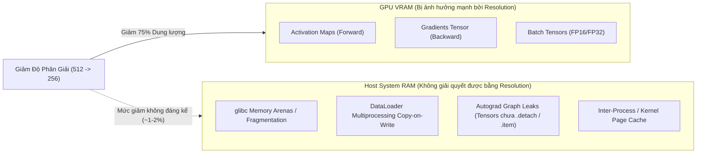
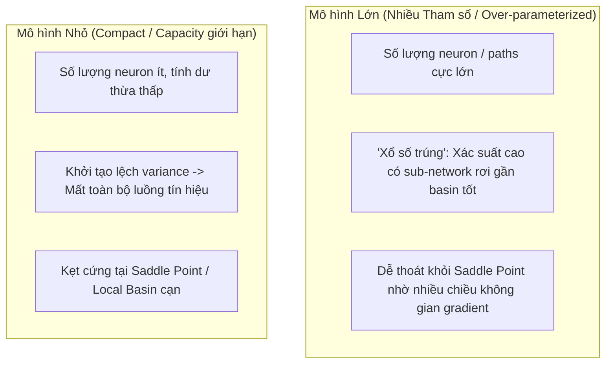
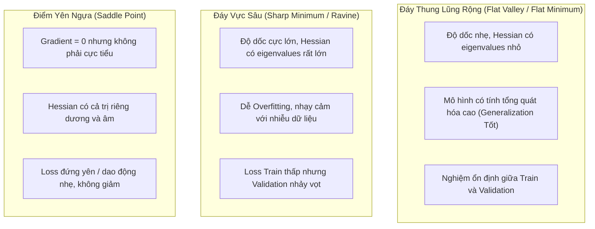
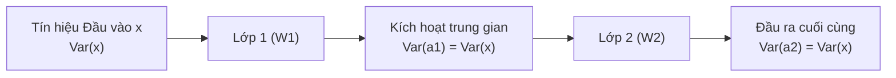
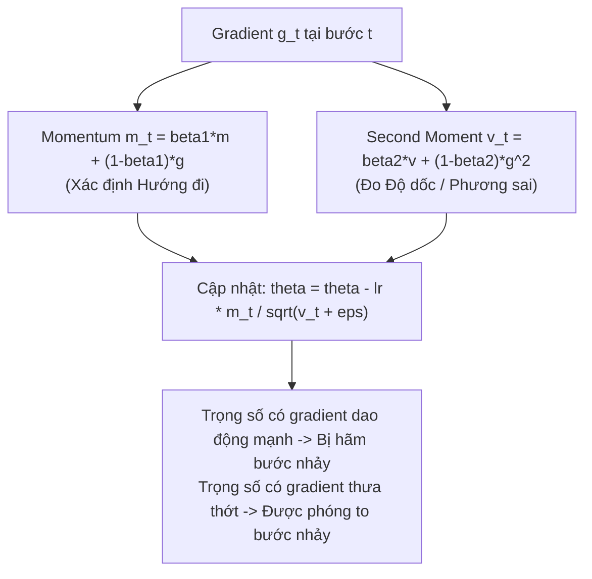
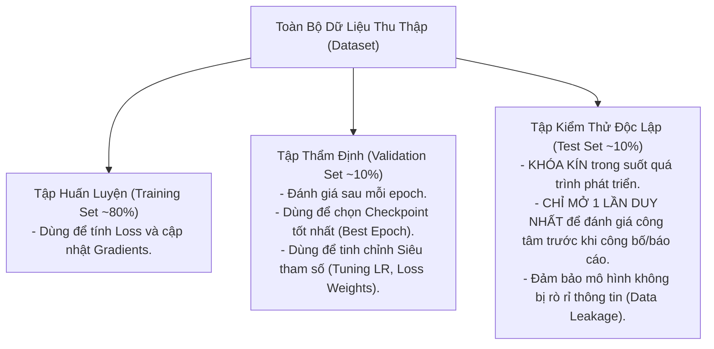

# TỔNG HỢP KIẾN THỨC HUẤN LUYỆN AI & PHƯƠNG ÁN KHẮC PHỤC SỰ CỐ NOTEBOOK TPS-INBETWEEN V3.0
## DỰ ÁN PBL6: NGHIÊN CỨU & TINH CHỈNH MÔ HÌNH TPS-INBETWEEN CHO HOẠT HỌA ANIME 2D

> **Tài liệu tham chiếu:** Trích xuất từ phiên thảo luận chuyên sâu về lý thuyết tối ưu hóa mô hình AI, kết hợp phân tích thực nghiệm mã nguồn và sự cố thực tế trên Kaggle/Local của pipeline **TPS-Inbetween V3.0**.  
> **Mục tiêu:**
> 1. Chẩn đoán và xử lý dứt điểm hiện tượng **tăng tích lũy RAM hệ thống (Host RAM leak)** qua từng epoch trên Notebook V3.0 (giải thích tại sao hạ độ phân giải dataset không giải quyết được vấn đề).
> 2. Phân tích nguyên nhân và phương án khắc phục hiện tượng **bão hòa loss (plateau / oscillation quanh một điểm)** khi huấn luyện các phiên bản thu nhỏ (small variants) của V3.0.
> 3. Hệ thống hóa các kiến thức tối ưu hóa nền tảng từ thảo luận: *Mixed Precision (AMP)*, *LoRA/PEFT*, *Quantization (QAT vs PTQ)*, *Khởi tạo trọng số (Xavier/He)*, *Dying ReLU & Activation functions*, *Loss landscape & Hessian Matrix*, *Cơ chế hoạt động của Optimizer (RMSProp/AdamW)*, và *Quy chuẩn Validation/Test*.

---

## MỤC LỤC
1. [Chẩn đoán & Giải pháp Triệt để: Sự cố Tràn RAM Tích lũy (Host RAM Leak)](#1-chẩn-đoán--giải-pháp-triệt-để-sự-cố-tràn-ram-tích-lũy-host-ram-leak)
   - 1.1. Tại sao giảm độ phân giải dữ liệu không cứu được RAM?
   - 1.2. Các cơ chế rò rỉ RAM phổ biến trong PyTorch & Notebook V3.0
   - 1.3. Ứng dụng kiến thức thảo luận & Giải pháp lập trình khắc phục
2. [Chẩn đoán & Khắc phục: Loss Bão hòa / Dao động quanh một điểm ở Bản nhỏ V3.0](#2-chẩn-đoán--khắc-phục-loss-bão-hòa--dao-động-quanh-một-điểm-ở-bản-nhỏ-v30)
   - 2.1. Vấn đề khởi tạo trọng số: Bẫy đối xứng (Symmetry Trap) & "Xổ số" khởi tạo
   - 2.2. Hiện tượng "Chết Neuron" (Dying ReLU) trong kiến trúc thu nhỏ
   - 2.3. Địa hình hàm Loss (Loss Landscape), Điểm yên ngựa (Saddle Point) & Cực tiểu phẳng
   - 2.4. Động lực học Optimizer & Hiện tượng lệch pha Learning Rate
   - 2.5. Xung đột giữa các thành phần trong Hàm Loss Hỗn hợp
3. [Hệ thống hóa Toàn diện Kiến thức Huấn luyện từ Phiên Thảo luận](#3-hệ-thống-hóa-toàn-diện-kiến-thức-huấn-luyện-từ-phiên-thảo-luận)
   - 3.1. Bảng so sánh chuyên sâu: Mixed Precision vs LoRA vs PTQ vs QAT
   - 3.2. Bản chất toán học của Mixed Precision (AMP) & Khác biệt với Quantization
   - 3.3. Vai trò của Khởi tạo Trọng số (Weight Initialization: Xavier vs He)
   - 3.4. Phân loại Hàm Kích hoạt (Activation Functions) & Tham số Trainable
   - 3.5. Cơ chế Tự thích ứng Tốc độ học (Adaptive Learning Rate) trong RMSProp & AdamW
   - 3.6. Nguyên tắc Phân định Tập Validation và Tập Test
   - 3.7. Nghiên cứu Mới: Mạng không dùng Hàm Kích hoạt (Fourier Analysis Networks - FAN)
4. [Kế hoạch Hành động Cụ thể cho TPS-Inbetween V3.0](#4-kế-hoạch-hành-động-cụ-thể-cho-tps-inbetween-v30)

---

## 1. CHẨN ĐOÁN & GIẢI PHÁP TRIỆT ĐỂ: SỰ CỐ TRÀN RAM TÍCH LŨY (HOST RAM LEAK)

### 1.1. Tại sao giảm độ phân giải dữ liệu không cứu được RAM?

Trong quá trình thực nghiệm V3.0, nhóm đã thử nghiệm giảm độ phân giải hình ảnh từ $512 \times 512$ xuống $256 \times 256$ (hoặc 270p), nhưng mức cải thiện RAM hệ thống (Host CPU RAM) là không đáng kể, và hiện tượng RAM tăng dần sau mỗi epoch vẫn tiếp diễn đến mức sập container (OOM Killed).



> [!IMPORTANT]
> **Phân biệt rạch ròi giữa VRAM (GPU) và Host RAM (CPU/Hệ điều hành):**
> - **Kích thước độ phân giải ảnh (Image Resolution)** chi phối trực tiếp kích thước ma trận kích hoạt (activation maps) và gradient lưu trên **VRAM của GPU**. Việc giảm resolution từ $512$ xuống $256$ làm giảm kích thước tensor bậc 2 ($H \times W$) đi $4$ lần trên VRAM.
> - **Host RAM (RAM container Kaggle 13-16 GB)** bị tích lũy là do **bộ nhớ CPU** của tiến trình Python, bộ đệm DataLoader đa luồng (`num_workers`), và đồ thị tính toán bị giữ tham chiếu. Vì kích thước file nén hoặc mảng metadata trên CPU vốn dĩ chỉ chiếm vài trăm MB, việc thu nhỏ ảnh không tác động vào căn nguyên gây rò rỉ bộ nhớ CPU.

---

### 1.2. Các cơ chế rò rỉ RAM phổ biến trong PyTorch & Notebook V3.0

Dựa trên cấu trúc triển khai mã nguồn của notebook V3.0 (`scratch/train_epoch.py` và `scratch/v3_engine.py`), các nguyên nhân gốc rễ gây tích lũy RAM qua từng epoch gồm:

#### A. Rò rỉ đồ thị tính toán (Autograd Graph Retention)
Trong vòng lặp training hoặc validation, nếu một tensor PyTorch được gán hoặc lưu vào danh sách (`list`, `dict`) phục vụ việc ghi log mà không gọi `.item()` hoặc `.detach()`, PyTorch sẽ **giữ lại toàn bộ cây tính toán (DAG)** phía sau tensor đó.
- *Hậu quả:* Toàn bộ các tensor trung gian của cả epoch không được garbage collector giải phóng, bộ nhớ tích lũy tuyến tính theo số bước ($O(\text{steps})$).

#### B. Phân mảnh bộ nhớ do `glibc` và Multiprocessing Fork (Copy-On-Write)
- Trong môi trường Linux/Kaggle, `DataLoader(num_workers > 0)` sử dụng cơ chế `fork` để tạo tiến trình nạp dữ liệu con.
- Đối tượng `SakugaGoldenDataset_v3` lưu các mảng numpy lớn trong bộ nhớ:
  $$\text{self.kps_data} \in \mathbb{R}^{N \times 2 \times 80 \times 2}, \quad \text{self.val\_c0} \in \mathbb{R}^{N \times 88 \times 2}$$
- Khi các tiến trình worker con đọc hoặc chạm vào các biến có bộ đếm tham chiếu (reference counting) của Python, cơ chế **Copy-On-Write (COW)** của Linux bị kích hoạt, sao chép các trang bộ nhớ vật lý thành các bản sao riêng cho từng worker.
- Trình phân bổ bộ nhớ mặc định của Linux (`glibc malloc`) tạo nhiều arena bộ nhớ cho các luồng nhưng **không trả RAM về cho hệ điều hành** (memory fragmentation), khiến RAM container chỉ tăng mà không giảm.

#### C. Tích lũy Metrics GPU trong pha Validation
Trong `train_epoch.py`:
```python
val_metrics_gpu_list.append(batch_m_gpu.detach())
```
Nếu danh sách này tích lũy hàng trăm batch metrics tensor trên GPU/CPU và việc ép kiểu sang CPU/NumPy không dọn dẹp biến tạm đúng thời điểm, chu kỳ gom rác (garbage collection) của Python bị hoãn lại.

---

### 1.3. Ứng dụng kiến thức thảo luận & Giải pháp lập trình khắc phục

Từ cuộc thảo luận:
- **Cháo bột Hải Lăng (Long):** *"buff tốc độ train thì dùng mixed precision... dùng float16 thay vì float32... tham số lưu ở dạng fp16, tiết kiệm bộ nhớ hơn... nên batch size tăng gấp đôi... đa số mô hình không cần precision cao vậy đâu..."*
- **Thằng Chó Văn báo đốm (Cường):** *"giảm float32 deu la quantize ma... dung vai cho tang tinh toan thoi chu chi... mixed precision thi dung toan bo thanh fp16 hay sao... có thể nén trong lúc train được mà (QAT)..."*

#### Giải pháp kỹ thuật đồng bộ cho V3.0:

```python
# =========================================================================
# 1. CẤU HÌNH BIẾN MÔI TRƯỜNG GLIBC TRƯỚC KHI IMPORT TORCH
# (Khống chế malloc arena, giải phóng trang nhớ lập tức về cho OS)
# =========================================================================
import os
os.environ["MALLOC_TRIM_THRESHOLD_"] = "65536"   # Ép glibc trả RAM về OS khi giải phóng > 64KB
os.environ["MALLOC_ARENA_MAX"] = "2"            # Giới hạn số arena bộ nhớ của glibc
os.environ["OMP_NUM_THREADS"] = "1"
os.environ["MKL_NUM_THREADS"] = "1"
os.environ["PYTORCH_CUDA_ALLOC_CONF"] = "expandable_segments:True"

import gc
import ctypes
import torch

def clean_memory():
    """Giải phóng cưỡng bức cả CPU Host RAM và GPU VRAM."""
    gc.collect()
    if torch.cuda.is_available():
        torch.cuda.empty_cache()
        torch.cuda.ipc_collect()
    # Gọi hàm malloc_trim của Linux C-Library
    try:
        ctypes.CDLL('libc.so.6').malloc_trim(0)
    except Exception:
        pass
```

```python
# =========================================================================
# 2. CHUẨN HÓA DATALOADER: BẢO VỆ BỘ NHỚ VÀ CHỐNG COPY-ON-WRITE
# =========================================================================
train_loader = DataLoader(
    train_dataset,
    batch_size=batch_size,
    sampler=train_sampler,
    num_workers=2,              # Giảm từ 4 xuống 2 trên Kaggle để hạn chế nhân đôi arena
    pin_memory=True,            # Giúp chuyển tensor lên GPU bất đồng bộ qua DMA
    persistent_workers=True,    # Giữ nguyên worker giữa các epoch, tránh fork liên tục gây leak
    prefetch_factor=2,
    collate_fn=v3.custom_collate_fn_v3,
    drop_last=True
)
```

```python
# =========================================================================
# 3. ÉP KIỂU ITEM() TRONG LOSS LOGGING & SỬ DỤNG MIXED PRECISION (AMP)
# =========================================================================
# Trong vòng lặp train:
scaler = torch.amp.GradScaler('cuda', enabled=torch.cuda.is_available())

with torch.amp.autocast('cuda', dtype=torch.float16):
    total_loss, l1, dice, density, hair = model(inputs)

scaler.scale(total_loss).backward()
scaler.step(optimizer)
scaler.update()
optimizer.zero_grad(set_to_none=True) # set_to_none=True giải phóng bộ nhớ tensor grad thay vì giữ 0

# TUYỆT ĐỐI KHÔNG LƯU NGUYÊN TENSOR VÀO BIẾN TÍCH LŨY
train_loss_accum += total_loss.detach().item()  # Lấy giá trị số thực thuần túy (float)
del total_loss, l1, dice, density, hair         # Hủy tham chiếu tức thì
```

---

## 2. CHẨN ĐOÁN & KHẮC PHỤC: LOSS BÃO HÒA / DAO ĐỘNG QUANH MỘT ĐIỂM Ở BẢN NHỎ V3.0

Khi thu nhỏ kiến trúc mạng V3.0 (ví dụ giảm số channel trong Encoder từ $64 \to 32$, giảm số blocks trong `SynthesisUNet`), mô hình xuất hiện hiện tượng: **cả `train_loss` và `val_loss` không chịu giảm mà chỉ dịch chuyển/dao động nhẹ quanh một giá trị duy nhất**.

Các trao đổi trong cuộc thảo luận cung cấp cái nhìn chính xác về mặt giải phẫu học mạng nơ-ron:

```
ikora: "khong rand: 1 la overfitting, 2 la plateau ma khong hoi tu, 3 la bung no"
ikora: "rand weight bang rand() thi ia chay la dung roi, phai xavier... truoc set toan bo weight la 0.5 train nhu cho"
cháo bột Hải Lăng: "nó là init weights... rand để phá vỡ tính đối xứng... Adam với AdamW học lẹ hơn"
Thằng Chó Văn báo đốm: "xavier la init weight chay voi scale phuong sai weight... k lam no scale qua to la do bi bay lung tung"
cháo bột Hải Lăng: "nó gọi là dying neuron... relu -> max(0,x)... leaky relu -> max(a,x)... prelu -> max(alpha*a,x)"
Thằng Chó Văn báo đốm: "hàm loss lùi convex thì kiểu gì cũng hội tụ... nhưng cái thế giới bọn act func tạo ra này ra cái mớ lổm xổm... saddle point và local point... ma trận bán tính dương (Hessian >= 0)..."
```

---

### 2.1. Vấn đề khởi tạo trọng số: Bẫy đối xứng (Symmetry Trap) & "Xổ số" khởi tạo



#### Bản chất cơ chế:
1. **Bẫy đối xứng (Symmetry Trap):**
   - Như ikora đề cập: *"trước set toàn bộ weight là 0.5 train như chó"*. Nếu các trọng số được khởi tạo giống nhau (hằng số), tất cả neuron trong cùng một lớp sẽ tính ra cùng một giá trị forward và nhận cùng một gradient backward. Toàn bộ lớp sụp đổ thành một neuron duy nhất, mô hình mất hoàn toàn năng lực học biểu diễn.
2. **Tại sao mô hình nhỏ bị tổn thương nặng nề hơn mô hình lớn?**
   - Ở các mô hình khổng lồ, theo lý thuyết *Lottery Ticket Hypothesis*, sự dư thừa tham số tạo ra vô số tổ hợp ngẫu nhiên ("xổ số trúng" như Cường và Long nói). Luôn có những đường dẫn khởi tạo nằm sẵn gần bồn tối ưu địa phương tốt.
   - Nhưng ở mô hình thu nhỏ, số kênh hẹp ($C=16, 32$), nếu khởi tạo bằng phân phối ngẫu nhiên thuần túy (`rand()` đều hoặc normal chuẩn $\sigma=1$), phương sai của đầu ra sau mỗi lớp sẽ tăng gấp bội hoặc tiêu biến về 0:
     $$\text{Var}(y) = n_{\text{in}} \cdot \text{Var}(w) \cdot \text{Var}(x)$$
     Nếu $\text{Var}(w) \neq \frac{1}{n_{\text{in}}}$ hoặc $\frac{2}{n_{\text{in}}}$, tín hiệu truyền qua vài lớp sẽ bị triệt tiêu (vanishing) hoặc nổ tung (exploding), dẫn đến mô hình rơi ngay vào trạng thái bão hòa (**Plateau**).

#### Giải pháp khắc phục:
Áp dụng chuẩn khởi tạo **Kaiming He Normal** (cho các lớp tích chập theo sau bởi ReLU/LeakyReLU) hoặc **Xavier Glorot** (cho các lớp tuyến tính/cổng hiển thị sigmoid/tanh):
```python
def init_weights_v3_small(m):
    if isinstance(m, (nn.Conv2d, nn.ConvTranspose2d)):
        # Kaiming Normal duy trì phương sai cho LeakyReLU (negative_slope=0.2)
        nn.init.kaiming_normal_(m.weight, a=0.2, mode='fan_in', nonlinearity='leaky_relu')
        if m.bias is not None:
            nn.init.zeros_(m.bias)
    elif isinstance(m, (nn.BatchNorm2d, nn.GroupNorm)):
        nn.init.ones_(m.weight)
        nn.init.zeros_(m.bias)
    elif isinstance(m, nn.Linear):
        nn.init.xavier_uniform_(m.weight)
        if m.bias is not None:
            nn.init.zeros_(m.bias)
```

---

### 2.2. Hiện tượng "Chết Neuron" (Dying ReLU) trong kiến trúc thu nhỏ

Cuộc đối thoại giữa Long, Cường và ikora chỉ ra trực diện vấn đề:
- *ikora:* "ta nghe bảo cái này để không bị chết relu"
- *Cường:* "để smooth tránh không, tránh số 0"
- *Long:* "nó gọi là dying neuron... relu -> max(0, x)... leaky relu -> max(a, x)... param relu -> max(alpha*a, x)"

#### Tại sao Dying ReLU làm mô hình nhỏ bão hòa đứng yên?
- Hàm ReLU định nghĩa là $f(x) = \max(0, x)$. Đạo hàm của nó là:
  $$f'(x) = \begin{cases} 1 & \text{khi } x > 0 \\ 0 & \text{khi } x \le 0 \end{cases}$$
- Nếu trong những bước huấn luyện đầu tiên, một learning rate hơi lớn hoặc một cú sốc gradient đẩy các trọng số $w$ làm cho tổng tiền kích hoạt $z = w^T x + b \le 0$ với toàn bộ tập dữ liệu, thì gradient qua neuron đó sẽ **bằng $0$ tuyệt đối**. Trọng số $w$ sẽ không bao giờ được cập nhật nữa. Neuron bị "chết não" vĩnh viễn.
- Trong mô hình lớn (với 256 - 512 channels), nếu chết 30% số neuron thì 70% còn lại vẫn gánh được tác vụ.
- Nhưng trong **mô hình nhỏ** (ví dụ chỉ có 32 channels), nếu 16 neuron bị chết, dung lượng mạng lập tức bị chia đôi. Mạng không còn đủ bậc tự do để tái tạo các đường nét hoạt họa chi tiết, dẫn đến việc mô hình chỉ học dự đoán giá trị trung bình (mean background), và hàm loss dừng giảm, dao động nhẹ quanh mức entropy trung bình.

#### Giải pháp khắc phục:
Thay thế toàn bộ các hàm `nn.ReLU(inplace=True)` bằng:
1. **`nn.LeakyReLU(negative_slope=0.1, inplace=True)`** hoặc `0.2`: Cho phép một lượng gradient nhỏ ($\alpha \cdot g$) chảy ngược lại ngay cả khi $x < 0$, hồi sinh các neuron bị âm.
2. **`nn.PReLU(num_parameters=1)`** (như Long phân tích: có tham số $\alpha$ học được theo gradient).
3. **`nn.GELU()`** hoặc **`nn.SiLU()` (Swish)**: Các hàm kích hoạt mượt mà, phi tuyến liên tục, không có điểm gãy đạo hàm tại $0$.

---

### 2.3. Địa hình hàm Loss (Loss Landscape), Điểm yên ngựa (Saddle Point) & Cực tiểu phẳng

Cường phân tích: *"hàm loss convex thì kiểu gì cũng hội tụ... nhưng cái thế giới bọn act func tạo ra này ra cái mớ lổm xổm... saddle point và local point... nếu là ma trận bán tính dương thì hệ số đường chéo lambda làm gì luôn >= 0..."*  
Long bổ sung: *"nếu điểm tối ưu nằm ở đáy thung lũng (flat minimum) thì tốt hơn đáy vực (sharp minimum), vì thung lũng nó tổng quát hơn..."*



#### Phân tích toán học:
- Một bài toán tối ưu lồi (Convex Optimization) có ma trận Hessian $H = \nabla^2 L(\theta)$ luôn **nửa xác định dương** ($H \succeq 0$, tức toàn bộ trị riêng $\lambda_i \ge 0$). Ở bài toán này, bất kỳ thuật toán Gradient Descent nào cũng sẽ hội tụ về cực tiểu toàn cục (Global Minimum).
- Tuy nhiên, mạng nơ-ron sâu với các hàm kích hoạt phi tuyến tạo ra một địa hình loss **phi lồi cao độ (highly non-convex)**. Hầu hết các điểm dừng ($\nabla L = 0$) trong không gian nhiều chiều không phải là cực tiểu địa phương mà là **Điểm yên ngựa (Saddle Point)**, nơi một số hướng có độ cong dương ($\lambda_i > 0$) nhưng một số hướng khác lại có độ cong âm ($\lambda_j < 0$).
- Khi một mô hình nhỏ bị kẹt quanh một điểm yên ngựa, gradient tổng hợp triệt tiêu lẫn nhau. Mô hình chỉ lắc lư nhẹ quanh điểm này mà không thể trượt xuống được bồn dốc nếu optimizer thiếu **quán tính (momentum)** hoặc **nhiễu gradient lành mạnh (stochastic noise)**.

---

### 2.4. Động lực học Optimizer & Hiện tượng lệch pha Learning Rate

Cường phân tích về RMSProp: *"learning rate / cái căn tích lũy... tức là nó scale learning rate cho từng trọng số 1, cái nào to nó scale học nhỏ lại và ngược lại, là phương sai scale cho từng trọng số riêng chứ không set cứng"*.

#### Cơ chế của AdamW / RMSProp:
$$\theta_{t} = \theta_{t-1} - \frac{\eta}{\sqrt{v_t} + \epsilon} \cdot m_t$$
Trong đó:
- $m_t = \beta_1 m_{t-1} + (1 - \beta_1) g_t$ (Kỳ vọng bậc 1 - Hướng quán tính)
- $v_t = \beta_2 v_{t-1} + (1 - \beta_2) g_t^2$ (Kỳ vọng bậc 2 - Phương sai gradient của từng trọng số)

#### Tại sao dùng nguyên Learning Rate của bản lớn cho bản nhỏ lại gây dao động quanh 1 điểm?
- Bản lớn có số lượng tham số nhiều, gradient được trung bình hóa trên không gian lớn, bước nhảy hiệu dụng nhỏ và đầm hơn.
- Bản thu nhỏ có ít tham số, các thung lũng tối ưu hẹp hơn (narrower valleys). Nếu áp dụng cùng một Learning Rate (ví dụ $\text{LR} = 8 \times 10^{-5}$ hoặc $1 \times 10^{-4}$):
  - Optimizer bước một bước quá dài, vượt qua đáy thung lũng sang sườn dốc đối diện.
  - Tại sườn dốc đối diện, gradient đổi dấu, đẩy mô hình bật ngược trở lại.
  - Kết quả: **Loss không thể đi sâu xuống đáy mà chỉ dao động qua lại quanh một giá trị không đổi**.

---

### 2.5. Xung đột giữa các thành phần trong Hàm Loss Hỗn hợp

Mô hình V3.0 sử dụng bộ hàm loss hỗn hợp rất phức tạp:
$$\mathcal{L}_{\text{total}} = \lambda_{\text{L1}} \mathcal{L}_{\text{L1}} + \lambda_{\text{dice}} \mathcal{L}_{\text{SoftclDice}} + \lambda_{\text{dens}} \mathcal{L}_{\text{Density}} + \lambda_{\text{hair}} \mathcal{L}_{\text{HairTip}}$$

- Ở mô hình lớn đầy đủ năng lực, mạng có đủ kênh để vừa học căn chỉnh vị trí nét (L1), vừa học giữ liên thông ngọn tóc (HairTip), vừa kiềm chế độ dày mực nét (Density).
- Ở **mô hình thu nhỏ**, năng lực biểu diễn của mạng bị nghẽn (capacity bottleneck). Gradient của $\mathcal{L}_{\text{Density}}$ (ép nét co lại) và $\mathcal{L}_{\text{SoftclDice}}$ (ép nét nối liền liên thông) triệt tiêu trực tiếp lẫn nhau. Mạng rơi vào thế giằng co cân bằng Nash cục bộ, khiến tổng loss không thể giảm thêm.

> [!TIP]
> **Giải pháp cho bản nhỏ:** Khi train bản nhỏ, cần tạm thời **tắt bớt hoặc giảm trọng số của các loss điều hòa phức tạp** (Density, HairTip), chỉ giữ lại $\mathcal{L}_{\text{L1}} + 0.1 \cdot \mathcal{L}_{\text{Dice}}$. Sau khi mô hình đã học trôi chảy việc nội suy nét cơ bản, mới mở dần các hàm loss tinh chỉnh (Curriculum Loss Scheduling).

---

## 3. HỆ THỐNG HÓA TOÀN DIỆN KIẾN THỨC HUẤN LUYỆN TỪ PHIÊN THẢO LUẬN

Bảng đối thoại giữa các thành viên chứa đựng một lượng lớn các khái niệm hiện đại trong kỹ thuật huấn luyện Deep Learning. Dưới đây là phân tích hệ thống hóa phục vụ tra cứu lâu dài cho dự án PBL6:

### 3.1. Bảng so sánh chuyên sâu: Mixed Precision vs LoRA vs PTQ vs QAT

| Tiêu chí | Mixed Precision (AMP - FP16/BF16) | LoRA (Low-Rank Adaptation) | Post-Training Quantization (PTQ) | Quantization-Aware Training (QAT) |
| :--- | :--- | :--- | :--- | :--- |
| **Bản chất cốt lõi** | Tính toán song song trên Tensor Cores ở độ chính xác nửa (FP16/BF16) kết hợp master weights FP32. | Đóng băng toàn bộ mạng gốc, chỉ thêm và huấn luyện 2 ma trận hạng thấp $A \times B$ ($r \ll d$). | Nén và ép kiểu trọng số (FP32 $\to$ INT8/INT4) **sau khi đã huấn luyện xong**. | Giả lập sai số làm tròn số dấu phẩy tĩnh (Fake Quantization) **ngay trong quá trình huấn luyện**. |
| **Giai đoạn áp dụng** | Trong lúc huấn luyện (Training & Fine-tuning). | Trong lúc tinh chỉnh (PEFT Fine-tuning). | Sau khi huấn luyện xong (Deployment / Inference). | Trong lúc huấn luyện (Retraining / Fine-tuning). |
| **Mục đích chính** | Tăng tốc độ huấn luyện gấp 2-3 lần, giảm 50% VRAM GPU. | Tinh chỉnh mô hình khổng lồ với tài nguyên tối thiểu, không làm quên tri thức gốc. | Giảm kích thước file mô hình (3-4x) và tăng tốc inference trên Edge/CPU. | Đạt độ nén tối đa (INT8/INT4) nhưng bảo toàn độ chính xác không bị sụt giảm như PTQ. |
| **Bộ nhớ VRAM** | Giảm ~40% - 50% VRAM (giảm kích thước activations). | Cực kỳ tiết kiệm (chỉ lưu gradient cho $< 1\%$ số tham số). | Không dùng khi train. Inference siêu nhẹ (chạy được trên RAM nhỏ). | Tương đương train thường, nhưng model xuất ra cực kỳ tối ưu. |
| **Khả năng tràn số (Underflow/Overflow)** | Cần bộ `GradScaler` để scale loss, chống underflow ở FP16. (BF16 không cần scaler). | Không bị ảnh hưởng, giữ nguyên precision gốc của base model. | Dễ mất mát thông tin nếu dải giá trị (dynamic range) của activations quá rộng. | Không bị vì mạng đã tự học cách thích nghi với sai số lượng tử hóa. |
| **Hỗ trợ phần cứng** | Nvidia T4 (FP16), L4/A100/H100 (BF16, FP8). | Mọi GPU hỗ trợ PyTorch. | Mọi thiết bị di động, CPU Intel/AMD (VNNI), Edge TPU. | Cần phần cứng và inference engine hỗ trợ INT8 Tensor Core. |

---

### 3.2. Bản chất toán học của Mixed Precision (AMP) & Khác biệt với Quantization

Trong chat, Cường nhầm lẫn: *"con mixed prec thi la quantize thi dung hon... quantize la giam dau phay dong thi fp32 thanh fp16 chu gi nua nhi?"*. Long đã đính chính chính xác:
- **Quantization (Lượng tử hóa):** Là phép chiếu ánh xạ từ không gian số thực liên tục sang tập số rời rạc hữu hạn (ví dụ từ liên tục 32-bit sang 256 mức rời rạc của INT8):
  $$q = \text{round}\left(\frac{x}{S}\right) + Z$$
  Phép toán này làm mất thông tin vĩnh viễn và không bảo toàn đầy đủ các phép vi phân liên tục.
- **Mixed Precision (Độ chính xác hỗn hợp):** Vẫn là **số dấu phẩy động (Floating Point)**, chỉ thu hẹp số bit biểu diễn phần mũ (exponent) và phần định trị (mantissa):
  - `FP32`: 1 bit dấu, 8 bit mũ, 23 bit định trị.
  - `FP16`: 1 bit dấu, 5 bit mũ, 10 bit định trị. (Dải biểu diễn: $\sim 6 \times 10^{-5}$ đến $65504$). Do dải số nhỏ, nếu gradient nhỏ hơn $6 \times 10^{-5}$ sẽ bị **Underflow** thành số 0. Vì vậy PyTorch cần `GradScaler` nhân loss lên $2^{16}$ trước khi backward và chia lại trước khi optimizer step.
  - `BF16 (Bfloat16)`: 1 bit dấu, 8 bit mũ (bằng FP32), 7 bit định trị. Không bao giờ bị underflow dải số như FP16, không cần GradScaler, rất ổn định trên GPU L4/A100.

> [!NOTE]
> **Quy tắc vàng khi Validation:** Như Long nhắc nhở trong chat (*"với khi validate tắt fp16 đi"*), trong pha thẩm định (Validation), nên chạy ở `FP32` hoặc `inference_mode` thuần túy nếu cần độ đo chính xác tuyệt đối từng bit cho các chỉ số nhạy cảm như L1 error, Chamfer Distance, tránh sai số do xấp xỉ phần định trị 10-bit của FP16 gây ra.

---

### 3.3. Vai trò của Khởi tạo Trọng số (Weight Initialization: Xavier vs He)

Cuộc trò chuyện nhắc đến Xavier: *"phải xavier... xavier là init weight chạy với scale phương sai weight... đừng làm nó scale quá to là đỡ bay lên không trung"*.



Mục tiêu tối thượng của khởi tạo trọng số là **giữ cho phương sai của tín hiệu kích hoạt ở chiều forward và phương sai của gradient ở chiều backward không đổi qua từng lớp**:
$$\text{Var}(y^{[l]}) = \text{Var}(y^{[l-1]}) \quad \text{và} \quad \text{Var}\left(\frac{\partial \mathcal{L}}{\partial z^{[l]}}\right) = \text{Var}\left(\frac{\partial \mathcal{L}}{\partial z^{[l+1]}}\right)$$

1. **Khởi tạo Xavier / Glorot (Dành cho Sigmoid, Tanh, Linear):**
   Giả định hàm kích hoạt tuyến tính quanh điểm 0 với đạo hàm bằng 1:
   $$W \sim \mathcal{N}\left(0, \, \sigma^2 = \frac{2}{n_{\text{in}} + n_{\text{out}}}\right)$$
2. **Khởi tạo Kaiming / He (Dành cho ReLU, LeakyReLU):**
   Vì ReLU dập tắt $50\%$ tín hiệu âm về 0, làm giảm một nửa phương sai năng lượng tín hiệu. He và đồng sự chứng minh phương sai cần được nhân đôi để bù lại:
   $$W \sim \mathcal{N}\left(0, \, \sigma^2 = \frac{2}{(1 + \alpha^2) \cdot n_{\text{in}}}\right)$$
   *(Với LeakyReLU, $\alpha$ chính là hệ số dốc âm `negative_slope`).*

---

### 3.4. Phân loại Hàm Kích hoạt (Activation Functions) & Tham số Trainable

Long phân tích: *"loss thì không có param nào trainable hết, act func thì tùy: relu không có, leaky relu không có, prelu thì có alpha trainable... còn gelu, swiglu, silu..."*.

| Hàm kích hoạt | Công thức toán học | Tham số học được (Trainable)? | Đặc tính nổi bật | Ứng dụng khuyên dùng |
| :--- | :--- | :---: | :--- | :--- |
| **ReLU** | $f(x) = \max(0, x)$ | **Không** | Tính toán siêu nhanh, nhưng dễ bị **Dying ReLU**. | Baseline, mạng lớn có nhiều kênh. |
| **Leaky ReLU** | $f(x) = \max(\alpha x, x), \; \alpha \approx 0.01 \text{ - } 0.2$ | **Không** (cố định $\alpha$) | Triệt tiêu hoàn toàn Dying ReLU, giữ gradient liên tục. | **Lựa chọn số 1 cho Anime Line Inbetweening**. |
| **PReLU (Parametric ReLU)** | $f(x) = \max(\alpha x, x)$ | **Có** ($\alpha$ cập nhật qua Backprop) | Tự động thích ứng mức độ cho phép tín hiệu âm đi qua theo từng kênh. | Khi cần mạng tự học mức độ bù nét ngược. |
| **ELU / SELU** | $f(x) = \begin{cases} x & x > 0 \\ \alpha(e^x - 1) & x \le 0 \end{cases}$ | **Không** | Tự chuẩn hóa trung bình về 0, trơn tru ở miền âm. | Mạng sâu không dùng BatchNorm. |
| **SiLU / Swish** | $f(x) = x \cdot \sigma(x) = \frac{x}{1 + e^{-x}}$ | **Không** | Không đơn điệu, mượt mà vô hạn, đạo hàm trơn tru. | Backbone hiện đại (YOLOv8, Stable Diffusion). |
| **GELU** | $f(x) = x \cdot \Phi(x) = x \cdot P(X \le x)$ | **Không** | Chuẩn hóa xác suất Gauss, triệt tiêu gradient đột ngột. | Transformer, Vision Transformer, ConvNeXt. |

---

### 3.5. Cơ chế Tự thích ứng Tốc độ học (Adaptive Learning Rate) trong RMSProp & AdamW

Cường phân tích: *"a Long đọc công thức rmprop chưa, learning rate / cái căn tích lũy... tức là nó scale learning rate cho từng trọng số 1, cái nào to nó scale học nhỏ lại và ngược lại"*.



- **Tại sao cơ chế này quan trọng cho TPS-Inbetween?**
  Mô hình bao gồm các nhánh có quy mô gradient cực kỳ chênh lệch:
  - Nhánh TPS Warp / Flow Propagator: Gradient tọa độ và displacement thường rất nhỏ ($10^{-3} \sim 10^{-4}$).
  - Nhánh U-Net phục hồi chi tiết ảnh: Gradient pixel biến động dữ dội ($10^{-1} \sim 10^1$).
  Nếu dùng SGD thuần với một learning rate duy nhất, nhánh U-Net sẽ nổ tung trong khi nhánh TPS không học được gì. Bộ chia $\sqrt{v_t} + \epsilon$ trong AdamW tự động cân bằng vận tốc cập nhật của cả hai nhánh, giúp toàn bộ hệ thống hội tụ đồng bộ.

---

### 3.6. Nguyên tắc Phân định Tập Validation và Tập Test

Trong cuộc trò chuyện, ikora hỏi: *"tap test khac tap val cho nao vay"*. Đây là một trong những khái niệm nền tảng nhưng hay bị vi phạm nhất trong thực tế:



> [!CAUTION]
> **Cảnh báo lỗi thực hành:** Tuyệt đối không dùng tập Test để chọn lọc mô hình tốt nhất (Best Checkpoint Selection) hay điều chỉnh ngưỡng Gate. Nếu làm vậy, tập Test đã bị "nhiễm độc thông tin" (Information Leakage), kết quả đo đạc sẽ bị lạc quan quá mức và mất tính khoa học trong đồ án PBL6.

---

### 3.7. Nghiên cứu Mới: Mạng không dùng Hàm Kích hoạt (Fourier Analysis Networks - FAN)

Long đề cập: *"có cả nghiên cứu về việc không dùng act func nhưng vẫn tạo được phi tuyến mà, điển hình là paper FAN Fourier Analysis Network"*.

- **Bản chất lý thuyết của FAN:**
  - Định lý xấp xỉ phổ quát (Universal Approximation Theorem) truyền thống dựa trên các hàm kích hoạt phi tuyến xếp tầng: $f(x) = \sigma(W_2 \sigma(W_1 x + b_1) + b_2)$.
  - FAN chứng minh rằng thay vì dùng các hàm kích hoạt điểm (point-wise activations như ReLU/GELU), ta có thể chiếu đầu vào qua hệ cơ sở điều hòa tuần hoàn (Fourier Basis):
    $$\phi(x) = [\cos(\omega_1 x), \sin(\omega_1 x), \dots, \cos(\omega_k x), \sin(\omega_k x)]^T$$
  - Khi đó, các phép biến đổi tuyến tính trên không gian tần số này có khả năng biểu diễn các hàm phi tuyến phức tạp với độ mượt mà cao, giải quyết triệt để các vấn đề về đạo hàm gián đoạn hoặc chết neuron.
- **Ý nghĩa với Inbetweening hoạt họa:** Dữ liệu nét vẽ anime là tín hiệu biên tần số cao. Việc nghiên cứu các cơ sở tuần hoàn Fourier có thể mở ra hướng thiết kế mạng trích xuất đường nét cực kỳ sắc bén trong tương lai mà không lo hiện tượng gai nét của ReLU.

---

## 4. KẾ HOẠCH HÀNH ĐỘNG CỤ THỂ CHO TPS-INBETWEEN V3.0

Để khắc phục ngay lập tức cả hai vấn đề trên notebook V3.0, nhóm cần thực hiện 4 bước hành động chuẩn xác sau:

### Bước 1: Vá triệt để rò rỉ RAM trong `scratch/train_epoch.py`
1. Đảm bảo toàn bộ các biến log loss đều gọi `.item()`:
   ```python
   # Sửa:
   train_loss_accum += total_loss.detach()
   # Thành:
   train_loss_accum += float(total_loss.detach().item())
   ```
2. Đặt `persistent_workers=True` và giảm `num_workers=2` trong `DataLoader`.
3. Chèn lệnh dọn dẹp `clean_memory()` sau mỗi batch thứ 100 và ngay khi kết thúc epoch.

### Bước 2: Nâng cấp Hàm Kích hoạt chống "Chết Neuron" ở Bản Nhỏ
Trong `scratch/v3_engine.py`, thay thế toàn bộ `nn.ReLU()` trong các khối Encoder và UNet thu nhỏ bằng:
```python
nn.LeakyReLU(negative_slope=0.15, inplace=True)
```

### Bước 3: Áp dụng Chuẩn Khởi tạo Trọng số Kaiming He cho Bản Nhỏ
Bổ sung hàm `init_weights_v3_small` vào cell khởi tạo mô hình trước khi nạp warm-start (áp dụng cho các layer mới hoặc toàn bộ nếu train from scratch).

### Bước 4: Điều chỉnh Learning Rate và Đơn giản hóa Hàm Loss ở Giai đoạn Đầu
Đối với phiên bản thu nhỏ:
1. Hạ Learning Rate xuống $0.5\times$ so với bản gốc:
   ```python
   lr_unet = 1.8e-5 * (0.95 ** (epoch - 1))
   lr_v3 = 4.0e-5 * (0.95 ** (epoch - 1))
   ```
2. Trong 5 epoch đầu tiên, đặt trọng số $\lambda_{\text{density}} = 0.0$ và $\lambda_{\text{hair}} = 0.0$, chỉ tập trung tối ưu $\mathcal{L}_{\text{L1}} + 0.1 \cdot \mathcal{L}_{\text{Dice}}$. Khi loss L1 đã giảm mượt mà xuống dưới $0.035$, mới kích hoạt lại các hàm loss tinh chỉnh nét.

---
*Tài liệu được lưu trữ chính thức tại thư mục `docs/` của dự án PBL6 nhằm phục vụ công tác nghiên cứu, gỡ lỗi thực nghiệm và hoàn thiện báo cáo khoa học.*
