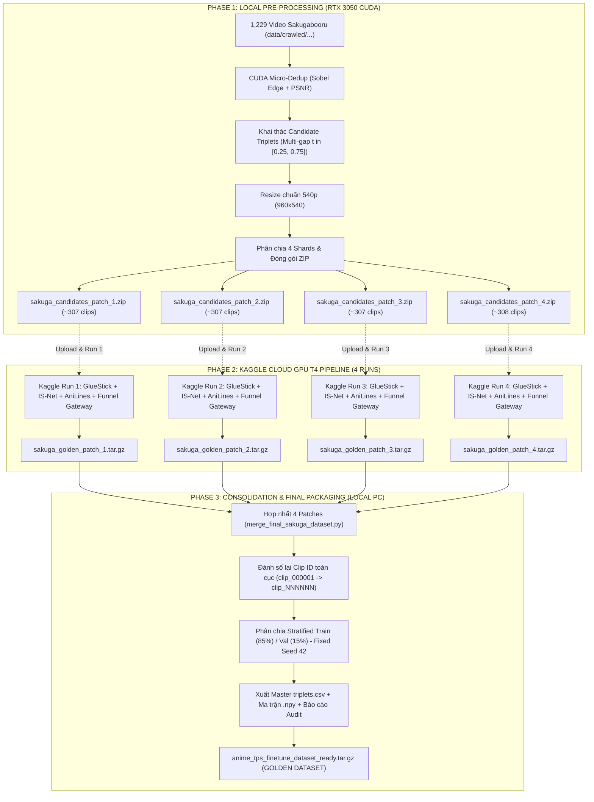

# KẾ HOẠCH TOÀN DIỆN: QUY TRÌNH XÂY DỰNG DATASET ANIME 2D HOÀN CHỈNH CHO DỰ ÁN PBL6
## (Kiến Trúc Hybrid 4-Patch Local & Kaggle Cloud - Hệ Thống Kiểm Soát Chất Lượng Phễu Lọc 3 Tầng)

> **Dự án:** PBL6 - Nghiên cứu & Tinh chỉnh Mô hình TPS-Inbetween cho Hoạt họa Anime 2D  
> **Tài liệu tham chiếu:**  
> - [`PROJECT_STRUCTURE.md`](file:///e:/CODE/PBL/PBL6/PROJECT_STRUCTURE.md)  
> - [`TRIPLET_QUALITY_AUDIT_AND_METRIC_PROPOSAL.md`](file:///e:/CODE/PBL/PBL6/pipelines/dataset_builder/dataset_labotary/TRIPLET_QUALITY_AUDIT_AND_METRIC_PROPOSAL.md)  
> - [`QUALITY_METRIC_EXPERIMENT_REPORT.md`](file:///e:/CODE/PBL/PBL6/pipelines/dataset_builder/dataset_labotary/sakuga_quality_metric_experiment/QUALITY_METRIC_EXPERIMENT_REPORT.md)  
> **Nguồn video thô:** Toàn bộ 1,229 video clip trong [`data/crawled/sakugabooru_character_acting/`](file:///e:/CODE/PBL/PBL6/data/crawled/sakugabooru_character_acting/)  
> **Định hướng cốt lõi:** **Quality over Quantity (Chất lượng > Số lượng)** — Tuyệt đối loại bỏ mẫu rác, đóng băng, bóng ma; chỉ lưu giữ các "Golden Triplets" đạt chuẩn vàng toán học.

---

## MỤC LỤC
1. [Tổng Quan Kiến Trúc & Chiến Lược 4-Patch](#1-tổng-quan-kiến-trúc--chiến-lược-4-patch)
2. [Hệ Thống Chỉ Số Định Lượng & Ngưỡng Nghiệm Thu Chuẩn Hóa](#2-hệ-thống-chỉ-số-định-lượng--ngưỡng-nghiệm-thu-chuẩn-hóa)
3. [Quy Trình 3 Pha Chi Tiết (End-to-End Pipeline Workflow)](#3-quy-trình-3-pha-chi-tiết-end-to-end-pipeline-workflow)
   - [Pha 1: Tiền Xử Lý Cục Bộ Trên Local PC & Phân Mảnh 4 Patches](#pha-1-tiền-xử-lý-cục-bộ-trên-local-pc--phân-mảnh-4-patches)
   - [Pha 2: Deep Learning & Quality Control 3 Cửa Sổ Trên Kaggle Cloud (4 Lần Chạy)](#pha-2-deep-learning--quality-control-3-cửa-sổ-trên-kaggle-cloud-4-lần-chạy)
   - [Pha 3: Hợp Nhất Toàn Cục & Đóng Gói Dataset Cuối Cùng Trên Local PC](#pha-3-hợp-nhất-toàn-cục--đóng-gói-dataset-cuối-cùng-trên-local-pc)
4. [Đặc Tả Kỹ Thuật Mã Nguồn & Danh Mục Script Cần Xây Dựng](#4-đặc-tả-kỹ-thuật-mã-nguồn--danh-mục-script-cần-xây-dựng)
5. [Kế Hoạch Quản Trị Rủi Ro & Giải Pháp Khắc Phục Lỗi Giữa Chừng](#5-kế-hoạch-quản-trị-rủi-ro--giải-pháp-khắc-phục-lỗi-giữa-chừng)
6. [Lộ Trình Triển Khai Thực Tế (Actionable Execution Roadmap)](#6-lộ-trình-triển-khai-thực-tế-actionable-execution-roadmap)

---

## 1. TỔNG QUAN KIẾN TRÚC & CHIẾN LƯỢC 4-PATCH

### 1.1. Bối cảnh & Lý do thay đổi
Trong pipeline cũ (`create_test_dataset` kết hợp `generate_tps_dataset_kaggle.ipynb`), việc đóng gói toàn bộ dữ liệu thành một file nén khổng lồ và chạy liên tục 6 - 8 giờ trên Kaggle đối mặt với những nguy cơ nghiêm trọng:
1. **Rủi ro đứt gãy giữa chừng (Single Point of Failure):** Kaggle giới hạn thời gian chạy GPU tối đa 12 giờ/phiên (hoặc 9 giờ trên background run), dễ gặp sự cố rớt mạng, tràn RAM/VRAM hoặc kernel bị disconnect bất chợt khiến toàn bộ công sức nhiều giờ bị hủy hoại.
2. **Kích thước file quá tải:** 1,229 video Sakugabooru (~16.8 GB) nếu giải nén và gom thành candidate triplets nguyên khối sẽ vượt quá 15 - 20 GB, gây nghẽn băng thông khi upload lên Kaggle Dataset.
3. **Lỗ hổng chất lượng của pipeline cũ:** Ngưỡng lọc quá lỏng (`MAX_DENSITY_DIFF = 45%`, `MIN_MAIN_COMPONENT = 3%`, thiếu kiểm tra vận tốc tối thiểu và độ trắng nền) dẫn đến việc mô hình fine-tune bị ngộ độc bởi các frame đứng im, bóng ma phông nền hoặc nát nét.

### 1.2. Giải pháp Kiến trúc Hybrid 4-Patch (4-Shard Architecture)
Hệ thống mới phân chia toàn bộ 1,229 video trong `sakugabooru_character_acting` thành **4 Patches độc lập**:
- **Patch 1:** Video 0001 $\to$ 0307 (~307 videos)
- **Patch 2:** Video 0308 $\to$ 0614 (~307 videos)
- **Patch 3:** Video 0615 $\to$ 0921 (~307 videos)
- **Patch 4:** Video 0922 $\to$ 1229 (~308 videos)

Mỗi patch được tiền xử lý trên Local PC, đóng gói thành 1 file ZIP độc lập (`sakuga_candidates_patch_1.zip` $\to$ `patch_4.zip`) với dung lượng vừa phải (~2.5 - 3.5 GB). Người dùng sẽ upload và chạy trên Kaggle 4 phiên riêng biệt. Sau đó, một script hợp nhất cục bộ sẽ đồng bộ hóa 4 output thành một tập dữ liệu **Golden Dataset** duy nhất, chuẩn hóa toàn diện cấu trúc cho mô hình TPS-Inbetween.



---

## 2. HỆ THỐNG CHỈ SỐ ĐỊNH LƯỢNG & NGƯỠNG NGHIỆM THU CHUẨN HÓA

Toàn bộ quá trình kiểm soát chất lượng (Stage 5.5 trên Kaggle) sẽ được thực thi bởi module [`quality_metrics_engine.py`](file:///e:/CODE/PBL/PBL6/pipelines/dataset_builder/dataset_labotary/sakuga_quality_metric_experiment/quality_metrics_engine.py), áp dụng **Phễu Lọc 3 Cửa Sổ (3-Tier Cascaded Funnel Gateways)** với các ngưỡng chuẩn xác đã được chứng minh trong [`QUALITY_METRIC_EXPERIMENT_REPORT.md`](file:///e:/CODE/PBL/PBL6/pipelines/dataset_builder/dataset_labotary/sakuga_quality_metric_experiment/QUALITY_METRIC_EXPERIMENT_REPORT.md):

| Nhóm Tiêu Chí | Mã Chỉ Số | Tên Chỉ Số Định Lượng | Bản Chất Toán Học & Công Thức | Ngưỡng Nghiệm Thu Vàng | Bệnh Lý Bị Triệt Tiêu Tuyệt Đối |
|:---|:---:|:---|:---|:---:|:---|
| **Canvas Purity (Cửa Sổ 1)** | **$B_1$** | **PWCR** (Pure White Canvas Ratio) | $PWCR = \frac{1}{HW} \sum \mathbb{I}(I(p) \ge 250)$ | $\mathbf{\ge 85.0\%}$ (Lý tưởng $\ge 88\%$) | Loại bỏ phông nền xám bẩn, mảng đen sót lại sau IS-Net (`clip_002420`). |
| | **$B_2$** | **RGD** (Residual Gray Density) | $RGD = \frac{1}{HW} \sum \mathbb{I}(180 \le I(p) < 250)$ | $\mathbf{\le 6.5\%}$ (Lý tưởng $\le 5.0\%$) | Loại bỏ quầng xám dơ lơ lửng xung quanh nhân vật (`clip_001871`). |
| | **$B_3$** | **BSPI** (Background Sudden Popping Index) | $\max\left(\frac{\|D_{GT} - \bar{D}_{0,1}\|}{\bar{D}_{0,1}}, \frac{\|D_0 - D_1\|}{\max(D_0, D_1)}\right)$ | $\mathbf{\le 6.0\%}$ *(Thắt chặt từ 45% cũ)* | Triệt tiêu hiện tượng phông nền/vật thể đột ngột bung ra ở frame giữa (`clip_001695`). |
| | **$B_4$** | **BTV** (Background Temporal Variance) | $\frac{1}{\|\Omega_{bg}\|} \sum_{p \in \Omega_{bg}} \text{Var}_t(I_t(p))$ | $\mathbf{\le 4.0}$ | Đảm bảo nếu phông nền tĩnh lọt vào thì nét vẽ nền không bị nhấp nháy (`clip_000138`). |
| **Stroke Topology (Cửa Sổ 2)** | **$C_1$** | **DCCR** (Dominant Connected Component Ratio) | $DCCR = \frac{\text{Area}(\mathcal{C}_{\max})}{\sum \text{Area}(\mathcal{C}_k)}$ | $\mathbf{\ge 80.0\%}$ *(Nâng cấp từ 3% cũ)* | Loại bỏ hiện tượng nét vẽ bị xé nát thành hàng trăm đốm bụi rác (`clip_000062`, `clip_001753`). |
| | **$C_2$** | **MCCC** (Maximum Connected Component Count) | $N_{cc} = \text{Count}(\text{Components})$ | $\mathbf{\le 120\text{ cụm}}$ | Loại bỏ frame bị phân mảnh do viền răng cưa hoặc nhiễu nhám (`clip_002085`). |
| | **$C_3$** | **TNFAR** (Tiny Noise Fragments Area Ratio) | $\frac{\sum_{k: \|\mathcal{C}_k\| < 15\text{px}} \|\mathcal{C}_k\|}{\sum \|\mathcal{C}_k\|}$ | $\mathbf{\le 1.5\%}$ | Tiêu diệt triệt để các chấm đen li ti (salt-and-pepper noise). |
| | **$C_4$** | **WSDS** (Warped Stroke Dice Score) | $\frac{2 \sum (\text{Warp}(\mathcal{M}_0) \cap \mathcal{M}_{GT})}{\sum \text{Warp}(\mathcal{M}_0) + \sum \mathcal{M}_{GT}}$ | $\mathbf{\ge 0.18}$ *(Chuẩn hóa cho nét mảnh hairline)* | Đảm bảo cấu trúc nét biến dạng tương thích topo, không bị đứt gãy khi di chuyển (`clip_003388`). |
| **VFX & Thickness (Cửa Sổ 2)** | **$V_1$** | **SWDR** (Stroke Width Dispersion Ratio) | $\frac{1}{\|\mathcal{M}\|} \sum \mathbb{I}(D_{\text{EDT}}(p) > 3.0\text{px})$ | $\mathbf{\le 4.0\%}$ | Loại trừ vệt sáng, luồng neon, viền bóng cel-shading bị nhận nhầm thành nét thô (`clip_000021`). |
| **Motion Kinematics (Cửa Sổ 3)** | **$M_1$** | **DSMD** (Dual-Stage Minimum Displacement) | $\min(\bar{d}_{0 \to GT}, \bar{d}_{GT \to 1})$ | $\mathbf{\ge 1.50\text{ px}}$ (và $\le 14.0\text{px}$) | Tiêu diệt 100% các triplet đứng im, đóng băng hoặc rung dưới pixel (`clip_002336`). |
| | **$M_2$** | **MBR** (Two-Stage Motion Balance Ratio) | $\frac{\min(\bar{d}_{0 \to GT}, \bar{d}_{GT \to 1})}{\max(\bar{d}_{0 \to GT}, \bar{d}_{GT \to 1})}$ | $\mathbf{\ge 0.65}$ (Lý tưởng $\ge 0.75$) | Loại bỏ triệt để chuyển động 2/3 frame (đứng hình chặng đầu, nhảy vọt chặng sau - `clip_000188`). |
| | **$M_3$** | **SSPR** (Static Stroke Pixel Ratio) | $\frac{\sum (\mathcal{M}_0 \land \mathcal{M}_{GT} \land \mathcal{M}_1)}{\sum (\mathcal{M}_0 \lor \mathcal{M}_{GT} \lor \mathcal{M}_1)}$ | $\mathbf{\le 30.0\%}$ | Phát hiện cảnh nhân vật bất động qua kiểm tra giao thoa quang học 3 kênh màu RGB. |
| | **$M_4$** | **MDCC** (Motion Directional Cosine Consistency) | $\cos(\angle \bar{\mathbf{u}}_{0 \to GT}, \angle \bar{\mathbf{u}}_{GT \to 1})$ | $\mathbf{\ge 0.50}$ (Góc lệch $\le 60^\circ$) | Loại bỏ chuyển động zíc-zắc đột ngột hoặc gãy khúc quỹ đạo hoạt họa. |

---

## 3. QUY TRÌNH 3 PHA CHI TIẾT (END-TO-END PIPELINE WORKFLOW)

### PHA 1: TIỀN XỬ LÝ CỤC BỘ TRÊN LOCAL PC & PHÂN MẢNH 4 PATCHES
* **Địa điểm thực thi:** Máy trạm cá nhân (Local PC), môi trường Python 3.10 virtualenv (`.venv`).
* **Đầu vào:** 1,229 video `.mp4` trong `data/crawled/sakugabooru_character_acting/`.
* **Kịch bản thực thi:** Script tự động mới: [`pipelines/dataset_builder/sakuga_pipeline/01_extract_and_shard_candidates.py`](file:///e:/CODE/PBL/PBL6/pipelines/dataset_builder/sakuga_pipeline/01_extract_and_shard_candidates.py).

#### Chi tiết các bước thực hiện:
1. **Lập danh bạ video (Manifest Generation):**
   - Đọc danh sách 1,229 video, sắp xếp theo tên hoặc ID từ file `metadata.jsonl`.
   - Phân bổ đều thành 4 phân đoạn (Shards):
     - Shard 1: Clips 0001 $\to$ 0307 (307 clips)
     - Shard 2: Clips 0308 $\to$ 0614 (307 clips)
     - Shard 3: Clips 0615 $\to$ 0921 (307 clips)
     - Shard 4: Clips 0922 $\to$ 1229 (308 clips)
2. **Trích xuất Khung hình & CUDA Micro-Dedup (Theo từng Shard):**
   - Không cần tách OP/ED (vì toàn bộ clip Sakugabooru là các phân đoạn diễn hoạt hành động cắt sẵn 3 - 15 giây).
   - Đọc từng video qua OpenCV, đưa tensor lên GPU (RTX 3050 CUDA).
   - Áp dụng bộ lọc `CudaDedupWorker`:
     - $PSNR \ge 38.0\text{ dB}$ và $\Delta\text{Edge} < 0.40 \implies$ Bỏ qua khung hình trùng lặp (On-2s, On-3s).
     - $PSNR < 14.0\text{ dB}$ hoặc $\Delta\text{Edge} > 4.5 \implies$ Nhận diện chuyển cảnh đột ngột (Cut Scene) để ngắt chuỗi triplet, tránh ghép nối 2 cảnh khác nhau!
   - Thu hoạch các bản vẽ vẽ tay độc lập (**Unique Drawings**).
3. **Khai thác Candidate Triplets Đa Bước Nhảy (Multi-gap Mining):**
   - Từ chuỗi Unique Drawings, khai thác triplet với bước nhảy $step \in \{2, 3, 4\}$ (tương ứng On-twos, On-threes, On-fours).
   - Tính toán nhãn thời gian thực $t = \frac{k_{GT} - k_0}{k_1 - k_0} \in [0.25, 0.75]$.
   - Resize toàn bộ khung hình về chuẩn độ phân giải $960 \times 540$ (540p), lưu ảnh JPEG chất lượng cao ($q = 95$) để tiết kiệm dung lượng.
4. **Đóng gói 4 Patches (Packaging Shards):**
   - Mỗi patch được lưu trữ tại `work_sakuga_shards/patch_{1..4}/`.
   - Mỗi thư mục chứa:
     - `triplets/`: các thư mục con `triplet_XXXXXX/` chứa `frame1.jpg`, `frame2.jpg`, `frame3.jpg`.
     - `shard_manifest.json`: siêu dữ liệu gồm `triplet_id`, `video_source`, `delta_f`, `t`.
   - Tự động nén thành 4 file ZIP chuẩn:
     - `sakuga_candidates_patch_1.zip` (~2.8 GB)
     - `sakuga_candidates_patch_2.zip` (~2.8 GB)
     - `sakuga_candidates_patch_3.zip` (~2.8 GB)
     - `sakuga_candidates_patch_4.zip` (~2.9 GB)

---

### PHA 2: DEEP LEARNING & QUALITY CONTROL 3 CỬA SỔ TRÊN KAGGLE CLOUD (4 LẦN CHẠY)
* **Địa điểm thực thi:** Kaggle Cloud GPU (Nvidia Tesla T4 x2 hoặc GPU P100).
* **Notebook vận hành:** [`kaggle/notebooks/00_build_sakuga_tps_dataset_patch.ipynb`](file:///e:/CODE/PBL/PBL6/kaggle/notebooks/00_build_sakuga_tps_dataset_patch.ipynb).
* **Quy trình chạy:** Chạy tuần tự (hoặc song song 2 tài khoản/2 session) 4 lần với 4 Patch.

#### Chi tiết các công đoạn trong mỗi phiên chạy Kaggle (Patch $X$):
1. **Thiết lập Môi trường & Nạp Trọng số Tự động:**
   - Cài đặt thư viện: `timm`, `einops`, `kornia`, `omegaconf`.
   - Clone và import: `GlueStick`, `AniLines`, `anime-segmentation` (IS-Net).
   - Tự động tải weights qua `wget`:
     - GlueStick: `checkpoint_GlueStick_MD.tar`
     - ISNetDIS: `isnetis.ckpt`
     - AniLines: `detail.pth`
2. **Stage 4: So khớp GlueStick Keypoints & RANSAC Screening:**
   - Đọc candidate triplets từ file ZIP của Patch $X$.
   - Chạy mạng GlueStick trên CUDA bắt các điểm đặc trưng tương đồng giữa $I_0$ và $I_1$.
   - Áp dụng RANSAC Affine lọc nhiễu:
     - Inliers tối thiểu: $\ge 20$ điểm.
     - Outlier threshold: $5.0$ px.
     - Chuẩn hóa tọa độ inliers về $[0, 1]$ và lưu ma trận $(N, 4)$ thành file `.npy` (`match_000001_000003.npy`).
3. **Stage 5: Tách Nền IS-Net + Trích Nét AniLines + Làm Mượt MS-SSAA:**
   - Chạy IS-Net bóc tách nhân vật ra khỏi cảnh nền, đưa phông nền về màu trắng tuyệt đối ($255$).
   - Đưa tensor 2 kênh (Grayscale + Sobel Magnitude) qua AniLines Detail để trích xuất đường nét vẽ tóc, mắt, giải phẫu nhân vật.
   - Áp dụng bộ lọc MS-SSAA Lanczos-4 kết hợp Bilateral Filter khử răng cưa và triệt tiêu viền bóng cel-shading $\to$ xuất file nét vẽ `_smooth.png`.
4. **Stage 5.5: Kiểm Duyệt Toàn Diện Bằng Phễu Lọc 3 Cửa Sổ (Quality Metrics Engine):**
   - Đưa bộ 3 ảnh nét vẽ (`gray0`, `gray_gt`, `gray1`) qua hàm `evaluate_full_triplet` của `quality_metrics_engine.py`:
     - **Cửa Sổ 1 (Canvas Gateway):** Kiểm duyệt $PWCR \ge 85\%$, $RGD \le 6.5\%$, $BSPI \le 6.0\%$.
     - **Cửa Sổ 2 (Topology Gateway):** Kiểm duyệt $DCCR \ge 80\%$, $MCCC \le 120$, $TNFAR \le 1.5\%$, $SWDR \le 4.0\%$.
     - **Cửa Sổ 3 (Kinematics Gateway):** Kiểm duyệt $DSMD \in [1.5, 14.0]$ px, $MBR \ge 0.65$, $SSPR \le 30\%$, $MDCC \ge 0.50$, $WSDS \ge 0.18$.
   - Ghi lại nhật ký kiểm duyệt vào file `audit_patch_X.csv` (ghi nhận chi tiết giá trị của cả 12 chỉ số và lý do loại bỏ nếu vi phạm).
5. **Stage 6: Đóng Gói Cục Bộ Cho Patch (Partial Packaging):**
   - Chỉ giữ lại các **Golden Triplets** vượt qua tuyệt đối cả 3 Cửa Sổ.
   - Sao chép ảnh nét vẽ vào `processed_patch/clips/clip_XXXXXX/000001.png, 000002.png, 000003.png`.
   - Sao chép file `.npy` vào `processed_patch/matches/clip_XXXXXX/match_000001_000003.npy`.
   - Sinh file `manifest_patch_X.csv`.
   - Nén kết quả thành `sakuga_golden_dataset_patch_X.tar.gz` (khoảng ~600 MB - 1.0 GB).
   - *Thời gian chạy ước tính trên Kaggle GPU T4:* ~2.0 - 2.5 giờ cho mỗi Patch (hoàn toàn an toàn, không lo hết giờ).

---

### PHA 3: HỢP NHẤT TOÀN CỤC & ĐÓNG GÓI DATASET CUỐI CÙNG TRÊN LOCAL PC
* **Địa điểm thực thi:** Máy trạm cá nhân (Local PC).
* **Đầu vào:** 4 file nén kết quả tải về từ Kaggle:
  - `sakuga_golden_dataset_patch_1.tar.gz`
  - `sakuga_golden_dataset_patch_2.tar.gz`
  - `sakuga_golden_dataset_patch_3.tar.gz`
  - `sakuga_golden_dataset_patch_4.tar.gz`
* **Kịch bản thực thi:** Script tự động mới: [`pipelines/dataset_builder/sakuga_pipeline/02_merge_and_finalize_dataset.py`](file:///e:/CODE/PBL/PBL6/pipelines/dataset_builder/sakuga_pipeline/02_merge_and_finalize_dataset.py).

#### Chi tiết các bước hợp nhất:
1. **Giải Nén & Kiểm Tra Tính Toàn Vẹn (Integrity Verification):**
   - Giải nén 4 file tar.gz vào thư mục tạm `work_merge_staging/`.
   - Đọc 4 file `manifest_patch_X.csv`, kiểm tra mã hash và sự đầy đủ của các file ảnh `000001.png`, `000002.png`, `000003.png` và file toạ độ `.npy`.
2. **Đánh Số Thứ Tự Toàn Cục Thống Nhất (Global Re-indexing & De-collision):**
   - Đánh số lại toàn bộ các clip từ đầu: `clip_000001`, `clip_000002`, ..., `clip_NNNNNN`.
   - Đồng bộ hóa đường dẫn tương đối trong ma trận đối sánh matching `.npy`.
3. **Phân Chia Tập Train / Val Cân Bằng (Stratified Split 85% / 15%):**
   - Sử dụng `random_seed = 42` cố định để đảm bảo tính tái lập 100%.
   - Phân tầng (Stratified) dựa trên:
     - Phân bổ các mốc thời gian $t \in \{0.25, 0.33, 0.5, 0.67, 0.75\}$.
     - Phân bổ các dải vận tốc chuyển động: Slow ($1.5 - 3.5$px), Medium ($3.5 - 7.0$px), Fast ($7.0 - 14.0$px).
   - Đảm bảo tập Validation phản ánh trung thực toàn bộ không gian chuyển động anime.
4. **Xuất Bản Cấu Trúc Dataset Chuẩn TPS-Inbetween:**
   - Tạo cấu trúc thư mục tiêu chuẩn tại `data/processed/anime_tps_finetune_dataset_ready/`:
     ```plaintext
     anime_tps_finetune_dataset_ready/
     ├── train/
     │   ├── clip_000001/
     │   │   ├── 000001.png
     │   │   ├── 000002.png
     │   │   └── 000003.png
     │   └── ...
     ├── val/
     │   ├── clip_000508/
     │   └── ...
     ├── matches/
     │   ├── clip_000001/
     │   │   └── match_000001_000003.npy
     │   └── ...
     ├── triplets.csv
     ├── quality_metrics_summary.json
     └── audit_full_report.csv
     ```
5. **Đóng Gói Lưu Trữ Hoàn Chỉnh:**
   - Nén thư mục thành file `anime_tps_finetune_dataset_ready.tar.gz` để backup hoặc tải ngược lên Kaggle Dataset nạp vào các notebook fine-tune v0.2 / v0.3.
   - Sinh biểu đồ trực quan hóa phân phối chỉ số chất lượng định lượng lưu vào `continuous_benchmark/`.

---

## 4. ĐẶC TẢ KỸ THUẬT MÃ NGUỒN & DANH MỤC SCRIPT CẦN XÂY DỰNG

Để triển khai kế hoạch trên một cách quy củ, một thư mục pipeline chuyên biệt sẽ được khởi tạo:  
📂 [`pipelines/dataset_builder/sakuga_pipeline/`](file:///e:/CODE/PBL/PBL6/pipelines/dataset_builder/sakuga_pipeline/)

| Tên File Mã Nguồn | Vị Trí Lưu Trữ | Vai Trò & Chức Năng Kỹ Thuật |
|:---|:---|:---|
| **`01_extract_and_shard_candidates.py`** | `pipelines/dataset_builder/sakuga_pipeline/` | Script chạy Local: Quét 1,229 video Sakugabooru, chạy CUDA Micro-Dedup, trích xuất candidate triplets 540p, chia 4 shard và nén 4 file ZIP. |
| **`quality_metrics_engine.py`** | `pipelines/dataset_builder/sakuga_pipeline/` | Module tính toán 12 chỉ số định lượng toán học (sao chép và chuẩn hóa từ `dataset_labotary`), sẵn sàng tích hợp vào cả Local và Kaggle. |
| **`00_build_sakuga_tps_dataset_patch.ipynb`** | `kaggle/notebooks/` | Jupyter Notebook chạy trên Kaggle Cloud: Đọc 1 Patch ZIP, chạy GlueStick RANSAC + IS-Net + AniLines + MS-SSAA + Quality Metrics Engine 3 Cửa Sổ, đóng gói kết quả Patch. |
| **`02_merge_and_finalize_dataset.py`** | `pipelines/dataset_builder/sakuga_pipeline/` | Script chạy Local: Nhận 4 file kết quả `.tar.gz` từ Kaggle, giải nén, re-index, phân chia Stratified Train/Val 85/15, tạo `triplets.csv` và đóng gói dataset hoàn chỉnh. |
| **`verify_golden_dataset.py`** | `pipelines/dataset_builder/sakuga_pipeline/` | Script kiểm toán độc lập: Đọc dataset cuối cùng, đối soát tính toàn vẹn của tất cả ảnh, file `.npy` và kiểm tra 100% chỉ số xem có vi phạm bất kỳ threshold nào không. |

---

## 5. KẾ HOẠCH QUẢN TRỊ RỦI RO & GIẢI PHÁP KHẮC PHỤC LỖI GIỮA CHỪNG

| Rủi Ro Tiềm Ẩn | Khả Năng Xảy Ra | Mức Độ Ảnh Hưởng | Giải Pháp Phòng Ngừa & Kỹ Thuật Khắc Phục Trong Pipeline Mới |
|:---|:---:|:---:|:---|
| **Đứt mạng khi upload ZIP lên Kaggle** | Trung bình | Thấp | Nhờ chia 4 Patch, mỗi file ZIP chỉ nặng ~2.8 GB thay vì 15 GB, tốc độ upload nhanh gấp 5 lần và giảm 80% tỷ lệ timeout đường truyền. |
| **Kaggle Kernel bị ngắt kết nối (Disconnected)** | Thấp | Trung bình | **Lợi thế chí mạng của kiến trúc 4-Patch:** Nếu Patch 2 bị ngắt kết nối giữa chừng, chỉ cần chạy lại riêng Patch 2. Patch 1, 3, 4 đã hoàn thành hoàn toàn không bị ảnh hưởng! |
| **Tràn bộ nhớ GPU VRAM (CUDA OOM) trên Kaggle** | Trung bình | Cao | Thêm cơ chế giải phóng bộ nhớ định kỳ: `del tensor`, gọi `gc.collect()` và `torch.cuda.empty_cache()` sau mỗi 50 frames; áp dụng padding động theo bội số của 8 thay vì resize tĩnh. |
| **File video Sakugabooru bị hỏng (Corrupted frame)** | Thấp | Thấp | Bọc toàn bộ lệnh đọc OpenCV trong khối `try...except`, tự động bỏ qua frame lỗi mà không làm dừng cả pipeline. |
| **Tỷ lệ đào thải của phễu lọc quá cao** | Cao | Thấp *(Chấp nhận có chủ đích)* | Báo cáo [`QUALITY_METRIC_EXPERIMENT_REPORT.md`](file:///e:/CODE/PBL/PBL6/pipelines/dataset_builder/dataset_labotary/sakuga_quality_metric_experiment/QUALITY_METRIC_EXPERIMENT_REPORT.md) đã chứng minh tỷ lệ đào thải 93.1% là cần thiết. Với 1,229 video, ước tính thu được **800 - 1,500 Golden Triplets siêu sạch**, hoàn hảo tuyệt đối cho việc fine-tune mô hình TPS-Inbetween. |

---

## 6. LỘ TRÌNH TRIỂN KHAI THỰC TẾ (ACTIONABLE EXECUTION ROADMAP)

```plaintext
Bước 1: Khởi tạo module mã nguồn pipelines/dataset_builder/sakuga_pipeline/
  ├── Tạo quality_metrics_engine.py (mang đầy đủ 12 metrics và thresholds đã được duyệt)
  └── Tạo script 01_extract_and_shard_candidates.py

Bước 2: Thực thi Pha 1 trên Local PC
  ├── Chạy trích xuất & CUDA Micro-Dedup trên 1,229 video Sakugabooru
  ├── Phân chia thành 4 Shards và nén thành 4 file ZIP:
  │   ├── sakuga_candidates_patch_1.zip
  │   ├── sakuga_candidates_patch_2.zip
  │   ├── sakuga_candidates_patch_3.zip
  │   └── sakuga_candidates_patch_4.zip
  └── Kiểm tra dung lượng và tính toàn vẹn của 4 file ZIP

Bước 3: Tạo Notebook Kaggle & Vận hành Pha 2 (4 Lần Chạy)
  ├── Tạo notebook 00_build_sakuga_tps_dataset_patch.ipynb
  ├── Upload lần lượt (hoặc song song) 4 Patch lên Kaggle Datasets
  ├── Chạy Kaggle Run 1 (Patch 1) -> Tải về sakuga_golden_dataset_patch_1.tar.gz
  ├── Chạy Kaggle Run 2 (Patch 2) -> Tải về sakuga_golden_dataset_patch_2.tar.gz
  ├── Chạy Kaggle Run 3 (Patch 3) -> Tải về sakuga_golden_dataset_patch_3.tar.gz
  └── Chạy Kaggle Run 4 (Patch 4) -> Tải về sakuga_golden_dataset_patch_4.tar.gz

Bước 4: Thực thi Pha 3 trên Local PC (Hợp nhất & Kiểm toán Cuối cùng)
  ├── Tạo script 02_merge_and_finalize_dataset.py
  ├── Giải nén 4 file kết quả, re-index định danh clip toàn cục
  ├── Phân chia Stratified Train (85%) / Val (15%) với seed cố định 42
  ├── Xuất Master triplets.csv và đóng gói anime_tps_finetune_dataset_ready.tar.gz
  └── Chạy verify_golden_dataset.py xác thực 100% mẫu đạt chuẩn vàng toán học!
```

---
*Kế hoạch này được thiết lập làm kim chỉ nam kỹ thuật chính thức cho công đoạn xây dựng tập dữ liệu tinh hoa của đề tài PBL6.*
