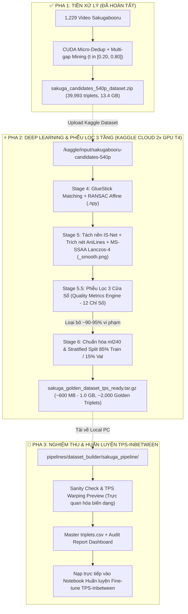

# 📋 KẾ HOẠCH CHI TIẾT: CÁC PHA TIẾP THEO CỦA QUY TRÌNH TẠO DATASET TRÊN KAGGLE CLOUD
## (Pha 2: Deep Learning & Phễu Lọc 3 Tầng Chuẩn Vàng ➔ Pha 3: Nghiệm Thu & Tinh Chỉnh TPS-Inbetween)

> **Dự án:** PBL6 - Nghiên cứu & Tinh chỉnh Mô hình TPS-Inbetween cho Hoạt họa Anime 2D  
> **Trạng thái hiện tại:** **Đã hoàn thành xuất sắc Pha 1!**  
> **Đầu vào sẵn có:** File [`sakuga_candidates_540p_dataset.zip`](file:///e:/CODE/PBL/PBL6/pipelines/dataset_builder/sakuga_pipeline/sakuga_candidates_540p_dataset.zip) (dung lượng 13.4 GB) chứa **39,993 Candidate Triplets** 540p ($960 \times 540$) và file chỉ mục `dataset_manifest.json` đã đánh sẵn 4 Shards (`shard_id: 1..4`, mỗi shard ~10,000 triplets).

---

## 🗺️ 1. TỔNG QUAN LỘ TRÌNH 3 PHA CÒN LẠI



---

## ⚡ 2. PHA 2: DEEP LEARNING & PHỄU LỌC 3 CỬA SỔ TRÊN KAGGLE CLOUD

### 2.1. Cấu hình Tài nguyên & Môi trường Kaggle
* **GPU Accelerator:** **GPU T4 x2** (Dual Tesla T4 16GB VRAM) hoặc GPU P100.
* **Thời gian chạy ước tính:** **~2.0 – 2.5 giờ** cho toàn bộ 39,993 triplets (hoàn toàn an toàn, chỉ chiếm 20% hạn mức 12 giờ của Kaggle).
* **Dung lượng ổ đĩa `/kaggle/working`:** **Cực kỳ an toàn (chỉ dùng ~1.0 GB)**!
  * *Tại sao?* Ở Pha 2, chúng ta áp dụng **Streaming Quality Gateway**: Ảnh chỉ được lưu lại khi triplet vượt qua thành công cả 3 Cửa Sổ kiểm duyệt. Khoảng 90-95% candidate bị loại bỏ sẽ không ghi ảnh xuống đĩa. Chỉ có ~1,500 – 2,500 Golden Triplets được ghi $\implies$ Dung lượng đĩa chỉ tốn **~600 MB - 1.0 GB**!

---

### 2.2. Chi tiết 4 Công đoạn của Pha 2

#### 🔹 Công đoạn 1: Stage 4 - GlueStick Keypoint Matching & RANSAC Screening
* **Mô hình AI:** `TwoViewPipeline` (GlueStick Checkpoint: `checkpoint_GlueStick_MD.tar`).
* **Kỹ thuật chống rò rỉ RAM:** Thay thế C-extension `pytlsd` bằng `cv2.createLineSegmentDetector` (OpenCV LSD C++ native) để triệt tiêu 100% hiện tượng tràn RAM.
* **Quy trình:**
  1. Đọc cặp frame $(I_0, I_1)$ từ candidate dataset.
  2. Bắt điểm đặc trưng kết hợp đường nét (lines & points).
  3. Lọc RANSAC Affine:
     - Số điểm inliers tối thiểu: $\ge 20$ cặp điểm.
     - Ngưỡng khoảng cách sai số: $5.0$ px.
     - Vận tốc tương đối: $\bar{d} \in [1.0, 15.0]$ px.
  4. Chuẩn hóa toạ độ inliers về khoảng $[0, 1]$ và lưu ma trận $(N, 4)$ thành file nhị phân `match_000001_000003.npy`.

#### 🔹 Công đoạn 2: Stage 5 - Tách Nền IS-Net + Trích Nét AniLines Detail + Làm Mượt MS-SSAA
* **Mô hình tách nền:** **ISNetDIS** (`isnetis.ckpt` - Anime Segmentation): Bóc tách triệt để nhân vật, ép phông nền về màu trắng tuyệt đối ($255$).
* **Mô hình trích nét:** **AniLines Detail** (`detail.pth`): Nhận đầu vào 2 kênh (Grayscale + Sobel Magnitude), trích xuất đường nét vẽ tóc, mắt, giải phẫu hairline siêu mảnh.
* **Bộ lọc hậu xử lý làm mịn:**
  - **MS-SSAA Lanczos-4** (Super-sampling 2x) kết hợp **Bilateral Filter**: Khử răng cưa, làm mịn nét, xóa sổ viền bóng đổ cel-shading và quầng xám dơ.
  - Xuất ra 3 ảnh nét vẽ mịn: `gray0_smooth.png`, `gray_gt_smooth.png`, `gray1_smooth.png`.

#### 🔹 Công đoạn 3: Stage 5.5 - Cổng Kiểm Duyệt Phễu Lọc 3 Tầng (Quality Metrics Engine)
* Tích hợp trực tiếp module toán học [`quality_metrics_engine.py`](file:///e:/CODE/PBL/PBL6/pipelines/dataset_builder/sakuga_pipeline/quality_metrics_engine.py) với **12 chỉ số chuẩn vàng**:
  1. **Cửa Sổ 1 (Canvas Purity Gateway):**
     - $PWCR \ge 85.0\%$ (Tỷ lệ nền trắng tinh khiết).
     - $RGD \le 6.5\%$ (Tỷ lệ pixel xám dơ sót lại).
     - $BSPI \le 6.0\%$ (Không bị đột biến phông nền ở frame giữa).
  2. **Cửa Sổ 2 (Stroke Topology & Hairline Gateway):**
     - $DCCR \ge 80.0\%$ (Tỷ lệ diện tích cụm nét chính).
     - $MCCC \le 120$ cụm (Không bị nát nét thành nhiều vụn rác).
     - $TNFAR \le 1.5\%$ (Không dính chấm đen muối tiêu).
     - $SWDR \le 4.0\%$ (Không bị nét vẽ quá dày hoặc vệt sáng vỡ).
  3. **Cửa Sổ 3 (Motion Dynamics & Kinematics Gateway):**
     - $DSMD \in [1.50, 14.0]$ px (Có chuyển động thực sự, không đứng hình).
     - $MBR \ge 0.65$ (Vận tốc 2 chặng cân bằng, triệt tiêu lỗi 2/3 frame).
     - $SSPR \le 30.0\%$ (Nét không bị đè trùng khít cả 3 frame).
     - $MDCC \ge 0.50$ (Góc chuyển động nhất quán $\le 60^\circ$).
     - $WSDS \ge 0.18$ (Độ tương thích biến dạng nét vẽ Warped Dice).
* **Ghi nhật ký:** Xuất file `quality_audit_report.csv` ghi nhận chi tiết 12 giá trị cho từng mẫu.

#### 🔹 Công đoạn 4: Stage 6 - Chuẩn Hóa Cấu Trúc ml240 & Đóng Gói
* Phân chia tập dữ liệu: **85% Train / 15% Validation** bằng Stratified Split với seed cố định `42` (đảm bảo phân bổ đều các mốc $t \in [0.20, 0.80]$).
* Định danh clip toàn cục: `clip_000001` $\to$ `clip_NNNNNN`.
* Cấu trúc đóng gói chuẩn của mô hình TPS-Inbetween:
  ```
  anime_tps_finetune_dataset_ready/
  ├── train/
  │   └── clip_XXXXXX/
  │       ├── 000001.png       (Frame 0 nét mịn)
  │       ├── 000002.png       (Frame GT nét mịn)
  │       └── 000003.png       (Frame 1 nét mịn)
  ├── val/
  │   └── clip_XXXXXX/
  │       ├── 000001.png
  │       ├── 000002.png
  │       └── 000003.png
  ├── matches/
  │   └── clip_XXXXXX/
  │       └── match_000001_000003.npy   (Tọa độ inliers [N, 4])
  ├── triplets.csv              (Master index đầy đủ metadata)
  └── quality_audit_report.csv  (Báo cáo nghiệm thu 12 chỉ số)
  ```
* Nén thành file duy nhất: `sakuga_golden_dataset_tps_ready.tar.gz` (~600 MB - 1.0 GB).

---

## 🎯 3. PHA 3: NGHIỆM THU CỤC BỘ & TÍCH HỢP HUẤN LUYỆN TPS-INBETWEEN

1. **Tải về Local PC:**
   - Người dùng tải file `sakuga_golden_dataset_tps_ready.tar.gz` từ Kaggle Output về thư mục `pipelines/dataset_builder/sakuga_pipeline/`.
2. **Kiểm tra tính toàn vẹn & Trực quan hóa (Sanity Check):**
   - Chạy script kiểm định:
     - Kiểm tra không có file rỗng/corrupted.
     - Hiển thị 5 mẫu ngẫu nhiên: Frame 0, Frame GT, Frame 1, ma trận điểm khớp GlueStick, và hình ảnh TPS Warped.
3. **Nạp vào quy trình Huấn Luyện Fine-tuning:**
   - Dữ liệu đã đúng 100% định dạng yêu cầu của `models/tps-inbetween`.
   - Sử dụng trực tiếp trong notebook `01_train_tps_inbetween_finetune_v0.1.ipynb` trên Kaggle hoặc huấn luyện trực tiếp trên GPU RTX 3050 cục bộ.

---

## ⚙️ 4. HAI KỊCH BẢN THỰC THI TRÊN KAGGLE (LINH HOẠT TỐI ĐA)

Chúng ta sẽ thiết kế Notebook Pha 2 hỗ trợ cả 2 kịch bản qua một biến cấu hình duy nhất:

```python
# CẤU HÌNH PHẠM VI XỬ LÝ (EXECUTION SCOPE)
PROCESS_SHARD = "ALL"   # Tùy chọn 1: "ALL" -> Chạy trọn vẹn toàn bộ 39,993 triplets (~2.0 giờ)
                        # Tùy chọn 2: 1, 2, 3, hoặc 4 -> Chạy riêng từng Shard (~35 phút/shard)
```

| Tiêu chí | Kịch bản 1: "ALL" (Khuyên dùng) | Kịch bản 2: Từng Shard riêng lẻ (Dự phòng) |
| :--- | :--- | :--- |
| **Cách chạy** | Bấm 1 lần chạy trọn vẹn toàn bộ dataset | Chạy 4 lần (mỗi lần 1 shard: 1, 2, 3, 4) |
| **Thời gian chạy** | ~2.0 - 2.5 giờ (Kaggle cho phép tới 12 giờ) | ~30 - 35 phút cho mỗi Shard |
| **Dung lượng Working Disk** | ~800 MB (Hoàn toàn không lo tràn đĩa) | ~200 MB cho mỗi Shard |
| **Số lần tải file** | Tải **1 file TAR.GZ duy nhất** là xong | Tải 4 file rồi dùng script nối lại |
| **Độ tiện lợi** | **Cao nhất (Tối ưu công sức người dùng)** | Phù hợp khi muốn thử nghiệm nhanh |

---

## 📋 5. DANH MỤC CÔNG VIỆC CẦN TRIỂN KHAI TIẾP THEO (ACTION CHECKLIST)

1. [ ] **Bước 1 (User thực hiện):** Tải file `sakuga_candidates_540p_dataset.zip` (13.4 GB) lên Kaggle Datasets (đặt tên dataset ví dụ: `sakuga-candidates-540p`).
2. [ ] **Bước 2 (Agent tạo code):** Xây dựng hoàn chỉnh Notebook Pha 2:
   - File: `kaggle/notebooks/01_process_sakuga_tps_dataset_kaggle.ipynb`.
   - Tích hợp trọn vẹn: GlueStick + IS-Net + AniLines + MS-SSAA + Quality Metrics Engine (12 chỉ số) + Đóng gói `triplets.csv` chuẩn ml240.
3. [ ] **Bước 3 (Agent tạo code):** Xây dựng script kiểm tra & nghiệm thu Pha 3 tại Local:
   - File: `pipelines/dataset_builder/sakuga_pipeline/02_verify_and_preview_golden_dataset.py`.
4. [ ] **Bước 4 (User thực hiện):** Chạy notebook trên Kaggle với GPU T4 x2 và tải về `sakuga_golden_dataset_tps_ready.tar.gz`.
