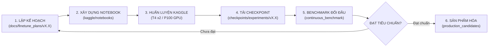

# QUẢN LÝ CÁC KẾ HOẠCH & PHIÊN BẢN HUẤN LUYỆN (FINETUNE PLANS & RUNS)

> **Mục tiêu:** Thư mục lưu trữ tập trung toàn bộ tài liệu quy hoạch, đặc tả kỹ thuật, kịch bản tạo notebook huấn luyện trên Cloud (Kaggle/Colab) và kế hoạch đánh giá đối chuẩn (Benchmark & Evaluation) cho từng đợt thử nghiệm tinh chỉnh (fine-tuning iterations) mô hình TPS-Inbetween.

---

## 1. QUY CHUẨN ĐẶT TÊN & PHÂN CHIA PHIÊN BẢN (VERSIONING)

Mỗi chu kỳ tinh chỉnh mô hình được đóng gói thành một thư mục phiên bản riêng biệt dạng `v{Major}.{Minor}`:
- `v0.1`: Thử nghiệm nền tảng đầu tiên trên tập dữ liệu đã lọc sạch `anime_tps_finetune_dataset_ready` (3,388 triplets), tập trung kiểm chứng pipeline huấn luyện, hàm mất mát kết hợp ($L_1 + \text{VGG} + \text{EDT}$) và kiểm soát triệt để hiện tượng tràn bộ nhớ (Out-Of-Memory) trên GPU Kaggle.
- `v0.2`: Mở rộng quy mô tập dữ liệu, tích hợp dữ liệu Sakugabooru biên độ chuyển động lớn hơn, tinh chỉnh trọng số mất mát EDT và thử nghiệm Unet architecture tweaks.
- `v0.3`: Tích hợp tầng Adaptive Stroke Fusion Head (ASF) và Gated Ghost Erasure (GGER) để triệt tiêu bóng ma, thay thế SciPy EDT bằng 100% PyTorch GPU Loss Engine để khắc phục triệt để lỗi reset kernel Kaggle Cell 10.
- `v1.0`: Phiên bản ứng viên sản phẩm (Production Candidate) đột phá toàn diện, chuyển sang sử dụng tập dữ liệu chuẩn vàng **`sakuga_golden_dataset_tps_ready.tar.gz`** (4,165 Golden Triplets từ 1,229 video Sakugabooru qua `sakuga_pipeline v2`), sẵn sàng đóng gói vào `checkpoints/production_candidates/` và tích hợp vào `product_app/`.
- `v2.0`: Thực nghiệm đối đầu kiểm chứng chiến lược khởi tạo trọng số (Warm-Start) trên Sakuga Golden Dataset V1 giữa Model V2.0.1 (từ TPS gốc) và Model V2.0.2 (từ v0.3 best). Kết quả V2.0.2 thắng áp đảo 90% số mẫu, giảm -32.88% ghosting và -60.25% Chamfer distance.
- `v2.1`: Nghiệm thu năng lực mô hình sau khi mở rộng quy mô dữ liệu với **Patch 2** (tăng từ 4,165 lên 6,734 triplets, tức +61.7% volume). Kế thừa checkpoint tốt nhất của V2.0 (`v2.0.2-best`) để finetune tiếp 30 epochs trên Sakuga Golden Dataset V1 + Patch 2.

---

## 2. CẤU TRÚC TIÊU CHUẨN CỦA MỖI THƯ MỤC PHIÊN BẢN

Mỗi thư mục phiên bản (ví dụ: `v1.0/`, `v2.1/`) bao gồm các tài liệu thành phần chuẩn hóa:

```plaintext
docs/finetune_plans/v1.0/
├── 01_finetune_plan_v1.0.md                           # Kế hoạch tổng thể: Mục tiêu, tập dữ liệu Sakuga Golden, kiến trúc ASF-GR & siêu tham số
├── 02_kaggle_notebook_plan_v1.0.md                    # Đặc tả kỹ thuật Notebook: Kiến trúc 12 cells, giải nén .tar.gz, tối ưu VRAM/RAM
├── 03_benchmark_testing_plan_v1.0.md                  # Kế hoạch đối chuẩn: Kịch bản đo đạc trên 620 mẫu Val & visual_samples, đối đầu 8 mô hình
└── 04_continuous_animation_reconstruction_plan_v1.0.md # Kế hoạch phục dựng phân cảnh liên tục: Kết xuất video MP4 24fps side-by-side kèm HUD
```

---

## 3. QUY TRÌNH VÒNG ĐỜI MỘT ĐỢT FINETUNE (LIFECYCLE PIPELINE)



1. **Giai đoạn 1 (Lập Kế hoạch):** Khởi tạo bộ tài liệu trong `docs/finetune_plans/vX.X/` xác định rõ mục tiêu cần khắc phục (ghosting, méo nét, độ ổn định thời gian $t$, phục dựng video).
2. **Giai đoạn 2 (Xây dựng Notebook):** Tạo file `.ipynb` tương ứng trong `kaggle/notebooks/`, áp dụng triệt để cơ chế tối ưu bộ nhớ và nạp dữ liệu chuẩn vàng.
3. **Giai đoạn 3 (Huấn luyện trên Cloud):** Đẩy dữ liệu và notebook lên Kaggle, kích hoạt GPU và giám sát quá trình hội tụ qua TensorBoard/Loss metrics.
4. **Giai đoạn 4 (Thu hoạch & Quản lý Trọng số):** Tải file checkpoint tối ưu (`best_val_psnr.pt`) về lưu trữ tại `checkpoints/experiments/vX.X/`.
5. **Giai đoạn 5 (Kiểm thử Đối chuẩn Toàn diện):** Chạy kịch bản benchmark theo kế hoạch, xuất báo cáo vào `continuous_benchmark/metrics/` và kiểm tra video/hình ảnh trực quan tại `continuous_benchmark/visual_audit/`.
6. **Giai đoạn 6 (Đóng gói Sản phẩm):** Nếu các chỉ số (PSNR, SSIM, Ghost Pixels, Tortuosity, TSI) vượt trội so với mô hình gốc, chuyển giao checkpoint vào `checkpoints/production_candidates/`.

---

## 4. BẢNG THEO DÕI CÁC PHIÊN BẢN HUẤN LUYỆN

| Phiên bản | Ngày khởi tạo | Trạng thái | Dataset chính | Mục tiêu trọng tâm | Checkpoint đích |
|:---:|:---:|:---:|:---|:---|:---|
| **v0.1** | 06/10/2026 | ❌ Thu hồi (Mode Collapse) | `anime_tps_finetune_dataset_ready` (3,388 triplets) | Phát hiện sụp đổ ảnh trắng (nền 255) do lỗi tọa độ warp, EDT đơn hướng và residual UNet âm cực đại | `checkpoints/experiments/v0.1/` (Revoked) |
| **v0.2** | 07/10/2026 | 🏆 Đạt chuẩn nghiệm thu v0.2 | `anime_tps_finetune_dataset_ready` (3,388 triplets) + `visual_samples` | Triệt tiêu hoàn toàn sụp đổ ảnh trắng (0.0%), Stroke Recall 89.7%, PSNR 21.05 dB (Val) & 24.53 dB (Samples) | `checkpoints/experiments/v0.2/model_tps_v0.2_best.pt` |
| **v0.3** | 07/10/2026 | 🚀 Hoàn tất kiến trúc ASF-GR | `anime_tps_finetune_dataset_ready` + Pretrained v0.2 | Triệt tiêu hiện tượng bóng ma (Ghosting), Adaptive Stroke Fusion Head, Gated Ghost Erasure, Pure GPU Loss Engine, khắc phục sự cố reset kernel Kaggle Cell 10 | `checkpoints/experiments/v0.3/model_tps_v0.3_best.pt` |
| **v1.0** | 15/10/2026 | 🌟 Sẵn sàng thực thi (Production Candidate) | `sakuga_golden_dataset_tps_ready.tar.gz` (4,165 Golden Triplets từ 1,229 video Sakugabooru) | Đột phá toàn diện: Hội tụ ASF-GR Engine trên dữ liệu chuẩn vàng quy mô lớn, triệt tiêu bóng ma (Ghost Pixels $< 5,000$ px), Stroke Recall $\ge 88\%$, PSNR $\ge 22.5$ dB, phục dựng mượt mà video hoạt hình 24fps | `checkpoints/production_candidates/model_tps_v1.0_production.pt` |
| **v2.0** | 18/10/2026 | ⚔️ Hoàn tất Đối đầu (V2.0.2 Thắng Áp Đảo) | `sakuga_golden_dataset_tps_ready` V1 (4,165 triplets: 3,545 train / 620 val) | Thực nghiệm đối đầu giữa V2.0.1 (từ Original) và V2.0.2 (từ v0.3 best). V2.0.2 thắng 90% số mẫu, giảm -32.88% ghosting, giảm -60.25% Chamfer distance | `checkpoints/experiments/v2.0/v2.0.2/tps_finetune_v2.0_artifacts/checkpoints_v1.1/model_tps_v2.0_best.pt` |
| **v2.1** | 19/10/2026 | ⚔️ Hoàn tất Benchmark V2.1 vs V2.0 vs Orig | `sakuga_golden_dataset_tps_ready_v1_patch2` (6,734 triplets: 5,727 train / 1,007 val) | Finetune tiếp từ V2.0.2 Best trên dataset mở rộng (+61.7% dữ liệu từ Patch 2). Đánh giá sự gia tăng về lượng dữ liệu ảnh hưởng đến khả năng tổng quát hóa và khử bóng ma | `checkpoints/experiments/v2.1/tps_finetune_v2.1_artifacts/checkpoints_v2.1/model_tps_v1.1_best.pt` |
| **v2.3** | 20/10/2026 | 🛡️ Hoàn tất Khử Ma Sâu & Numerical Stability | `sakuga_golden_dataset_tps_ready_v1_patch2` (6,734 triplets) | Khắc phục NaN loss, giảm -34.3% ghosting, nhưng Stroke Density bị tụt xuống 0.77x (nét hơi thanh) | `checkpoints/experiments/v2.3/tps_finetune_v2.3_artifacts/checkpoints_v2.3/model_tps_v2.3_best.pt` |
| **v2.4** | 21/10/2026 | 🎯 Hoàn tất Bảo tồn Nét Mảnh (Fine Stroke Preservation) | `sakuga_golden_dataset_tps_ready_v1_patch2` (6,734 triplets) | Nâng Stroke Recall lên 93.46%, giữ vững -34.2% ghosting, tuy nhiên Stroke Density phình lên 1.4580 | `checkpoints/experiments/v2.4/checkpoints_v2.4/model_tps_v2.4_best.pt` |
| **v2.5** | 22/10/2026 | ⚖️ Hoàn tất Exact-STE Density Calibration | `sakuga_golden_dataset_tps_ready_v1_patch2` (6,734 triplets) | Khóa chặt Stroke Density về 1.0101, -34.5% ghosting, 92.03% Recall, triệt tiêu 100% phình mực | `checkpoints/experiments/v2.5/checkpoints_v2.5/model_tps_v2.5_best.pt` |
| **v2.6** | 22/10/2026 | 🏆 Hoàn tất Visual Gold Standard Model Soup (Target 1.10x) | `sakuga_golden_dataset_tps_ready_v1_patch2` (100 Stratified Val Triplets) | Nội suy lồi hậu huấn luyện giữa V2.5 và V2.4, đạt chuẩn vàng Density 1.0999, giảm 90% số mẫu nét mỏng, Stroke Recall 92.42%, giảm -33.8% ghosting | `checkpoints/experiments/v2.6/checkpoints_v2.6/model_tps_v2.6_best.pt` |


