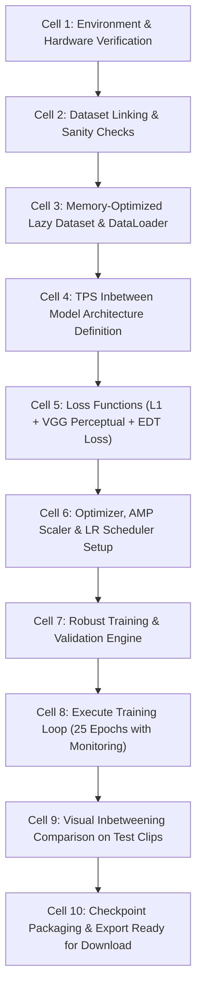

# ĐẶC TẢ KỸ THUẬT NOTEBOOK HUẤN LUYỆN KAGGLE v0.1 (KAGGLE NOTEBOOK SPECIFICATION)

> **Tài liệu tham chiếu:** Thiết kế chi tiết cấu trúc các Cells, giải pháp triệt tiêu rò rỉ bộ nhớ (Memory Leak Prevention) và cơ chế vận hành notebook huấn luyện mô hình TPS-Inbetween v0.1 trên môi trường Kaggle GPU.  
> **File Notebook tương ứng:** `kaggle/notebooks/01_train_tps_inbetween_finetune_v0.1.ipynb`

---

## 1. NGUYÊN TẮC THIẾT KẾ & BỐI CẢNH PHẦN CỨNG KAGGLE

Môi trường runtime của Kaggle sở hữu cấu hình:
- **GPU:** NVIDIA Tesla T4 (16 GB VRAM) hoặc Tesla P100 (16 GB VRAM).
- **CPU RAM:** 30 GB (chia sẻ chung với OS và các tiến trình con).
- **Bộ nhớ đĩa lưu trữ tạm thời (`/kaggle/working`):** Giới hạn tối đa **19.5 GB**.
- **Dataset Input (`/kaggle/input`):** Read-only, dung lượng không tính vào `/kaggle/working`.

### 1.1. Bảng Phân Tích 5 Nguy Cơ Tràn Bộ Nhớ & Giải Pháp Khắc Phục Triệt Để

| # | Nguy cơ tràn bộ nhớ | Nguyên nhân kỹ thuật | Giải pháp kỹ thuật áp dụng trong Notebook |
|:---:|:---|:---|:---|
| **1** | **CUDA OOM (GPU)** | Đưa cả batch ảnh $960 \times 540$ qua các tầng sâu của Unet (tới $32 \times c$ channels) cùng lúc với lưu trữ computational graph. | **Random Crop Patch $512 \times 512$** trong lúc train; chỉ dùng Full Frame $544 \times 960$ trong validation dưới cờ `@torch.no_grad()`. |
| **2** | **CUDA Activation Explosion** | Huấn luyện với độ chính xác chuẩn Float32 (32-bit) tiêu tốn gấp đôi VRAM lưu giữ activations trong backward pass. | Áp dụng **PyTorch AMP (Automatic Mixed Precision - FP16)** kết hợp `torch.cuda.amp.GradScaler()`. Tiết kiệm 50% VRAM activations. |
| **3** | **CPU RAM OOM (30 GB)** | Tiền tải toàn bộ 3,388 clip ảnh và file `.npy` vào bộ nhớ RAM (`pre_process=True` giống `ml240.py` nguyên bản) gây sập kernel. | **Lazy Dataset Loader (Đọc theo yêu cầu):** Chỉ lưu danh sách đường dẫn và metadata trong RAM; ảnh và file `.npy` chỉ nạp vào RAM khi worker gọi `__getitem__`. |
| **4** | **Graph Memory Leak** | Lưu biến tensor còn gradient vào danh sách lịch sử loss (ví dụ: `history.append(loss)`). | Luôn chuyển đổi tensor sang giá trị float thuần túy bằng `loss.item()` trước khi ghi log hoặc append vào danh sách. |
| **5** | **Disk Space Overflow** | Ghi checkpoint mỗi epoch vào `/kaggle/working` khiến đĩa 19.5 GB bị đầy sau 15-20 epochs. | **Cơ chế Checkpoint Rotator:** Chỉ giữ lại đúng `best_model.pt`, `latest_model.pt` và các mốc thập phân (epoch 10, 20). |

---

## 2. KIẾN TRÚC & CẤU TRÚC 10 KHỐI (CELLS) TRONG NOTEBOOK

Notebook được cấu trúc chặt chẽ thành 10 phần tuần tự, đảm bảo tính trực quan, tự kiểm tra lỗi (self-validating) và dễ theo dõi:

---

## 3. CHI TIẾT KỸ THUẬT TỪNG PHẦN CỦA NOTEBOOK

### 3.1. Cell 1 — Kiểm tra Môi trường & Thiết bị GPU
- Kiểm tra `torch.cuda.is_available()`, tên GPU, dung lượng VRAM thực tế.
- Bật cờ `torch.backends.cudnn.benchmark = True` để tối ưu tốc độ thuật toán convolution trên GPU NVIDIA.
- Thiết lập hạt giống ngẫu nhiên (Random Seed = 42) trên PyTorch, NumPy, Python để đảm bảo tính tái lập.

### 3.2. Cell 2 — Liên kết Dataset & Kiểm tra Toàn vẹn Dữ liệu
- Tự động nhận diện thư mục input của Kaggle:
  - Trường hợp 1: Dataset được upload trực tiếp dạng folder tại `/kaggle/input/anime-tps-finetune-dataset-ready/`.
  - Trường hợp 2: Dataset dạng file nén `.tar.gz` hoặc `.zip` được bung nén vào `/tmp/dataset/` (sử dụng RAM disk hoặc ổ tạm nhanh để không chiếm `/kaggle/working`).
- Đọc và kiểm tra file `triplets.csv`, in số lượng mẫu train (2,880) và val (508).

### 3.3. Cell 3 — Lớp `AnimeTPSLazyDataset` Tối ưu Bộ nhớ
- **Không bao giờ nạp toàn bộ ảnh vào RAM cùng lúc.**
- Mỗi mẫu chỉ đọc 3 file PNG ($I_0, I_{GT}, I_1$) bằng thư viện PIL hoặc OpenCV, chuyển sang Grayscale, chuẩn hóa dải giá trị $[0, 1]$ và đảo ngược màu (`1.0 - img` để nền trắng về 0, nét vẽ về 1).
- Đọc file tọa độ `match_000001_000003.npy` dạng `float32`.
- Trong chế độ `train`: Áp dụng **Random Spatial Crop** kích thước $512 \times 512$ đồng thời cho cả 3 ảnh và co dãn tương ứng tọa độ các điểm khớp TPS.
- Trong chế độ `val`: Pad ảnh lên kích thước chia hết cho 32 ($544 \times 960$).
- Thiết lập `DataLoader` với `num_workers=2`, `pin_memory=True`, `persistent_workers=True`.

### 3.4. Cell 4 — Kiến trúc Mô hình Tối ưu Hóa TPS-Inbetween
- Tái cấu trúc lớp `TPS_inbet` tương thích với `checkpoints/pretrained_baselines/tps-original/model_latest.pt`.
- **Đóng băng hoàn toàn:**
  - `Contextnet` (Feature encoder).
  - Khối giải nghiệm ma trận TPS (`tps_grid`, `tps_theta_from_points`) chạy hoàn toàn trong bối cảnh `@torch.no_grad()`.
- **Mở huấn luyện (trainable):**
  - `IFNet` (Motion Refinement).
  - `Unet` (Synthesis & Refinement).
- **Hỗ trợ Batch Arbitrary $t$:** Cải tiến forward pass để nhận vector thời gian $t \in \mathbb{R}^{B \times 1 \times 1 \times 1}$ cho phép mỗi mẫu trong batch có giá trị $t$ riêng biệt (như $t=0.25, 0.33, 0.5, 0.67$), loại bỏ vòng lặp chậm chạp qua từng $t$.

### 3.5. Cell 5 — Hàm Mất mát Chuyên biệt cho Line Art
- **EDT Loss:** Xây dựng hàm tính Euclidean Distance Transform bằng `scipy.ndimage.distance_transform_edt` hoặc torch, chuyển đổi trước trong CPU worker hoặc batch GPU để tạo lực kéo nét vẽ về đúng vị trí.
- **VGG Perceptual Loss:** Nạp VGG-16 `features[:16]` đặt chế độ `requires_grad=False`, đóng băng hoàn toàn.
- **Tổng hợp:**
  $$\mathcal{L} = \mathcal{L}_1(I_{\text{pred}}, I_{GT}) + 0.1 \cdot \mathcal{L}_{\text{VGG}}(I_{\text{pred}}, I_{GT}) + 0.4 \cdot \mathcal{L}_{\text{EDT}}(I_{\text{pred}}, I_{GT})$$

### 3.6. Cell 6 — Cấu hình Optimizer, Mixed Precision & Scheduler
- Khởi tạo `torch.cuda.amp.GradScaler()` cho FP16 mixed precision.
- Optimizer `AdamW` với 2 nhóm tham số riêng biệt:
  - Nhóm IFNet: `lr = 2e-5`, `weight_decay = 1e-4`.
  - Nhóm UNet: `lr = 5e-5`, `weight_decay = 1e-4`.
- Scheduler: `torch.optim.lr_scheduler.CosineAnnealingLR` với chu kỳ 25 epochs.

### 3.7. Cell 7 & 8 — Vòng lặp Huấn luyện & Đánh giá (Training & Validation Loop)
- **Gradient Accumulation:** Tích lũy gradient sau mỗi 2 steps (`loss = loss / accum_steps; scaler.scale(loss).backward()`).
- Sau mỗi epoch:
  - Chạy hàm validation trên toàn bộ 508 triplets của tập val.
  - Tính toán các chỉ số: `val_loss`, `val_psnr`, `val_ssim`, `val_ghost_pixels`.
  - So sánh với `best_val_psnr`: Nếu vượt trội, tự động lưu đè file `/kaggle/working/model_tps_v0.1_best.pt`.
  - Lưu checkpoint gần nhất `/kaggle/working/model_tps_v0.1_latest.pt`.
  - Gọi chủ động `torch.cuda.empty_cache()` và `gc.collect()` để dọn sạch bộ nhớ cache của GPU trước epoch tiếp theo.

### 3.8. Cell 9 — Trực quan hóa So sánh Nhanh (Visual Inspection)
- Tự động lấy 3 mẫu triplet đại diện trong tập validation (ví dụ $t=0.25, 0.50, 0.67$).
- Suy luận trực tiếp và vẽ biểu đồ matplotlib 4 cột:
  - Cột 1: Frame $I_0$ ($t=0.0$).
  - Cột 2: Frame Inbetween do mô hình vừa fine-tune sinh ra.
  - Cột 3: Frame Ground Truth thực tế ($I_{GT}$).
  - Cột 4: Bản đồ sai khác (Absolute Difference Heatmap).
- Lưu ảnh kết quả vào thư mục `/kaggle/working/visual_samples/`.

### 3.9. Cell 10 — Đóng gói Sản phẩm để Tải về (Export Packaging)
- Tạo file log huấn luyện `training_history.csv` chứa: epoch, train_loss, val_loss, val_psnr, val_ssim, learning_rate.
- Tự động nén các file quan trọng nhất thành `tps_inbetween_finetune_v0.1_results.zip`:
  - `model_tps_v0.1_best.pt`
  - `training_history.csv`
  - Thư mục `visual_samples/`
- Xuất liên kết tải trực tiếp từ giao diện Kaggle Output.

---

## 4. HƯỚNG DẪN TẢI & CHẠY TRÊN GIAO DIỆN KAGGLE

1. **Bước 1 (Tạo Dataset trên Kaggle):**
   - Nén thư mục `data/processed/anime_tps_finetune_dataset_ready` thành file `.zip`.
   - Vào mục **Datasets** trên Kaggle $\rightarrow$ Chọn **New Dataset** $\rightarrow$ Đặt tên `anime-tps-finetune-dataset-ready` $\rightarrow$ Upload file zip.
2. **Bước 2 (Tạo Notebook):**
   - Vào mục **Code** trên Kaggle $\rightarrow$ Chọn **New Notebook**.
   - Chọn Menu **File $\rightarrow$ Upload Notebook** $\rightarrow$ Tải file `kaggle/notebooks/01_train_tps_inbetween_finetune_v0.1.ipynb`.
3. **Bước 3 (Gán Tài nguyên):**
   - Mục **Settings (bên phải):**
     - **Accelerator:** Chọn **GPU T4 x2** hoặc **GPU P100**.
     - **Persistence:** Chọn **Variables and Files**.
     - **Internet:** Bật **ON** (để tải trọng số VGG).
   - Mục **Input (bên phải):**
     - Bấm **Add Input** $\rightarrow$ Tìm và thêm Dataset `anime-tps-finetune-dataset-ready`.
4. **Bước 4 (Kích hoạt Huấn luyện):**
   - Chọn **Run All** hoặc chọn **Save & Run All (Commit)** để notebook chạy ngầm trong nền không sợ mất kết nối mạng cá nhân.
