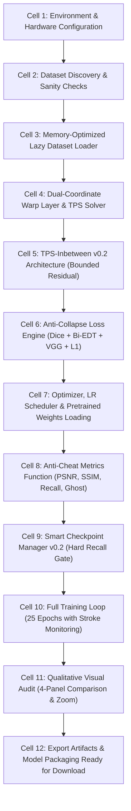

# ĐẶC TẢ KỸ THUẬT NOTEBOOK HUẤN LUYỆN KAGGLE v0.2 (KAGGLE NOTEBOOK SPECIFICATION)

> **Tài liệu tham chiếu:** Thiết kế chi tiết cấu trúc các Cells, giải pháp triệt tiêu rò rỉ bộ nhớ, tái cấu trúc Warp Layer và cơ chế chống sụp đổ chế độ (Anti-Blank-Collapse Engine) cho phiên bản v0.2.  
> **File Notebook tương ứng:** `kaggle/notebooks/02_train_tps_inbetween_finetune_v0.2.ipynb`

---

## 1. NGUYÊN TẮC THIẾT KẾ CỐT LÕI v0.2

Phiên bản v0.2 được thiết kế dựa trên các bài học sống còn từ v0.1:
1. **Phân tách Warp Layer:** Không dùng chung hàm `backward_warp` cho cả Coarse TPS (tọa độ $[0, 1]$) và Fine IFNet Flow (tọa độ pixel). Tách thành `warp_normalized_flow` và `warp_pixel_flow`.
2. **Khống chế Residual UNet:** Thay đổi $res = \text{Sigmoid} \times 2 - 1$ thành $res = \tanh(x) \times 0.15$ khởi tạo 0.
3. **Bộ Loss đa mục tiêu chống lười (Anti-Lazy Losses):**
   - $\mathcal{L}_{Dice}$ (Stroke Dice Loss): Phạt cực nặng khi mô hình không vẽ nét ($P = 0$).
   - $\mathcal{L}_{EDT\_bi}$ (Bidirectional EDT Loss): Phạt cả nét vẽ thừa lẫn nét vẽ thiếu.
   - $\mathcal{L}_{Density}$ (Stroke Density Conservation): Bảo toàn khối lượng nét vẽ.
4. **Giám sát trực tiếp Stroke Recall trong lúc Train:** In tỷ lệ % nét vẽ mô hình dự đoán theo từng batch.
5. **Rào chắn cứng trong SmartCheckpointManager:** Không bao giờ lưu checkpoint nếu Stroke Recall $< 70\%$.

---

## 2. KIẾN TRÚC 12 KHỐI (CELLS) TRONG NOTEBOOK v0.2

---

## 3. CHI TIẾT TỪNG CELL TRONG NOTEBOOK v0.2

### Cell 1: Cấu hình Môi trường, Thiết bị Phần cứng & Hạt giống Ngẫu nhiên
- Khởi tạo seed = 42, kiểm tra GPU CUDA (P100 / T4).
- Thiết lập `torch.backends.cudnn.benchmark = True`.

### Cell 2: Định vị & Kiểm tra Toàn vẹn Dữ liệu Dataset
- Nhận diện tự động `/kaggle/input/anime-tps-finetune-dataset-ready` hoặc file `.tar.gz`.
- Đọc `triplets.csv`, xác nhận 2,880 train và 508 val.

### Cell 3: Dataset & DataLoader Lazy Tối ưu Hóa Bộ nhớ Cực Hạn
- Đọc theo yêu cầu (`__getitem__`), chuyển đổi ảnh $1.0 - \text{array} / 255.0$ (nét đen = 1.0, nền trắng = 0.0).
- Random Crop $512 \times 512$ trong lúc train, Full-pad chia hết cho 32 trong validation.

### Cell 4: Hệ Thống Biến Dạng Lưới Hai Hệ Tọa Độ (Dual-Coordinate Warp Layer)
- `warp_normalized_flow`: Ánh xạ luồng TPS $[0, 1] \to [-1, 1]$.
- `warp_pixel_flow`: Ánh xạ luồng IFNet pixel chia $(W-1)/2, (H-1)/2$.
- `tps_flow_from_theta`: Giải TPS RBF với chunking bộ nhớ chống OOM.

### Cell 5: Kiến trúc Mô hình TPS-Inbetween v0.2 với Bounded Residual
- Khối `SynthesisUnet_v2`: Lớp conv cuối kết thúc với `tanh(x) * 0.15`.
- Trọng số và bias của conv cuối khởi tạo bằng 0 (`nn.init.zeros_`).
- Forward kết hợp:
  $$pred = \text{clamp}(base + res, 0.0, 1.0)$$

### Cell 6: Các Hàm Mất Mát Chống Sụp Đổ Chế Độ
- `StrokeDiceLoss`:
  $$\mathcal{L}_{Dice} = 1.0 - \frac{2 \sum (pred \cdot target) + 1e-5}{\sum pred^2 + \sum target^2 + 1e-5}$$
- `compute_bidirectional_edt_loss`:
  $$\mathcal{L}_{EDT\_bi} = \text{mean}(pred \times EDT_{target}^2) + \text{mean}(target \times EDT_{pred}^2)$$
- `VGGPerceptualLoss`: Trích xuất feature conv1_2 và conv2_2.
- `StrokeDensityLoss`:
  $$\mathcal{L}_{Density} = |\text{mean}(pred) - \text{mean}(target)|$$

### Cell 7: Thiết lập Optimizer, AMP Scaler & Nạp Trọng số Khởi Đầu
- Đóng băng Encoder `Contextnet`.
- Optimizer: AdamW với learning rate $1.5 \times 10^{-4}$, Cosine Annealing scheduler.
- Nạp trọng số pretrained baseline TPS gốc vào IFNet.

### Cell 8: Hàm Đo Lường Chỉ Số Chống Bẫy (Anti-Cheat Validation Metrics)
- `calculate_metrics_v2`:
  - `psnr`, `ssim`.
  - `stroke_recall`: Độ phủ nét trong bán kính 5px.
  - `chamfer_distance`: Phạt 1.0 nếu mất toàn bộ nét vẽ.
  - `ghost_pixels`: Đánh dấu -1 nếu ảnh bị trắng.

### Cell 9: Quản Lý Checkpoint Tự Động Thông Minh (Smart Checkpoint Manager v0.2)
- Rào chắn cứng: `stroke_recall >= 0.70`.
- Composite score xếp hạng:
  $$\text{Score} = \text{PSNR} + 20 \times \text{SSIM} + 25 \times \text{Recall} - 0.0002 \times \text{Ghost}$$
- Tự động lưu `model_tps_v0.2_best.pt` khi đạt kỷ lục mới hợp lệ.

### Cell 10: Vòng Lặp Huấn Luyện & Thẩm Định Hoàn Chỉnh (25 Epochs)
- Tích hợp `tqdm` với live postfix: `Loss`, `Dice`, `EDT`, `PredStroke%`, `GTStroke%`.
- Thẩm định toàn diện cuối mỗi epoch với bảng báo cáo tiến bộ.

### Cell 11: Kiểm Toán Trực Quan Định Tính & So Sánh Song Song
- Xuất 10 mẫu kiểm toán vào thư mục `visual_samples_v0.2/`:
  - Panel 1: Keyframe 0 (t=0.0)
  - Panel 2: Coarse TPS Warp
  - Panel 3: Finetuned v0.2 Output (đảm bảo nét vẽ đậm rõ)
  - Panel 4: Ground Truth

### Cell 12: Đóng Gói Thành Phẩm & Xuất File Tải Về Trực Tiếp
- Xuất `training_history_v0.2.csv`.
- Xuất file checkpoint `model_tps_v0.2_best.pt`.
- Tạo link tải trực tiếp trong Kaggle.
