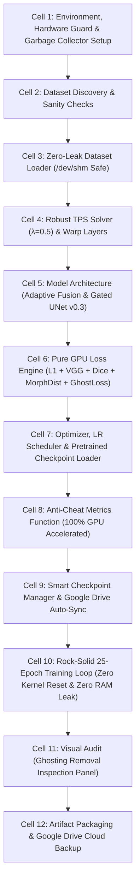

# ĐẶC TẢ KỸ THUẬT NOTEBOOK HUẤN LUYỆN KAGGLE v0.3 (KAGGLE NOTEBOOK SPECIFICATION)

> **Tài liệu tham chiếu:** Thiết kế chi tiết cấu trúc 12 Cells, cơ chế Zero-Leak GPU Loss Engine, tầng Adaptive Stroke Fusion và giải pháp triệt tiêu hiện tượng Kernel Reset cho phiên bản v0.3.  
> **File Notebook tương ứng:** `kaggle/notebooks/03_train_tps_inbetween_finetune_v0.3.ipynb`

---

## 1. NGUYÊN TẮC THIẾT KẾ CỐT LÕI v0.3

Phiên bản v0.3 giải quyết 2 bài toán song song: **Chất lượng thị giác (Khử Ghosting)** và **Kỹ thuật hạ tầng (Khắc phục Kernel Reset trên Kaggle Cloud)**:

1. **Khử rò rỉ RAM (Zero-Leak GPU-native Losses):**
   - Không sử dụng thư viện ngoài SciPy chạy trên CPU trong vòng lặp batch.
   - Thay thế hoàn toàn bằng các phép toán hình thái học PyTorch thực thi $100\%$ trên GPU (`F.max_pool2d` multi-scale dilation).
2. **Kiến trúc Adaptive Stroke Fusion & Gated Refinement (ASF-GR):**
   - Thay thế phép cộng tuyến tính cứng `(1-t)*I0 + t*I1` bằng tầng `AdaptiveStrokeFusionHead` dự đoán mặt nạ mềm $M \in [0, 1]$.
   - Mở khóa khả năng tẩy nét ma trong Synthesis UNet bằng nhánh `GhostEraserGate` kết hợp `DetailEnhancer`.
3. **Bộ nạp dữ liệu an toàn bộ nhớ chia sẻ (`/dev/shm`):**
   - Cấu hình `num_workers = 2`, `persistent_workers = True`, `pin_memory = True` và `prefetch_factor = 2` để đảm bảo không bao giờ tràn `/dev/shm` trên Kaggle.
4. **Bộ giải TPS chống suy biến ma trận (Singular Matrix Guard):**
   - Lọc bỏ keypoint trùng lặp $(\|c_i - c_j\| < 10^{-4})$, nâng $\lambda = 0.5$ bảo đảm tính xác định dương nghiêm ngặt của hệ phương trình TPS.
5. **Dọn rác bộ nhớ chủ động:**
   - Thực thi `torch.cuda.empty_cache()` và `gc.collect()` tự động sau mỗi epoch và sau mỗi đợt validation.

---

## 2. KIẾN TRÚC 12 KHỐI (CELLS) TRONG NOTEBOOK v0.3



---

## 3. CHI TIẾT TỪNG CELL TRONG NOTEBOOK v0.3

### Cell 1: Cấu hình Môi trường, Phần cứng & Trình Dọn Rác Chủ Động
- Thiết lập seed = 42, kiểm tra cấu hình Multi-GPU (NVIDIA T4 x2 hoặc P100).
- Kích hoạt `torch.backends.cudnn.benchmark = True`.
- Thiết lập hàm dọn dẹp bộ nhớ an toàn:
  ```python
  def cleanup_memory():
      gc.collect()
      torch.cuda.empty_cache()
  ```

### Cell 2: Định vị & Kiểm tra Toàn Vẹn Dữ liệu Dataset
- Tự động quét đường dẫn Kaggle Input: `/kaggle/input/anime-tps-finetune-dataset-ready` hoặc các thư mục tương đương.
- Đọc `triplets.csv`, kiểm tra số lượng mẫu (2,880 train và 508 val), kiểm tra độ sẵn sàng của thư mục `matches/`.

### Cell 3: Dataset & DataLoader Tối ưu Hóa `/dev/shm`
- Chuẩn hóa ảnh: đảo ngược dải màu $(1.0 - \text{array} / 255.0)$ để nét đen $= 1.0$, nền trắng $= 0.0$.
- Cắt ngẫu nhiên $512 \times 512$ cho training; padding chia hết cho 32 cho validation.
- Thiết lập DataLoader với các cờ bảo vệ tài nguyên Cloud:
  ```python
  num_workers = 2
  persistent_workers = True
  pin_memory = True
  prefetch_factor = 2
  ```

### Cell 4: Bộ Biến Dạng Lưới Hai Hệ Tọa Độ & Bộ Giải TPS Kháng Suy Biến
- `warp_normalized_flow`: Ánh xạ luồng TPS $[0, 1] \to [-1, 1]$.
- `warp_pixel_flow`: Ánh xạ luồng quang học IFNet chia $(W-1)/2, (H-1)/2$.
- `robust_tps_theta_from_points`:
  - Khử các điểm trùng lặp: loại bỏ điểm $j$ nếu khoảng cách $\|c_i - c_j\| < 1e-4$.
  - Tăng $\lambda = 0.5$ để $K + \lambda I$ luôn đối xứng xác định dương, chống lỗi `torch.linalg.solve` trên CUDA.

### Cell 5: Kiến trúc Mô Hình TPS-Inbetween v0.3 (ASF-GR Engine)
- **Khối `AdaptiveStrokeFusionHead`:**
  - Nhận `[fine_I0t, fine_I1t, flow_refine, t_tensor]`.
  - Dự đoán ma trận mặt nạ mềm $M \in [0, 1]$ qua Sigmoid.
  - Tính $\text{base\_interp} = M \odot \text{fine\_I0t} + (1 - M) \odot \text{fine\_I1t}$.
- **Khối `SynthesisUnet_v3`:**
  - Nhánh 1 (`conv_erase`): Khởi tạo bias = 2.0, qua Sigmoid tạo $G_{\text{erase}} \in [0, 1]$ (tẩy nét ma).
  - Nhánh 2 (`conv_add`): Khởi tạo 0, qua Sigmoid $\times 0.25$ tạo $R_{\text{add}}$ (tôn đậm nét chính).
  - Đầu ra: $\text{pred\_t} = \text{clamp}(G_{\text{erase}} \odot \text{base\_interp} + R_{\text{add}}, 0.0, 1.0)$.

### Cell 6: Bộ Hàm Mất Mát 100% PyTorch GPU Tensor (Zero-Leak Loss Engine)
1. $\mathcal{L}_{L1}$: Sai số trung bình tuyệt đối.
2. $\mathcal{L}_{VGG}$: VGG16 Perceptual Loss trên các feature layers.
3. $\mathcal{L}_{Dice}$: Stroke Dice Loss phạt triệt để việc mất nét.
4. $\mathcal{L}_{Morph\_Dist}$:
   - Tính toán trực tiếp trên GPU bằng `F.max_pool2d` với các kernel $\{3, 5, 9, 15\}$.
   - Thay thế hoàn toàn SciPy EDT, **0% rò rỉ RAM hệ thống**.
5. $\mathcal{L}_{Ghost}$:
   - $\text{mean}\left(\text{ReLU}(\text{pred} - 0.15) \odot (1.0 - \text{Dilate}(\text{GT}, 5))\right)$.
   - Phạt thẳng tay bất kỳ nét xám ma nào nằm ngoài vùng nét vẽ thực tế của Ground Truth.
6. $\mathcal{L}_{Density}$: Bảo toàn khối lượng mực vẽ.

### Cell 7: Bộ Tối Ưu Hóa, Lập Lịch Tốc Độ Học & Nạp Trọng Số Khởi Tạo
- Nạp checkpoint v0.2 tốt nhất (`model_tps_v0.2_best.pt`) làm trọng số khởi đầu để kế thừa toàn bộ khả năng vẽ nét sắc sảo, giúp v0.3 tập trung hội tụ vào nhiệm vụ khử bóng ma.
- `optimizer`: AdamW ($lr = 1.2 \times 10^{-4}$, weight_decay = $10^{-4}$).
- `scheduler`: CosineAnnealingLR ($T_{\max} = 25$, $\eta_{\min} = 10^{-5}$).
- `torch.amp.GradScaler('cuda')`.
- Hỗ trợ phân bổ Multi-GPU qua `nn.DataParallel` nếu có từ 2 GPU trở lên.

### Cell 8: Hàm Đo Lường Chỉ Số Đánh Giá Chống Bẫy v0.3 (100% Pure GPU Accelerated)
- Đo lường PSNR, SSIM, Stroke Recall, Ghost Pixels thực thi $100\%$ trên GPU PyTorch Tensor (`F.conv2d` Gaussian filter, `F.max_pool2d`).
- **Triệt tiêu hoàn toàn** việc chuyển tensor về CPU numpy và OpenCV float64 tính GaussianBlur, loại bỏ vĩnh viễn hiện tượng phân mảnh glibc heap gây tràn RAM máy chủ.
- Kiểm tra rào chắn sụp đổ ảnh trắng (Blank Collapse Detector).

### Cell 9: Quản Lý Checkpoint Tự Động & Đồng Bộ Google Drive (Smart Checkpoint Manager & GDrive Syncer)
- **Rào chắn kép:**
  1. $\text{Stroke Recall} \ge 75.0\%$ (Bảo đảm không bị sụp đổ trắng).
  2. $\text{Ghost Pixels} \le 12,000$ px (Bắt buộc phải giảm bóng ma so với v0.2).
- **Công thức xếp hạng kỷ lục mới:**
  $$\text{Score}_{v0.3} = \text{PSNR} + 20 \times \text{SSIM} + 30 \times \text{Recall} - 0.0005 \times \text{GhostPixels}$$
- **Hệ thống sao lưu dự phòng Google Drive Cloud (GDrive Backup Manager):**
  - Tự động phát hiện thư mục mount sẵn (`/content/drive/MyDrive/...`) hoặc kết nối qua Google Drive REST API / Service Account JSON / Kaggle Secrets.
  - Ngay khi phát hiện kỷ lục Best Epoch mới, tự động sao chép đồng thời `model_tps_v0.3_best.pt` và `model_tps_v0.3_latest.pt` lên Google Drive.
  - Cơ chế non-blocking: sự cố mạng hay API Google Drive không bao giờ làm gián đoạn hay crash tiến trình training.

### Cell 10: Vòng Lặp Huấn Luyện Vững Chắc (25 Epochs - Zero Kernel Reset & Zero RAM Leak)
- Cơ chế Gradient Accumulation $= 2$.
- Điều tiết hiển thị `tqdm.set_postfix` mỗi 10 batch để dập tắt độ trễ nghẽn đồng bộ CPU-GPU.
- Thu dọn bộ nhớ chủ động trước và sau mỗi đợt Validation:
  ```python
  cleanup_memory()  # Bao gồm gc.collect(), cuda.empty_cache(), và libc.malloc_trim(0)
  ```
- Tự động xuất và đồng bộ `training_history_v0.3.csv` liên tục qua từng epoch.
- Bọc khối `KeyboardInterrupt` bảo toàn trọng số tức thì nếu người dùng dừng sớm.

### Cell 11: Kiểm Toán Trực Quan Định Tính & Bằng Chứng Khử Bóng Ma
- Xuất 10 panel ảnh so sánh 4 cột vào `visual_samples_v0.3/`:
  - Panel 1: Keyframe 0 (t=0.0)
  - Panel 2: Coarse TPS Warp (Chứa bóng ma đối chứng)
  - Panel 3: Finetuned v0.3 (Đã khử sạch bóng ma)
  - Panel 4: Ground Truth

### Cell 12: Đóng Gói Thành Phẩm & Xuất File Tải Về Trực Tiếp (Kèm Backup GDrive Cuối)
- Xuất file checkpoint `model_tps_v0.3_best.pt`.
- Xuất file `training_history_v0.3.csv`.
- Nén toàn bộ `checkpoints_v0.3` thành file zip `tps_finetune_v0.3_artifacts.zip`.
- Đồng bộ toàn bộ gói artifacts hoàn chỉnh lên Google Drive của người dùng.
