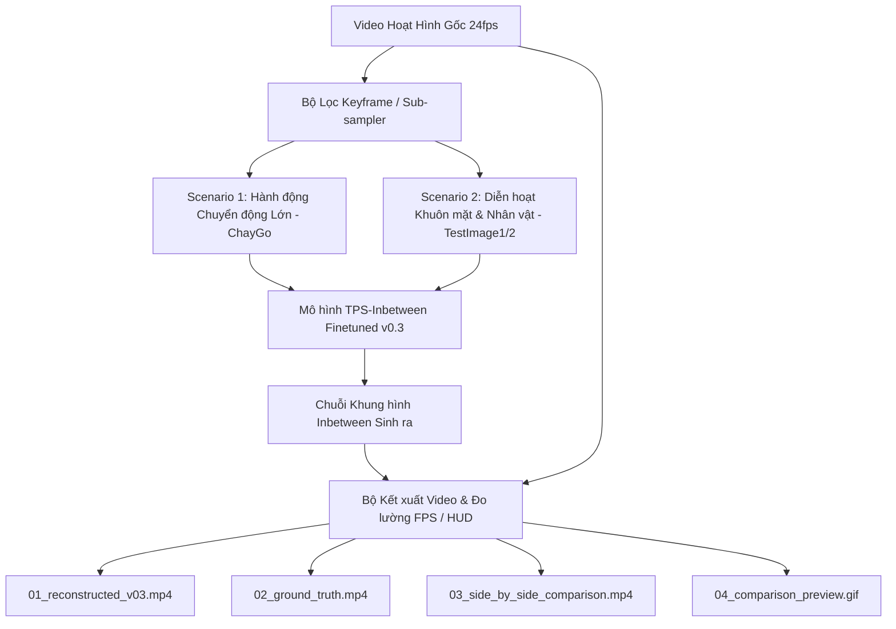

# KẾ HOẠCH BỔ SUNG BENCHMARK: PHỤC DỰNG PHÂN CẢNH CHUYỂN ĐỘNG NHÂN VẬT LIÊN TỤC (CONTINUOUS CHARACTER ANIMATION RECONSTRUCTION PLAN)

> **Mô hình Trọng tâm:** TPS-Inbetween (*Thin-Plate Spline-based Interpolation for Animation Line Inbetweening*)  
> **Phiên bản Áp dụng Khởi điểm:** v0.3 (ASF-GR Engine: Adaptive Stroke Fusion & Gated Refinement)  
> **Phạm vi Quy chuẩn:** Bắt buộc áp dụng cho toàn bộ các phiên bản finetune từ v0.3 trở về sau  
> **Trọng số Thực thi v0.3:** `checkpoints/experiments/v0.3/model_tps_v0.3_best.pt`  
> **Ngày khởi tạo:** 08/10/2026  
> **Tài liệu Liên kết:** [03_benchmark_testing_plan_v0.3.md](file:///e:/CODE/PBL/PBL6/docs/finetune_plans/v0.3/03_benchmark_testing_plan_v0.3.md), [tps_finetuned_v0.3_benchmark_report.md](file:///e:/CODE/PBL/PBL6/continuous_benchmark/metrics/tps-inbetween-finetuned-v0.3/tps_finetuned_v0.3_benchmark_report.md)

---

## 1. MỤC TIÊU VÀ BỐI CẢNH NÂNG CẤP QUY TRÌNH (CONTEXT & OBJECTIVES)

Trong các phiên bản benchmark trước đây (v0.1, v0.2), việc kiểm thử chủ yếu tập trung vào các **cặp khung hình tĩnh rời rạc (Discrete Triplets)** trong tập Validation (508 triplets) và một vài mẫu đơn lẻ của `visual_samples`. 

Tuy nhiên, trong quy trình sản xuất phim hoạt hình 2D thực tế (Anime Production Pipeline), mô hình AI không chỉ cần hoạt động tốt trên từng khung hình riêng lẻ mà phải đáp ứng được yêu cầu **tính nhất quán thời gian (Temporal Consistency)** và **độ mượt mà chuyển động thị giác (Visual Motion Fluidity)** khi phát lại ở tốc độ 24fps.

### Mục tiêu Cốt lõi của Hạng mục Mới:
1. **Kiểm thử Phục dựng Phân cảnh Liên tục (Continuous Sequence Reconstruction):**
   - Lọc ra các Keyframe (Genga - 原画) từ một đoạn phim hoạt hình gốc với bước nhảy thời gian thực tế ($\Delta t$).
   - Dùng mô hình finetune (khởi đầu với v0.3) để tự động nội suy phục dựng toàn bộ các In-between frame (Douga - 動画) bị lược bỏ.
   - Ghép nối tuần tự thành một đoạn phim ngắn hoàn chỉnh và đối chiếu trực tiếp với đoạn phim gốc.
2. **Triệt tiêu Hiện tượng Lũy kế Lỗi Thị giác (Error Accumulation Audit):**
   - Đánh giá xem khi chạy liên tục qua nhiều giây, mô hình có bị tích tụ nét thừa (Ghosting accumulation), giật cục đường nét (Line jittering), hay biến dạng hình thể nhân vật hay không.
3. **Sản phẩm Đo đạc Trực quan Side-by-Side (Comparative Video HUD):**
   - Kết xuất video MP4 chia đôi màn hình (Split-screen / Side-by-side) đồng bộ từng mili-giây kèm bảng thông số kỹ thuật thời gian thực (Real-time HUD Overlay) để người kiểm toán và đạo diễn hoạt hình có thể nhận xét trực quan.

---

## 2. LỰA CHỌN PHÂN CẢNH KIỂM THỬ CHUẨN (BENCHMARK TEST SCENES)

Quy trình sẽ chuẩn hóa 2 kịch bản phân cảnh nhân vật đặc trưng trong thư mục `data/test_sets/visual_samples/`:

### 2.1. Phân cảnh 1: Chuyển Động Thân Thể Biên Độ Lớn (Full-Body Action Motion - `ChayGo`)
- **Nguồn dữ liệu:** `data/test_sets/visual_samples/ChayGo.mp4` (854x480, 24fps).
- **Đặc trưng phân cảnh:** Nhân vật chạy nước rút, chuyển động chu kỳ chân tay và vạt áo có độ dịch chuyển pixel lớn ($> 5-15\text{ px}$).
- **Cấu hình trích lọc:**
  - Chọn phân cảnh tiêu biểu dài **3.0 - 5.0 giây** (~72 - 120 frames liên tục).
  - Tần suất trích xuất Keyframe: Lấy mỗi 3 frame hoặc 4 frame làm 1 Keyframe (mô phỏng nhịp vẽ hoạt hình "trên số 3" - *On Threes / 8fps keyframes* của ngành anime).
  - Mô hình có nhiệm vụ phục dựng 2-3 inbetween frames giữa mỗi cặp Keyframe để nâng tốc độ lên mượt mà 24fps.

### 2.2. Phân cảnh 2: Diễn Hoạt Khuôn Mặt & Biểu Cảm (Character Facial Acting - `TestImage1` / `TestImage2`)
- **Nguồn dữ liệu:** Chuỗi ảnh douga vẽ tay thực tế `F1` đến `F12` từ `data/test_sets/visual_samples/TestImage1` (1920x1080 / 850x480).
- **Đặc trưng phân cảnh:** Nhân vật quay đầu, mở to mắt, thay đổi khẩu hình miệng và các lọn tóc mảnh chuyển động phi tuyến tính.
- **Cấu hình trích lọc:**
  - Lấy các Keyframe mốc neo chính: $F_1, F_2, F_4, F_6, F_8, F_10, F_{12}$.
  - Mô hình phục dựng các frame chuyển tiếp: $F_3, F_5, F_7, F_9, F_{11}$ theo đúng mốc $t$ chuẩn ghi trong `time.txt`.

---

## 3. KIẾN TRÚC PIPELINE PHỤC DỰNG TỰ ĐỘNG (RECONSTRUCTION PIPELINE)

Quy trình phục dựng sẽ được tự động hóa qua script độc lập:
`continuous_benchmark/inference_scripts/run_continuous_scene_reconstruction.py`

### 3.1. Các bước xử lý trong Pipeline:
1. **Trích xuất & Tiền xử lý (Frame Extraction & Normalization):**
   - Đọc chuỗi frame gốc từ video hoặc thư mục ảnh, chuyển về không gian line art nhị phân nền trắng/nét đen $I \in [0, 1]$.
   - Padding kích thước ảnh về bội số của 32 (cho UNet/IFNet).
2. **Khớp nối Keypoint Thích Ứng (Adaptive Feature Matching):**
   - Sử dụng SIFT + RANSAC để tự động trích xuất các cặp điểm tương đồng ($c_0, c_1$) giữa 2 Keyframe liền kề.
   - Tối ưu hóa số lượng điểm neo tối đa (80 keypoints) để tránh suy biến hình học.
3. **Nội suy Bằng Động cơ v0.3 (ASF-GR Inference Engine):**
   - Tính toán biến dạng Coarse TPS với $\lambda = 0.5$ an toàn trên CPU float64.
   - Chạy IFNet tinh chỉnh dòng quang học.
   - Kích hoạt **Adaptive Stroke Fusion Head** để chọn dứt khoát 1 nét thay vì cộng mờ.
   - Kích hoạt **Gated Ghost Erasure Residual** để tẩy sạch nét ma thừa.
4. **Hậu xử lý & Kết xuất Khung hình (Frame Assembly):**
   - Chuyển tensor dự đoán về ảnh uint8 [0, 255].
   - Ghép lại các Keyframe gốc và các Inbetween frame được phục dựng theo đúng thứ tự thời gian.
5. **Bộ Kết xuất Video & HUD Thời gian thực (Video & HUD Compositor):**
   - Dùng OpenCV / ImageIO xuất các định dạng video MP4 (H.264, 24fps) và ảnh động GIF.
   - Thêm thanh thông số thời gian thực (HUD Header & Footer) lên video Side-by-side:
     - `Frame Index / Total Frames`
     - `Timestamp (giây)`
     - `Loại frame: [KEYFRAME (Gốc)] hoặc [INBETWEEN (v0.3 Phục dựng)]`
     - `PSNR (dB)` & `SSIM` tức thời tại frame đó
     - `Ghost Pixels` tức thời

---

## 4. HỆ THỐNG SẢN PHẨM ĐẦU RA KIỂM TOÁN (AUDIT DELIVERABLES)

Mỗi lần chạy benchmark phân cảnh liên tục cho một checkpoint (ví dụ `v0.3`), hệ thống sẽ xuất toàn bộ sản phẩm vào thư mục:
`continuous_benchmark/visual_audit/finetune_v0.3/continuous_reconstruction/`

| Tên File Sản Phẩm | Định dạng | Nội dung & Mục đích Sử dụng |
|:---|:---:|:---|
| **`01_reconstructed_v03.mp4`** | MP4 (24fps) | Toàn bộ phân cảnh được phục dựng bởi mô hình v0.3 |
| **`02_ground_truth.mp4`** | MP4 (24fps) | Phân cảnh gốc đối chứng thực tế của họa sĩ |
| **`03_side_by_side_comparison.mp4`** | MP4 (24fps) | Video đối chiếu song song: Trái (Gốc) - Phải (v0.3) kèm HUD real-time |
| **`04_three_way_comparison.mp4`** | MP4 (24fps) | Đối chiếu 3 cột: Gốc vs Coarse TPS vs v0.3 (Chứng minh khử bóng ma) |
| **`05_comparison_preview.gif`** | GIF động | Ảnh GIF preview nhanh phân cảnh hành động để nhúng vào báo cáo |
| **`reconstruction_metrics.csv`** | CSV | Log chi tiết thông số từng frame trong toàn bộ phân cảnh |
| **`CONTINUOUS_RECONSTRUCTION_REPORT.md`** | Markdown | Báo cáo phân tích chuyên sâu chất lượng chuyển động toàn chuỗi |
| **`frames_reconstructed/`** | Thư mục PNG | Toàn bộ các frame ảnh tuần tự được mô hình sinh ra |
| **`frames_ground_truth/`** | Thư mục PNG | Toàn bộ các frame ảnh tuần tự gốc |

---

## 5. BỘ CHỈ SỐ ĐÁNH GIÁ CHẤT LƯỢNG CHUYỂN ĐỘNG LIÊN TỤC

Bên cạnh các chỉ số frame đơn lẻ, bổ sung các chỉ số chuyên biệt cho chuyển động video:

1. **PSNR & SSIM Trung Bình Toàn Chuỗi:**
   - $\text{PSNR}_{\text{avg}} \ge 20.0\text{ dB}$, $\text{SSIM}_{\text{avg}} \ge 0.880$.
2. **Độ Biến Thiên Chất Lượng Thời Gian (Temporal Stability Index - TSI):**
   $$\sigma_{\text{PSNR}} = \sqrt{\frac{1}{N}\sum_{i=1}^N (\text{PSNR}_i - \text{PSNR}_{\text{avg}})^2}$$
   - Độ lệch chuẩn $\sigma_{\text{PSNR}} \le 2.0\text{ dB}$, chứng minh mô hình không bị "nhấp nháy" chất lượng giữa các frame liên tiếp.
3. **Tỷ Lệ Giảm Bóng Ma Tích Lũy (Cumulative Ghosting Reduction):**
   - Tổng lượng `Ghost Pixels` trên toàn bộ video giảm $\ge 25\%$ so với TPS Coarse Warp.
4. **Tỷ Lệ Sụp Đổ Trắng Toàn Chuỗi (Blank Collapse Rate):**
   - **Bắt buộc 0.0% (0 frame trắng trên toàn bộ video)**.
5. **Tốc Độ Xử Lý Toàn Phân Cảnh (Rendering Speed):**
   - Đạt $\ge 15 - 20\text{ FPS}$ trên GPU RTX 3050, cho phép render một phân cảnh 5 giây trong vòng chưa đầy 6-8 giây.

---

## 6. LỘ TRÌNH THỰC HIỆN CHI TIẾT (IMPLEMENTATION CHECKLIST)

- [ ] **Giai đoạn 1: Chuẩn bị & Phê duyệt Kế hoạch** (Bước hiện tại).
  - Lấy ý kiến phản hồi và phê duyệt từ người dùng.
- [ ] **Giai đoạn 2: Lập trình Script Benchmark Phục Dựng Chuyên Dụng**
  - Viết file `continuous_benchmark/inference_scripts/run_continuous_scene_reconstruction.py`.
  - Hỗ trợ tham số dòng lệnh tùy chọn video đầu vào, bước nhảy keyframe, checkpoint mô hình, kích thước render, cấu hình HUD.
- [ ] **Giai đoạn 3: Thực thi Phục Dựng Phân Cảnh Nhân Vật với Checkpoint v0.3**
  - Chạy trên môi trường ảo `.venv` dùng GPU RTX 3050.
  - Phục dựng phân cảnh nhân vật chạy `ChayGo` và phân cảnh diễn hoạt `TestImage1`.
- [ ] **Giai đoạn 4: Kết xuất Video Đối Chiếu Side-by-Side & Báo Cáo**
  - Xuất các file MP4 (Gốc, v0.3, Side-by-Side với HUD, Three-Way).
  - Tạo file GIF động và bảng CSV số liệu chi tiết.
  - Viết tài liệu báo cáo nghiệm thu phục dựng `CONTINUOUS_RECONSTRUCTION_REPORT.md`.
- [ ] **Giai đoạn 5: Chuẩn hóa Quy trình Cho Các Checkpoint Kế Tiếp (v0.4+)**
  - Cập nhật hướng dẫn benchmark chung để mọi checkpoint sau này đều tự động chạy kèm module phục dựng phân cảnh liên tục.
