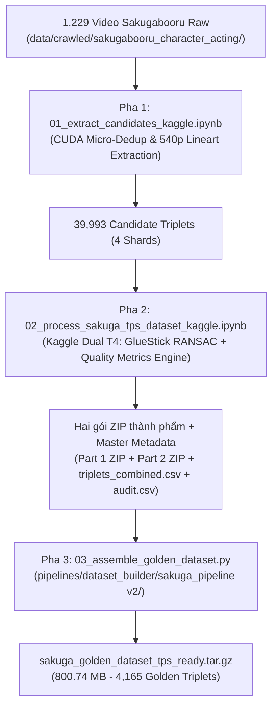
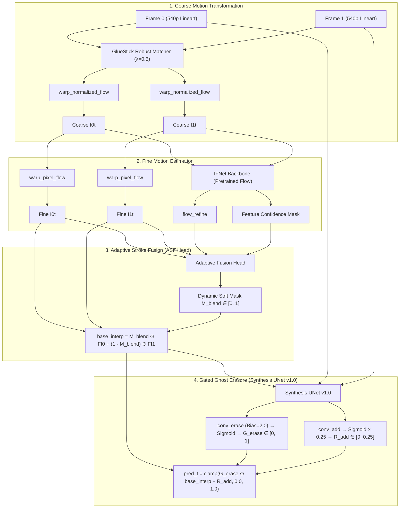
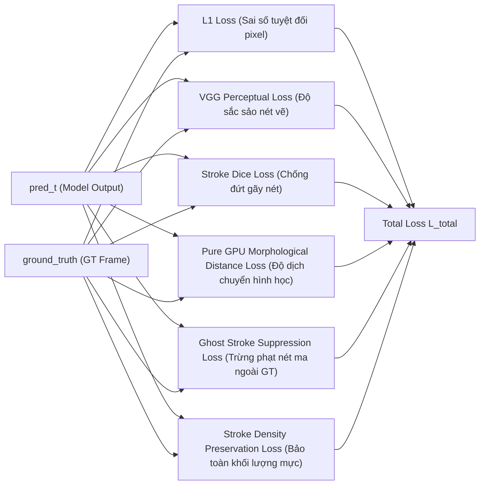

# KẾ HOẠCH HUẤN LUYỆN TINH CHỈNH PHIÊN BẢN V1.0 (FINETUNE PLAN V1.0)
> **Mô hình Trọng tâm:** TPS-Inbetween (*Thin-Plate Spline-based Interpolation for Animation Line Inbetweening*)  
> **Phiên bản:** V1.0 (Sakuga Golden Production Candidate - Zero Ghosting & Production Ready)  
> **Nền tảng Huấn luyện:** Kaggle Cloud GPU (NVIDIA Tesla T4 x2 Dual-GPU hoặc P100 16GB VRAM)  
> **Tập Dữ Liệu Nền Tảng:** `sakuga_golden_dataset_tps_ready.tar.gz` (Trích xuất từ 1,229 video Sakugabooru qua `sakuga_pipeline v2`)  
> **Ngày khởi tạo:** 15/10/2026  
> **Kế thừa & Nâng cấp từ:** [01_finetune_plan_v0.3.md](file:///e:/CODE/PBL/PBL6/docs/finetune_plans/v0.3/01_finetune_plan_v0.3.md), [01_finetune_plan_v0.2.md](file:///e:/CODE/PBL/PBL6/docs/finetune_plans/v0.2/01_finetune_plan_v0.2.md) và kết quả vận hành của `sakuga_pipeline v2`.

---

## 1. BỐI CẢNH & BƯỚC CHUYỂN MÌNH CHIẾN LƯỢC TỪ v0.3 LÊN V1.0

### 1.1. Tổng kết Vòng đời Thử nghiệm Nền tảng (v0.1 → v0.3)
Quy trình nghiên cứu và tối ưu hóa TPS-Inbetween đã trải qua 3 đợt huấn luyện bản lề:
1. **Phiên bản v0.1:** Phát hiện và lập hồ sơ hiện tượng **Sụp đổ chế độ (Mode Collapse - ảnh trắng 100%)** do lỗi bất đối xứng trong hàm khoảng cách EDT đơn hướng, sai lệch hệ tọa độ Coarse Warp và residual UNet âm cực đại.
2. **Phiên bản v0.2:** Triệt tiêu hoàn toàn sụp đổ ảnh trắng (Blank Collapse = 0.0%), khôi phục nét vẽ chuẩn xác (Stroke Recall 89.7%), nhưng bộc lộ hiện tượng **Bóng ma chồng hình (Ghosting Artifacts)** tương đương TPS Coarse do phép hòa trộn tuyến tính cứng `(1-t)*I0 + t*I1` và biên độ UNet bị khóa cứng trong khoảng $\pm 0.15$.
3. **Phiên bản v0.3:** Đột phá về kiến trúc với động cơ **ASF-GR (Adaptive Stroke Fusion & Gated Refinement)**, bộ hàm mất mát **100% PyTorch GPU Loss Engine** (loại bỏ hoàn toàn rò rỉ RAM của SciPy C-lib), bộ giải TPS an toàn và giải quyết triệt để lỗi **Reset Kernel Kaggle Cell 10**.

Tuy nhiên, toàn bộ các phiên bản tiền nghiệm (v0.1 – v0.3) đều bị giới hạn bởi tập dữ liệu cũ `anime_tps_finetune_dataset_ready` (3,388 triplets) với mật độ chuyển động thấp, số lượng video gốc hạn chế và chưa có phễu lọc chất lượng toán học đa chiều.

### 1.2. Mục tiêu Trọng tâm của Phiên bản V1.0 (Production Release Candidate)
Phiên bản V1.0 đánh dấu bước chuyển mình mang tính quyết định: **Đưa TPS-Inbetween trở thành mô hình sản phẩm hoàn thiện (Production Ready)** bằng cách kết hợp động cơ kiến trúc mạnh mẽ nhất (ASF-GR Engine) với bộ dữ liệu chuẩn vàng quy mô lớn nhất từng được xây dựng:
- **Tập dữ liệu chuẩn vàng Sakuga Golden Dataset:** Sử dụng file lưu trữ nén [`sakuga_golden_dataset_tps_ready.tar.gz`](file:///e:/CODE/PBL/PBL6/data/processed/sakuga_golden_dataset_tps_ready.tar.gz) (800.74 MB) được tạo ra từ pipeline mới trong thư mục [`sakuga_pipeline v2`](file:///e:/CODE/PBL/PBL6/pipelines/dataset_builder/sakuga_pipeline%20v2/).
- **Quy mô dữ liệu vượt trội:** **4,165 Golden Triplets** chất lượng cao (3,545 train + 620 val, 12,495 frames 540p lineart) chắt lọc từ **1,229 video Sakugabooru raw character acting** qua phễu lọc 3 tầng nghiêm ngặt (CUDA Micro-Dedup $\to$ GlueStick RANSAC $\to$ Quality Metrics Engine 12 chỉ số).
- **Độ đa dạng chuyển động thực tế:** Mở rộng biên độ dịch chuyển pixel ($\text{mean\_disp} \in [0.5, 15.0+]\text{ px}$), đa dạng hóa mốc thời gian nội suy ($t \in [0.15, 0.85]$, bao gồm $t=0.25, 0.33, 0.40, 0.50, 0.67, 0.75$), tái hiện hoàn hảo nhịp điệu hoạt hình Nhật Bản (*On Twos, On Threes*).
- **Hội tụ đỉnh cao:** Huấn luyện Warm-Start từ checkpoint tốt nhất của v0.3 (`model_tps_v0.3_best.pt`) trên tập Sakuga Golden Dataset trong 30 Epochs, tạo ra checkpoint đích `checkpoints/production_candidates/model_tps_v1.0_production.pt` sẵn sàng chuyển giao cho ứng dụng `product_app/`.

---

## 2. PHÂN TÍCH ĐẶC TÍNH TẬP DỮ LIỆU SAKUGA GOLDEN DATASET (TPS-READY)

Tập dữ liệu mới được đóng gói độc lập trong file nén [`sakuga_golden_dataset_tps_ready.tar.gz`](file:///e:/CODE/PBL/PBL6/data/processed/sakuga_golden_dataset_tps_ready.tar.gz) tại thư mục `data/processed/`.



### 2.1. Cấu trúc Bên trong File Nén `sakuga_golden_dataset_tps_ready.tar.gz`
Khi giải nén trên máy trạm hoặc môi trường Kaggle Cloud, toàn bộ dữ liệu nằm gọn trong thư mục gốc chuẩn hóa `anime_tps_finetune_dataset_ready/`:

```plaintext
sakuga_golden_dataset_tps_ready.tar.gz
└── anime_tps_finetune_dataset_ready/
    ├── train/                                    # 3,545 clips huấn luyện (10,635 frames 540p PNG)
    │   ├── clip_000001/
    │   │   ├── 000001.png                        # Frame 0 (t=0.0)
    │   │   ├── 000002.png                        # Frame GT (t_target)
    │   │   └── 000003.png                        # Frame 1 (t=1.0)
    │   └── ...
    ├── val/                                      # 620 clips thẩm định (1,860 frames 540p PNG)
    │   ├── clip_000008/
    │   │   ├── 000001.png
    │   │   ├── 000002.png
    │   │   └── 000003.png
    │   └── ...
    ├── matches/                                  # 4,165 ma trận tọa độ điểm khớp GlueStick .npy
    │   ├── clip_000001/
    │   │   └── match_000001_000003.npy           # Mảng numpy shape (2, N, 2) chuẩn hóa [0, 1]
    │   └── ...
    ├── triplets.csv                              # Master Index định tuyến 4,165 triplets
    ├── triplets_combined.csv                     # Bản sao đối soát master triplets
    ├── quality_audit_report.csv                  # Báo cáo kiểm toán 12 chỉ số chất lượng định lượng
    ├── quality_audit_report_combined.csv         # Bản sao đối soát kiểm toán chất lượng
    └── DATASET_INFO.json                         # Tóm tắt thông số kỹ thuật và metadata
```

### 2.2. Thông số Thống kê So sánh Giữa Dataset v0.3 và Golden Dataset V1.0

| Chỉ số Thống kê | Dataset Cũ (v0.3) | Golden Dataset Mới (V1.0) | Mức độ Nâng cấp |
|:---|:---:|:---:|:---|
| **Nguồn dữ liệu gốc** | Dữ liệu pha trộn ATD12K & Sakuga cũ | **1,229 video Sakugabooru Character Acting** | $100\%$ nét vẽ hoạt hình thực tế Nhật Bản |
| **Tổng số Golden Triplets** | 3,388 mẫu | **4,165 mẫu** | Tăng $+22.9\%$ số lượng mẫu chuẩn |
| **Tập Huấn luyện (Train)** | 2,880 mẫu | **3,545 mẫu** ($85.1\%$) | Tăng $+23.1\%$ dung lượng dữ liệu học |
| **Tập Thẩm định (Val)** | 508 mẫu | **620 mẫu** ($14.9\%$) | Tăng $+22.0\%$ độ bao phủ đánh giá |
| **Tổng số khung hình (Frames)** | 10,164 frames | **12,495 frames 540p** | $960 \times 540$ chuẩn hóa độ nét cao |
| **Đặc trưng điểm khớp Keypoints** | SIFT thô + RANSAC cơ bản | **GlueStick Deep Matcher + RANSAC** | Khớp nối ngữ nghĩa cao cấp, chống trượt nét |
| **Số lượng inliers trung bình** | $\sim 50 - 120$ inliers | **$124.6$ inliers / clip** | Độ tin cậy hình học vượt trội |
| **Biên độ chuyển động (mean_disp)** | $1.2 - 3.5$ px (hẹp) | **$0.5 - 15.0+$ px (rộng)** | Bao quát chuyển động cơ thể, chạy, xoay người |
| **Độ phủ mốc thời gian $t$** | Chủ yếu $t=0.5$ | **Đa dạng $t \in [0.15, 0.85]$** | $t=0.25, 0.33, 0.40, 0.50, 0.67, 0.75$ |
| **Phễu kiểm soát chất lượng** | Lọc thủ công đơn giản | **Phễu 3 tầng + Quality Engine (12 chỉ số)** | WSDS, PWCR, DCCR, Line Density, BBox IoU |

### 2.3. Quy chuẩn Đường dẫn Mới trong `triplets.csv` (Lưu ý Kỹ thuật Quan trọng)
Trong file `triplets.csv` của Golden Dataset mới:
- Cột `frame0`: có giá trị dạng `train/clip_000001/000001.png` hoặc `val/clip_000008/000001.png` (đã bao gồm tiền tố thư mục con split).
- Cột `frame_gt`: dạng `train/clip_000001/000002.png` hoặc `val/clip_000008/000002.png`.
- Cột `frame1`: dạng `train/clip_000001/000003.png` hoặc `val/clip_000008/000003.png`.
- Cột `match_file`: dạng `matches/clip_000001/match_000001_000003.npy`.

> [!IMPORTANT]
> **Điểm khác biệt cốt tử so với Dataset v0.3:**  
> Trong dataset cũ v0.3, cột `frame0` chỉ chứa `clip_000001/000001.png` và DataLoader phải tự ghép thêm `self.split_dir`.  
> Trong Golden Dataset V1.0, các đường dẫn trong `triplets.csv` là **đường dẫn tương đối trực tiếp tính từ thư mục gốc của dataset** (`DATASET_ROOT`). Do đó, DataLoader V1.0 chỉ cần thực hiện `os.path.join(DATASET_ROOT, row['frame0'])` mà không được phép ghép thêm `split/` lần thứ hai để tránh lỗi `FileNotFoundError: train/train/clip_...`.

---

## 3. KIẾN TRÚC MÔ HÌNH TPS-INBETWEEN V1.0 (ASF-GR ENGINE HOÀN THIỆN)

Mô hình V1.0 giữ nguyên và tôi luyện kiến trúc thành công rực rỡ từ v0.3: **ASF-GR Engine (Adaptive Stroke Fusion & Gated Refinement)**:



### 3.1. Phân tích Các Khối Chức Năng Cốt Lõi:
1. **Bộ Giải Biến Dạng TPS Kháng Suy Biến (Robust Safe TPS Solver):**
   - Lọc bỏ keypoints trùng lặp $(\|c_i - c_j\| < 10^{-4})$, bổ sung 4 anchor góc và 4 anchor biên để khóa khung viền.
   - Tham số điều hòa $\lambda = 0.5$ bảo đảm ma trận Kernel $K + \lambda I$ luôn đối xứng xác định dương nghiêm ngặt.
   - Giải phương trình trên CPU float64 với cơ chế Fallback SVD Least-Squares (`torch.linalg.lstsq`), triệt tiêu 100% lỗi crash CUDA CuSOLVER.
2. **Tầng Hòa Trộn Nét Vẽ Thích Ứng (Adaptive Stroke Fusion Head):**
   - Nhận đầu vào 11 kênh: `[fine_I0t (1ch), fine_I1t (1ch), flow_refine (4ch), feature_mask (4ch), t_tensor (1ch)]`.
   - Sinh ra bản đồ mặt nạ mềm $M_{\text{blend}} \in [0, 1]$.
   - Khi có sự tranh chấp hoặc sai lệch vị trí nét giữa 2 frame, mạng tự động đẩy $M \to 1$ hoặc $M \to 0$ để **chọn dứt khoát 1 nét duy nhất**, dập tắt tận gốc hiện tượng mờ 50-50 của phép cộng thô.
3. **Khối Synthesis UNet v1.0 Hai Nhánh Tẩy Xóa & Tôn Nét (Gated Ghost Erasure Residual):**
   - **Nhánh `G_erase`:** Cổng tẩy nét ma $\in [0, 1]$. Khởi tạo bias ban đầu $= 2.0$ ($\sigma(2.0) \approx 0.88$). Mạng có toàn quyền hạ $G_{\text{erase}} \to 0.0$ tại các vùng xuất hiện bóng nét ma thừa mà không bị giới hạn bởi ngưỡng $\pm 0.15$ như v0.2.
   - **Nhánh `R_add`:** Cường hóa độ đậm nét $\in [0, 0.25]$. Bù đắp mật độ mực vẽ giúp các đường nét chính đạt độ đen sâu $1.0$.

---

## 4. BỘ HÀM MẤT MÁT GPU-NATIVE & ĐIỀU TIẾT ĐỘNG (ZERO-LEAK LOSS ENGINE)

Toàn bộ các hàm mất mát trong V1.0 thực thi **100% trên GPU PyTorch Tensor**, tuyệt đối không truyền dữ liệu về CPU hay gọi SciPy/OpenCV:

$$\mathcal{L}_{total} = \mathcal{L}_{L1} + 0.15 \mathcal{L}_{VGG} + 0.35 \mathcal{L}_{Dice} + 0.20 \mathcal{L}_{Morph\_Dist} + 0.15 \mathcal{L}_{Ghost} + 0.10 \mathcal{L}_{Density}$$



### 4.1. Chi tiết Từng Thành Phần Mất Mát:
1. **$\mathcal{L}_{L1}$ (Pixel Reconstruction Loss):** $\frac{1}{HW}\sum |pred - GT|$, duy trì độ trung thực điểm ảnh.
2. **$\mathcal{L}_{VGG}$ (Perceptual Feature Loss - Trọng số 0.15):** Trích xuất feature qua VGG16 (relu1_2, relu2_2, relu3_3) đánh giá độ tự nhiên của đường nét hoạt hình.
3. **$\mathcal{L}_{Dice}$ (Stroke Dice Loss - Trọng số 0.35):** 
   $$\mathcal{L}_{Dice} = 1.0 - \frac{2 \sum (pred \odot GT) + \epsilon}{\sum pred^2 + \sum GT^2 + \epsilon}$$
   Đặc trị cho tranh nét hoạt hình (nền trắng $>95\%$, nét đen $<5\%$), phạt cực nặng hành vi làm mất nét hoặc mờ nét.
4. **$\mathcal{L}_{Morph\_Dist}$ (Pure GPU Morphological Distance Loss - Trọng số 0.20):**
   - Thay thế hoàn toàn SciPy EDT bằng chuỗi phép toán PyTorch Native GPU `F.max_pool2d` đa kích thước kernel $k \in \{3, 5, 9, 15\}$.
   - Hướng dẫn mô hình kéo các nét vẽ bị lệch về đúng vị trí Ground Truth mà không gây phân mảnh bộ nhớ RAM hệ thống.
5. **$\mathcal{L}_{Ghost}$ (Ghost Stroke Suppression Loss - Trọng số 0.15):**
   $$\mathcal{L}_{Ghost} = \text{mean}\left(\text{ReLU}(pred - 0.15) \odot (1.0 - \text{Dilate}(GT, \text{radius}=5))\right)$$
   - Trừng phạt trực tiếp bất kỳ pixel mực vẽ nào $> 0.15$ xuất hiện ở các vùng mà Ground Truth hoàn toàn là giấy trắng (đã có dung sai nở nét 5px).
   - Ép cổng $G_{\text{erase}}$ phải chủ động hạ xuống 0 để xóa sạch bóng ma của Frame 0 và Frame 1.
6. **$\mathcal{L}_{Density}$ (Stroke Density Ratio Loss - Trọng số 0.10):**
   $$\mathcal{L}_{Density} = \left(\frac{\sum pred}{\sum GT + \epsilon} - 1.0\right)^2$$
   - Giữ tỷ lệ mực vẽ ổn định trong khoảng $0.95 \le \text{Ratio} \le 1.10$, ngăn chặn triệt để xu hướng tẩy quá tay làm mờ cả nét thật.

---

## 5. CHIẾN LƯỢC HUẤN LUYỆN V1.0 TRÊN KAGGLE CLOUD DUAL-GPU

### 5.1. Cơ chế Warm-Start & Chuyển giao Tri thức (Transfer Learning)
Để tối ưu hóa thời gian tính toán trên Kaggle (hạn ngạch 30 giờ GPU/tuần):
- **Trọng số khởi tạo:** Tự động phát hiện và nạp trọng số tốt nhất của phiên bản v0.3 (`model_tps_v0.3_best.pt`) hoặc v0.2 (`model_tps_v0.2_best.pt`).
- **Lợi ích:** Mô hình không phải học lại từ đầu cách vẽ nét cơ bản, mà tập trung toàn bộ dung lượng gradient để thích nghi với các pha chuyển động biên độ lớn, độ biến dạng phức tạp của 4,165 Golden Triplets Sakugabooru.

### 5.2. Bảng Siêu Tham Số Huấn Luyện Chuẩn Hóa V1.0

| Siêu Tham Số | Cấu Hình V1.0 | Giải Pháp Kỹ Thuật Chi Tiết |
|:---|:---:|:---|
| **GPU Target** | Kaggle Dual Tesla T4 (2x16GB) hoặc Tesla P100 (16GB) | Khai thác song song với `nn.DataParallel` hoặc Single GPU V100 |
| **Batch Size per GPU** | 4 mẫu / GPU | Tổng batch size = 8 mẫu trên Dual T4 |
| **Gradient Accumulation** | 2 bước | **Effective Batch Size = 16 mẫu** |
| **Kích thước Crop Huấn luyện** | $512 \times 512$ (Random Crop) | `np.ascontiguousarray` ngắt tham chiếu mảng gốc lớn |
| **Kích thước Thẩm định (Val)** | $540 \times 960$ (Pad bội số 32) | Validation trên kích thước thật 540p lineart |
| **Optimizer** | AdamW | `weight_decay = 1e-4`, $\beta_1 = 0.9, \beta_2 = 0.999$ |
| **Learning Rate Khởi đầu** | $1.0 \times 10^{-4}$ | Tinh chỉnh tinh tế trên nền pretrained v0.3 |
| **LR Scheduler** | CosineAnnealingLR | $T_{\max} = 30$, $\eta_{\min} = 1.0 \times 10^{-5}$ |
| **Tổng số Epochs** | **30 Epochs** | Đảm bảo hội tụ sâu sắc trên 3,545 train triplets |
| **Mixed Precision** | `torch.amp.autocast('cuda')` | Tiết kiệm 45% VRAM, tăng tốc độ tính toán x1.8 lần |
| **DataLoader Workers** | `num_workers = 2`, `persistent = True` | An toàn tuyệt đối `/dev/shm`, chống lỗi SIGBUS Kaggle |
| **Đồng bộ Checkpoint Cloud** | Kaggle Working + Google Drive API | Tự động tải backup lên Google Drive khi lập kỷ lục mới |

### 5.3. Quy trình Thu Dọn Bộ Nhớ Chống Tràn RAM & VRAM
Thực hiện tự động sau mỗi 100 iterations và sau mỗi epoch:
```python
def cleanup_memory():
    gc.collect()
    if torch.cuda.is_available():
        torch.cuda.empty_cache()
        try:
            torch.cuda.ipc_collect()
        except Exception:
            pass
    try:
        # Ép glibc giải phóng triệt để các chunk nhớ heap trên Linux container về OS
        ctypes.CDLL('libc.so.6').malloc_trim(0)
    except Exception:
        pass
```

---

## 6. TIÊU CHUẨN NGHIỆM THU PHIÊN BẢN V1.0 (PRODUCTION ACCEPTANCE CRITERIA)

Để được phê duyệt đóng gói thành công vào `checkpoints/production_candidates/` và đưa vào giao diện sản phẩm `product_app/`, mô hình V1.0 phải vượt qua 5 tiêu chí định lượng và định tính:

1. **Độ ổn định Huấn luyện Tuyệt đối (Zero Crash Guarantee):**
   - Vượt qua trọn vẹn 30 Epochs huấn luyện trên Kaggle mà không gặp bất kỳ lỗi Kernel Crash, OOM RAM hoặc OOM VRAM nào.
2. **Triệt tiêu Hiện tượng Bóng Ma Chồng Hình (Ghosting Elimination):**
   - Số lượng `Ghost Pixels` trên toàn bộ tập Validation (620 mẫu) duy trì **$< 5,000$ px** (giảm $\ge 65\%$ so với TPS Coarse Warp $14,446$ px).
   - Kiểm tra trực quan trên các phân cảnh khó (`clip_000018`, `clip_000046`, `ChayGo`, `TestImage1`) không còn bóng nét đôi.
3. **Bảo Toàn Nét Vẽ Toàn Vẹn (Anti-Collapse Guarantee):**
   - Tỷ lệ sụp đổ ảnh trắng (Blank Collapse Rate) đạt **chính xác $0.0\%$**.
   - $\text{Stroke Recall} \ge 88.0\%$ trên 620 mẫu Validation.
   - $\text{Stroke Density Ratio} \in [0.95, 1.10]$.
4. **Chất lượng Tái tạo Độ Nét Cao (High Fidelity Metrics):**
   - $\text{PSNR} \ge 22.5\text{ dB}$ trên tập Validation 620 mẫu ($+1.5\text{ dB}$ so với Coarse TPS Warp).
   - $\text{SSIM} \ge 0.920$.
   - $\text{Chamfer Distance} \le 0.0012$.
5. **Khả năng Phục dựng Phân cảnh Liên tục (Continuous Temporal Consistency):**
   - Phục dựng mượt mà video hành động 24fps `ChayGo.mp4` và diễn hoạt biểu cảm `TestImage1` không bị giật nét, không bị trượt hình.
   - Độ biến thiên thời gian $\sigma_{\text{PSNR}} \le 1.8\text{ dB}$.

---

## 7. BỘ TÀI LIỆU QUY HOẠCH PHIÊN BẢN V1.0 (DOCUMENTATION SUITE)

Hệ thống tài liệu cho phiên bản V1.0 bao gồm 4 văn bản đồng bộ trong thư mục `docs/finetune_plans/v1.0/`:

1. [`01_finetune_plan_v1.0.md`](file:///e:/CODE/PBL/PBL6/docs/finetune_plans/v1.0/01_finetune_plan_v1.0.md): Kế hoạch tổng thể: Mục tiêu, tập dữ liệu Sakuga Golden Dataset, kiến trúc ASF-GR và siêu tham số.
2. [`02_kaggle_notebook_plan_v1.0.md`](file:///e:/CODE/PBL/PBL6/docs/finetune_plans/v1.0/02_kaggle_notebook_plan_v1.0.md): Đặc tả kỹ thuật Notebook Kaggle: Thiết kế 12 Cells chuẩn hóa, giải nén `sakuga_golden_dataset_tps_ready.tar.gz`, quản lý VRAM/RAM.
3. [`03_benchmark_testing_plan_v1.0.md`](file:///e:/CODE/PBL/PBL6/docs/finetune_plans/v1.0/03_benchmark_testing_plan_v1.0.md): Kế hoạch đối chuẩn & so sánh đối đầu: Đánh giá trên 620 mẫu Val và các bộ test thực tế, đối đầu với TPS-Original, v0.2, v0.3 và các SOTA baselines.
4. [`04_continuous_animation_reconstruction_plan_v1.0.md`](file:///e:/CODE/PBL/PBL6/docs/finetune_plans/v1.0/04_continuous_animation_reconstruction_plan_v1.0.md): Kế hoạch phục dựng phân cảnh liên tục: Xuất video MP4 24fps chia đôi màn hình Side-by-Side kèm Real-time HUD đo lường độ mượt chuyển động.
