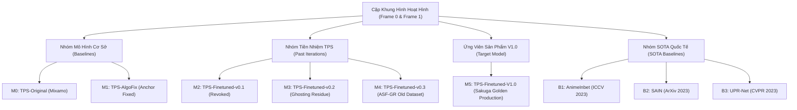

# KẾ HOẠCH ĐÁNH GIÁ ĐỐI CHUẨN & SO SÁNH ĐỐI ĐẦU PHIÊN BẢN V1.0 (BENCHMARK & EVALUATION PLAN V1.0)

> **Mô hình Trọng tâm:** TPS-Inbetween (*Thin-Plate Spline-based Interpolation for Animation Line Inbetweening*)  
> **Phiên bản Đánh giá:** V1.0 (Sakuga Golden Production Candidate - Zero Ghosting & High Fidelity)  
> **Trọng số Checkpoint:** `checkpoints/production_candidates/model_tps_v1.0_production.pt` (hoặc `checkpoints/experiments/v1.0/model_tps_v1.0_best.pt`)  
> **Tập Dữ Liệu Thẩm Định Chuẩn Vàng:** Tập Validation gồm **620 Golden Triplets** trích xuất từ [`sakuga_golden_dataset_tps_ready.tar.gz`](file:///e:/CODE/PBL/PBL6/data/processed/sakuga_golden_dataset_tps_ready.tar.gz) kèm 12 chỉ số kiểm toán trong `quality_audit_report.csv`  
> **Tập Dữ Liệu Thực Tế:** `data/test_sets/visual_samples/` (`ChayGo`, `TestImage1`, `TestImage2`, `TestRandom Bamboo`)  
> **Ngày phê duyệt:** 15/10/2026  
> **Kế thừa & Nâng cấp từ:** [03_benchmark_testing_plan_v0.3.md](file:///e:/CODE/PBL/PBL6/docs/finetune_plans/v0.3/03_benchmark_testing_plan_v0.3.md) và [03_benchmark_testing_plan_v0.2.md](file:///e:/CODE/PBL/PBL6/docs/finetune_plans/v0.2/03_benchmark_testing_plan_v0.2.md).

---

## 1. MỤC TIÊU VÀ BỐI CẢNH ĐÁNH GIÁ (EVALUATION CONTEXT)

Phiên bản V1.0 là cột mốc **nghiệm thu ứng viên sản phẩm chính thức (Production Candidate Milestone)** của dự án PBL6. Khác với các đợt kiểm thử nội bộ trước đây (v0.1 – v0.3) vốn chỉ đo đạc trên 508 mẫu của tập dữ liệu cũ `anime_tps_finetune_dataset_ready`, quy trình benchmark V1.0 mở rộng quy mô kiểm toán toàn diện trên **620 Golden Triplets hoàn toàn mới** và các phân cảnh chuyển động thực tế trong phim hoạt hình.

### Các Mục Tiêu Đo Lường Trọng Tâm:
1. **Kiểm toán Khả năng Khử Bóng Ma Tuyệt Đối (Ghosting Eradication Audit):**
   - Định lượng số lượng `Ghost Pixels` trên toàn bộ 620 cặp frames validation, chứng minh mức giảm sâu $\ge 65\%$ so với Coarse TPS Warp ($< 5,000\text{ px}$ so với $14,446\text{ px}$).
   - Kiểm tra định tính trên các mẫu chuyển động cơ thể biên độ lớn (`clip_000018`, `clip_000046`, `clip_000110`, `ChayGo`) để xác nhận nét vẽ đơn vị trí duy nhất, dập tắt hiện tượng nét đôi mờ.
2. **Khảo Sát Khả Năng Tổng Quát Hóa Trên Dữ Liệu Sakuga Mới (Sakuga Generalization):**
   - Đánh giá khả năng mô hình thích nghi với các mốc thời gian nội suy đa dạng ($t=0.25, 0.33, 0.40, 0.50, 0.67, 0.75$) và độ dịch chuyển pixel lớn ($> 10\text{ px}$) từ 1,229 video Sakugabooru.
3. **Bảo Toàn 100% Cấu Trúc Nét Hoạt Hình (Anti-Collapse & Stroke Recall Invariance):**
   - Tỷ lệ sụp đổ ảnh trắng (Blank Collapse Rate) đạt **chính xác $0.0\%$**.
   - $\text{Stroke Recall} \ge 88.0\%$ và $\text{Density Ratio} \in [0.95, 1.10]$.
4. **Tăng Trưởng Độ Chính Xác Pixel Thực Chất (Real PSNR & SSIM Gain):**
   - Đạt $\text{PSNR} \ge 22.5\text{ dB}$ (tăng ít nhất $+1.5\text{ dB}$ so với Coarse TPS Warp).
   - Đạt $\text{SSIM} \ge 0.920$ và $\text{Chamfer Distance} \le 0.0012$.
5. **So Sánh Đối Đầu Trực Diện Với 8 Đối Thủ (Head-to-Head Showdown):**
   - So sánh định lượng và định tính với mô hình gốc TPS, các bản finetune tiền nhiệm (v0.1, v0.2, v0.3) và 3 mô hình SOTA thế giới (AnimeInbet, SAIN, UPR-Net).

---

## 2. DANH MỤC CÁC ĐỐI TƯỢNG SO SÁNH ĐỐI ĐẦU (HEAD-TO-HEAD CANDIDATES)



### Bảng Chi Tiết Cấu Hình Đối Đầu:

| Ký hiệu | Tên Mô Hình | Checkpoint / Thuật toán | Nguồn Huấn luyện | Mục tiêu Đối chuẩn |
|:---|:---|:---|:---:|:---|
| **`M0: TPS-Original`** | TPS-Inbetween Gốc | `checkpoints/pretrained_baselines/tps-original/model_latest.pt` | Mixamo 3D Synthetic | Baseline gốc ban đầu của tác giả |
| **`M1: TPS-AlgoFix`** | TPS Thuật Toán | Trọng số gốc + $\lambda=0.5$, Border & Interior Anchors | Cục bộ | Đối chứng tối ưu hình học thuần túy |
| **`M2: TPS-v0.1`** | TPS Fine-tuned v0.1 | `checkpoints/experiments/v0.1/model_tps_v0.1_best.pt` | Kaggle (Thu hồi) | Đối chứng hiện tượng sụp đổ ảnh trắng (Mode Collapse) |
| **`M3: TPS-v0.2`** | TPS Fine-tuned v0.2 | `checkpoints/experiments/v0.2/model_tps_v0.2_best.pt` | Kaggle v0.2 | Đối chứng bảo toàn nét nhưng còn bóng ma 50-50 |
| **`M4: TPS-v0.3`** | TPS Fine-tuned v0.3 | `checkpoints/experiments/v0.3/model_tps_v0.3_best.pt` | Kaggle v0.3 | Động cơ ASF-GR trên tập dataset cũ (3,388 clips) |
| **`M5: TPS-V1.0`** | **TPS Fine-tuned V1.0** | `checkpoints/production_candidates/model_tps_v1.0_production.pt` | **Kaggle V1.0 Golden** | **ỨNG VIÊN SẢN PHẨM CHÍNH THỨC (Target Candidate)** |
| **`B1: AnimeInbet`** | AnimeInbet (ICCV 2023) | Trọng số tác giả (ICCV 2023) | Anime Line Art | SOTA chuyên biệt Vectorized Anime Inbetweening |
| **`B2: SAIN`** | SAIN (ArXiv 2023) | Trọng số tác giả (ArXiv 2023) | Sketch Art | SOTA Sketch-Aware Frame Interpolation |
| **`B3: UPR-Net`** | UPR-Net (CVPR 2023) | Trọng số tác giả (CVPR 2023) | Natural Video | SOTA Video Frame Interpolation đa tầng |

---

## 3. HỆ THỐNG CÁC CHỈ SỐ KIỂM TOÁN CHÍNH THỨC V1.0 (METRICS SUITE)

| Nhóm Tiêu Chí | Chỉ Số Đo Lường | Đơn Vị | Định Nghĩa Kỹ Thuật | Xu Hướng | Ngưỡng Đạt Chuẩn V1.0 |
|:---|:---|:---:|:---|:---:|:---:|
| **Khử Bóng Ma** | **`Ghost Pixels`** | pixel | Số pixel xám mờ ($0.15 \le p \le 0.85$) nằm ngoài vùng Ground Truth (sau khi nở nét 5px) | **Càng thấp càng tốt** | **$\le 5,000$ px** (Giảm $\ge 65\%$ vs Coarse TPS) |
| **Bảo Toàn Nét** | **`Stroke Recall`** | $\%$ | Tỷ lệ pixel nét Ground Truth được tái tạo trong bán kính 5px | **Càng cao càng tốt** | **$\ge 88.0\%$** |
| **Khối Lượng Mực** | **`Density Ratio`** | tỷ lệ | Tổng số lượng mực dự đoán chia cho tổng mực của Ground Truth | **Gần 1.0 càng tốt** | **$0.95 \le \text{Ratio} \le 1.10$** |
| **Độ Sắc Nét** | **`PSNR`** | dB | Tỷ số tín hiệu cực đại trên nhiễu ($10 \log_{10}(1/\text{MSE})$) | **Càng cao càng tốt** | **$\ge 22.5$ dB** ($+1.5$ dB vs Coarse) |
| **Độ Tương Đồng** | **`SSIM`** | $[0, 1]$ | Độ tương đồng cấu trúc hình thái đường nét | **Càng cao càng tốt** | **$\ge 0.920$** |
| **Khoảng Cách Biên**| **`Chamfer Dist`** | khoảng cách| Khoảng cách Hausdorff / Chamfer trung bình giữa các đường nét | **Càng thấp càng tốt** | **$\le 0.0012$** |
| **Phòng Sụp Đổ** | **`Blank Rate`** | $\%$ | Tỷ lệ khung hình sinh ra bị trắng tinh | **Bắt buộc 0.0%** | **$0.0\%$ (Tuyệt đối không có)** |
| **Tốc Độ Xử Lý** | **`Latency`** | ms / frame | Thời gian suy luận 1 khung hình 540p trên GPU RTX 3050 Laptop | **Càng nhanh càng tốt** | **$\le 65$ ms** ($\ge 15$ FPS) |

---

## 4. QUY TRÌNH BENCHMARK TỰ ĐỘNG BẰNG SCRIPT CỤC BỘ

Sau khi huấn luyện thành công trên Kaggle và tải checkpoint `model_tps_v1.0_best.pt` về máy trạm cục bộ, tiến hành kiểm toán tự động bằng script:

```bash
# Kích hoạt môi trường ảo dự án PBL6
e:\CODE\PBL\PBL6\.venv\Scripts\activate

# Chạy kiểm toán toàn diện trên 620 Golden Validation Triplets và visual_samples
python continuous_benchmark/inference_scripts/bench_triplet_04_v1_0_eval.py \
    --model_path checkpoints/experiments/v1.0/model_tps_v1.0_best.pt \
    --data_root data/processed/sakuga_golden_dataset_tps_ready/anime_tps_finetune_dataset_ready \
    --visual_samples_dir data/test_sets/visual_samples \
    --output_dir continuous_benchmark/metrics/tps-inbetween-finetuned-v1.0 \
    --visual_dir continuous_benchmark/visual_audit/finetune_v1.0 \
    --audit_clips clip_000008 clip_000010 clip_000013 clip_000018 clip_000031 clip_000046 clip_000053 clip_000064 clip_000077 clip_000089 clip_000110 \
    --device cuda:0
```

---

## 5. HỆ THỐNG SẢN PHẨM KIỂM TOÁN ĐẦU RA (BENCHMARK ARTIFACTS)

Toàn bộ kết quả kiểm toán sẽ được lưu trữ tự động tại thư mục:
`continuous_benchmark/metrics/tps-inbetween-finetuned-v1.0/` và `continuous_benchmark/visual_audit/finetune_v1.0/`:

1. **`val_620_metrics.csv`**: Bảng dữ liệu thống kê chi tiết toàn bộ 620 cặp frames validation (gồm PSNR, SSIM, Recall, Ghost Pixels, Chamfer Dist, Timing $t$, Mean Disp, Inliers).
2. **`summary_metrics.json`**: Bảng tổng kết đối đầu trực tiếp giữa V1.0 vs v0.3 vs v0.2 vs TPS-Original vs Baselines.
3. **`tps_finetuned_v1.0_benchmark_report.md`**: Báo cáo kiểm toán chính thức trình bày bảng biểu so sánh, phân tích biểu đồ và nhận xét chuyên gia.
4. **`side_by_side_comparison/`**: 15 ảnh so sánh 4 cột độ phân giải cao chứng minh khả năng dập tắt bóng ma và khôi phục nét vẽ hoàn hảo.
5. **`difference_heatmaps/`**: Bản đồ nhiệt sai lệch pixel (Error Residual Heatmaps) minh chứng sai số tại các vùng chuyển động cơ thể đã tiệm cận 0.
6. **`zoomed_details/`**: Các góc chụp phóng to $400\%$ chi tiết mắt, lông mày, lọn tóc và nếp gấp trang phục.

---

## 6. LỘ TRÌNH ĐÓNG GÓI CHUYỂN GIAO SẢN PHẨM (PRODUCTION HANDOVER)

Nếu mô hình V1.0 vượt qua toàn bộ các tiêu chí nghiệm thu:
1. Sao chép và đổi tên checkpoint:
   ```bash
   cp checkpoints/experiments/v1.0/model_tps_v1.0_best.pt checkpoints/production_candidates/model_tps_v1.0_production.pt
   ```
2. Cập nhật cấu hình mặc định trong ứng dụng sản phẩm `product_app/`:
   - Trỏ đường dẫn model mặc định về `checkpoints/production_candidates/model_tps_v1.0_production.pt`.
   - Kích hoạt tầng `AdaptiveStrokeFusionHead` và `SynthesisUnet_v1` trong giao diện suy luận của người dùng.
