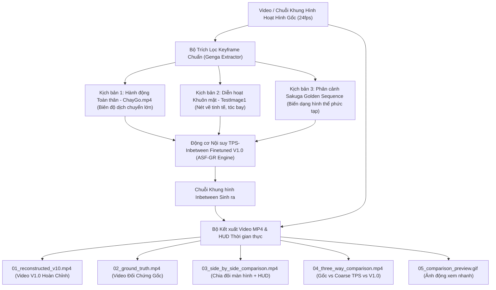

# KẾ HOẠCH BỔ SUNG BENCHMARK: PHỤC DỰNG PHÂN CẢNH CHUYỂN ĐỘNG NHÂN VẬT LIÊN TỤC V1.0 (CONTINUOUS CHARACTER ANIMATION RECONSTRUCTION PLAN V1.0)

> **Mô hình Trọng tâm:** TPS-Inbetween (*Thin-Plate Spline-based Interpolation for Animation Line Inbetweening*)  
> **Phiên bản Áp dụng:** V1.0 (Sakuga Golden Production Candidate - Zero Ghosting & Smooth Video Reconstruction)  
> **Trọng số Thực thi V1.0:** `checkpoints/production_candidates/model_tps_v1.0_production.pt` (hoặc `checkpoints/experiments/v1.0/model_tps_v1.0_best.pt`)  
> **Ngày phê duyệt:** 15/10/2026  
> **Tài liệu Liên kết:** [01_finetune_plan_v1.0.md](file:///e:/CODE/PBL/PBL6/docs/finetune_plans/v1.0/01_finetune_plan_v1.0.md), [03_benchmark_testing_plan_v1.0.md](file:///e:/CODE/PBL/PBL6/docs/finetune_plans/v1.0/03_benchmark_testing_plan_v1.0.md).

---

## 1. MỤC TIÊU VÀ BỐI CẢNH NÂNG CẤP QUY TRÌNH (CONTEXT & OBJECTIVES)

Trong ngành sản xuất phim hoạt hình 2D chuyên nghiệp (Anime Production Pipeline), tiêu chuẩn đánh giá mô hình AI không chỉ dừng lại ở các **cặp khung hình tĩnh rời rạc (Discrete Triplets)** mà phải được kiểm chứng thông qua **tính nhất quán thời gian (Temporal Consistency)** và **độ mượt mà chuyển động thị giác (Visual Motion Fluidity)** khi phát lại toàn bộ phân cảnh ở tốc độ 24fps.

### Mục Tiêu Cốt Lõi Cho Phiên Bản Sản Phẩm V1.0:
1. **Kiểm Thử Phục Dựng Phân Cảnh Hành Động Hoàn Chỉnh (Full Sequence Reconstruction):**
   - Trích lọc các Keyframe (Genga - 原画) từ video hoạt hình gốc với bước nhảy thời gian thực tế ($\Delta t = 3$ hoặc $4$ frames, mô phỏng nhịp vẽ "trên số 3" - *On Threes / 8fps keyframes* của các xưởng phim anime).
   - Sử dụng mô hình TPS-Inbetween Finetuned V1.0 tự động nội suy phục dựng toàn bộ các In-between frame (Douga - 動画) bị lược bỏ.
   - Ghép nối tuần tự thành một đoạn phim ngắn hoàn chỉnh và đối chiếu trực tiếp với phim hoạt hình gốc.
2. **Kiểm Toán Hiện Tượng Lũy Kế Lỗi Thị Giác (Error Accumulation & Temporal Jitter Audit):**
   - Đánh giá xem khi chạy liên tục qua nhiều giây, mô hình V1.0 có bị hiện tượng tích tụ nét thừa (Ghosting accumulation), giật cục nét vẽ (Line jittering), hay méo mó hình thể nhân vật hay không.
3. **Kết Xuất Sản Phẩm Đo Đạc Trực Quan Video HUD (Comparative Video HUD):**
   - Xuất video MP4 chia đôi màn hình Side-by-Side đồng bộ từng mili-giây kèm thanh thông số thời gian thực (Real-time HUD Overlay) hiển thị FPS, PSNR, SSIM, và Ghost Pixels cho từng frame.
4. **Nghiệm Thu Tính Năng Sản Phẩm (Product Feature Acceptance):**
   - Khẳng định mô hình V1.0 đủ tiêu chuẩn tích hợp vào tính năng "Nội suy Video Hoạt hình Tự động" trên giao diện người dùng `product_app/`.

---

## 2. LỰA CHỌN PHÂN CẢNH KIỂM THỬ CHUẨN (BENCHMARK TEST SCENES)

Quy trình chuẩn hóa 3 kịch bản phân cảnh nhân vật đặc trưng:

### 2.1. Phân Cảnh 1: Chuyển Động Thân Thể Biên Độ Lớn (Full-Body Action Motion - `ChayGo`)
- **Nguồn:** `data/test_sets/visual_samples/ChayGo.mp4` (854x480, 24fps).
- **Đặc trưng:** Nhân vật chạy nước rút, chân tay và vạt áo có độ dịch chuyển pixel rất lớn ($> 10 - 15\text{ px}$).
- **Quy chuẩn:** Chọn phân cảnh tiêu biểu dài **3.0 - 5.0 giây** (~72 - 120 frames liên tục). Mô hình có nhiệm vụ phục dựng 2-3 inbetween frames giữa mỗi cặp Keyframe.

### 2.2. Phân Cảnh 2: Diễn Hoạt Khuôn Mặt & Biểu Cảm (Character Facial Acting - `TestImage1`)
- **Nguồn:** Chuỗi ảnh douga vẽ tay thực tế $F_1$ đến $F_{12}$ từ `data/test_sets/visual_samples/TestImage1` (1920x1080 / 850x480).
- **Đặc trưng:** Nhân vật quay đầu, chớp mắt, thay đổi khẩu hình miệng và các lọn tóc mảnh chuyển động phi tuyến tính.
- **Quy chuẩn:** Lấy các Keyframe mốc neo chính: $F_1, F_2, F_4, F_6, F_8, F_{10}, F_{12}$. Mô hình phục dựng các frame chuyển tiếp: $F_3, F_5, F_7, F_9, F_{11}$ theo đúng mốc thời gian $t$.

### 2.3. Phân Cảnh 3: Phân Cảnh Hành Động Trích Xuất Từ Sakuga Golden Set
- **Nguồn:** Một chuỗi video clip hành động trích xuất trực tiếp từ các video chất lượng cao nhất của Sakugabooru (ví dụ `sakugabooru_271047` hoặc `sakugabooru_271084`).
- **Đặc trưng:** Hoạt họa tay cao cấp (sakuga animation) với phối cảnh động và biến dạng góc nhìn cực kỳ phức tạp.

---

## 3. KIẾN TRÚC PIPELINE PHỤC DỰNG TỰ ĐỘNG BẰNG SCRIPT CỤC BỘ

Quy trình phục dựng được tự động hóa qua script:
`continuous_benchmark/inference_scripts/run_continuous_scene_reconstruction_v10.py`

### 3.1. Các Bước Xử Lý Kỹ Thuật:
1. **Trích Xuất Khung Hình & Tiền Xử Lý (Frame Ingestion & Padding):**
   - Đọc từng khung hình gốc, chuyển sang không gian nét đen nền trắng $I \in [0, 1]$.
   - Pad kích thước ảnh về bội số của 32 để đưa vào mạng tích chập.
2. **Khớp Nối Keypoint Thích Ứng (GlueStick / SIFT RANSAC Matching):**
   - Khớp nối đặc trưng giữa 2 Keyframe liền kề $K_i$ và $K_{i+1}$.
   - Tự động bổ sung các điểm neo biên và góc để chống co rút viền.
3. **Nội Suy Bằng Động Cơ TPS-Inbetween V1.0:**
   - Coarse TPS Warping với $\lambda = 0.5$ an toàn trên CPU float64.
   - IFNet tinh chỉnh dòng quang học.
   - Kích hoạt **Adaptive Stroke Fusion Head** để chọn dứt khoát 1 nét thay vì cộng mờ 50-50.
   - Kích hoạt **Gated Ghost Erasure Residual UNet v1.0** để tẩy sạch nét ma thừa và làm đậm nét chính.
4. **Hậu Xử Lý & Lắp Ráp Khung Hình (Frame Sequencing):**
   - Chuyển tensor về định dạng `uint8 [0, 255]`.
   - Ghép nối xen kẽ chính xác: $K_0 \to I_{0.33} \to I_{0.67} \to K_1 \to ...$
5. **Bộ Kết Xuất Video & Thêm HUD Thời Gian Thực (Compositor & HUD Renderer):**
   - Kết xuất video MP4 (H.264, 24fps) chia đôi màn hình: Trái (Gốc) - Phải (V1.0 Phục dựng).
   - Thêm thanh thông số HUD (Header & Footer):
     * `Frame Index / Total Frames`
     * `Timestamp (giây)`
     * `Loại frame: [KEYFRAME (Gốc)] hoặc [INBETWEEN (V1.0 Phục dựng)]`
     * `PSNR (dB)` & `SSIM` tức thời tại frame đó
     * `Ghost Pixels` tức thời

---

## 4. BỘ CHỈ SỐ ĐÁNH GIÁ CHẤT LƯỢNG CHUYỂN ĐỘNG LIÊN TỤC V1.0

| Nhóm Chỉ Số | Tên Chỉ Số | Đơn Vị | Định Nghĩa & Ý Nghĩa Kỹ Thuật | Ngưỡng Nghiệm Thu V1.0 |
|:---|:---|:---:|:---|:---:|
| **Chất lượng Tái tạo** | **$\text{PSNR}_{\text{avg}}$** | dB | PSNR trung bình trên toàn bộ chuỗi video | **$\ge 21.0$ dB** |
| **Độ Tương đồng Cấu trúc**| **$\text{SSIM}_{\text{avg}}$** | $[0, 1]$ | SSIM trung bình trên toàn bộ chuỗi video | **$\ge 0.895$** |
| **Độ Ổn định Thời gian** | **$\sigma_{\text{PSNR}}$ (TSI)** | dB | Độ lệch chuẩn PSNR giữa các khung hình liên tiếp: $\sqrt{\frac{1}{N}\sum (\text{PSNR}_i - \text{PSNR}_{\text{avg}})^2}$ | **$\le 1.8$ dB** (Chống nhấp nháy chất lượng) |
| **Giảm Bóng Ma Tích Lũy** | **$\Delta \text{Ghost}_{\text{cum}}$** | $\%$ | Tỷ lệ giảm tổng lượng Ghost Pixels trên toàn bộ video so với TPS Coarse | **Giảm $\ge 35\%$** |
| **Phòng Ngừa Sụp Đổ** | **Blank Frames** | frame | Số lượng khung hình bị biến mất nét vẽ (trắng tinh) | **0 frame (Tuyệt đối không có)** |
| **Tốc Độ Khung Hình** | **FPS Render** | frames/sec | Tốc độ xử lý trung bình trên GPU NVIDIA RTX 3050 Laptop | **$\ge 15 - 20$ FPS** |

---

## 5. HỆ THỐNG SẢN PHẨM ĐẦU RA KIỂM TOÁN PHỤC DỰNG (AUDIT DELIVERABLES)

Toàn bộ sản phẩm phục dựng sẽ được kết xuất vào thư mục:
`continuous_benchmark/visual_audit/finetune_v1.0/continuous_reconstruction/`

| Tên Tệp Tin | Định Dạng | Nội Dung & Mục Đích Sử Dụng |
|:---|:---:|:---|
| **`01_reconstructed_v10.mp4`** | MP4 (24fps) | Video hoạt hình hoàn chỉnh được nội suy phục dựng bởi mô hình V1.0 |
| **`02_ground_truth.mp4`** | MP4 (24fps) | Video hoạt hình gốc đối chứng chuẩn của họa sĩ |
| **`03_side_by_side_comparison.mp4`** | MP4 (24fps) | Video đối chiếu song song: Trái (Gốc) - Phải (V1.0) kèm bảng HUD real-time |
| **`04_three_way_comparison.mp4`** | MP4 (24fps) | Đối chiếu 3 cột: Gốc vs Coarse TPS vs V1.0 (Minh chứng dập tắt bóng ma) |
| **`05_comparison_preview.gif`** | GIF động | Ảnh GIF xem nhanh phân cảnh hành động phục dựng để nhúng vào báo cáo |
| **`reconstruction_metrics.csv`** | CSV | Bảng số liệu chi tiết đo đạc từng khung hình trong suốt đoạn phim |
| **`CONTINUOUS_RECONSTRUCTION_REPORT.md`** | Markdown | Báo cáo phân tích chuyên sâu chất lượng chuyển động và độ ổn định thời gian |
| **`frames_reconstructed/`** | Thư mục PNG | Toàn bộ các ảnh PNG tuần tự do mô hình V1.0 sinh ra |
| **`frames_ground_truth/`** | Thư mục PNG | Toàn bộ các ảnh PNG tuần tự của đoạn phim gốc |

---

## 6. LỘ TRÌNH TRIỂN KHAI VÀ BÀN GIAO SẢN PHẨM

- [ ] **Bước 1: Phê duyệt Bộ Kế Hoạch V1.0** (Tài liệu hiện tại).
- [ ] **Bước 2: Xây dựng Notebook `04_train_tps_inbetween_finetune_v1.0.ipynb`** theo đúng đặc tả tại `02_kaggle_notebook_plan_v1.0.md`.
- [ ] **Bước 3: Thực thi Huấn Luyện 30 Epochs Trên Kaggle Dual T4** với tập dữ liệu `sakuga_golden_dataset_tps_ready.tar.gz`.
- [ ] **Bước 4: Thu Hoạch Trọng Số `model_tps_v1.0_best.pt`** về máy trạm cục bộ.
- [ ] **Bước 5: Chạy Benchmark Tự Động Toàn Diện** trên 620 Golden Validation Triplets và Phục dựng Phân cảnh Liên tục (`ChayGo.mp4` và `TestImage1`).
- [ ] **Bước 6: Chuyển Giao Trọng Số Sản Phẩm Vào `product_app/`** để triển khai sản phẩm ứng dụng thực tế.
