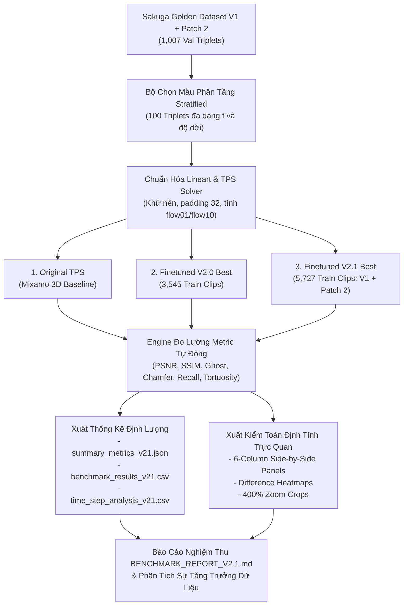

# KẾ HOẠCH ĐÁNH GIÁ ĐỐI CHUẨN & SO SÁNH ĐỐI ĐẦU PHIÊN BẢN V2.1 (BENCHMARK & EVALUATION PLAN V2.1)

> **Mô hình Trọng tâm:** TPS-Inbetween (*Thin-Plate Spline-based Interpolation for Animation Line Inbetweening*)  
> **Kiến trúc:** ASF-GR Engine (*Adaptive Stroke Fusion Head + Gated Ghost Erasure Residual UNet*)  
> **Phiên bản Đánh giá:** V2.1 (Finetuned từ Checkpoint Best V2.0 trên Sakuga Golden Dataset Mở Rộng V1 + Patch 2)  
> **Đối tượng Đánh giá Đối đầu Tam Mã:**
> 1. **Original TPS-Inbetween Baseline:** Trọng số gốc tác giả (Mixamo 3D Synthetic) tại `checkpoints/pretrained_baselines/tps-original/model_latest.pt`
> 2. **TPS Finetuned V2.0 (Best Checkpoint):** Mô hình huấn luyện trên Golden Dataset V1 (4,165 triplets), lấy bản tối ưu nhất V2.0.2 tại `checkpoints/experiments/v2.0/v2.0.2/tps_finetune_v2.0_artifacts/checkpoints_v1.1/model_tps_v2.0_best.pt`
> 3. **TPS Finetuned V2.1 (Target Candidate):** Mô hình warm-start từ V2.0 Best và finetune tiếp 30 epochs trên Golden Dataset mở rộng bổ sung Patch 2 (6,734 triplets), lưu tại `checkpoints/experiments/v2.1/tps_finetune_v2.1_artifacts/checkpoints_v2.1/model_tps_v1.1_best.pt`
>
> **Tập Dữ Liệu Đánh Giá:** [`sakuga_golden_dataset_tps_ready_v1_patch2`](file:///e:/CODE/PBL/PBL6/data/processed/sakuga_golden_dataset_tps_ready_v1_patch2) (6,734 triplets: 5,727 train / 1,007 val)  
> **Chế độ Đánh giá:** Phân tầng đại diện (Stratified Validation Suite - 100 triplets) phủ toàn bộ không gian thời gian $t \in [0.20, 0.80]$ và biên độ chuyển động, kết hợp kiểm toán trực quan cận cảnh (Visual Audit Panels).  
> **Ngày lập kế hoạch:** 19/10/2026.

---

## 1. BỐI CẢNH KỸ THUẬT & MỤC TIÊU NGHIÊN CỨU

### 1.1. Bối cảnh Sinh ra Phiên bản V2.1
- **V2.0** đã chứng minh tính ưu việt của chiến lược khởi tạo (Warm-Start) từ `v0.3-best` (Model V2.0.2) so với khởi tạo từ model gốc Mixamo 3D (Model V2.0.1): giảm tới -32.88% bóng ma (`ghost pixels`) và giảm -60.25% khoảng cách hình học `chamfer distance`. Tuy nhiên, V2.0 chỉ được huấn luyện trên quy mô dữ liệu V1 ban đầu (3,545 train triplets / 620 val triplets).
- Để tiếp tục nâng cao tính khái quát hóa (generalization) và khả năng xử lý các chuyển động anime phức tạp, dự án đã triển khai **Pipeline thế hệ 2** sản xuất thêm **Patch 2** (bao gồm 1,047 triplets trích xuất từ ATD-12K Japan và 1,522 triplets từ Sakugabooru Clean Acting).
- Hợp nhất V1 và Patch 2 tạo thành tập dữ liệu quy mô lớn: **6,734 triplets** (5,727 train / 1,007 val), tăng **+61.7% về tổng số lượng** (+61.5% số lượng mẫu train).
- **V2.1** được tạo ra bằng cách lấy chính **checkpoint tốt nhất của V2.0** (`model_tps_v2.0_best.pt` thuộc nhánh V2.0.2) làm trọng số khởi đầu, sau đó tiếp tục tinh chỉnh (fine-tune) sâu 30 epochs trên toàn bộ 5,727 train triplets của tập dữ liệu mở rộng này.

### 1.2. Mục Tiêu Đánh Giá Đối Chuẩn V2.1
1. **Định lượng Hiệu quả của Việc Tăng Lượng Dữ liệu (+61.7% Data Volume):**
   - Xác định liệu việc bổ sung Patch 2 có giúp mô hình tiếp tục giảm lỗi bóng ma (`ghost pixels`), thu hẹp khoảng cách nét (`chamfer distance`), và tăng độ phủ nét (`stroke recall`) hay không.
   - Thẩm định nguy cơ bão hòa (diminishing returns) hoặc suy giảm hiệu năng trên các phân phối dữ liệu cũ.
2. **Khảo sát Năng lực Khái Quát Hóa (Generalization Ability):**
   - Đánh giá trên tập validation mở rộng (bao gồm cả các mẫu kiểm thử V1 cũ lẫn các mẫu kiểm thử Patch 2 mới).
   - Kiểm tra hành vi nội suy trên các mốc thời gian lệch tâm ($t=0.25, 0.33, 0.40, 0.60, 0.67, 0.75$).
3. **So Sánh Đối Đầu Tam Mã Trực Tiếp (Triad Head-to-Head Showdown):**
   - Đối chiếu đồng thời: **TPS Gốc (Mixamo 3D) $\to$ TPS V2.0 (V1 Golden) $\to$ TPS V2.1 (V1 + Patch 2)**.
   - Làm rõ tiến trình nâng cấp chất lượng qua 3 thế hệ mô hình.
4. **Kiểm Toán Trực Quan Độ Nét & Khử Bóng Ma (Visual Audit):**
   - Dựng ảnh Side-by-Side 6 cột: `[Keyframe 0 | Coarse TPS | Original TPS | V2.0 Best | V2.1 Best | Ground Truth]`.
   - Render Difference Heatmaps so sánh sai số dư thừa giữa V2.0 và V2.1.
   - Cắt crop phóng đại 400% để quan sát cấu trúc vi mô của nét vẽ (mí mắt, sợi tóc, ngón tay).

---

## 2. HỆ THỐNG TIÊU CHÍ & CHỈ SỐ ĐO LƯỜNG (METRICS SUITE)

| Nhóm Chỉ Số | Tên Chỉ Số | Đơn Vị | Phương Pháp Đo Đạc & Ý Nghĩa Kỹ Thuật | Xu Hướng Kỳ Vọng |
|:---|:---|:---:|:---|:---:|
| **Bóng Ma** | `Ghost Pixels` | pixel | Đếm số lượng pixel mờ nằm trong dải xám $[180, 250]$ trên ảnh dự đoán tại những tọa độ mà Ground Truth là nền trắng ($> 250$). Phản ánh trực tiếp hiện tượng nét đôi mờ. | **Càng thấp càng tốt** |
| **Hình Học Nét** | `Chamfer Dist` | khoảng cách | Khoảng cách trung bình Hausdorff hai chiều giữa tập điểm nét dự đoán và tập điểm nét Ground Truth (chuẩn hóa theo đường chéo khung hình). | **Càng thấp càng tốt** |
| **Bảo Toàn Nét** | `Stroke Recall` | $\%$ | Tỷ lệ phần trăm pixel nét vẽ Ground Truth được tái hiện trong bán kính lân cận 5px của ảnh dự đoán. | **Càng cao càng tốt ($\ge 92\%$)** |
| **Mật Độ Mực** | `Density Ratio` | tỷ lệ | Tỷ số giữa tổng số pixel nét mực dự đoán chia cho tổng số pixel nét mực Ground Truth. Tránh nét bị bẹt to hoặc biến mất. | **Tiệm cận 1.0 $[0.95 - 1.15]$** |
| **Độ Tự Nhiên** | `Tortuosity` | tỷ số | Tỷ số giữa độ dài cung đường cong thực tế và khoảng cách đường thẳng giữa hai đầu mút của từng đường nét (đo bằng skeleton analysis). | **Mềm mại tự nhiên $\approx 1.5 - 1.6$** |
| **Độ Tương Đồng**| `SSIM` | $[0, 1]$ | Chỉ số tương đồng cấu trúc hình thái học giữa ảnh dự đoán và Ground Truth. | **Càng cao càng tốt ($\ge 0.90$)** |
| **Chất Lượng Tín Hiệu**| `PSNR` | dB | Tỷ số tín hiệu cực đại trên nhiễu $10 \log_{10}(1/\text{MSE})$. | **$\ge 18.0$ dB** |
| **Sai Số Tuyệt Đối**| `IE MAE` | $[0, 255]$ | Mean Absolute Error giữa ảnh dự đoán và ảnh Ground Truth. | **Càng thấp càng tốt** |
| **Ổn Định Gradient**| `Blank Rate` | $\%$ | Tỷ lệ khung hình sinh ra bị trắng tinh hoàn toàn (Mode Collapse). | **Bắt buộc 0.0%** |
| **Độ Trễ Suy Luận**| `Latency` | ms/frame | Thời gian suy luận 1 khung hình 540p trên GPU RTX. | **Ổn định $\le 130$ ms** |

---

## 3. THIẾT KẾ THỰC NGHIỆM & QUY TRÌNH THỰC THI

### 3.1. Danh mục Checkpoints Tham Gia Benchmark
1. **TPS Original Baseline:**
   - Đường dẫn: `checkpoints/pretrained_baselines/tps-original/model_latest.pt`
   - Nguồn gốc: Huấn luyện trên mô hình 3D tổng hợp Mixamo bởi tác giả bài báo gốc.
2. **TPS Finetuned V2.0 (Best Checkpoint):**
   - Đường dẫn: `checkpoints/experiments/v2.0/v2.0.2/tps_finetune_v2.0_artifacts/checkpoints_v1.1/model_tps_v2.0_best.pt`
   - Nguồn gốc: Huấn luyện trên Sakuga Golden Dataset V1 (3,545 train / 620 val).
3. **TPS Finetuned V2.1 (Target Candidate):**
   - Đường dẫn: `checkpoints/experiments/v2.1/tps_finetune_v2.1_artifacts/checkpoints_v2.1/model_tps_v1.1_best.pt`
   - Nguồn gốc: Finetune tiếp từ V2.0 Best trên Sakuga Golden Dataset V1 + Patch 2 (5,727 train / 1,007 val).

### 3.2. Mẫu Phân Tầng (Stratified Sampling Strategy)
- Lấy 100 mẫu phân tầng bao phủ:
  - Các mốc thời gian $t$: $0.20, 0.25, 0.33, 0.40, 0.50, 0.60, 0.67, 0.75, 0.80$.
  - Biên độ chuyển động: từ dịch chuyển nhỏ ($\text{mean\_disp} < 1.0\text{ px}$) đến trung bình và cực lớn ($\text{mean\_disp} > 15.0\text{ px}$).
  - Các clip kiểm toán trực quan tiêu biểu: `clip_000008`, `clip_000010`, `clip_000018`, `clip_000064`, `clip_003046`, `clip_003050` (thuộc V1) và các clip đại diện mới từ Patch 2 như `clip_004200`, `clip_005300`.

---

## 4. KẾT QUẢ ĐẦU RA VÀ ĐỊNH NGHĨA HOÀN THÀNH (DELIVERABLES)
1. **Script thực thi tự động:** `continuous_benchmark/inference_scripts/run_tps_benchmark_v21.py`.
2. **Dữ liệu số liệu định lượng:**
   - `checkpoints/experiments/v2.1/summary_metrics_v21.json`
   - `checkpoints/experiments/v2.1/benchmark_results_v21.csv`
   - `checkpoints/experiments/v2.1/time_step_analysis_v21.csv`
3. **Thư mục ảnh kiểm toán định tính:** `checkpoints/experiments/v2.1/visual_comparisons/` (gồm `side_by_side/`, `difference_heatmaps/`, `zoomed_details/`).
4. **Văn bản báo cáo phân tích đối đầu:** `checkpoints/experiments/v2.1/BENCHMARK_REPORT_V2.1.md`.
