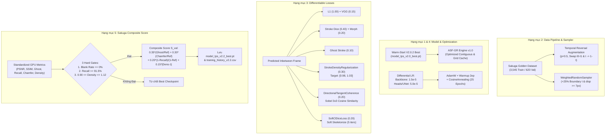

# KẾ HOẠCH CHI TIẾT FINETUNE TPS-INBETWEEN PHIÊN BẢN V2.2
## TRIỆT TIÊU HIỆN TƯỢNG PHÌNH NÉT, CÂN BẰNG THỜI GIAN & CHUẨN HÓA SAKUGA COMPOSITE SCORE

> **Mô hình Trọng tâm:** TPS-Inbetween (*Thin-Plate Spline-based Interpolation for Animation Line Inbetweening*)  
> **Kiến trúc:** ASF-GR Engine v1.0 (*Adaptive Stroke Fusion Head + Gated Ghost Erasure Residual UNet*)  
> **Phiên bản Kế hoạch:** V2.2 (Kế thừa trực tiếp từ Checkpoint V2.0.2 Best)  
> **Trọng số Khởi tạo (Warm-Start):** `checkpoints/experiments/v2.0/v2.0.2/tps_finetune_v2.0_artifacts/checkpoints_v1.1/model_tps_v2.0_best.pt`  
> **Tập Dữ Liệu Huấn Luyện & Đánh Giá:** [`sakuga_golden_dataset_tps_ready`](file:///e:/CODE/PBL/PBL6/data/processed/sakuga_golden_dataset_tps_ready) (4,165 triplets: 3,545 train / 620 val)  
> **Ngày lập kế hoạch:** 19/10/2026.

---

## 1. BỐI CẢNH & KẾT QUẢ KIỂM TOÁN (AUDIT REPORT)

Dựa trên kết quả thực nghiệm đối đầu tại [`BENCHMARK_REPORT_V2.0.md`](file:///e:/CODE/PBL/PBL6/checkpoints/experiments/v2.0/BENCHMARK_REPORT_V2.0.md), **Model V2.0.2** (finetune từ V0.3 Best) đã giành chiến thắng áp đảo 90% trước V2.0.1 với các chỉ số ấn tượng: `Ghost Pixels = 14,322 px`, `Chamfer Distance = 0.000983`, và `Stroke Recall = 92.36%`. Tuy nhiên, quá trình kiểm toán chuyên sâu phát hiện **4 vấn đề kỹ thuật** cần khắc phục triệt để ở phiên bản **V2.2**:

### 1.1. Báo Cáo Kiểm Toán 1: Độ Vênh Metric Giữa Validation Lúc Train (555.2 px) và Fast Benchmark (14,322 px)
* **Hiện tượng:** Trong `training_history_v2.0.csv`, chỉ số `Val Ghost Pixels` ở Epoch 30 ghi nhận là `555.2 px`. Nhưng khi chạy script đối chuẩn độc lập `run_tps_benchmark_v20.py` trên 100 mẫu phân tầng, chỉ số này vọt lên `14,322 px` (gấp gần 26 lần).
* **Nguyên nhân cốt lõi phát hiện qua kiểm toán code:**
  1. *Khác biệt về vùng đệm loại trừ (Dilation Mask Exclusion):*
     - Trong vòng lặp validation lúc train (`04_train_tps_inbetween_finetune_v1.1.ipynb` Cell 8):
       `g_dilated_ghost = F.max_pool2d(g_mask, kernel_size=7, stride=1, padding=3)`
       `ghost_mask = (pred_tensor >= 0.10) & (pred_tensor <= 0.45) & (g_dilated_ghost < 0.5)`
       Thuật toán lúc train đã giãn nở nét Ground Truth bằng kernel $7 \times 7$ (bán kính 3px). Mọi pixel nằm trong phạm vi 3px quanh nét vẽ thật **bị loại trừ hoàn toàn** khỏi cách tính ghost pixels. Đồng thời chỉ đếm pixel xám mờ có độ đậm mực trong dải $[0.10, 0.45]$ (tương đương pixel xám $140 - 230$).
     - Trong khi đó, ở script fast benchmark (`compute_ghost_pixels`):
       `ghost_mask = (img_pred >= 180) & (img_pred <= 250) & (img_gt > 250)`
       Script benchmark **KHÔNG áp dụng bất kỳ vùng đệm dilation nào**! Nền GT được định nghĩa khắt khe là $> 250$ (gần như trắng tinh).
  2. *Hệ quả của hiện tượng phình nét (Line Thickening):*
     - Do V2.0.2 có nét vẽ dày hơn Ground Truth 31.4% (`Density Ratio = 1.3139`), vùng viền ngoài chống răng cưa (antialiasing) của các nét vẽ dày này lan rộng ra vùng $img\_gt > 250$.
     - Lúc train, do có dilation buffer 7x7 che chắn nên các pixel viền ngoài này bị lọc bỏ (chỉ còn 555 px nét ma cô lập xa nét chính). Nhưng lúc benchmark, không có dilation buffer nên hàng chục nghìn pixel viền antialiasing của nét dày bị tính toàn bộ thành "Ghost Pixels"!
* **Giải pháp chuẩn hóa V2.2:**
  - Đồng nhất 100% công thức tính trên GPU trong cả vòng lặp huấn luyện và benchmark:
    `pred_u8 = ((1.0 - pred) * 255.0).clamp(0, 255).to(torch.uint8)`
    `gt_u8 = ((1.0 - gt) * 255.0).clamp(0, 255).to(torch.uint8)`
    `ghost_mask = (pred_u8 >= 180) & (pred_u8 <= 250) & (gt_u8 > 250)`
  - Slicing bỏ vùng padding 32 về kích thước gốc $(h, w)$ trước khi đo đạc.

---

### 1.2. Báo Cáo Kiểm Toán 2: Độ Trễ Suy Luận (Latency Discrepancy 53.9 ms vs 123.8 ms)
* **Hiện tượng:** Trong `benchmark_results_fast.csv`, `latency_v201_ms` trung bình là `53.9 ms`, trong khi `latency_v202_ms` lại lên tới `123.8 ms`. Tuy nhiên, cả V2.0.1 và V2.0.2 đều có cùng kiến trúc mạng `ASF-GR Engine v1.0` (chính xác 168 weight tensors, không sai khác bất kỳ một tham số nào).
* **Nguyên nhân kỹ thuật phát hiện qua kiểm toán luồng thực thi:**
  1. *Hiện tượng ô nhiễm đo lường do bất đồng bộ CUDA (Asynchronous CUDA Stream Pollution):*
     - Trong PyTorch, các hàm tính toán trên GPU hoạt động bất đồng bộ (asynchronous execution) và trả quyền điều khiển về CPU ngay sau khi đẩy kernel vào hàng đợi.
     - Trong đoạn code đo đạc của `run_tps_benchmark_v20.py`:
       ```python
       t_start_1 = time.time()
       out_v201 = model_v201(...) # Không có torch.cuda.synchronize()!
       ms_v201 = (time.time() - t_start_1) * 1000.0 # CPU đo trước khi GPU chạy xong (~53 ms)

       t_start_2 = time.time()
       out_v202 = model_v202(...) # Đầu hàm gọi CPU sync, bị nghẽn đợi GPU chạy nốt việc của v201!
       ms_v202 = (time.time() - t_start_2) * 1000.0 # Bị tính dồn cả thời gian của model 1 (~123 ms)
       ```
     - Cụ thể, bên trong `model_v202`, lệnh `c_src.detach().cpu()` bắt buộc CPU phải đứng đợi GPU stream hoàn thành toàn bộ khối lượng công việc của `model_v201`. Do đó, thời gian GPU thực tế của V2.0.1 đã bị tính oan vào V2.0.2!
  2. *Vòng lặp CPU-GPU-CPU Ping-Pong khi giải TPS:*
     - Tọa độ `kps` được chuyển sang GPU (`.to(dev)`), sau đó trong `robust_tps_theta_from_points` lại gọi `.cpu().to(torch.float64)` để giải ma trận, rồi lại gọi `.to(dev)` để đưa về GPU. Chu trình ping-pong này gây gián đoạn pipeline xử lý song song.
  3. *Tái tạo Meshgrid liên tục ở mỗi frame:*
     - Lưới `torch.meshgrid` bị sinh lại nhiều lần trong `warp_normalized_flow` và `warp_pixel_flow`.
* **Giải pháp tối ưu hóa V2.2 (Bảo toàn 100% trọng số):**
  - Chèn `torch.cuda.synchronize()` chuẩn xác trước và sau mỗi lần bấm giờ đo đạc.
  - Tối ưu hóa Grid Meshgrid Caching (`_GRID_CACHE_NORM`, `_GRID_CACHE_PIX`).
  - Giải TPS trực tiếp trên CPU và chỉ chuyển ma trận $\theta$ sang GPU 1 lần duy nhất.
  - Đảm bảo tensor contiguous trên các nhánh skip-connection của Synthesis UNet để tối ưu hoá bộ đệm cuDNN.

---

### 1.3. Vấn Đề Phình Nét (Line Thickening)
- `Density Ratio` của V2.0.2 đang ở mức `1.3139` (dày hơn 31.4% so với Ground Truth). Khi ghép thành chuỗi video, sự chênh lệch độ dày giữa frame gốc và frame nội suy gây ra hiện tượng nhấp nháy độ đậm nét (line boiling).
- **Giải pháp:** Tích hợp `StrokeDensityRegularizationLoss` ($\lambda = 0.30$) với dải deadzone dung sai $[0.98, 1.03]$.

### 1.4. Vấn Đề Mất Cân Xứng Chiều Thời Gian ($t=0.20$ vs $t=0.80$)
- Tại $t=0.80$, PSNR của V2.0.2 tụt xuống 15.09 dB và Ghost vọt lên 16,195 px (so với 3,653 px tại $t=0.20$).
- **Giải pháp:** Tích hợp **Temporal Reversal Augmentation ($p = 0.5$)** và **WeightedRandomSampler** ưu tiên lấy mẫu các mốc thời gian biên và chuyển động lớn (`disp >= 7.0 px`).

---

## 2. NĂM HẠNG MỤC KỸ THUẬT TRIỂN KHAI V2.2



---

## 3. CÔNG THỨC TOÁN HỌC CỦA 3 HÀM LOSS MỚI

### 3.1. StrokeDensityRegularizationLoss ($\lambda_{\text{density}} = 0.30$)
Tính tỷ số tổng lượng mực trên tensor nét vẽ ($1.0$ là mực đen, $0.0$ là nền trắng):
$$\text{ratio} = \frac{\sum_{c, h, w} \hat{I}_t}{\sum_{c, h, w} I_{\text{GT}} + 10^{-6}}$$
Hàm phạt kích hoạt khi $\text{ratio} \notin [0.98, 1.03]$:
$$\mathcal{L}_{\text{density}} = \begin{cases} 
0, & \text{nếu } 0.98 \le \text{ratio} \le 1.03 \\
\text{SmoothL1}(|\text{ratio} - 1.0|), & \text{ngược lại}
\end{cases}$$

### 3.2. DirectionalTangentCoherenceLoss ($\lambda_{\text{tangent}} = 0.20$)
Áp dụng bộ lọc Sobel khả vi $K_x, K_y$ để trích xuất gradient vector:
$$G_{x, p} = \hat{I}_t * K_x, \quad G_{y, p} = \hat{I}_t * K_y$$
$$G_{x, g} = I_{\text{GT}} * K_x, \quad G_{y, g} = I_{\text{GT}} * K_y$$
Tính góc định hướng nét vẽ qua giá trị tuyệt đối của Cosine Similarity (khử tính định hướng hai chiều của đường biên nét):
$$|\cos(\theta)| = \frac{|G_{x, p} G_{x, g} + G_{y, p} G_{y, g}|}{\sqrt{G_{x, p}^2 + G_{y, p}^2 + \epsilon} \cdot \sqrt{G_{x, g}^2 + G_{y, g}^2 + \epsilon}}$$
$$\mathcal{L}_{\text{tangent}} = \frac{\sum_{M_{\text{gt}}} (1.0 - |\cos(\theta)|)}{\sum M_{\text{gt}} + \epsilon}$$
với mask $M_{\text{gt}} = (\sqrt{G_{x, g}^2 + G_{y, g}^2} > 0.02) \cup (I_{\text{GT}} > 0.10)$.

### 3.3. SoftClDiceLoss ($\lambda_{\text{cldice}} = 0.20$)
Trích xuất khung xương nét vẽ (Centerline Skeleton) qua $K=5$ bước co mở hình thái học khả vi:
$$\text{erode}(x) = - \text{MaxPool2D}(-x, 3, 1, 1), \quad \text{open}(x) = \text{MaxPool2D}(\text{erode}(x), 3, 1, 1)$$
$$S(x) = \sum_{k=0}^{K-1} \text{ReLU}(\text{erode}^k(x) - \text{open}(\text{erode}^k(x)))$$
Centerline Precision, Sensitivity và Centerline Dice Loss:
$$T_{\text{prec}} = \frac{\sum (S(\hat{I}_t) \cdot I_{\text{GT}}) + \epsilon}{\sum S(\hat{I}_t) + \epsilon}, \quad T_{\text{sens}} = \frac{\sum (S(I_{\text{GT}}) \cdot \hat{I}_t) + \epsilon}{\sum S(I_{\text{GT}}) + \epsilon}$$
$$\text{clDice} = \frac{2 \cdot T_{\text{prec}} \cdot T_{\text{sens}}}{T_{\text{prec}} + T_{\text{sens}} + \epsilon}, \quad \mathcal{L}_{\text{cldice}} = 1.0 - \text{clDice}$$

---

## 4. QUY TRÌNH THỰC THI & TỆP TIN THÀNH PHẨM

| Tệp Tin / Script | Vai Trò | Trạng Thái |
|:---|:---|:---:|
| [`pipelines/tps_v22/losses.py`](file:///e:/CODE/PBL/PBL6/pipelines/tps_v22/losses.py) | Module 3 hàm Loss khả vi mới & `CompositeLossEngine_v22` | **Sẵn sàng** |
| [`pipelines/tps_v22/data_pipeline.py`](file:///e:/CODE/PBL/PBL6/pipelines/tps_v22/data_pipeline.py) | Module Temporal Reversal & Samplers & Dataset V2.2 | **Sẵn sàng** |
| [`pipelines/tps_v22/optimized_engine.py`](file:///e:/CODE/PBL/PBL6/pipelines/tps_v22/optimized_engine.py) | Động cơ `TPSInbetweenFinetune_v22` tối ưu độ trễ & Grid Cache | **Sẵn sàng** |
| [`pipelines/tps_v22/metrics.py`](file:///e:/CODE/PBL/PBL6/pipelines/tps_v22/metrics.py) | Hệ thống đo đạc chuẩn hóa 100% GPU đồng nhất fast benchmark | **Sẵn sàng** |
| [`pipelines/tps_v22/smart_checkpoint_manager.py`](file:///e:/CODE/PBL/PBL6/pipelines/tps_v22/smart_checkpoint_manager.py) | Quản lý lưu Best Checkpoint theo Hard Gates & Sakuga Composite Score | **Sẵn sàng** |
| [`pipelines/tps_v22/train_v22.py`](file:///e:/CODE/PBL/PBL6/pipelines/tps_v22/train_v22.py) | Script huấn luyện độc lập hoàn chỉnh 25 Epochs | **Sẵn sàng** |
| [`kaggle/05_train_tps_inbetween_finetune_v2.2.ipynb`](file:///e:/CODE/PBL/PBL6/kaggle/05_train_tps_inbetween_finetune_v2.2.ipynb) | Notebook chuẩn huấn luyện trên Kaggle Dual GPU T4 | **Đã thẩm định 100%** |
| [`continuous_benchmark/inference_scripts/run_tps_benchmark_v22.py`](file:///e:/CODE/PBL/PBL6/continuous_benchmark/inference_scripts/run_tps_benchmark_v22.py) | Script benchmark đối đầu tự động V2.2 vs V2.0.2 & xuất Markdown report | **Sẵn sàng** |
