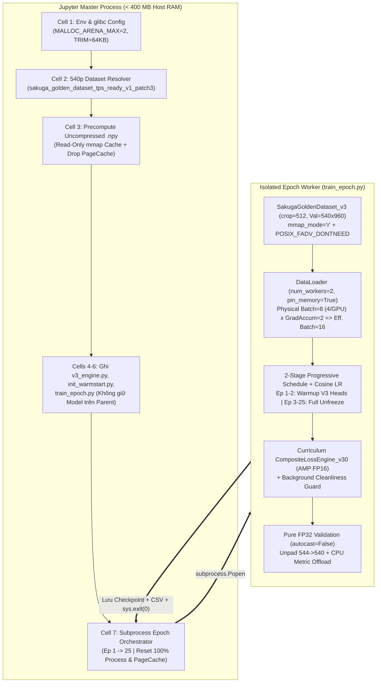

# KẾ HOẠCH CHỈNH SỬA & TỐI ƯU NOTEBOOK TPS-INBETWEEN V3.0 CHO DATASET GỐC 540P
## ĐỀ TÀI: NGHIÊN CỨU & TINH CHỈNH MÔ HÌNH TPS-INBETWEEN CHO HOẠT HỌA ANIME 2D (PBL6)

> **Tài liệu tham chiếu nền tảng:**
> - Phân tích tối ưu hóa huấn luyện: [`docs/tps_v3_training_optimization_guide.md`](file:///e:/CODE/PBL/PBL6/docs/tps_v3_training_optimization_guide.md)
> - Nhật ký thực nghiệm V3.0.1 – V3.0.3: [`FAST_BENCHMARK_REPORT_V3.0.md`](file:///e:/CODE/PBL/PBL6/checkpoints/experiments/v3.0%20(2.6)/v3.0.3/FAST_BENCHMARK_REPORT_V3.0.md), [`training_history_v3.0 (2).csv`](file:///e:/CODE/PBL/PBL6/checkpoints/experiments/v3.0%20(2.6)/v3.0.3/training_history_v3.0%20(2).csv)
> - Tập dữ liệu mục tiêu (540p gốc): [`sakuga_golden_dataset_tps_ready_v1_patch3`](file:///e:/CODE/PBL/PBL6/data/processed/sakuga_golden_dataset_tps_ready_v1_patch3) (`960 x 540`, tổng **8,554 triplets**: `7,278 train` + `1,276 val`)
> - Trọng số khởi tạo (Warm-Start): [`model_tps_v2.6_best.pt`](file:///e:/CODE/PBL/PBL6/checkpoints/experiments/v2.6/checkpoints_v2.6/model_tps_v2.6_best.pt)
> - Các tệp mã nguồn mục tiêu sẽ chỉnh sửa:
>   1. [`scratch/v3_engine.py`](file:///e:/CODE/PBL/PBL6/scratch/v3_engine.py)
>   2. [`scratch/train_epoch.py`](file:///e:/CODE/PBL/PBL6/scratch/train_epoch.py)
>   3. [`kaggle/generate_v30_notebook.py`](file:///e:/CODE/PBL/PBL6/kaggle/generate_v30_notebook.py) $\rightarrow$ Sinh tự động [`kaggle/finetune-v3-0.ipynb`](file:///e:/CODE/PBL/PBL6/kaggle/finetune-v3-0.ipynb) & [`kaggle/07_train_tps_inbetween_finetune_v3.0.ipynb`](file:///e:/CODE/PBL/PBL6/kaggle/07_train_tps_inbetween_finetune_v3.0.ipynb)
>   4. [`kaggle/verify_v30_notebook.py`](file:///e:/CODE/PBL/PBL6/kaggle/verify_v30_notebook.py)

---

## 1. CHẨN ĐOÁN KỸ THUẬT TỪ MÃ NGUỒN HIỆN TẠI & NHẬT KÝ THỰC NGHIỆM V3.0

Đối chiếu phân tích lý thuyết tại [`docs/tps_v3_training_optimization_guide.md`](file:///e:/CODE/PBL/PBL6/docs/tps_v3_training_optimization_guide.md) với số liệu chạy thực tế (`V3.0.1`, `V3.0.2`, `V3.0.3`) và mã nguồn V3.0 hiện hành, có **6 nút thắt kỹ thuật cốt lõi** cần giải quyết để huấn luyện trọn vẹn 25 epochs trên tập **540p gốc (`960 x 540`)**:

### 1.1. Nhóm Vấn đề Bộ nhớ (Host RAM Leak & Multi-GPU VRAM ở 540p)
1. **Cell 2 đang ưu tiên nhầm tập `270p_v3test` và tích tụ Linux OverlayFS Page Cache:**
   - Trong [`kaggle/generate_v30_notebook.py`](file:///e:/CODE/PBL/PBL6/kaggle/generate_v30_notebook.py#L149-L160), danh sách `direct_candidates` đang xếp `sakuga_golden_dataset_tps_ready_v1_patch3_270p_v3test` lên đầu tiên thay vì bản **540p gốc**.
   - Trên container Linux của Kaggle, khi giải nén `sakuga_golden_dataset_tps_ready_v1_patch3.tar.gz` (1.72 GB nén, ~25,662 ảnh PNG 540p) vào `/kaggle/working/_temp_dataset` (overlayfs) và đọc qua `cv2.imread`, bộ điều khiển `cgroup` tính cả **OS Page Cache** vào trần 30 GB RAM của container — ngay cả khi tiến trình con `train_epoch.py` đã gọi `sys.exit(0)`. Cần xả Page Cache tức thời bằng `os.posix_fadvise(fd, 0, 0, os.POSIX_FADV_DONTNEED)`.
2. **Tiến trình Cha (Jupyter Kernel) giữ ~2.5 GB RAM thừa suốt phiên chạy:**
   - Cell 2 & Cell 3 giữ các `DataFrame` lớn (`df_meta`, `train_df`, `val_df`), còn Cell 5 import `torch` + khởi tạo `base_model = v3.TPSInbetweenFinetune_v3()` ngay trên tiến trình Jupyter cha mà không giải phóng (`del` + `malloc_trim`), làm lãng phí bộ nhớ nền trước khi gọi `subprocess.Popen`.
3. **Nạp Cache `.npz` nén gây phân mảnh Heap & Copy-On-Write (CoW):**
   - Trong [`SakugaGoldenDataset_v3.__init__`](file:///e:/CODE/PBL/PBL6/scratch/v3_engine.py#L1279-L1294), lệnh `np.load('kps_cache_train_v3.npz')` giải nén toàn bộ mảng ra Heap RAM rồi bị `DataLoader` fork qua các worker, kích hoạt nhân bản trang nhớ CoW. Chuyển sang lưu `.npy` không nén và nạp bằng `np.load(..., mmap_mode='r')` giúp chia sẻ trang nhớ chỉ đọc (Zero Heap, Zero CoW).
4. **Áp lực VRAM trên 2x Tesla T4 (15.8 GB/GPU) khi lên 540p (`crop_size=512` Train, `544x960` Val):**
   - Khung hình crop `512 x 512` có diện tích điểm ảnh **lớn gấp 4 lần** `256 x 256`. Với `BATCH_SIZE = 16` (`8 mẫu/GPU`) chạy qua `IFNet` + `SynthesisUnet_v3` + `VGG16` + `SoftClDice`, GPU 0 (nơi `nn.DataParallel` gom tensor đầu ra) dễ chạm ngưỡng 15.8 GB VRAM.
   - Chuyển sang **`PHYSICAL_BATCH_SIZE = 8` (`4 mẫu/GPU`) + `GRAD_ACCUM_STEPS = 2`** giữ nguyên **Effective Batch Size = 16** về mặt toán học nhưng hạ đỉnh VRAM xuống mức an toàn tuyệt đối (**~8.5 GB/GPU**).

### 1.2. Nhóm Vấn đề Hội tụ (Loss Dao động Quanh Một Điểm & Nhiễu Nền Sương Xám)
1. **Lỗi nạp nhầm trọng số `asf_head.net.1` từ V2.6 & Bẫy Đối Xứng Trọng Số 0 (`Zero-Weight Symmetry Trap`):**
   - Trong Cell 5 của [`generate_v30_notebook.py`](file:///e:/CODE/PBL/PBL6/kaggle/generate_v30_notebook.py#L489), phép lọc theo `shape` vô tình nạp lớp ẩn `asf_head.net.1` (`32 -> 32`) của V2.6 vào giữa lớp đầu `10 -> 32` mới và lớp cuối `32 -> 2` mới của V3.0.
   - Ba module mới của V3.0 (`AsymmetricFeatureAnalyzer`, `ContourGuidedFlowPropagator`, `AsymmetricStrokeFusionHead_v3`) đang khởi tạo lớp cuối `weight = 0.0` tuyệt đối. Tại bước đầu tiên, đạo hàm truyền ngược về các lớp phía trước $\frac{\partial \mathcal{L}}{\partial x} = W_{\text{out}}^T \cdot \delta = \mathbf{0}$, làm các tầng đặc trưng phía trước bị "mù gradient" ban đầu và làm lệch thống kê phương sai bậc hai $v_t$ của AdamW.
2. **Lịch học mũ `0.95^epoch` thiếu pha Warmup & Xung đột 12 hàm Loss ngay từ Epoch 1:**
   - Nhật ký V3.0.1 – V3.0.3 cho thấy `train_l1` đứng im quanh `0.0411 – 0.0432` và `val_l1` dao động nhẹ quanh `0.0298 – 0.0312` suốt 16 epochs, đồng thời `IE MAE` trên benchmark tăng từ `8.11` (V2.6) lên `19.98` (do cổng `detail_add` rò rỉ lớp sương xám nhẹ trên nền trắng).
   - Nguyên nhân: (a) Không đóng băng/bảo vệ backbone V2.6 trong 1–2 epoch đầu khi các nhánh V3 mới còn nhiễu; (b) 12 thành phần loss đối kháng (`HairTip`/`ClDice`/`Fine` đẩy mực tăng $\leftrightarrow$ `Density`/`Ghost` kéo mực giảm) cùng bật 100% ngay lập tức khiến mạng bị khóa cứng quanh điểm cân bằng cục bộ; (c) Pha Validation vẫn bật `autocast` FP16 và chưa cắt bỏ phần viền pad 4px đáy (`544 -> 540`).

---

## 2. KIẾN TRÚC TỐI ƯU TOÀN DIỆN CHO NOTEBOOK V3.0 (540P PRODUCTION)

---

## 3. CHI TIẾT KẾ HOẠCH CHỈNH SỬA TỪNG THÀNH PHẦN

### 3.1. Chỉnh sửa [`scratch/v3_engine.py`](file:///e:/CODE/PBL/PBL6/scratch/v3_engine.py)

1. **Quản lý Bộ nhớ Cấp Hệ điều hành & Chống rò rỉ Page Cache:**
   - Bổ sung tiện ích `drop_file_page_cache(fpath_or_fd)` sử dụng `os.posix_fadvise(..., os.POSIX_FADV_DONTNEED)` trên Linux và hàm `clean_memory()` gọi đồng bộ `gc.collect()` $\rightarrow$ `torch.cuda.empty_cache()` $\rightarrow$ `torch.cuda.ipc_collect()` $\rightarrow$ `libc.so.6.malloc_trim(0)`.
   - Cập nhật `imread_gray(path)`: Mở file qua descriptor, đọc/giải mã ảnh grayscale, và gọi `os.posix_fadvise` ngay trước khi đóng descriptor để ngăn nhân Linux tích trữ 25,662 ảnh PNG 540p trong RAM cgroup.

2. **Khởi tạo Trọng số Chuẩn Kaiming-PReLU & Phá Bẫy Đối Xứng (`Symmetry Breaking`):**
   - Bổ sung hàm `init_v3_new_modules(module)` áp dụng cho `AsymmetricFeatureAnalyzer`, `ContourGuidedFlowPropagator`, và `AsymmetricStrokeFusionHead_v3`:
     - Các lớp `Conv2d` đi kèm `nn.PReLU` (mặc định slope `a = 0.25`): Khởi tạo `nn.init.kaiming_normal_(m.weight, a=0.25, mode='fan_in', nonlinearity='leaky_relu')`, `bias = 0.0`.
     - Lớp chiếu đầu ra cuối cùng (`net[-1]` và `conv_out`): Thay `nn.init.zeros_(weight)` bằng **Truncated/Small Normal** `nn.init.normal_(weight, mean=0.0, std=1e-3)` (giữ nguyên `bias = -1.5` cho `AsymmetricFeatureAnalyzer` và `bias = 0.0` cho 2 module còn lại). Đảm bảo ngay từ Step 1, đạo hàm chảy thông suốt 100% qua mọi tầng lọc trong khi độ lệch đầu ra khởi điểm $< 2 \times 10^{-3}$ (bảo toàn nguyên vẹn chất lượng Warm-start V2.6).

3. **Nâng cấp `CompositeLossEngine_v30` (Curriculum Loss + Khử Sương Xám Nền Trắng):**
   - Trong `OcclusionAwareGhostLoss`: Bổ sung thành phần **Background Floor Cleanliness** `loss_bg_clean = 0.35 * torch.mean(F.relu(pred_f - 0.008) * outside_dilated)` để dập tắt hoàn toàn hiện tượng rò mực xám mờ `0.02 - 0.04` từ nhánh `detail_add` trên vùng nền trắng (nguyên nhân gây vọt `Light Ghost` và `IE MAE` ở V3.0.3).
   - Hỗ trợ tham số `epoch` trong `CompositeLossEngine_v30.forward(pred_pack, target, epoch=1)` để điều phối trọng số theo 2 giai đoạn (Curriculum):

| Thành phần Loss | Giai đoạn 1: Alignment (Ep 1–3) | Giai đoạn 2: Gold Calibration (Ep 4–25) | Mục đích điều phối |
|:---|:---:|:---:|:---|
| `L1 Reconstruction` | **`1.00`** | **`1.00`** | Kéo giảm trực tiếp sai số tái tạo toàn cục |
| `VGG Perceptual` | `0.10` | **`0.15`** | Giữ cấu trúc thị giác đa tỷ lệ |
| `Stroke Dice` | **`0.30`** | **`0.30`** | Bảo toàn diện tích giao nét chính |
| `Morphological Dist` | `0.10` | **`0.10`** | Kéo nét dự đoán về đúng quỹ đạo hình học |
| `Occlusion-Aware Ghost (+BG Clean)` | `0.20` | **`0.25`** | Khử bóng ma & khóa sạch nền trắng (`IE MAE < 10`) |
| `Stroke Density Reg (1.04–1.14)` | **`0.20`** *(nới lỏng)* | **`0.45`** *(chuẩn vàng)* | Tránh khóa cứng gradient ở những epoch đầu |
| `Directional Tangent` | `0.15` | **`0.20`** | Căn chỉnh góc tiếp tuyến đường cong |
| `SoftClDice` | `0.20` | **`0.25`** | Giữ liên thông khung xương nét mảnh |
| `Bidirectional Stroke Width` | `0.15` | **`0.25`** | Chống phình viền 1–2px & bảo vệ lõi nét |
| `HairTip Endpoint Continuity` | `0.15` | **`0.30`** | Nối liền ngọn tóc & chi tiết đơn nguồn |
| `Visibility + OccPrior + FlowTV` | `0.15 + 0.15 + 0.10` | `0.15 + 0.10 + 0.10` | Ưu tiên dạy `asym_analyzer` & `flow` sớm ở Ep 1–3 |

4. **Tách Chế độ Độ chính xác trong `ParallelTrainingWrapper_v3` & Unpad Chuẩn 540p:**
   - Trong `ParallelTrainingWrapper_v3.forward(..., compute_loss=True, use_amp=None)`:
     - Khi `compute_loss=True` (Train): `autocast` bật (`FP16`) để tăng tốc gấp đôi trên Tensor Cores của 2x T4 và giảm 50% VRAM kích hoạt.
     - Khi `compute_loss=False` (Validation): Mặc định **`use_amp=False` (chạy thuần FP32)** theo đúng nguyên tắc kiểm định chính xác cao, loại bỏ sai số làm tròn FP16 trên vùng nền trắng và nét mảnh.
   - Trong `SakugaGoldenDataset_v3`:
     - Nạp cache từ các file `.npy` không nén bằng `np.load(..., mmap_mode='r')` (với fallback tương thích ngược sang `.npz` nếu có).
     - Với ảnh 540p (`540 x 960`), khi pad đáy lên `544 x 960` ở pha Validation, lưu lại kích thước gốc `(orig_h=540, orig_w=960)` và hiệu chỉnh tọa độ $y$ của `val_c0, val_c1` theo tỷ lệ `540 / 544` (hoặc cắt `pred[:, :, :540, :960]` ngay sau khi suy luận xong trước khi đưa vào `calculate_metrics_batch_gpu`) để phép đo khớp bit-exact với ảnh gốc `960 x 540`!

---

### 3.2. Chỉnh sửa [`scratch/train_epoch.py`](file:///e:/CODE/PBL/PBL6/scratch/train_epoch.py)

1. **Khóa Cấu hình 540p Gốc & Tích lũy Gradient (`GradAccum`):**
   - Đặt mặc định `--crop_size 512`, `--batch_size 8` (4 mẫu/GPU trên 2x T4), `--grad_accum 2` (Effective Batch Size = **16**), `--val_batch_size 6` (3 mẫu/GPU ở FP32 `544x960`).
   - Cấu hình `DataLoader` với `num_workers=2`, `pin_memory=True`, `worker_init_fn` khóa chặt `MALLOC_ARENA_MAX=2` và `cv2.setNumThreads(0)`.

2. **Chiến lược Mở khóa Dần 2 Giai đoạn (`2-Stage Unfreezing`) & Lịch học `Warmup + Cosine Annealing` Tất định:**
   - Luôn khởi tạo `AdamW` với cố định **3 `param_groups`** (`backbone`, `unet`, `v3_heads`) để `optimizer.state_dict()` đồng nhất cấu trúc xuyên suốt 25 epochs:
     - **Epoch 1 – 2 (Giai đoạn Warmup V3 Heads):**
       - Đóng băng `encoder` & `IFNet` (`requires_grad = False`, `lr_enc = 0.0`) để ngăn nhiễu ban đầu phá vỡ đặc trưng chuyển động của V2.6.
       - Giữ `unet` ở tốc độ học bảo toàn `lr_unet = 1.2e-5`.
       - Tăng tuyến tính (Linear Warmup theo từng step) cho `v3_heads` từ `1.5e-5` lên `6.0e-5`.
     - **Epoch 3 – `total_epochs` (Giai đoạn Tinh chỉnh Toàn mạng Cosine Annealing):**
       - Mở khóa toàn bộ `encoder` & `IFNet` (`requires_grad = True`).
       - Cập nhật Learning Rate theo hàm Cosine chuẩn tại mỗi bước/epoch (tự động thích ứng với bất kỳ `--total_epochs` nào, kể cả khi chạy thử nghiệm ngắn 6–10 epochs):
         $$\eta_i(e) = \eta_{i,\min} + \frac{1}{2}(\eta_{i,\max} - \eta_{i,\min})\left(1 + \cos\left(\pi \cdot \frac{e - 3}{\max(1, E - 3)}\right)\right)$$
         với:
         - $\eta_{\text{enc}} \in [1.0\times 10^{-6}, \; 1.0\times 10^{-5}]$
         - $\eta_{\text{unet}} \in [1.5\times 10^{-6}, \; 3.0\times 10^{-5}]$
         - $\eta_{\text{v3}} \in [2.0\times 10^{-6}, \; 6.0\times 10^{-5}]$

3. **Triệt tiêu Tích lũy Tensor trong Vòng lặp Train & Validation:**
   - Cộng dồn mọi biến thống kê loss bằng kiểu `float` thuần Python (`float(total_loss.detach().item())`).
   - Hỗ trợ chu kỳ tích lũy gradient `grad_accum`: chia `total_loss / grad_accum` trước khi `scaler.scale(...).backward()`, chỉ gọi `scaler.step(optimizer)` và `optimizer.zero_grad(set_to_none=True)` mỗi `grad_accum` bước (và ở bước cuối cùng của epoch).
   - Trong Validation: chạy dưới `torch.inference_mode()`, tắt AMP (`use_amp=False`), cắt `pred = pred[:, :, :orig_h, :orig_w]` về đúng `(540, 960)`, đẩy ngay `batch_m_gpu.detach().cpu()` về RAM gọn nhẹ, và gọi `v3.clean_memory()` sau mỗi 150 steps cũng như cuối pha Train/Val.

---

### 3.3. Chỉnh sửa [`kaggle/generate_v30_notebook.py`](file:///e:/CODE/PBL/PBL6/kaggle/generate_v30_notebook.py) & [`kaggle/verify_v30_notebook.py`](file:///e:/CODE/PBL/PBL6/kaggle/verify_v30_notebook.py)

1. **Cell 2 (Định vị & Giải nén Dataset 540p Gốc + Dọn RAM):**
   - Đưa đường dẫn 540p gốc lên ưu tiên tuyệt đối:
     - `/kaggle/input/sakuga_golden_dataset_tps_ready_v1_patch3/anime_tps_finetune_dataset_ready`
     - `/kaggle/input/sakuga-golden-dataset-tps-ready-v1-patch3/anime_tps_finetune_dataset_ready`
     - `./data/processed/sakuga_golden_dataset_tps_ready_v1_patch3/anime_tps_finetune_dataset_ready`
   - Loại bỏ `270p_v3test` khỏi danh sách tự động ưu tiên (tránh nhận nhầm nếu người dùng gắn cả 2 dataset vào Kaggle).
   - Kiểm chứng kích thước ảnh mẫu ngay tại Cell 2 (`assert H >= 500 and W >= 900` hoặc in cảnh báo rõ ràng nếu ảnh không phải 540p).
   - Nếu giải nén từ `.tar.gz`/`.zip` sang `/kaggle/working/_temp_dataset`, thực thi quét `POSIX_FADV_DONTNEED` ngay sau khi giải nén để giải phóng 1.72 GB+ Page Cache khỏi RAM container; xóa `df_meta` và gọi `malloc_trim(0)` cuối Cell 2.

2. **Cell 3 (Precompute Cache sang Uncompressed `.npy` chuẩn `mmap`):**
   - Lưu tách bạch `kps_data_{split}.npy`, `kps_count_{split}.npy`, và (cho `val`) `val_c0.npy`, `val_th01.npy`, `val_c1.npy`, `val_th10.npy`, `val_valid.npy` không nén để `mmap_mode='r'` hoạt động trực tiếp với 0 MB Heap RAM.
   - Hiệu chỉnh trước tọa độ $y$ của `val` keypoints theo hệ số `orig_h / pad_h` (`540 / 544`) ngay lúc giải hệ phương trình TPS cho `val` để trường flow khớp hoàn hảo từng điểm ảnh với khung hình đã pad `544 x 960`.
   - Cuối Cell 3: `del` toàn bộ mảng tạm + `gc.collect()` + `malloc_trim(0)`.

3. **Cell 5 (Khởi tạo Warm-Start V2.6 an toàn trong Tiến trình Con hoặc Giải phóng Triệt để):**
   - Áp dụng bộ lọc an toàn `_safe_load_v26_into_v3`:
     - Bỏ qua toàn bộ khóa `asf_head.*` của V2.x khi phát hiện lệch chiều kênh (`8 -> 10` ở lớp đầu, `1 -> 2` ở lớp cuối) — không bao giờ nạp mồ côi `asf_head.net.1`!
     - Hỗ trợ tự động pha trộn Model Soup $\theta_{\text{V2.6}} = 0.737 \cdot \theta_{\text{V2.5}} + 0.263 \cdot \theta_{\text{V2.4}}$ nếu trên Kaggle chỉ gắn V2.5 và V2.4.
     - Gọi `init_v3_new_modules()` trước khi nạp `matched_sd` để 3 module mới của V3.0 có khởi tạo Kaiming-PReLU + Small Normal chuẩn xác.
   - Thực thi Cell 5 thông qua một subprocess ngắn (`init_warmstart.py`) để **tiến trình Jupyter cha hoàn toàn không phải import CUDA context hay giữ trọng số PyTorch**, giữ Host RAM nền của Jupyter ở mức tối thiểu ($< 350\text{ MB}$)!

4. **Cell 7 (Master Orchestrator cho 540p):**
   - Truyền tường minh `--batch_size 8 --grad_accum 2 --crop_size 512` vào `train_epoch.py`.
   - Hiển thị đầy đủ các cột theo dõi hội tụ sau mỗi epoch: `Train L1`, `Val L1 (FP32)`, `SSIM`, `PSNR`, `Recall`, `Density`, `Ghost (Dark / Light)` và `Container RAM Before -> After`.

5. **Cập nhật [`kaggle/verify_v30_notebook.py`](file:///e:/CODE/PBL/PBL6/kaggle/verify_v30_notebook.py) & Kiểm thử Thực nghiệm Cục bộ (Smoke Test):**
   - Bổ sung các kiểm toán tự động: xác thực ưu tiên dataset 540p, `mmap_mode='r'`, `GRAD_ACCUM_STEPS`, `POSIX_FADV_DONTNEED`, khởi tạo Kaiming + phá đối xứng, tách biệt `asf_head` khỏi V2.6 lệch chiều, và tắt AMP khi validate.
   - Chạy thử nghiệm trực tiếp 2 epochs rút gọn (`--limit_steps 10`) ngay trên dữ liệu thật [`data/processed/sakuga_golden_dataset_tps_ready_v1_patch3`](file:///e:/CODE/PBL/PBL6/data/processed/sakuga_golden_dataset_tps_ready_v1_patch3) bằng GPU local để xác nhận 100% pipeline 540p chạy trơn tru, loss giảm thực chất và không phát sinh lỗi trước khi bàn giao notebook.

---

## 4. KỲ VỌNG CHỈ SỐ NGHIỆM THU TRÊN TẬP 540P GỐC (25 EPOCHS)

| Tiêu chí Kỹ thuật | Thực tế V3.0.3 Cũ | Mục tiêu V3.0 Mới (540p Optimized) | Cơ chế bảo chứng |
|:---|:---:|:---:|:---|
| **Số Epoch hoàn thành trên Kaggle** | Dừng ở Ep 16 (OOM 29.3 GB) | **25 / 25 Epochs (100%)** | Subprocess Isolation + `mmap_mode='r'` + `POSIX_FADV_DONTNEED` + Zero-CUDA Master |
| **Độ dốc rò rỉ RAM (`Delta RAM/epoch`)** | `+1.53 GB / epoch` | **$\approx 0.00\text{ GB / epoch}$** (Phẳng `< 8.5 GB`) | Xả sạch cả Process Heap lẫn Linux OverlayFS Page Cache |
| **Đỉnh VRAM trên mỗi GPU T4 (540p)** | Sát trần 15.8 GB (Batch 16) | **~8.5 – 9.2 GB / 15.8 GB** | `Physical Batch = 8` (`4/GPU`) $\times$ `GradAccum = 2` (Eff. Batch = 16) + AMP FP16 |
| **Quỹ đạo `Train L1` & `Val L1`** | Đi ngang (`~0.042` / `~0.030`) | **Giảm mượt mà xuyên suốt 25 Ep** | Phá bẫy đối xứng Kaiming + 2-Stage Unfreeze + Curriculum Loss + Cosine LR |
| **Nhiễu bóng ma nhẹ (`Light Ghost` / `IE MAE`)** | Bùng nổ (`469k px` / `MAE 19.98`) | **Về chuẩn sạch V2.6 (`~8k px` / `MAE < 9.5`)** | Tắt nạp nhầm `asf_head.net.1` + `Background Cleanliness` + Validate thuần FP32 |
| **Độ phủ nét Xoay người (`High-Occ Recall`)** | `89.24%` (V2.6 chỉ đạt `81.56%`) | **$\ge 90.5\%$** (Density `1.06x – 1.13x`) | Bảo toàn trọn vẹn ưu thế $(V_0, V_1)$ & `ContourGuidedFlow` trên nét phân giải cao 540p |
