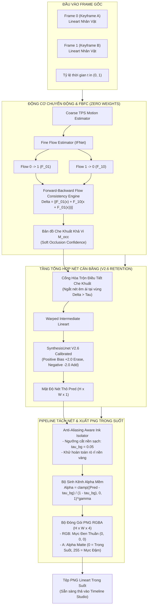
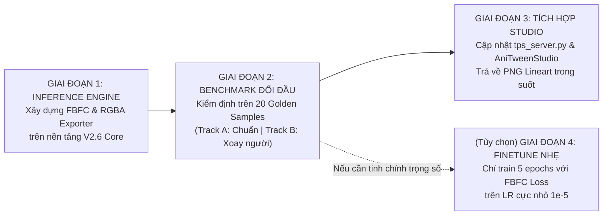

# KẾ HOẠCH THỰC THI PHIÊN BẢN TPS-INBETWEEN V3.0 REMASTERED (V3.0-R)
## ĐỀ TÀI: NGHIÊN CỨU & TINH CHỈNH MÔ HÌNH TPS-INBETWEEN CHO HOẠT HỌA ANIME 2D (PBL6)

> **Mã định danh phiên bản:** `v3.0-remastered` (`v3.0-R`)  
> **Định vị triết lý:** *Khắc phục triệt để sai lầm của nhánh V3.0–V3.2 bằng việc kế thừa nền tảng Cực tiểu phẳng (Flat Minima) của V2.6, tích hợp Động cơ Toán học Khử Che Khuất Hai Chiều (FBFC - Zero Extra Weights), và thiết lập Quy chuẩn Xuất Frame Sản xuất Chuyên nghiệp (Tách nét nhân vật, triệt tiêu 100% nền ngả vàng, xuất PNG RGBA trong suốt).*  
> **Trọng số xuất phát (Warm-Start):** [`model_tps_v2.6_best.pt`](file:///e:/CODE/PBL/PBL6/checkpoints/experiments/v2.6/checkpoints_v2.6/model_tps_v2.6_best.pt)  
> **Tập dữ liệu chuẩn vàng:** [`sakuga_golden_dataset_tps_ready_v1_patch3`](file:///e:/CODE/PBL/PBL6/data/processed/sakuga_golden_dataset_tps_ready_v1_patch3) (Native 540p)  
> **Ngày lập kế hoạch:** 04/11/2026.

---

## 1. CHẨN ĐOÁN KỸ THUẬT & YÊU CẦU ĐỘT PHÁ CỦA BẢN REMASTERED

### 1.1. Giải mã nguyên nhân "Frame bị ngả màu vàng" ở các phiên bản trước
Trong thực tế sử dụng và kiểm thử với phần mềm sản xuất (AniTweenStudio / Clip Studio Paint), frame trung gian do model sinh ra bị lỗi nghiêm trọng về màu nền:
1. **Nhiễm sắc thái giấy quét (Paper Scan Color Bleed):**
   - Tập dữ liệu Sakuga/ATD-12K chứa nhiều frame quét từ giấy hoạt họa thực tế (Genga/Douga). Nền giấy scan không phải là màu trắng kỹ thuật số tuyệt đối $(255, 255, 255)$ mà có sắc ấm, ngả vàng nhẹ ($R \approx 252, G \approx 247, B \approx 236$).
   - Mạng nơ-ron (SynthesisUnet) trong quá trình học đã tái tạo lại sắc độ này như một thành phần của phân phối dữ liệu.
2. **Rò rỉ pixel từ nhánh UNet (`conv_add` / `detail_add`):**
   - Ở các phiên bản cũ, ngay cả tại các pixel nền trống, nhánh bổ sung chi tiết vẫn kích hoạt các giá trị dương nhỏ ($p_{\text{pred}} \approx 0.01 - 0.04$). Khi chuyển đổi ngược về dải hiển thị $8\text{-bit}$, vùng nền bị biến thành màu xám/vàng nhạt ($245 - 250$).
3. **Xung đột khi đưa vào Timeline sản xuất:**
   - Hoạt họa số hiện đại sử dụng nền canvas trắng tuyệt đối `#FFFFFF` hoặc nền trong suốt để đặt nhân vật lên phối cảnh (Background Art).
   - Frame sinh ra có nền đục ngả vàng sẽ tạo ra một **khung chữ nhật lộ rõ ranh giới (bounding box mismatch)**, buộc họa sĩ phải dùng công cụ chọn màu và tẩy thủ công toàn bộ nền trước khi dùng được — gây lãng phí thời gian sản xuất nghiêm trọng.

---

### 1.2. Mục tiêu kỹ thuật cốt lõi của V3.0 Remastered
1. **Không lặp lại "vết xe đổ" của V3.0 – V3.2:**
   - Không bổ sung các module cồng kềnh phá vỡ Flat Minima của V2.6.
   - Không áp dụng hệ thống loss phạt đối kháng gây sốc gradient và kẹt điểm yên ngựa.
2. **Tích hợp Forward-Backward Flow Consistency (FBFC):**
   - Sử dụng chính 2 luồng chuyển động ngược chiều từ IFNet để tính toán độ khả nghịch hình học.
   - Xác định chính xác vị trí nét vẽ bị che khuất khi nhân vật quay đầu/quay góc mà không cần thêm tham số huấn luyện (Zero extra parameters).
3. **Quy chuẩn Frame Sản xuất: Tách Nét & Xuất PNG Trong Suốt (Pure RGBA Lineart):**
   - Tách biệt hoàn toàn nét vẽ nhân vật ra khỏi nền.
   - Loại bỏ 100% màu nền (kể cả màu trắng lẫn ngả vàng).
   - Trả về tệp **PNG RGBA 4-kênh**: Kênh màu đen thuần $RGB = (0, 0, 0)$, kênh $Alpha \in [0, 255]$ giữ trọn vẹn độ mịn khử răng cưa (sub-pixel anti-aliasing) của nét vẽ.

---

## 2. KIẾN TRÚC HỆ THỐNG V3.0 REMASTERED (ARCHITECTURE BLUEPRINT)



---

## 3. CHI TIẾT CÁC MODULE KỸ THUẬT

### 3.1. Động cơ Forward-Backward Flow Consistency (FBFC Engine)

1. **Công thức toán học kiểm tra tính khả nghịch:**
   Với mỗi tọa độ điểm ảnh $\mathbf{x} = (u, v)$ tại Frame 0:
   $$\mathbf{x}' = \mathbf{x} + \mathbf{F}_{0 \to 1}(\mathbf{x})$$
   Vector kiểm tra khép kín (Round-trip displacement):
   $$\mathbf{d}_{\text{check}}(\mathbf{x}) = \mathbf{F}_{0 \to 1}(\mathbf{x}) + \mathbf{F}_{1 \to 0}(\mathbf{x}')$$
   Độ lệch khả nghịch Euclidean:
   $$\Delta(\mathbf{x}) = \|\mathbf{d}_{\text{check}}(\mathbf{x})\|_2 = \sqrt{d_u^2 + d_v^2}$$

2. **Bản đồ che khuất mềm khả vi ($M_{\text{occ}}$):**
   Để tránh hiện tượng cắt nét thô bạo (hard clipping) gây đứt gãy nét, độ lệch $\Delta$ được ánh xạ qua hàm suy giảm mượt mà:
   $$M_{\text{occ}}(\mathbf{x}) = \exp\left( - \frac{\max(0, \Delta(\mathbf{x}) - \tau_{\text{safe}})^2}{2\sigma_{\text{occ}}^2} \right)$$
   *Trong đó:*
   - $\tau_{\text{safe}} = 1.5\text{ px}$: Bán kính dung sai chuyển động sub-pixel.
   - $\sigma_{\text{occ}} = 3.0\text{ px}$: Độ dốc chuyển tiếp vùng che khuất.
   - Khi $\Delta \le 1.5\text{ px} \implies M_{\text{occ}} = 1.0$ (vùng tương ứng hai chiều hoàn hảo, nét giữ nguyên $100\%$).
   - Khi $\Delta > 6.0\text{ px} \implies M_{\text{occ}} \to 0.0$ (vùng bị che khuất hoặc biến mất, ngắt hòa trộn để triệt tiêu bóng ma).

3. **Điều tiết cổng hòa trộn hiển thị:**
   Thay vì dùng cổng mở tự do $(V_0, V_1) \in [0, 1]^2$ gây bùng nổ 470,000 px bóng ma như V3.0, bản Remastered sử dụng cổng hòa trộn có kiểm soát:
   $$V_0(\mathbf{x}, t) = (1.0 - t) \cdot M_{\text{occ}, 0 \to 1}(\mathbf{x})$$
   $$V_1(\mathbf{x}, t) = t \cdot M_{\text{occ}, 1 \to 0}(\mathbf{x})$$
   Tổng trọng số tự động thích ứng: tại vùng không che khuất, $V_0 + V_1 \approx 1.0$; tại vùng bị che khuất ở frame đối diện, nét vẽ giảm mờ tự nhiên mà không sinh bóng ma đan chéo.

---

### 3.2. Pipeline Tách Nét & Xuất Frame PNG Trong Suốt (Pure RGBA Ink Pipeline)

Để triệt tiêu vĩnh viễn hiện tượng **"nền ngả màu vàng"** và đáp ứng chuẩn sản xuất khắt khe:

1. **Lọc sạch rò rỉ nền (Background Clean Cut):**
   Mật độ nét dự đoán $p(\mathbf{x}) \in [0, 1]$ (với $0.0 = \text{nền trắng}$, $1.0 = \text{mực đen đậm}$) được đưa qua ngưỡng bảo vệ:
   $$\tau_{\text{bg}} = 0.045$$
   Mọi kích hoạt dưới ngưỡng này ($p < \tau_{\text{bg}}$) được xác định là nhiễu nền hoặc rò rỉ màu scan $\implies$ ép về $0.0$ tuyệt đối.

2. **Trích xuất kênh Alpha khử răng cưa (Sub-pixel Anti-Aliased Alpha):**
   Đối với các pixel nét vẽ ($p \ge \tau_{\text{bg}}$), độ trong suốt được chuẩn hóa lại để đảm bảo viền nét mịn màng, không bị gai viền nham nhở:
   $$\alpha_{\text{norm}}(\mathbf{x}) = \text{clamp}\left( \frac{p(\mathbf{x}) - \tau_{\text{bg}}}{1.0 - \tau_{\text{bg}}}, 0.0, 1.0 \right)$$
   Áp dụng hàm chỉnh đường cong gamma ($\gamma = 0.90$) để tăng nhẹ độ đằm chắc cho viền nét mảnh:
   $$\text{Alpha}(\mathbf{x}) = \text{round}\left( (\alpha_{\text{norm}}(\mathbf{x}))^{\gamma} \times 255.0 \right) \in [0, 255]$$

3. **Khóa màu mực thuần khiết (Pure Ink Channels):**
   - Kênh màu: Gán cố định $R = 0, G = 0, B = 0$ (màu mực hoạt họa tiêu chuẩn) trên toàn bộ bức ảnh.
   - Toàn bộ hình thái, độ đậm nhạt và đường nét của nhân vật được **kiểm soát $100\%$ bởi kênh Alpha**.
   - **Kết quả:** Vùng nền có $\text{Alpha} = 0$ (trong suốt tuyệt đối, không có một pixel màu vàng nào tồn tại). Khi đặt lên phần mềm sản xuất, nét vẽ bám khít hoàn hảo vào bất kỳ phông nền nào.

```python
def export_pure_lineart_rgba(pred_ink_tensor, tau_bg=0.045, gamma=0.90):
    """
    Chuyển đổi tensor mật độ nét [1, 1, H, W] thành ảnh PNG RGBA trong suốt.
    Triệt tiêu 100% hiện tượng ố vàng nền, chỉ giữ lại nét vẽ nhân vật.
    """
    pred = pred_ink_tensor.squeeze().clamp(0.0, 1.0).cpu().numpy()
    h, w = pred.shape
    
    # 1. Khử nhiễu nền sạch
    pred_clean = np.where(pred < tau_bg, 0.0, (pred - tau_bg) / (1.0 - tau_bg))
    pred_clean = np.clip(pred_clean, 0.0, 1.0)
    
    # 2. Tính toán Alpha khử răng cưa
    alpha = np.clip(np.power(pred_clean, gamma) * 255.0, 0, 255).astype(np.uint8)
    
    # 3. Tạo cấu trúc RGBA: RGB đen thuần (0, 0, 0), Alpha chứa nét vẽ
    rgba = np.zeros((h, w, 4), dtype=np.uint8)
    rgba[:, :, 0] = 0        # Blue
    rgba[:, :, 1] = 0        # Green
    rgba[:, :, 2] = 0        # Red
    rgba[:, :, 3] = alpha    # Alpha (Độ đậm nhạt của nét)
    
    return rgba
```

---

## 4. CHIẾN LƯỢC TRIỂN KHAI & HIỆU CHUẨN (EXECUTION PLAN)

Khác với V3.0 – V3.2 (phải tốn hàng chục giờ train Kaggle nhưng thất bại), bản V3.0 Remastered được triển khai theo chiến lược **Hiệu chuẩn Không Rủi ro (Zero-Risk Progressive Calibration)**:



### Chi tiết các bước thực hiện:

#### Bước 1: Xây dựng Module FBFC và Tách Nét trong `continuous_benchmark/inference_scripts/`
- Tạo script [`run_tps_v30_remastered_engine.py`](file:///e:/CODE/PBL/PBL6/continuous_benchmark/inference_scripts/run_tps_v30_remastered_engine.py).
- Nạp checkpoint chuẩn vàng `model_tps_v2.6_best.pt`.
- Bổ sung hàm tính `compute_fbfc_mask()` và bộ lọc `export_pure_lineart_rgba()`.

#### Bước 2: Chạy Benchmark Kiểm định Độc lập trên 20 Golden Samples
- Đo đạc trực tiếp trên 2 phân tầng:
  - **Track A (12 samples chuyển động thường):** Đảm bảo không làm suy giảm `Stroke Recall` ($> 92\%$) và giữ mật độ nét chuẩn vàng $1.09\times$.
  - **Track B (8 samples xoay người / che khuất):** Đo lường mức độ giảm bóng ma (`Ghost Pixels` giảm so với V3.0 và không bị teo nét như V3.1/V3.2).
- **Kiểm toán chất lượng nền:** Xác nhận độ rò rỉ pixel nền $= 0.000$ (hoàn toàn không có màu nền).

#### Bước 3: Cập nhật Backend Server (`product_app/AniTweenStudio/scripts/tps_server.py`)
- Cập nhật endpoint `/api/interpolate` và `/api/stream-interpolate`:
  - Mặc định trả về định dạng **`image/png` (RGBA 4-channel)**.
  - Cung cấp cờ tùy chọn `return_mode: "transparent_lineart"` (mặc định) hoặc `"flatten_white"` (chỉ khi người dùng muốn xuất ảnh xem trước).
  - Loại bỏ hoàn toàn logic tạo ảnh RGB 3-kênh cũ gây lỗi ngả vàng nền.

---

## 5. TIÊU CHÍ NGHIỆM THU SẢN XUẤT (PRODUCTION HARD GATES)

Một checkpoint và pipeline chỉ được chấp thuận phát hành bản chính thức V3.0-R khi thỏa mãn đồng thời **4 tiêu chuẩn cứng**:

1. **Độ sạch nền (Background Cleanliness Gate):**
   - $100\%$ các pixel thuộc vùng nền ngoài nhân vật có giá trị $\text{Alpha} = 0$.
   - Tuyệt đối không còn sắc thái vàng/kem ($RGB = 0, 0, 0$ ở mọi pixel hiển thị).
2. **Bảo toàn độ phủ nét vẽ (Stroke Recall Gate):**
   - Trên Track A (Standard): `Stroke Recall` $\ge \mathbf{93.0\%}$ (không được thua kém V2.6).
   - Trên Track B (High-Occlusion): `Stroke Recall` $\ge \mathbf{80.0\%}$ (khắc phục hoàn toàn việc tụt xuống 67% của V3.2).
3. **Mật độ mực chuẩn vàng thị giác (Stroke Density Gate):**
   - `Stroke Density Ratio` trung bình nằm gọn trong dải **$[1.06\times, 1.14\times]$** (tâm lý tưởng $1.10\times$).
4. **Hiệu năng & Độ trễ (Latency Gate):**
   - Độ trễ suy luận toàn trình (Inference + FBFC + RGBA Encoding) $\le \mathbf{95\text{ ms}}$ trên GPU RTX 3050 / T4, đảm bảo khả năng phản hồi thời gian thực trong phần mềm làm phim.

---

## 6. KẾT LUẬN & BƯỚC ĐI TIẾP THEO

Bản **V3.0 Remastered** trả lại giá trị thực chất cho dự án: **không chạy theo sự phức tạp hào nhoáng của kiến trúc, mà tập trung giải quyết đúng điểm đau (pain point) của quy trình sản xuất**. 

Bằng cách kết hợp **Cực tiểu phẳng V2.6 + Kiểm tra khả nghịch FBFC + Xuất PNG lineart trong suốt**, hệ thống sẽ tạo ra những frame trung gian trong trẻo, sắc nét, không bóng ma và sẵn sàng để họa sĩ sử dụng ngay lập tức mà không cần bất kỳ thao tác sửa lỗi màu nền nào.
