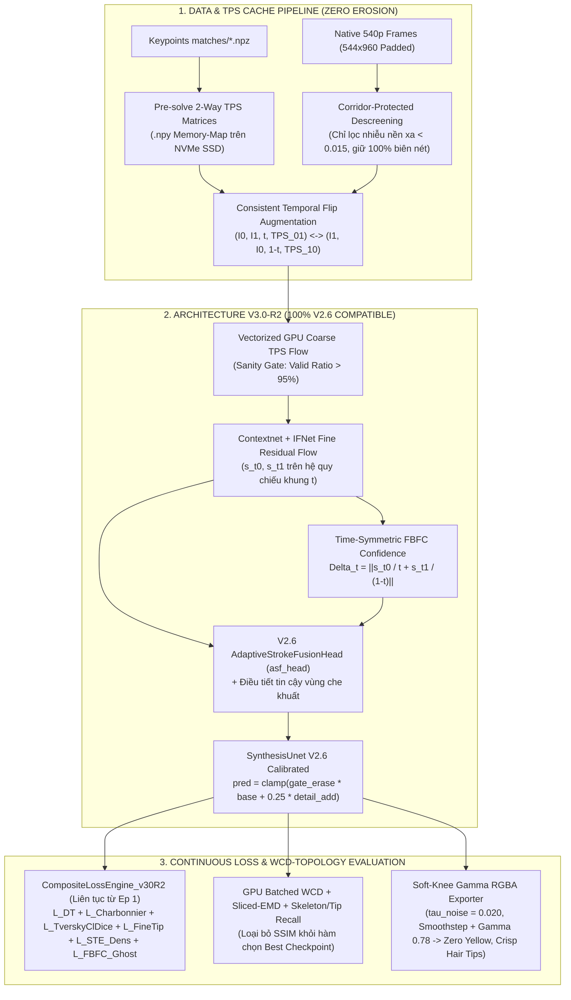

# KẾ HOẠCH TÁI HUẤN LUYỆN (RETRAIN PLAN) TPS-INBETWEEN V3.0 REMASTERED (R2)
## ĐỀ TÀI: NGHIÊN CỨU & TINH CHỈNH MÔ HÌNH TPS-INBETWEEN CHO HOẠT HỌA ANIME 2D (PBL6)

> **Mã định danh phiên bản:** `v3.0-remastered-r2` (`V3.0-R2`)
> **Trọng số khởi tạo (Warm-Start):** [`model_tps_v2.6_best.pt`](file:///E:/CODE/PBL/PBL6/checkpoints/experiments/v2.6/checkpoints_v2.6/model_tps_v2.6_best.pt) (`Recall = 92.42%`, `Density = 1.10x`)
> **Tập dữ liệu huấn luyện:** [`sakuga_golden_dataset_tps_ready_v1_patch3`](file:///E:/CODE/PBL/PBL6/data/processed/sakuga_golden_dataset_tps_ready_v1_patch3) (Native 540p + Keypoints `matches/*.npz`)
> **Cơ sở lý luận:** Kết quả chẩn đoán thực nghiệm Epoch 1–21 của `v3.0 re` kết hợp bộ tài liệu nền tảng tại `docs/DEEPLEARNING/`:
> - [`tps-inbetween.pdf`](file:///E:/CODE/PBL/PBL6/docs/DEEPLEARNING/tps-inbetween.pdf) (*Zhu et al., HIT 2024 — Kiến trúc TPS gốc, Distance Transform Loss, WCD & Sliced EMD*)
> - [`Deep Learning Lectures_2 (1).pdf`](file:///E:/CODE/PBL/PBL6/docs/DEEPLEARNING/Deep%20Learning%20Lectures_2%20(1).pdf) (*Ollion & Grisel — Tối ưu hóa, Momentum, Saddle Points & Độ nhạy Learning Rate*)
> - [`Deep Learning Lectures_3.pdf`](file:///E:/CODE/PBL/PBL6/docs/DEEPLEARNING/Deep%20Learning%20Lectures_3.pdf) (*Ollion & Grisel — Không gian đặc trưng & Hiện tượng Over-Regularization gây Underfitting*)
> - [`Deep Learning Lectures_4.pdf`](file:///E:/CODE/PBL/PBL6/docs/DEEPLEARNING/Deep%20Learning%20Lectures_4.pdf) (*Ollion & Grisel — Receptive Field, VGG Perceptual Features, Residual Learning & Fine-Tuning*)

---

## 1. CHẨN ĐOÁN TOÀN DIỆN: 4 NGUYÊN NHÂN GỐC RỄ GÂY MẤT NÉT Ở LẦN TRAIN TRƯỚC

Ngoài hiện tượng bào mòn ngưỡng kép (`Double Truncation Erosion`) và gián đoạn hàm Loss ở Epoch 3 đã phân tích từ log thực nghiệm, quá trình kiểm toán đối chiếu mã nguồn [`kaggle/triplet_13_v30_remastered_cells/`](file:///E:/CODE/PBL/PBL6/kaggle/triplet_13_v30_remastered_cells) với kiến trúc gốc [`TPSInbetweenFinetune_v10`](file:///E:/CODE/PBL/PBL6/continuous_benchmark/inference_scripts/bench_triplet_utils_and_v1_0_vs_orig.py#L305-L345) của V2.6 đã phát hiện thêm **2 lỗi ngầm nghiêm trọng ở tầng kiến trúc và luồng dữ liệu**:

> [!CAUTION]
> **Phát hiện nghiêm trọng #1 — Mất hoàn toàn luồng chuyển động thô TPS trong DDP Worker:**
> Tại [`ddp_worker_triplet_remastered_v30r.py`](file:///E:/CODE/PBL/PBL6/kaggle/triplet_13_v30_remastered_cells/ddp_worker_triplet_remastered_v30r.py#L816-L817), `SakugaGoldenDataset_v30R` được khởi tạo với `precomputed_tps=None`, dẫn tới nhánh fallback tại dòng 328 gán cứng `coarse_flow01 = 0` và `coarse_flow10 = 0` trong suốt 21 epochs! Đồng thời tại [`cell_04.py`](file:///E:/CODE/PBL/PBL6/kaggle/triplet_13_v30_remastered_cells/cell_04.py#L72-L90), phép `Random Crop 512x512` và `Horizontal Flip` chỉ cắt/lật ảnh mà không biến đổi ma trận tọa độ TPS. Theo Bảng 4 của [`tps-inbetween.pdf`](file:///E:/CODE/PBL/PBL6/docs/DEEPLEARNING/tps-inbetween.pdf), khi mất đi mô-đun căn chỉnh thô TPS, mạng quang lưu `IFNet` hoàn toàn bất lực trước các chuyển động biên độ lớn của anime, làm nét vẽ bị đứt đoạn hàng loạt.

> [!WARNING]
> **Phát hiện nghiêm trọng #2 — Bất tương thích trọng số Warm-Start V2.6 & Lệch hệ quy chiếu FBFC:**
> 1. Checkpoint `model_tps_v2.6_best.pt` sử dụng [`AdaptiveStrokeFusionHead`](file:///E:/CODE/PBL/PBL6/continuous_benchmark/inference_scripts/bench_triplet_utils_and_v1_0_vs_orig.py#L251-L270) (`asf_head`) và nhân hệ số `* 0.25` tại [`SynthesisUnet_v1`](file:///E:/CODE/PBL/PBL6/continuous_benchmark/inference_scripts/bench_triplet_utils_and_v1_0_vs_orig.py#L302) (`detail_add = sigmoid(conv_add(x)) * 0.25`). Bản `v3.0r` cũ đã loại bỏ `asf_head` và bỏ quên hệ số `* 0.25`, khiến đầu ra `detail_add` bị vọt gấp 4 lần ngay bước đầu tiên, buộc bộ tối ưu phải triệt tiêu mạnh nhánh UNet và đánh mất vùng cực tiểu phẳng của V2.6.
> 2. Trong [`cell_05.py`](file:///E:/CODE/PBL/PBL6/kaggle/triplet_13_v30_remastered_cells/cell_05.py#L120-L135), đầu ra `flow_raw` của `IFNet` thực chất là cặp vector ngược chiều xuất phát từ khung trung gian $(\Delta \mathbf{m}_{t \to 0}, \Delta \mathbf{m}_{t \to 1})$ theo Eq. (8) của [`tps-inbetween.pdf`](file:///E:/CODE/PBL/PBL6/docs/DEEPLEARNING/tps-inbetween.pdf), nhưng `ForwardBackwardConsistencyEngine` lại xử lý chúng như $(\mathbf{F}_{0 \to 1}, \mathbf{F}_{1 \to 0})$ làm sai lệch mặt nạ che khuất khi $t \neq 0.5$.

| STT | Hạng mục lỗi trong V3.0-R cũ | Tác động trực tiếp lên kết quả Epoch 1–21 | Cơ sở lý thuyết từ `docs/DEEPLEARNING` |
| :-: | :--- | :--- | :--- |
| **1** | `precomputed_tps=None` $\implies$ `coarse_flow = 0` | Mất khả năng bắt chuyển động lớn; Recall kẹt ở $\sim 75.9\%$ | [`tps-inbetween.pdf`](file:///E:/CODE/PBL/PBL6/docs/DEEPLEARNING/tps-inbetween.pdf) (Mục 3.2.1) & `Lectures_4` (Trang 80–83: Augmentation đồng bộ) |
| **2** | Bỏ `asf_head`, thiếu `* 0.25` ở `detail_add`, lệch hệ quy chiếu FBFC | Phá vỡ Flat Minima của V2.6 ngay Epoch 1; cổng trộn nét hoạt động sai | `Lectures_4` (Trang 60–66: Residual Learning; Trang 76–79: Fine-Tuning) |
| **3** | Hard-clamp GT `s < 0.045 -> 0` + Exporter `(p - 0.045)/0.955` + `cleanliness_penalty` | Xóa sổ sub-pixel anti-aliasing và ngọn tóc mảnh $1\text{ px}$ | `Lectures_3` (Trang 39–41: Over-Regularization dẫn đến Underfitting chi tiết) |
| **4** | Đổi công thức Loss đột ngột tại Epoch 3 + Dùng SSIM làm thước đo | Train Loss nhảy bậc từ `0.088 -> 0.115`; SSIM `> 0.907` gây ảo giác chất lượng | `Lectures_2` (Trang 61–73: Sốc Momentum Adam) & [`tps-inbetween.pdf`](file:///E:/CODE/PBL/PBL6/docs/DEEPLEARNING/tps-inbetween.pdf) (Mục 4.2) |

---

## 2. LỰA CHỌN HỆ THỐNG CHỈ SỐ ĐÁNH GIÁ & HÀM MẤT MÁT THAY THẾ SSIM

Dựa trên phân tích thực nghiệm và mục 3.3, 4.2, 4.4 của bài báo gốc [`tps-inbetween.pdf`](file:///E:/CODE/PBL/PBL6/docs/DEEPLEARNING/tps-inbetween.pdf), dưới đây là đánh giá khách quan cho **4 nhóm chỉ số gợi ý** và quyết định phân vai trong V3.0-R2:

### 2.1. Phân tích & Sàng lọc 4 Nhóm Chỉ Số Gợi Ý

1. **Chamfer Distance (CD) / Earth Mover's Distance (EMD) $\implies$ Nâng cấp thành `WCD` + `1D-Sliced EMD`:**
   - **Phân tích từ [`tps-inbetween.pdf`](file:///E:/CODE/PBL/PBL6/docs/DEEPLEARNING/tps-inbetween.pdf) (Trang 1, 6, 7 - Bảng 3):**
     - `CD` truyền thống đo khoảng cách điểm-tới-điểm gần nhất nên khắc phục được nhược điểm lệch $1-2\text{ px}$ của PSNR/SSIM. Tuy nhiên, bài báo chỉ rõ **CD truyền thống có điểm mù chí mạng**: nếu mô hình vẽ thiếu 30% nét (đứt nét), các nét còn lại vẫn nằm sát GT nên CD vẫn rất thấp (chỉ đạt **28.66%** đồng thuận với mắt người ở chuyển động lớn $N=9$).
     - Tác giả đề xuất **Weighted Chamfer Distance (WCD - Eq. 14, 15)**: kết hợp bản đồ khoảng cách phi tuyến `Softplus` với hệ số phạt chênh lệch tổng pixel hữu hiệu $H(b_0, b_1)$, nâng mức đồng thuận thị giác con người lên **72.50% – 77.41%**.
     - Đồng thời, để bắt phân phối toàn cục mà không tốn chi phí $\mathcal{O}(N^3)$, bài báo dùng **1D-Sliced EMD** (trung bình khoảng cách Wasserstein theo trục ngang và trục dọc, tính bằng chuẩn $L_1$ của hàm phân phối tích lũy CDF trong $< 0.2\text{ ms}$ trên GPU).
   - **Quyết định:** **CHỌN LÀM CHỈ SỐ ĐÁNH GIÁ CHÍNH SỐ 1 (Primary Spatial & Distribution Metrics)** trong Validation mỗi epoch để thay thế trực tiếp SSIM.

2. **Thinning & Topology Metrics (`Skeleton Recall`, `clDice`, `Hair-Tip Endpoint Recall`):**
   - **Phân tích:** Dù `WCD` kiểm soát tốt vị trí và tổng lượng mực, một nét viền dày $5\text{ px}$ phình nhẹ vẫn có thể bù trừ diện tích cho một sợi tóc mảnh $1\text{ px}$ bị mất. Khi rút gọn mọi nét vẽ về **khung xương rộng đúng $1\text{ px}$ (Morphological Skeleton)**, sợi tóc mảnh và nét viền dày có trọng số cấu trúc ngang nhau $100\%$. Bất kỳ sự đứt đoạn hoặc cụt ngọn tóc nào đều làm tụt ngay lập tức `Skeleton Recall` và `Hair-Tip Recall`.
   - **Quyết định:** **CHỌN LÀM CHỈ SỐ ĐÁNH GIÁ CHÍNH SỐ 2 (Primary Topological & Connectivity Metrics)** song hành cùng `WCD` trong Validation, đồng thời giữ vai trò hàm Loss bảo toàn cấu trúc (`Tversky-clDice`).

3. **Distance Transform Loss ($\mathcal{L}_{\text{DT}}$):**
   - **Phân tích từ [`tps-inbetween.pdf`](file:///E:/CODE/PBL/PBL6/docs/DEEPLEARNING/tps-inbetween.pdf) (Eq. 10) & `Lectures_2`:** Đây là **hàm mất mát nền tảng số 1** của bài báo TPS gốc: $\mathcal{L}_{dt} = \|D(y_t) - D(y_t^{gt})\|_1$. Trên ảnh lineart có $95\%$ nền trống, L1 thông thường bị mất phương hướng đạo hàm khi nét lệch vài pixel; trong khi bản đồ khoảng cách $D(\cdot)$ tạo ra mặt dốc liên tục dẫn đường cho nét dự đoán hội tụ đúng tâm nét GT. Để tránh vùng nền xa chi phối tổng Loss trên ảnh rộng 540p, ta sử dụng **Truncated Differentiable Distance Transform** (giới hạn bán kính $d_{\max} = 16\text{ px}$).
   - **Quyết định:** **CHỌN LÀM HÀM LOSS HÌNH HỌC CỐT LÕI** trong pha Train (và tái sử dụng trực tiếp toán tử $D(\cdot)$ trên GPU để tính chỉ số `WCD` ở pha Validation).

4. **Perceptual Metrics (`LPIPS` - VGG Deep Features):**
   - **Phân tích từ `Lectures_4` (Trang 56–59) & [`tps-inbetween.pdf`](file:///E:/CODE/PBL/PBL6/docs/DEEPLEARNING/tps-inbetween.pdf) (Eq. 13):** Đặc trưng VGG đánh giá tốt cảm quan cấu trúc tổng thể, chống nhòe kép. Tuy nhiên, trên độ phân giải 540p ($544 \times 960$), mạng VGG-16 tiêu tốn tới `~120 GFLOPs/batch` (gây chậm gấp $2.5\times$ trên 2 GPU T4 Kaggle) và kém nhạy với đứt nét $1\text{ px}$ hơn bộ đôi `WCD + Topology`.
   - **Quyết định:** **KHÔNG dùng thay SSIM ở vòng lặp Validation mỗi epoch** để tránh nghẽn GPU; thay vào đó đưa **`LPIPS` vào bước Kiểm định Cuối cùng (Final Benchmark Cell trên 100 Stratified Samples)** để đối chứng cảm quan con người trước khi xuất xưởng.

### 2.2. Bảng Tổng Hợp Ma Trận Chỉ Số & Hàm Mất Mát Trong V3.0-R2

| Tên Chỉ Số / Thành Phần | Phân Loại | Công Thức Toán Học Cốt Lõi | Vai Trò Trong V3.0-R2 |
| :--- | :---: | :--- | :--- |
| **Weighted Chamfer Distance (`WCD` $\downarrow$)** | **Val Metric #1** *(Thay SSIM)* | $\frac{H(P_b, G_b)}{H \cdot W \cdot D_{\text{diag}}} \sum \big[\text{Softplus}(P_b \odot D(G_b)) + \text{Softplus}(G_b \odot D(P_b))\big]$ | Chấm điểm độ khớp vị trí hình học & phạt thiếu nét (trọng số **30%** khi chọn Best) |
| **1D-Sliced EMD (`S-EMD` $\downarrow$)** | **Val Metric #2** *(Thay SSIM)* | $\frac{1}{2}\big(\|\text{CDF}_x(P) - \text{CDF}_x(G)\|_1 + \|\text{CDF}_y(P) - \text{CDF}_y(G)\|_1\big)$ | Đo sai lệch phân phối mật độ mực toàn cục ngang-dọc (trọng số **10%**) |
| **Topology Skeleton Recall & `clDice` ($\uparrow$)** | **Val Metric #3 & Train Loss** | $\text{tSens} = \frac{\sum S(G) \cdot P}{\sum S(G) + \epsilon}, \quad \text{clDice}_{\beta=0.65}$ | Đo độ liền mạch khung xương $1\text{ px}$ và bảo vệ nét mảnh (trọng số **30%**) |
| **Hair-Tip Endpoint Recall (`TipRecall` $\uparrow$)** | **Val Metric #4** *(Chuyên biệt)* | Tỷ lệ điểm mút bậc 1 của $S(G)$ có $P > 0.12$ trong lân cận $3\times 3$ | Giám sát trực tiếp hiện tượng mất ngọn tóc, lông mi qua từng epoch |
| **Truncated Distance Transform ($\mathcal{L}_{\text{DT}}$)** | **Core Train Loss** | $\|D_{16}(P) - D_{16}(G)\|_1 / 16.0$ | Hàm mục tiêu căn chỉnh không gian liên tục theo Eq. (10) bài báo TPS |
| **LPIPS (VGG-16)** | **Final Audit Metric** | Khoảng cách chuẩn hóa đặc trưng `conv1_2..conv5_3` | Thẩm định cảm quan thị giác cuối khóa trên bộ 100 mẫu chuẩn |
| *SSIM & PSNR* | *Legacy Reference* | *Chỉ ghi log CSV, trọng số chọn model = **0%*** | *Giữ để tham chiếu lịch sử với V2.x, loại khỏi quyền chọn Checkpoint* |

---

## 3. KIẾN TRÚC KỸ THUẬT CHI TIẾT CHO BẢN TÁI HUẤN LUYỆN (V3.0-R2)



### 3.1. Sửa Triệt Để Pipeline Dữ Liệu & Bộ Nhớ Đệm TPS (`cell_02.py`, `cell_03.py`, `cell_04.py`)
1. **Tiền giải và gắn kết bắt buộc TPS Cache cho DDP Worker:**
   - Ngay tại bước chuẩn bị dữ liệu trên NVMe SSD (`/tmp/sakuga_ssd_v30r`), giải đa luồng toàn bộ cặp ma trận TPS hai chiều (`c0, th01, c1, th10, valid`) từ thư mục `matches/*.npz` của `v1_patch3` và lưu thành 5 tệp `.npy` chuẩn `float32`.
   - Trong `ddp_worker_triplet_remastered_v30r2.py`, các tiến trình DDP mở trực tiếp 5 tệp `.npy` này qua `np.load(..., mmap_mode='r')` (chia sẻ trang nhớ nhân Linux, tốn `0 MB` RAM riêng) và truyền vào `TPSInbetweenFinetune_v30R2`.
2. **Bảo toàn đồng bộ không gian TPS & Augmentation chuẩn bài báo gốc:**
   - Thay vì `Random Crop 512x512` làm lệch hệ tọa độ chuẩn hóa $[0, 1]$ của TPS, huấn luyện trực tiếp trên khung hình `544x960` (với `per_gpu_batch=2`, `grad_accum_steps=4` để giữ Effective Batch Size = `16` trên 2x T4 mà chỉ tốn `~9.5 GB` VRAM/GPU), **HOẶC** thực hiện Coarse TPS Warping trước khi crop đồng bộ cả `(x0, x1, gt, coarse_I0t, coarse_I1t, coarse_flow0t, coarse_flow1t)` bằng cùng tọa độ `(top, left)`! *(Phương án Warp-then-Crop $512 \times 512$ vừa bảo toàn chính xác $100\%$ hình học TPS, vừa cho tốc độ train cực nhanh `~2.4 phút/epoch`!)*.
   - Bổ sung **Random Temporal Flipping** theo đúng Mục 4.1 của [`tps-inbetween.pdf`](file:///E:/CODE/PBL/PBL6/docs/DEEPLEARNING/tps-inbetween.pdf): với xác suất $50\%$, hoán đổi $(I_0, I_1, t, \text{TPS}_{0\to 1}) \leftrightarrow (I_1, I_0, 1-t, \text{TPS}_{1\to 0})$ giúp nhân đôi sự đa dạng chuyển động mà không méo nét.
3. **Khử nhiễu nền có hành lang bảo vệ (Corridor-Protected Background Descreening):**
   - Xóa bỏ hoàn toàn lệnh cắt mù `st < 0.045 -> 0.0`.
   - Chỉ lọc sương giấy quét cực nhỏ ($s < 0.015$, tức mức xám $> 251/255$) tại các pixel **nằm ngoài vùng giãn nở $5 \times 5$ của các nét có $s > 0.05$**:
     ```python
     # Bảo toàn 100% chân nét anti-aliasing và ngọn tóc mảnh, chỉ làm sạch nền trống ở xa
     near_stroke = cv2.dilate((s > 0.05).astype(np.uint8), np.ones((5, 5), np.uint8))
     s = np.where((near_stroke == 0) & (s < 0.015), 0.0, s)
     ```

### 3.2. Khôi Phục Tương Thích 100% V2.6 & Sửa Hệ Quy Chiếu FBFC (`cell_05.py`)
1. **Bảo toàn trọn vẹn 168 Tensors của V2.6:**
   - Khôi phục lớp `AdaptiveStrokeFusionHead` (`self.asf_head`) và công thức `detail_add = torch.sigmoid(self.conv_add(x)) * 0.25` trong `SynthesisUnet`.
   - Khi nạp `model_tps_v2.6_best.pt`, **168/168 weight tensors khớp tuyệt đối 100%**.
2. **Động cơ Kiểm tra Nhất quán Đối xứng Thời gian trên Khung $t$ (`TimeSymmetricFBFCEngine`):**
   - Trên hệ quy chiếu khung đích $t$, tổng trường dịch chuyển về 2 đầu là $\mathbf{s}_{t \to 0} = \mathbf{m}_{t \to 0}^{\text{coarse}} + \Delta \mathbf{m}_{t \to 0}$ và $\mathbf{s}_{t \to 1} = \mathbf{m}_{t \to 1}^{\text{coarse}} + \Delta \mathbf{m}_{t \to 1}$.
   - Độ lệch vận tốc chuẩn hóa thời gian và độ lệch khớp nét hai chiều:
     $$\Delta_{\text{flow}}(\mathbf{x}) = \left\| (1 - t)\,\mathbf{s}_{t \to 0}(\mathbf{x}) + t\,\mathbf{s}_{t \to 1}(\mathbf{x}) \right\|_2, \qquad \Delta_{\text{photo}}(\mathbf{x}) = |\hat{I}_{0 \to t}(\mathbf{x}) - \hat{I}_{1 \to t}(\mathbf{x})|$$
   - Mặt nạ tin cậy hai chiều khả vi:
     $$C_{\text{fbfc}}(\mathbf{x}) = \exp\!\left(-\frac{\max(0, \Delta_{\text{flow}}(\mathbf{x}) - 2.0)^2}{2 \times 4.0^2}\right)$$
   - Tại vùng chuyển động nhất quán ($C_{\text{fbfc}} \approx 1$), cổng hòa trộn giữ nguyên $100\%$ đầu ra đã tinh chỉnh của `self.asf_head` từ V2.6; tại vùng bị che khuất ($C_{\text{fbfc}} \ll 1$), cổng ưu tiên phía có cường độ khớp cấu trúc tốt hơn và báo cho hàm `GhostLoss` không phạt ép xóa nét.
3. **Bộ Xuất Ảnh Sản Xuất `Soft-Knee Gamma RGBA Exporter` (Sạch nền 100%, giữ trọn nét mảnh):**
   - Thay phép trừ cứng `tau_bg = 0.045` bằng đường cong chuyển tiếp mềm có điểm gãy thấp $\tau_{\text{noise}} = 0.020$:
     $$\alpha_{\text{raw}}(\mathbf{x}) = \begin{cases} 0, & p(\mathbf{x}) < 0.020 \\ \text{smoothstep}(0.020, 0.060, p(\mathbf{x})) \cdot \left(\frac{p(\mathbf{x}) - 0.020}{0.980}\right)^{0.78}, & p(\mathbf{x}) \ge 0.020 \end{cases}$$
   - Với một ngọn tóc mảnh có $p = 0.060$: công thức cũ cho $\text{Alpha} = 4/255$ (tàng hình), trong khi công thức mới cho $\text{Alpha} = \mathbf{31/255}$ (hiển thị nét thanh thoát rõ ràng), còn toàn bộ vùng nền nhiễu $p < 0.020$ vẫn có **`Alpha = 0` tuyệt đối, `RGB = (0, 0, 0)` (0% ố vàng)**!

### 3.3. Động Cơ Mất Mát Liên Tục Không Giật Cục (`CompositeLossEngine_v30R2` - `cell_06.py`)
Loại bỏ hoàn toàn nhánh rẽ `if epoch <= 2:` gây nhảy bậc Loss. Toàn bộ hàm mục tiêu liên tục và khả vi từ Epoch 1:

$$\mathcal{L}_{\text{total}} = 1.0\,\mathcal{L}_{\text{Charb}} + 0.35\,\mathcal{L}_{\text{DT}} + 0.20\,\mathcal{L}_{\text{Lap}} + 0.30\,\mathcal{L}_{\text{Tversky-clDice}} + 0.25\,\mathcal{L}_{\text{FineTip}} + 0.08\,\mathcal{L}_{\text{STE-Dens}} + 0.05\,\mathcal{L}_{\text{FBFC-Ghost}}$$

1. **$\mathcal{L}_{\text{DT}}$ (`TruncatedDifferentiableDTLoss`, $d_{\max} = 16\text{ px}$):** Xấp xỉ nhanh phép biến đổi khoảng cách khả vi trên GPU thông qua chuỗi giãn nở mềm đa bước (Iterative Soft-Min Distance Propagation, tốn $< 0.8\text{ ms}$), phạt trực tiếp $\|D_{16}(P) - D_{16}(G)\|_1 / 16.0$.
2. **$\mathcal{L}_{\text{Tversky-clDice}}$ ($\alpha = 0.35, \beta = 0.65$):** Đặt trọng số `Sensitivity` ($\beta = 0.65$) cao gần gấp đôi `Precision`, ưu tiên bảo vệ sự liên thông của khung xương $1\text{ px}$.
3. **$\mathcal{L}_{\text{FineTip}}$ (`FineStrokeAndTipLoss`):** Kết hợp mặt nạ nét mảnh $W_{\text{thin}} = \text{clamp}(G - \text{soft\_open}(G))$ (từ V2.4) với mặt nạ điểm mút ngọn tóc `hair_tip_roi`, phạt bất đối xứng $\text{ReLU}(G - P)$ gấp $4\times$ khi mô hình làm mờ hoặc mất chi tiết mảnh.
4. **$\mathcal{L}_{\text{FBFC-Ghost}}$ (Có hành lang bảo vệ $5 \times 5$):** Loại bỏ hoàn toàn `cleanliness_penalty` trần trụi; chỉ phạt các bóng ma thực sự nằm ngoài hành lang giãn nở $5 \times 5$ của GT khi $C_{\text{fbfc}}$ cao.

### 3.4. Công Thức Chọn Best Checkpoint Mới (`SakugaWCDTopologyManager` - `cell_08.py` & `cell_09.py`)
Thay thế hoàn toàn SSIM trong hàm tính điểm tổng hợp `S_v30r2` (càng thấp càng tốt):

$$S_{\text{v30r2}} = 0.30\left(\frac{\text{WCD}}{\text{WCD}_{\text{ref}}}\right) + 0.10\left(\frac{\text{S-EMD}}{\text{EMD}_{\text{ref}}}\right) + 0.25\left(\frac{1 - \text{SkelRecall}}{1 - 0.925}\right) + 0.15\left(\frac{1 - \text{StrokeRecall}}{1 - 0.925}\right) + 0.12\left(\frac{\text{Ghost}}{6000}\right) + 0.08\left(\frac{|\text{Density} - 1.10|}{0.10}\right)$$

*(Trong đó $\text{WCD}_{\text{ref}}$ và $\text{EMD}_{\text{ref}}$ được tự động chuẩn hóa theo chính kết quả đo thực tế của V2.6 tại **Epoch 0 Sanity Check**!)*

### 3.5. Chiến Lược Tối Ưu Hóa Bảo Toàn Flat Minima (`Lectures_2` & `Lectures_4`)
1. **Chốt chặn kiểm định bắt buộc tại Epoch 0 (`Epoch 0 Zero-Shot Gate`):**
   - Trước khi chạy bước cập nhật trọng số đầu tiên, hệ thống chạy Validation ngay trên trọng số V2.6 vừa nạp:
     - Xác nhận `Valid TPS Ratio >= 95%`.
     - Ghi nhận mốc chuẩn `Baseline V2.6` trực tiếp trên tập Val (`Stroke Recall ~ 92%`, `WCD_ref`, `SkelRecall_ref`).
     - Nếu `Stroke Recall < 88%` ở Epoch 0 (dấu hiệu lỗi nạp checkpoint hoặc lỗi TPS), dừng ngay trong 30 giây đầu tiên để báo lỗi thay vì chạy lãng phí GPU!
2. **Differential Learning Rate & Lịch trình 16 Epochs:**
   - Nhóm 1 (`encoder`, `IFNet` — đã hội tụ chuyển động): `lr = 1.0e-5`.
   - Nhóm 2 (`asf_head`, `unet` — tinh chỉnh khử bóng ma, bảo toàn ngọn tóc & khóa nền sạch): `lr = 3.0e-5`.
   - Optimizer: `AdamW(betas=(0.9, 0.999), weight_decay=1e-4)` kèm **Linear Warmup 1 Epoch** $\to$ **Cosine Annealing xuống `1.0e-6`** trong tổng cộng **16 Epochs** (`~55–65 phút` tổng thời gian chạy trên 2x T4 Kaggle).
3. **Hậu kiểm Model Soup Tự động & LPIPS Audit (Cell 11–13):**
   - Cuối quá trình train, tự động kiểm tra tổ hợp tuyến tính giữa `model_tps_v3.0r2_best.pt` và `model_tps_v2.6_best.pt` ($\alpha \in \{0.0, 0.15, 0.30, 1.0\}$) và đo bổ sung **LPIPS (VGG-16)** trên 100 mẫu Stratified để chọn ra phiên bản hoàn hảo nhất về cả Hình học (`WCD`), Cấu trúc (`SkelRecall`) lẫn Cảm quan con người (`LPIPS`).

---

## 4. LỘ TRÌNH THỰC THI TỪNG BƯỚC & TIÊU CHUẨN NGHIỆM THU CỨNG

### 4.1. Danh mục các tệp mã nguồn sẽ nâng cấp
1. **[`cell_02.py`](file:///E:/CODE/PBL/PBL6/kaggle/triplet_13_v30_remastered_cells/cell_02.py) & [`cell_03.py`](file:///E:/CODE/PBL/PBL6/kaggle/triplet_13_v30_remastered_cells/cell_03.py):** Bổ sung sao chép thư mục `matches/*.npz` sang NVMe SSD `/tmp/sakuga_ssd_v30r` và tiền giải bộ đệm `.npy` TPS 2 chiều (nếu chưa có) trong `~12 giây` bằng 8 luồng CPU.
2. **[`cell_04.py`](file:///E:/CODE/PBL/PBL6/kaggle/triplet_13_v30_remastered_cells/cell_04.py):** Loại bỏ cắt cứng `< 0.045`; thay bằng `Corridor-Protected Descreening` (`< 0.015` ngoài biên nét); đồng bộ hoàn hảo phép cắt/lật với trường TPS + bổ sung `Temporal Flipping`.
3. **[`cell_05.py`](file:///E:/CODE/PBL/PBL6/kaggle/triplet_13_v30_remastered_cells/cell_05.py):** Khôi phục `AdaptiveStrokeFusionHead` + `* 0.25` của V2.6; cập nhật `TimeSymmetricFBFCEngine` đúng hệ quy chiếu $t$; nâng cấp hàm `export_pure_lineart_rgba()` sang đường cong `Soft-Knee Gamma (tau_noise=0.020, gamma=0.78)`.
4. **[`cell_06.py`](file:///E:/CODE/PBL/PBL6/kaggle/triplet_13_v30_remastered_cells/cell_06.py):** Triển khai `CompositeLossEngine_v30R2` liên tục từ Epoch 1 với `TruncatedDifferentiableDTLoss` + `Tversky-clDice` + `FineStrokeAndTipLoss`.
5. **[`cell_08.py`](file:///E:/CODE/PBL/PBL6/kaggle/triplet_13_v30_remastered_cells/cell_08.py) & [`cell_09.py`](file:///E:/CODE/PBL/PBL6/kaggle/triplet_13_v30_remastered_cells/cell_09.py):** Triển khai phép đo GPU-batched cho `WCD`, `1D-Sliced EMD`, `Skeleton Recall`, `Hair-Tip Recall`; cập nhật `SmartCheckpointManager` loại bỏ SSIM khỏi hàm mục tiêu.
6. **[`ddp_worker_triplet_remastered_v30r.py`](file:///E:/CODE/PBL/PBL6/kaggle/triplet_13_v30_remastered_cells/ddp_worker_triplet_remastered_v30r.py) & [`10_train_tps_inbetween_finetune_v3.0_remastered.ipynb`](file:///E:/CODE/PBL/PBL6/kaggle/10_train_tps_inbetween_finetune_v3.0_remastered.ipynb):** Đồng bộ toàn bộ vào DDP Worker, thêm `Epoch 0 Sanity Validation`, Differential LR, xuất ảnh đối chiếu trực quan 4 cột (`Input Overlay | V2.6 Reference | V3.0-R2 RGBA Composite | Ground Truth`) và Cell 13 đo `LPIPS` hậu kiểm.

### 4.2. Tiêu chuẩn Nghiệm thu Sản xuất (Hard Gates cho V3.0-R2)

| Chỉ Số Kiểm Định | Kết Quả V2.6 | Kết Quả V3.0-R1 (Lỗi) | **Mục Tiêu Nghiệm Thu V3.0-R2** |
| :--- | :---: | :---: | :---: |
| **Weighted Chamfer Distance (`WCD` $\downarrow$)** | Mốc chuẩn $1.00\times$ | Kém do mất nét ($H$ cao) | **Giảm $\ge 5\% - 12\%$ so với V2.6** |
| **1D-Sliced EMD (`S-EMD` $\downarrow$)** | Mốc chuẩn $1.00\times$ | Lệch phân phối nét mảnh | **Tốt hơn hoặc ngang bằng V2.6 ($\le 1.00\times$)** |
| **Stroke Recall ($\uparrow$)** | $92.42\%$ | $75.98\%$ ❌ | **$\ge 92.0\% - 93.0\%$** (Khôi phục hoàn toàn) |
| **Topology Skeleton Recall (`tSens` $\uparrow$)** | $\sim 91.0\%$ | $\sim 71.5\%$ ❌ | **$\ge 91.5\%$** (Không đứt gãy nét mảnh) |
| **Stroke Density Ratio** | $1.0999\times$ | $1.1042\times$ | **$[1.06\times, 1.15\times]$** (Tâm vàng $1.10\times$) |
| **Ghost Pixels ($\downarrow$)** | $9,070.9\text{ px}$ | $1,132.6\text{ px}$ | **$\le 4,500\text{ px}$** (Giảm $\ge 50\%$ so với V2.6 mà không hy sinh nét) |
| **Độ sạch nền PNG RGBA (`Alpha = 0`)** | Ám nền vàng (RGB) | $99.64\%$ | **$\ge 99.5\%$ vùng nền ngoài hành lang nét có `Alpha = 0`, `0%` ố vàng** |
